# Specification-driven development conventions

The method's shared facts. Each method skill states a portable rule; this skill
holds the facts those rules rely on that are the same everywhere. What differs
per repository — paths, commands, the tracker, the test stack — belongs in that
repository's own companion skill, `<project>-conventions`, whose contract is
§ "Your companion" below.

| Area      | Method skill                                                  |
| --------- | ------------------------------------------------------------- |
| Coding    | [`coding-conventions`](../coding-conventions/SKILL.md)         |
| Delivery  | [`deliver-change`](../deliver-change/SKILL.md)                 |
| Testing   | [`test-from-scenarios`](../test-from-scenarios/SKILL.md)       |
| Questions | [`clarify-requirements`](../clarify-requirements/SKILL.md)     |
| Technology | [`technology-decisions`](../technology-decisions/SKILL.md)  |
| Specs     | [`spec-and-traceability`](../spec-and-traceability/SKILL.md)   |
| Next work | [`next`](../next/SKILL.md)                                     |

## Read before starting

- `README.md` — the project-level design authority.
- `AGENTS.md` — the entry point to owning guidance.
- The Feature's specification, its `.feature` file, and its `lessons/`.
- The repo-wide lessons in `.spec/lessons/`.
- [`coding-conventions`](../coding-conventions/SKILL.md) § "Say it once, and
  briefly" — how every report, finding and answer is written.

## Workflow

The authoritative delivery sequence. Role indexes and companion guidance link
here rather than maintaining another copy.

```mermaid
flowchart LR
    Ask[Raw ask] -->|/spec| Specification[Specification + scenarios]
    Specification --> AgreementReview[Independent agreement review + recorded verdict]
    AgreementReview -->|/groom| Grooming[Grooming]
    Grooming -->|/design| Architecture[Architecture]
    Architecture --> DesignReview[Independent design review + recorded verdict]
    DesignReview --> Stubs[Interface stubs]
    Stubs -->|/test| Tests[Tests]
    Tests -->|/implement| Implementation[Implementation]
    Implementation -->|/review| Review[Diff review]
    Review -->|/pr| PR[PR]
    PR -->|/ship| Release[Release]
```

An edge label names the command that runs the step; Claude Code invokes it as
`/<name>`, Codex as `$<name>`. A step with no label is a continuation of the one
before it. Each step lands as a change, and the diff pass runs on every one: on
a specification change it returns a verdict per authored section, the owner of
§ 12 records it, and [`next`](../next/SKILL.md) § "Stage gates" reads it. Work
items are cut from claims whose § 12 rows are approved, during grooming.

The owner of § 7 reviews the groomed agreement and records design readiness
before tests and implementation. Readiness is the author's assessment, not an
independent approval. The design pass returns its verdict and the owner of § 12
records it. Once the design is Ready and the applicable design scope is approved
in § 12, the owner of § 7 scaffolds the declared interfaces as compiling stubs,
so a test fails on
behaviour rather than on a compile error; the tests and the implementation start
from them. The diff pass (§ "Review passes") reviews the local diff before the
PR is opened; subsequent PR feedback follows the same ownership and revision
rules. Standalone spikes start at their work item, with the owner of § 7 taking
the first pass at feasibility; written performance concerns go to the owner of
§ 8 › `### Performance` for measurement.

A shortcut may skip authoring, never approval. A gate tied to an approval is met
only when that approval exists: a filled section is content, not consent, and an
earlier review verdict does not establish human consent to a new decision.
Apply [`spec-and-traceability`](../spec-and-traceability/SKILL.md)
§ "Approval applicability" to the current revision and scope; unchanged work
retains its applicable baseline evidence.

## Delivery state

Delivery state lives in the tracker; the companion names the field and its
values. The method fixes three things only: an item is signalled taken before
its branch ([`deliver-change`](../deliver-change/SKILL.md) § "The shape of
it"), what each stage needs before it is offered ([`next`](../next/SKILL.md)
§ "Stage gates"), and no child advances before its Feature is split.

## Section ownership

The one place this is written. Each section of a Feature's specification has
exactly one owning role; a role that needs another's section changed escalates and
does not write there. The table is generated from each role's
`owned_spec_sections` declaration by the projector; change the role file, not the
table.

<!-- BEGIN GENERATED: section-ownership -->
| Section                   | Owner              |
| ------------------------- | ------------------ |
| 1. Business Goal          | `spec-author`      |
| 2. User Needs             | `spec-author`      |
| 3. Acceptance Criteria    | `spec-author`      |
| 4. Constraints            | `spec-author`      |
| 5. Out of Scope           | `spec-author`      |
| 6. Concern Separation     | `architect`        |
| 7. Technical Design       | `architect`        |
| 7. › `### Observability`  | `observability`    |
| 8. Testing Strategy       | `test-writer`      |
| 8. › `### Performance`    | `benchmarker`      |
| 9. Traceability Matrix    | `test-writer`      |
| 10. Lessons / Spec Deltas | `spec-author`      |
| 11. Open Questions        | whoever is blocked |
| 12. Sign-off              | `spec-author`      |
| Tasks                     | `organizer`        |
| Scoring                   | `organizer`        |
<!-- END GENERATED: section-ownership -->

The `.feature` file belongs to the owner of § 3; its step definitions belong to
the owner of § 9.

## Review passes

A review pass reads one unit of work and reports on it. Each unit has exactly
one reviewer; the registry is generated from each role's `reviews` declaration
and the units declared in the roles index, so change those, not the table.

<!-- BEGIN GENERATED: review-passes -->
| Order | Unit       | Reviews                                           | Runs when                                                                     | Never                                                                        | Reviewer        |
| ----- | ---------- | ------------------------------------------------- | ----------------------------------------------------------------------------- | ---------------------------------------------------------------------------- | --------------- |
| 1     | design     | a design, before implementation exists            | a design exists and implementation has not started                            | propose a redesign, or review its own design                                 | `spec-reviewer` |
| 2     | diff       | a diff, against the claims and decisions it cites | a change is proposed for merge                                                | edit the change, or approve one whose claims it cannot locate                | `spec-reviewer` |
| 3     | surface    | what a change exposes to a hostile caller         | a change touches a boundary, a credential, a permission or input from outside | write a working exploit, or soften a finding because the fix is inconvenient | `adversary`     |
| 4     | repository | the repository at rest                            | on a cadence, or before a release; never on a single diff                     | fix what it finds, or grade a judgment call as a violation                   | `auditor`       |
<!-- END GENERATED: review-passes -->

A pass edits nothing it reviews: it reports findings and a verdict, and each
goes to whoever owns the artifact. No pass reviews its own work.

The requester supplies review inputs the pass's available tools cannot obtain:
identified baseline and target revisions (or an identified working snapshot),
the complete relevant diff including deletions and untracked changes, linked
claims and decisions, and the history or verification evidence requested by the
pass. The reviewer checks completeness and asks the requester for missing
material. Missing evidence is an incomplete or blocked review, never an empty
finding list represented as approval. If the target changes, identify the new
snapshot before continuing. A supplied bundle grants no write or execution
authority to the pass.

**Order.** The design pass runs before implementation exists, because a design
finding raised after the code is written costs the code. The diff pass runs
before the surface pass: attacking a change that does not yet do what it claims
produces findings about code that is about to change anyway. The repository pass
never runs on a diff; its unit is the tree, and drift a change introduces is the
diff pass's finding on that change.

**The surface pass is not gated on a clean diff pass.** Where a change touches a
credential, a permission or untrusted input, both run, and the diff pass's
findings never delay or suppress the surface pass's. Order decides whose findings
arrive first, not who is allowed to look.

**The narrower unit owns a finding two passes can see.** A problem visible in the
diff belongs to the diff pass even where the repository pass would also find it
at rest. The exception is impact: a finding whose consequence is a security one
belongs to the surface pass's report whoever noticed it, because the two rank
severity by different measures — what it gets an attacker, against what failure
it causes.

**Severity.** Every finding carries one:

| Severity     | Means                                                                 |
| ------------ | --------------------------------------------------------------------- |
| Blocking     | the change cannot merge: a claim unmet, a constraint broken, a test weakened |
| Major        | fixed before the item is done                                         |
| Minor        | fixed, or the reason it was not is recorded                           |
| Suggestion   | the owner's choice                                                    |

A finding that names no claim, constraint, record or convention is at most a
Suggestion.

**Two passes disagreeing on severity is not settled by precedence.** Both
findings stand and the artifact's owner decides. One pass does not overrule
another; a pass that could would stop being worth running.

## ID schemes

| Scheme        | Form              | Scope                             | Cited from outside as |
| ------------- | ----------------- | --------------------------------- | --------------------- |
| Epic          | `0003`            | repository                        | `0003`                |
| Feature       | `F1`, `F5b`       | its epic                          | `0003-F1`             |
| Claim         | `B-001`, `B-006b` | its Feature                       | `0001-F1 B-001`       |
| Constraint    | `C-12`            | its Feature                       | `0001-F1 C-12`        |
| Open question | `OQ-3`            | its Feature                       | `0001-F1 OQ-3`        |
| Task          | `0001-11`         | its **epic**, not its Feature     | `0001-11`             |
| Decision      | `decision 0002`   | its Feature                       | `0001-F2 decision 0002` |
| ADR           | `ADR-0002`        | repo or Feature, by blast radius  | `ADR-0002` (repo), `0001-F2 ADR-0002` (Feature) |
| Checker rule  | `SPEC031`         | the checker's rule set            | `SPEC031`             |

Always carry the prefix in prose — several sequences have a twelfth member.
Cross-specification references use qualified keys, not sibling-spec hyperlinks;
see `spec-and-traceability` § "One answer, one section".

In human-facing prose, lead with the meaning: pair a key with the Feature name
and relevant behavior, or a work-item number with its title and intended outcome.
Explain a referenced question, claim or constraint in plain language; the key
alone is not context. Include a direct source link when available, while keeping
the explanation self-contained. Never invent a title or meaning for an unread
record; retrieve it or state the evidence gap.

An ID becomes **permanent on merge or citation outside its authoring branch**,
whichever happens first. Shared reviews and work-item citations count even before
merge. Permanent IDs are never reused or renumbered, including during migrations;
a withdrawn permanent claim keeps its number retired.

Before publication, a new ID may change to resolve a collision only with every
local reference updated. Rebase and inspect shared reservations before allocating.
An unmerged branch is not proof that its IDs are unpublished. Unknown publication
history or two colliding permanent IDs returns for an explicit identity decision;
never renumber either automatically. This rule preserves published citations in
commits, reviews, items and sibling specifications.

## The spec / work-item split

**Delivery state is tracked in the work-item tracker; content is tracked in the
repository.** Items name their specification. A Feature specification's `status`
mirrors exactly one Feature coordination item's delivery state; a child item
never supplies that value, and children keep their own states. The companion
names the tracker, source field, coordination-item identity and synchronization
operation. The coordination record's maintenance owner updates the source first
and copies its value to the mirror; the mirror is never independently authored.

Before that source exists, or when its identity is ambiguous or unreadable,
report the gap and leave the mirror unchanged. Never infer a replacement from
child states. Drift between an identified source and its mirror is a review
finding; the offline checker never calls the tracker.

`priority` is authored in the specification and never mirrored. Derived fields
— `rank`, `blocks` — are recomputed, never hand-edited. `spec_status` is the
document's own maturity, set by the owner of § 12 from the diff pass's verdict
and never mirrored.

## Spec layout

- A Feature's specification is `<area>/.spec/README.md`, in the narrowest
  directory that covers all the code it governs. The same rule places one for
  build, CI or documentation; no empty code folder is made to host one.
- Exactly one `.feature` file sits beside it, each scenario tagged with the
  `@B-00n` claim it documents. A `.feature` file with no specification beside it
  is an orphan: every scenario has an owning agreement.
- A scenario uses the glossary's word for each domain thing. A synonym it coins
  is a finding; the companion names where the glossary lives.
- Three record folders sit beside the specification: `decisions/` (product and
  scope calls), `adr/` (durable technical rules) and `lessons/` (incidents and
  what they changed). A record binding the whole repository lives at the root
  `.spec/adr/` or `.spec/lessons/` instead, numbered repo-wide.
- The root `.spec/` holds no specification; it is excluded from the checker.
- Blanks for a specification, an ADR, a decision and a lesson live under
  `.specht/templates/`, written by `dotnet specht init --all`. Guidance lives in
  the blank; a copy carries content only.
- The twelve numbered sections plus `Tasks` and `Scoring`, their order and the
  traceability-matrix columns are owned by `.specht/manifest.json`. Each section
  carries `<!-- last written by: <role>, <date> -->` under its heading.
- `dotnet specht` checks every specification offline and exits non-zero on a
  violation; `--strict` fails on warnings too. A rule id such as `SPEC031` is
  cited as the checker reports it.

## Your companion

Every consuming repository has exactly one companion skill, named
`<project>-conventions`. It is **the only skill that names the repository's own
paths, commands or tool versions**; the method's — the checker, its layout and
the entry files — are named here. Each method skill links to it by area, so it
must answer for each of these:

| Area         | The companion names                                                     |
| ------------ | ----------------------------------------------------------------------- |
| Layout       | the projects, directories and what sits beside them at the root        |
| Coding       | the formatter, analyzers, dependency policy and build commands         |
| Delivery     | the tracker, delivery-state field, Feature coordination-item identity and mirror synchronization operation, ownership record and authorized release/reassignment operation, branches, merge strategy, where a claim citation survives |
| Testing      | the test projects, tiers, how scenarios execute and whether any are documentation only, assertion form, naming form and discovery traps, the changed-line coverage threshold and its gate |
| Questions    | where answers are recorded and which questions are already settled     |
| Working records | where discovery notes and confirmed needs live before work items exist |
| Scratch      | where bounded experiments and generated logs live, their exclusion from delivery and cleanup convention |
| Release      | version and changelog authority, targets, publishing and recovery procedures, or an explicit statement of what is not established |
| Specs        | where specifications live when the layout differs from § "Spec layout", the glossary and the epic blank |
| Next work    | tracker access, the identity contract, planning metadata, ranking inputs, shared-edit evidence, reservations and where standalone work appears |
| Benchmarking | the harness, where benchmarks live and the measurement traps           |

A companion restates no method rule. It says where the rule lands.

## Never add

- A rule in a generated host directory. Those trees are projected from tracked
  sources; a rule there cannot be reviewed in a pull request.
- A second index of roles or skills beside the one the projector reads.
- A reused or renumbered permanent ID, or an unpublished ID changed without all local references.
- An independent edit to mirrored `status`, or a hand edit to any derived field.
- A hand edit to the generated section-ownership table.
- A path, a command or a repository name that belongs to one consuming
  repository. The checker and its files are the method's, not a project's.
- A specification in two places at once.
