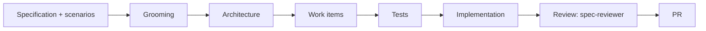

# Specification-driven development conventions

The method's shared facts. Each method skill states a portable rule; this skill
holds the facts those rules rely on that are the same everywhere. What differs
per repository — paths, commands, the tracker, the test stack — belongs in that
repository's own companion skill, `<project>-conventions`, whose contract is
§ "Your companion" below.

| Area      | Method skill                                                  |
| --------- | ------------------------------------------------------------- |
| Coding    | [`coding-conventions`](../coding-conventions/SKILL.md)         |
| Delivery  | [`deliver-change`](../deliver-change/SKILL.md)                 |
| Testing   | [`test-from-scenarios`](../test-from-scenarios/SKILL.md)       |
| Questions | [`clarify-requirements`](../clarify-requirements/SKILL.md)     |
| Specs     | [`spec-and-traceability`](../spec-and-traceability/SKILL.md)   |
| Next work | [`next`](../next/SKILL.md)                                     |

## Read before starting

- `README.md` — the project-level design authority.
- `AGENTS.md` — the entry point to owning guidance.
- The Feature's specification, its `.feature` file, and its `lessons/`.
- The repo-wide lessons in `.spec/lessons/`.

## Workflow

The authoritative delivery sequence. Role indexes and companion guidance link
here rather than maintaining another copy.

The architect reviews the groomed agreement and records design readiness before
tests and implementation. `spec-reviewer` reviews the local diff before the PR is
opened; subsequent PR feedback follows the same ownership and revision rules.
Standalone spikes start at their work item, with the architect taking the first
pass at feasibility; written performance concerns go to `benchmarker` for
measurement.

## Section ownership

The one place this is written. Each section of a Feature's specification has
exactly one owning role; a role that needs another's section changed escalates and
does not write there. The table is generated from each role's
`owned_spec_sections` declaration by the projector; change the role file, not the
table.

<!-- BEGIN GENERATED: section-ownership -->
| Section                   | Owner                                |
| ------------------------- | ------------------------------------ |
| 1. Business Goal          | `spec-author`                        |
| 2. User Needs             | `spec-author`                        |
| 3. Acceptance Criteria    | `spec-author`                        |
| 4. Constraints            | `spec-author`                        |
| 5. Out of Scope           | `spec-author`                        |
| 6. Concern Separation     | `architect`                          |
| 7. Technical Design       | `architect`                          |
| 8. Testing Strategy       | `test-writer`                        |
| 8. › `### Performance`    | `benchmarker`                        |
| 9. Traceability Matrix    | `test-writer`                        |
| 10. Lessons / Spec Deltas | `spec-author`                        |
| 11. Open Questions        | whoever is blocked                   |
| 12. Sign-off              | `spec-reviewer`                      |
| Tasks                     | `spec-author`                        |
| Scoring                   | derived — recompute, never hand-edit |
<!-- END GENERATED: section-ownership -->

The `.feature` file belongs to `spec-author`; its step definitions belong to
`test-writer`.

## ID schemes

| Scheme        | Form              | Scope                             | Cited from outside as |
| ------------- | ----------------- | --------------------------------- | --------------------- |
| Epic          | `0003`            | repository                        | `0003`                |
| Feature       | `F1`, `F5b`       | its epic                          | `0003-F1`             |
| Claim         | `B-001`, `B-006b` | its Feature                       | `0001-F1 B-001`       |
| Constraint    | `C-12`            | its Feature                       | `0001-F1 C-12`        |
| Open question | `OQ-3`            | its Feature                       | `0001-F1 OQ-3`        |
| Task          | `0001-11`         | its **epic**, not its Feature     | `0001-11`             |
| ADR           | `ADR-0002`        | repo or Feature, by blast radius  | `ADR-0002`            |
| Checker rule  | `SPEC031`         | the checker's rule set            | `SPEC031`             |

Always carry the prefix in prose — several sequences have a twelfth member.

**Ids are never reused and never renumbered**, including during a migration
between layouts. Renumbering breaks every citation in every past commit, review,
item and sibling specification. A dropped claim leaves its number retired.

## The spec / work-item split

**Delivery state is tracked in the work-item tracker; content is tracked in the
repository.** Exactly one field crosses that line in each direction: the item
names its specification, and the specification's `status` frontmatter mirrors
the item's delivery state once the item exists. `priority` is authored in the
specification and never mirrored. Derived fields — `rank`, `blocks` — are
recomputed, never hand-edited. The companion names the tracker and the label or
field that carries delivery state.

## Spec layout

- A Feature's specification is `<area>/.spec/README.md`, beside the code it
  governs. Exactly one `.feature` file sits beside it, each scenario tagged with
  the `@B-00n` claim it documents.
- Three record folders sit beside the specification: `decisions/` (product and
  scope calls), `adr/` (durable technical rules) and `lessons/` (incidents and
  what they changed). A record binding the whole repository lives at the root
  `.spec/adr/` or `.spec/lessons/` instead, numbered repo-wide.
- The root `.spec/` holds no specification; it is excluded from the checker.
- Blanks for a specification, an ADR, a decision and a lesson live under
  `.specht/templates/`, written by `dotnet specht init --all`. Guidance lives in
  the blank; a copy carries content only.
- The twelve numbered sections plus `Tasks` and `Scoring`, their order and the
  traceability-matrix columns are owned by `.specht/manifest.json`. Each section
  carries `<!-- last written by: <role>, <date> -->` under its heading.
- `dotnet specht` checks every specification offline and exits non-zero on a
  violation; `--strict` fails on warnings too. A rule id such as `SPEC031` is
  cited as the checker reports it.

## Your companion

Every consuming repository has exactly one companion skill, named
`<project>-conventions`. It is **the only skill that names the repository, a
path, a command, or a tool version.** Each method skill links to it by area, so
it must answer for each of these:

| Area         | The companion names                                                     |
| ------------ | ----------------------------------------------------------------------- |
| Layout       | the projects, directories and what sits beside them at the root        |
| Coding       | the formatter, analyzers, dependency policy and build commands         |
| Delivery     | the tracker, the delivery-state field, branches, merge strategy, where a claim citation survives |
| Testing      | the test projects, tiers, assertion form, naming form and discovery traps |
| Questions    | where answers are recorded and which questions are already settled     |
| Specs        | where specifications live when the layout differs from § "Spec layout" |
| Next work    | tracker access, planning metadata, ranking inputs and reservations     |
| Benchmarking | the harness, where benchmarks live and the measurement traps           |

A companion restates no method rule. It says where the rule lands.

## Never add

- A rule in a generated host directory. Those trees are projected from tracked
  sources; a rule there cannot be reviewed in a pull request.
- A second index of roles or skills beside the one the projector reads.
- A renumbered claim, constraint, question or task id.
- A hand edit to `status` after the work item exists, or to any derived field.
- A hand edit to the generated section-ownership table.
- A path, a command or a repository name that belongs to one consuming
  repository. The checker and its files are the method's, not a project's.
- A specification in two places at once.
