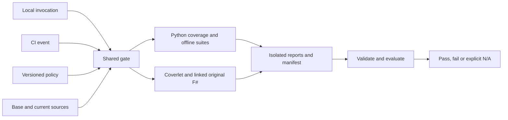
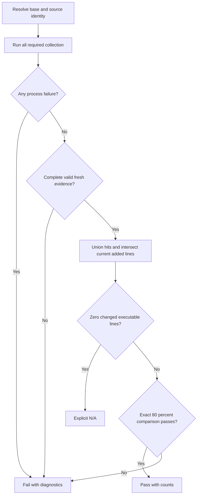

# Specification: Repository verification

## 1. Business Goal

<!-- last written by: spec-author, 2026-10-27 -->

Reject changes whose executable production lines lack the repository's minimum
coverage, using one reproducible local and CI gate rather than an unmeasured
coverage promise.

## 2. User Needs

<!-- last written by: spec-author, 2026-10-27 -->

| Persona | Need | Failure today |
| --- | --- | --- |
| Maintainer | Measure coverage before merge | ADR-0007 requires a gate but none exists |
| Contributor | Run the CI decision locally | Passing suites alone do not measure changed-line coverage |
| Reviewer | Read trustworthy counts and comparison identity | Missing or stale reports can hide untested changes |

## 3. Acceptance Criteria

<!-- last written by: spec-author, 2026-10-27 -->

| ID | Claim | Source | Status |
| --- | --- | --- | --- |
| B-001 | Given successful test and collector runs with complete valid evidence for changed executable production lines, the gate exits zero exactly when the pooled covered-line count is at least 80% of the pooled changed executable-line count, and exits nonzero otherwise. | User coverage-policy request; ADR-0007 | Active |
| B-002 | Given missing, malformed, stale or mismapped evidence, evidence inventory inconsistent with the measured current source snapshot, or a failed collector/test command, the gate exits nonzero without reporting a passing coverage result. | Trustworthy verification | Active |
| B-003 | Given successful test and collector runs with complete valid evidence but no changed executable production lines, the gate exits zero and reports not applicable with a zero denominator rather than a coverage percentage. | Documentation-only changes | Active |
| B-004 | Given local or CI verification, both use the same policy and evaluator, include executable gate tooling in production scope, and report the comparison revision and covered/changed line counts. | User policy and enforcement request | Active |

## 4. Constraints

<!-- last written by: spec-author, 2026-10-27 -->

| ID | Constraint | Rules out |
| --- | --- | --- |
| C-1 | Production entrypoints retain their existing FSI/Python execution contracts. | A production project or test-framework migration |
| C-2 | Coverage reports and build artifacts remain untracked. | Machine-specific reports in commits |
| C-3 | Runtime dependency versions retain one authoring source; coverage-specific versions are pinned centrally. | Independently copied runtime package versions |
| C-4 | Threshold decisions use exact counts. | Rounded 79.9% passing an 80% floor |
| C-5 | Test files, generated host projections and non-executable metadata do not inflate production coverage. | Tests or generated bytes masking production misses |
| C-6 | Production text uses UTF-8 with LF or CRLF so Git and collector line identities agree. | Ambiguous separators dropping executable changes |

## 5. Out of Scope

<!-- last written by: spec-author, 2026-10-27 -->

| Item | Owner / reason |
| --- | --- |
| Skill-reference lint behavior | 0001-F4 |
| Projector output formats | 0001-F1 |
| Host installation behavior | 0038-F1 |
| Branch coverage and a historical whole-repository coverage target | This agreement measures changed executable lines |
| Lowering thresholds automatically or shipping waivers | Requires an explicit later policy decision |

## 6. Concern Separation

<!-- last written by: architect, 2026-10-27 -->

| Concern | Responsibility | Claims / owner |
| --- | --- | --- |
| Policy | Versioned threshold, source selection and evidence contract | B-001, B-003, B-004; ADR-0007 |
| Identity | Git comparison, production inventory and source hashes | B-001, B-002 |
| Collection | Existing suites and instrumented original sources; preserve failures | B-002, B-004 |
| Evaluation | Validate/normalize/union reports and compare exact counts | B-001–B-003 |
| Production behavior | Preserve original FSI and offline installer execution | 0001-F1; 0038-F1; ADR-0003 |
| CI | Same gate with immutable event base and retained diagnostics | B-004 |

Use effects at collection boundaries and deterministic evaluation over immutable
inputs. No persistence schema, service, broker or extensible hierarchy is needed.

## 7. Technical Design

<!-- last written by: architect, 2026-10-27 -->

### DR-1 — Shared gate and policy

Local and CI execution use one gate with required `--base <commit-or-ref>`.
Collect fresh evidence before evaluation; arbitrary pre-existing reports are not
a supported CLI input. One policy owns the integer 80% threshold, inventory/
exclusions, required evidence and schema version. Pin Python coverage 7.12.0 and
Coverlet MSBuild 6.0.4 centrally. ADR-0010 requires original-source collection;
existing F# dependency declarations and pinned SDK remain authoritative. Generate
coverage-build references from those declarations rather than tracking duplicate
versions or the probe's cache workaround.

CI grants package-read permission only to the verification job and supplies its
temporary workflow token only during tool restore. Installer jobs retain
contents-read permission; no separately configured package secret is required.

Inventory tracked and non-ignored untracked Python/F# production sources across
the repository, including the gate itself. Exclude declared tests, exact test-only
harnesses, generated host trees and artifacts. A directory containing tests is
not wholly exempt. Deleted sources have no current denominator; a new unmapped
source fails closed, and another language requires a collector/policy change.



DR-1: both contexts consume fresh machine-local evidence through the same gate.

### DR-2 — Original-source F# collection

Production remains FSI under ADR-0003. Test-only SDK assemblies link original
scripts without rewriting bodies; source-directory identity remains the real
checkout. The CLI assembly adds only a preceding argument shim exposing process
arguments to the unchanged entrypoint. Exclude that shim from production coverage;
use portable PDBs and unoptimized debug builds.

Instrumentation order is build, instrument, execute, generate report and restore
binaries. Capture runner failure, still produce diagnostics/restore, then fail.
Expected negative CLI outcomes must be asserted; ignored exit status cannot turn
a failed suite into successful validation. Keep original FSI checks alongside
compiled CLI collection; union their production line identities across separate
reports. Validate checkout, output and interpreter paths before the shell-based
build adapter runs; unsupported path characters fail explicitly.

### DR-2a — Python collection and discovery

Complete F# restore/instrumented collection before Python's offline synthetic
collector probes so clean package caches are available. Use the same pinned
Python environment for installer and gate suites. Collect in parallel data files,
combine and emit XML inside the isolated run directory. Explicitly omit declared
tests; inventory remains authoritative.

Coverage source roots must discover unimported production Python as zero-hit.
Compare reports against the complete inventory; any undiscoverable/missing source
fails instead of disappearing from the denominator. Future inventory roots must
be reflected in collection. Every collector and suite exit remains required even
when changed executable lines are zero.

### DR-3 — Identity, provenance and freshness

Resolve the requested base to a full SHA; require exactly one merge base with
HEAD. Unknown, disconnected or ambiguous history fails. Record requested base,
comparison base, HEAD, policy digest, canonical production inventory/source
SHA-256 values, exact tool versions, report digests/collector identities and
process exit results in the versioned manifest. Reject unknown schema versions,
missing fields, duplicate source/report/process identities, nonzero required
results or omitted required collectors. Reports must remain inside the trusted
isolated run directory.

Recheck HEAD, inventory and source bytes after collection and before evaluation.
Mutation, stale identity, malformed reports or digest mismatch fails. Hashes bind
bytes; trusted fresh collection establishes provenance, not attacker-controlled
report authenticity. Pre/post hashing neither locks the checkout nor detects an
actor who restores bytes between observations. Local runs require a stable tree;
CI uses an isolated checkout. Modification time is diagnostic only.

Compare the merge base to staged/unstaged tracked changes and non-ignored
untracked sources. Use zero-context diff without rename detection: new paths and
untracked production sources contribute all current added lines; deleted hunk
halves contribute none. Reject binary source/invalid hunk metadata. Require UTF-8
with LF/CRLF and use LF identities; unsupported separators fail before diffing.

CI uses full history and immutable event SHAs: pull requests compare event base
against checked-out head; main pushes compare previous SHA against pushed HEAD.
An initial/manual run without a valid base fails and requests an explicit base.

```mermaid
sequenceDiagram
  participant Gate
  participant Git as Checkout
  participant Collectors
  participant Artifacts as Isolated artifacts
  participant Evaluator
  Gate->>Git: Resolve identity, inventory and source hashes
  Gate->>Collectors: Run required suites and coverage
  Collectors->>Artifacts: Write reports
  Collectors-->>Gate: Exit results
  Gate->>Git: Recheck HEAD, inventory and bytes
  alt Failure or mutation
    Gate-->>Gate: Fail and retain diagnostics
  else Stable complete evidence
    Gate->>Artifacts: Hash reports; publish complete manifest
    Gate->>Evaluator: Validate identity and evaluate current added lines
    Evaluator-->>Gate: Exact counts and verdict
  end
```

DR-3: partial reports are diagnostic; only complete stable evidence is evaluable.

### DR-4 — Mapping and exact arithmetic

Parse Cobertura class-level lines, excluding duplicate method copies. Require
positive integer line numbers within source bounds and nonnegative integer hits.
Union duplicate `(repository-relative source, line)` entries with logical OR
across reports/classes.

Resolve relative filenames against declared XML source roots and checkout; resolve
absolute filenames directly. Require one canonical inventoried match inside the
checkout. A source root of `/` may reconstruct an absolute path from Coverlet's
root-relative spelling. Never strip arbitrary prefixes or match only basenames.
Ignore explicitly declared test/harness sources; unexplained, escaping or
ambiguous mappings fail. Collector roots cannot expand production inventory.

Require evidence for every inventoried source before diff intersection. Missing
new files fail despite otherwise high coverage. Collector sequence points,
including zero-hit points, define executable lines; comments/directives without
points do not count. A genuinely non-executable source needs validated empty-
source evidence, never an absent entry.

Let D be distinct added/current executable production lines and H their hit
subset. Pool runtimes with each `(path,line)` counted once. For nonempty D, pass
iff `100 * |H| >= 80 * |D|`; round only for display. Empty D reports
`N/A: 0 changed executable production lines` after full evidence validation,
never 100%. Return verdict, integer counts and sorted missed `(path,line)` pairs;
report unresolved evidence explicitly and keep portable output paths relative.



DR-4: N/A is reachable only after successful complete validation.

### Effects and publication boundaries

Use plain functions with patchable standard-library subprocess/filesystem readers;
imports have no effects. Keep a process-local snapshot separate from the portable
manifest: it also holds parsed policy, observed tool versions and trusted absolute
run directory. Collection/report resolution must use that same directory;
re-inventory uses current bytes and snapshot policy. Evidence errors report a
nonzero exit. Direct arithmetic inputs support deterministic evaluation without
pretending fabricated reports establish collector feasibility.

Use a unique ignored run directory, no cross-run collection cache or shared
report writer. Publish a complete manifest only after required reports exist.
Retain failed diagnostics locally and upload them in CI without changing the
failure exit result.

### Feasibility, risks and readiness

Historical linked-original probes established static Coverlet collection without
source-body rewriting or migrating the custom runner: 62 checks passed; the unit
report had 582 executable production lines/545 hit, and the CLI report had
582/497 plus 25/13 entrypoint lines. Python coverage 7.12.0 collected existing
installer execution and unimported synthetic zero-hit sources. The macOS arm64
dotnet-coverage probe produced no feasibility evidence. SDK-cache overrides were
local experiment workarounds, not accepted configuration. These observations
prove feasibility, not changed-line scores or delivery coverage.

Inventory/hashing is linear in source bytes; parsing/intersection is linear in
report records plus changed lines, with linear executable-line storage. Added
compilation/instrumentation and process startup are unmeasured costs; no latency
budget, service or paid provider is introduced.

Risk: medium for silent inventory/path errors and compiled-CLI parity; fail-closed
evidence validation and retained original execution checks address them. CI risk
is low after local proof, with Linux execution still requiring CI evidence.
Database/class/distributed-state views do not apply: there is no application data
schema, object hierarchy, durable business workflow or event delivery.

Readiness: Ready for tests and implementation of B-001–B-004 under C-1–C-5.
Linked-original collection is feasible; empty-source evidence remains fail-closed.
Applicable agreement/design and testability verdicts stay in § 12. This author
assessment grants neither delivery nor executable coverage; verification belongs
to § 8–9.

## 8. Testing Strategy

<!-- last written by: test-writer, 2026-10-27 -->

Unit checks cover exact pooled arithmetic, executable-line intersection,
duplicate-hit union, source/path normalization, diff parsing and evidence
validation. Cover the exact floor, below-floor values, missing/malformed/stale
reports, same-mtime mutation, inventory gaps, ambiguous mappings and failed
processes. Validate evidence before reporting a zero denominator as N/A.

Acceptance checks invoke the shared local/CI entry with synthetic checkout state
and patched process effects; assert exits, comparison identity, counts and N/A
without a percentage. Include gate production in inventory; exclude tests and
harnesses. Real pinned Python and compiled F# collectors must report missed
branches and unexecuted new sources or fail closed; synthetic reports alone
cannot establish collector measurement.

Testability: pure evaluation and standard filesystem/process seams need no clock,
credential, live provider or constructor effects. No test-only public members;
database, UI and distributed-state tiers do not apply. Require the repository's
80% pooled changed executable production-line floor under ADR-0007. Reports stay
ignored; local verification does not assert Linux CI execution.

## 9. Traceability Matrix

<!-- last written by: test-writer, 2026-10-27 -->

| Claim ID | Scenario | Test | Status |
| --- | --- | --- | --- |
| B-001 | [@B-001](repository-verification.feature#B-001) | `EvaluationTests.test_B001_exact_floor_pools_languages_by_line_count`, `test_B001_below_floor_does_not_round_up`, `test_B001_only_changed_executable_lines_enter_denominator`; `SourceTests.test_B001_diff_includes_modified_current_lines_and_all_new_file_lines`, `test_B001_diff_treats_git_pathspec_magic_filename_literally`, `test_B001_crlf_source_retains_git_lf_line_identity`; `GateAcceptanceTests.test_B001_gate_exit_and_counts_observe_exact_floor` | Covered |
| B-002 | [@B-002](repository-verification.feature#B-002) | `EvidenceTests.test_B002_missing_report_is_rejected`, `test_B002_malformed_report_is_rejected`, `test_B002_stale_source_bytes_are_rejected_despite_same_mtime`, `test_B002_mismapped_source_is_rejected`, `test_B002_new_production_source_absent_from_reports_is_rejected`, `test_B002_failed_test_process_is_rejected`; `SourceTests.test_B002_non_lf_source_separators_are_rejected_before_diff`; `CollectionTests.test_B002_failed_child_cannot_publish_manifest`, `test_B002_source_mutation_during_collection_cannot_publish_manifest`; `CollectorIntegrationTests.test_B002_python_collector_reports_missed_branch_and_unimported_new_source`, `test_B002_fsharp_collector_reports_real_missed_branch_and_unused_new_source` | Covered |
| B-003 | [@B-003](repository-verification.feature#B-003) | `EvaluationTests.test_B003_no_changed_executable_lines_is_not_applicable`; `GateAcceptanceTests.test_B003_gate_reports_zero_denominator_without_percentage` | Covered |
| B-004 | [@B-004](repository-verification.feature#B-004) | `SourceTests.test_B004_inventory_includes_gate_and_excludes_test_generated_sources`, `test_B004_inventory_preserves_carriage_return_in_literal_git_filename`; `GateAcceptanceTests.test_B004_local_and_ci_share_policy_evaluator_and_output` | Covered — local invocation parity; Linux CI execution pending |

Test methods resolve in [`test_gate.py`](../coverage/test_gate.py),
[`test_collectors.py`](../coverage/test_collectors.py) and
[`test_cli_driver.py`](../coverage/test_cli_driver.py); class-qualified names
identify their containing test classes.

### Recorded verification

| Historical run | Recorded evidence |
| --- | --- |
| Initial discovery | 24 tests: 23 intended assertion failures, zero errors; deletion-only case passed against stubs. |
| Final suite | 36 gate tests, including real collector regressions, passed; line-identity regression had nine assertion failures before correction. |
| Source-bound coverage `4b09202932144842998f626f876e5615` | 220/245 (89.80%); comparison `c890c826dc439cd617349a417ef396748eab2439`, HEAD `36e2efec7a41012c60a13b5c3fef9f3ba64e550e`; independent validation reproduced counts. Six processes exited zero: 62 linked F# tests, six CLI cases, 23 installer tests, 36 gate tests and Python combine/report. |
| Initially empty-cache run `b9a269b572274089a3ad5b6e2b6561b2` | 217/242 (89.67%); real F# collection bootstrapped later offline checks. |
| Negative run `735ffab129854761aa932d4b8ff2eab7` | Failed 210/335; 100 deliberately unimported executable lines reported zero hits. Hashes/counts independently inspected; temporary probe removed. |

Recorded tools: coverage.py 7.12.0, Coverlet 6.0.4, SDK 10.0.401. Reports remain
ignored. Linux CI execution is pending; these are historical local results.

## 10. Lessons / Spec Deltas

<!-- last written by: spec-author, 2026-10-27 -->

| Date | Trigger | Change | Affected IDs |
| --- | --- | --- | --- |
| 2026-10-16 | Coverage-policy request | Adopt pooled changed-line coverage and comparison policy; feasibility probes establish no delivery score. | B-001–B-004; decision 0001 |
| 2026-10-27 | Confirmed concise-specification plan | Compress in place; qualify sibling references; separate strategy, locators and history. | §§ 1–12; IDs unchanged |
| 2026-10-27 | PR #13 restore failed with unset credentials | Restore tools using the temporary workflow token with job-scoped package-read permission. | B-004 |

## 11. Open Questions

<!-- last written by: spec-author, 2026-10-27 -->

| ID | Question | Blocks | Resolution |
| --- | --- | --- | --- |
| OQ-1 | Does repository verification belong under epic 0001? | None | Resolved by the user, 2026-10-16: add 0001-F6 under epic 0001. |

## 12. Sign-off

<!-- last written by: spec-author, 2026-10-27 -->

| Section | Status | Reviewer | Note |
| --- | --- | --- | --- |
| Concision migration: §§ 1–12 | 🟢 | spec-reviewer | Independent `/root/review`, 2026-10-27: Approved snapshot SHA-256 `f27fd76c55d76a7023b3e96f55f010b453564c682325dd738b0b557381841b38`; no findings. Unchanged baseline scope retains its prior evidence; no new behavior or coverage is approved. |

### Historical verdicts

These verdicts concern earlier subjects; they do not approve this migration.
Full notes, limitations and superseded pending rows are recoverable from § 12
of this specification at Git revision `57cd1200b089d2872d4538c91b5d085cf069307d`.

| Scope | Verdict | Reviewer | Subject / evidence |
| --- | --- | --- | --- |
| 1-12 | 🟢 | spec-reviewer | 2026-10-16; `/root/f4_baseline_review`; `/root/coverage_testability`; Missing |
| 1-12 and implementation | 🟢 | spec-reviewer | 2026-10-16; `/root/coverage_diff_review`; `/root/coverage_surface_review`; Linux CI execution remains pending |

## Tasks

<!-- last written by: organizer, 2026-10-17 -->

- [0053 — Coordinate Repository verification delivery](../.issue/0053-coordinate-repository-verification.yml) — authoritative delivery-status source.
- [0044 — Enforce repository changed-line coverage](../.issue/0044-repository-coverage-gate.yml).

## Scoring

<!-- last written by: organizer, 2026-10-16 -->

| Field | Value | Basis |
| --- | --- | --- |
| value | 4 | Makes the repository's adopted coverage requirement enforceable for every production change. |
| risk | 3 | Collector parity and source/report identity need independent verification. |
