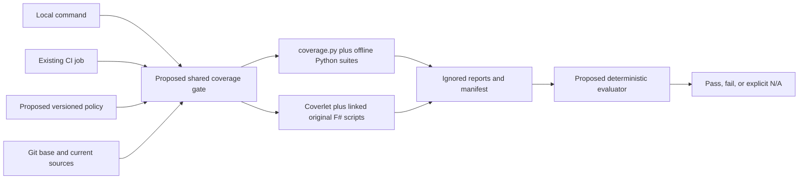
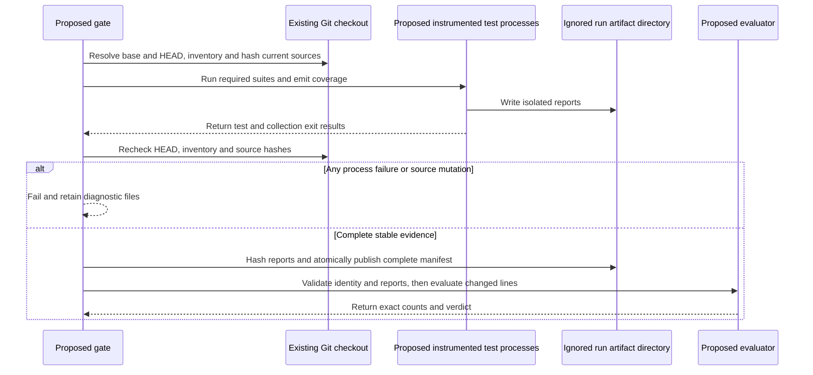
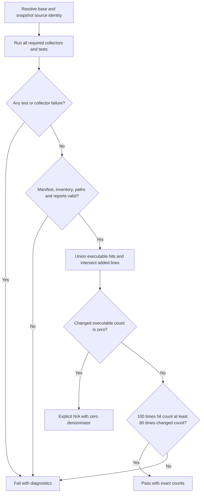

# Specification: Repository verification

## 1. Business Goal

<!-- last written by: spec-author, 2026-10-16 -->

Reject changes whose executable production lines lack the repository's minimum
coverage, using one reproducible local and CI gate rather than an unmeasured
coverage promise.

## 2. User Needs

<!-- last written by: spec-author, 2026-10-16 -->

| Persona | Need | Failure today |
| --- | --- | --- |
| Maintainer | Measure coverage before merge | ADR-0007 requires a gate but none exists |
| Contributor | Run the CI decision locally | Passing suites alone do not measure changed-line coverage |
| Reviewer | Read trustworthy counts and comparison identity | Missing or stale reports can hide untested changes |

## 3. Acceptance Criteria

<!-- last written by: spec-author, 2026-10-16 -->

| ID | Claim | Source | Status |
| --- | --- | --- | --- |
| B-001 | Given successful test and collector runs with complete valid evidence for changed executable production lines, the gate exits zero exactly when the pooled covered-line count is at least 80% of the pooled changed executable-line count, and exits nonzero otherwise. | User coverage-policy request; ADR-0007 | Active |
| B-002 | Given missing, malformed, stale or mismapped evidence, evidence inventory inconsistent with the measured current source snapshot, or a failed collector/test command, the gate exits nonzero without reporting a passing coverage result. | Trustworthy verification | Active |
| B-003 | Given successful test and collector runs with complete valid evidence but no changed executable production lines, the gate exits zero and reports not applicable with a zero denominator rather than a coverage percentage. | Documentation-only changes | Active |
| B-004 | Given local or CI verification, both use the same policy and evaluator, include executable gate tooling in production scope, and report the comparison revision and covered/changed line counts. | User policy and enforcement request | Active |

## 4. Constraints

<!-- last written by: spec-author, 2026-10-16 -->

| ID | Constraint | Rules out |
| --- | --- | --- |
| C-1 | Production entrypoints retain their existing FSI/Python execution contracts. | A production project or test-framework migration |
| C-2 | Coverage reports and build artifacts remain untracked. | Machine-specific reports in commits |
| C-3 | Runtime dependency versions retain one authoring source; coverage-specific versions are pinned centrally. | Independently copied runtime package versions |
| C-4 | Threshold decisions use exact counts. | Rounded 79.9% passing an80% floor |
| C-5 | Test files, generated host projections and non-executable metadata do not inflate production coverage. | Tests or generated bytes masking production misses |

## 5. Out of Scope

<!-- last written by: spec-author, 2026-10-16 -->

| Item | Owner / reason |
| --- | --- |
| Skill-reference lint behavior | 0001-F4 |
| Projector output formats | 0001-F1 |
| Host installation behavior | 0038-F1 |
| Branch coverage and a historical whole-repository coverage target | This agreement measures changed executable lines |
| Lowering thresholds automatically or shipping waivers | Requires an explicit later policy decision |

## 6. Concern Separation

<!-- last written by: architect, 2026-10-16 -->

The person approved `0001-F6 Repository verification` under epic `0001`; approved B-001–B-004 and C-1–C-5 govern this design at `.github/.spec`.

| Concern | Responsibility | Claim / existing owner |
| --- | --- | --- |
| Coverage policy | One versioned policy declares 80%, production/test selection and report schema; README links its command. | B-001, B-003, B-004; ADR-0007 |
| Source identity | Inventory repository production sources, resolve the requested Git base, identify added/current lines and hash source contents. | B-001, B-002 |
| Collection | Execute existing tests plus coverage-tool tests; compile original linked F# scripts for instrumentation; preserve test failures. | B-002, B-004 |
| Evaluation | Validate reports and collection manifest, normalize paths, union executable line hits, compute exact changed-line coverage. | B-001–B-003 |
| Projection behavior | Existing FSI entrypoints remain the production runtime; this Feature consumes their original sources. | Existing 0001-F1; ADR-0003 |
| Installer behavior | Existing offline unittest suite remains authoritative for installation behavior. | Existing 0038-F1 |
| CI | Invoke the same gate with a validated event-specific base and upload ignored diagnostic reports. | B-004 |

No persistence schema, service, broker or reusable interface hierarchy is required. Python orchestration is effects; evaluation is deterministic functions over immutable input values. Composition is sufficient; no Gang of Four pattern earns additional participants.

## 7. Technical Design

<!-- last written by: architect, 2026-10-16 -->

### DR-1: Shared gate and policy

`.github/.spec` owns repository verification; `.github/coverage/` contains gate Python code, tests, and test-only compiled F# projects. Existing production files remain under their current owners. The command is `python3 .github/coverage/run.py --base <commit-or-ref>`; it collects fresh evidence before evaluating it. There is no supported CLI accepting arbitrary pre-existing reports.

A single policy file defines integer `threshold_percent: 80`, inventory/exclusion patterns and schema version. Pin Python coverage 7.12.0 centrally in a requirements file. Pin Coverlet MSBuild 6.0.4 in a common props file imported by both coverage-only projects. [ADR-0010](../../.spec/adr/0010-collect-coverage-from-original-sources.md) records this repository-wide collector decision. Keep existing script `#r "nuget:"` declarations authoritative: derive generated PackageReference items from those declarations under `.artifacts/coverage/`, never duplicate their versions in tracked coverage projects. Compiler FSharp.Core selection follows the pinned SDK; the spike's local cache workaround is not production configuration.

Select tracked and non-ignored untracked `**/*.py`, `**/*.fsx` and `**/*.fs` across the repository. Exclude test files by declared patterns (`**/test_*.py`, `**/*.tests.fsx`) and exact test-only F# shim/harness paths, including `.github/coverage/fsharp/FsiArguments.fs`; exclude generated host directories and `.artifacts/`. The gate's own Python code is production inventory. Tests do not exempt a directory containing production tools. Deleted sources have no current denominator. A new production file without a collector/report mapping fails closed; adding a language requires an explicit collector/policy change.



DR-1 component view: existing execution contexts consume one proposed gate; reports remain machine-local artifacts, not committed inputs.

### DR-2: Original F# sources, instrumentable test-only assemblies

Production commands remain `dotnet fsi scripts/project.fsx` and `dotnet fsi scripts/project.tests.fsx`. Accepted ADR-0003 is unchanged. Coverage-only SDK projects link the original `.fsx` files as Compile items; the compiler accepts their existing `#r` and `#load` directives without body rewriting. Explicit PackageReference items supply the same pinned dependencies.

The unit-runner project links original `scripts/Projection.fsx` and `scripts/project.tests.fsx`; original `__SOURCE_DIRECTORY__` therefore resolves the real repository. The CLI project links original `scripts/Projection.fsx`, a test-only preceding `fsi` shim, and original `scripts/project.fsx`. The shim declares `module fsi` and `let CommandLineArgs = System.Environment.GetCommandLineArgs()` so the unchanged entrypoint receives identical user arguments. Exclude only this shim from production coverage. Debug builds use portable PDBs and disabled optimization.

Each project exposes a coverage target using Coverlet's pinned MSBuild instrumentation and result targets: Build → InstrumentModules → execute runner → GenerateCoverageResult. Capture runner exit status, produce diagnostics and restore binaries, then fail when the runner failed. Never let IgnoreExitCode turn failure into successful validation. Run CLI behavior cases sequentially against the instrumented compiled CLI: valid `--root`, check-current, check-drift, write, unknown argument and ProjectionError. The driver asserts expected exit codes and outputs; a deliberately invalid CLI case is a successful test only when its expected failure is asserted.

The existing tests' real FSI subprocess checks remain. The compiled CLI coverage driver adds actual entrypoint execution; it does not replace the production FSI checks or turn spike evidence into claim coverage. Collect unit and CLI reports separately; evaluation unions production line identity across them. Compiling scripts for coverage introduces a test-only build step, not a packaged projector or second production implementation.

### DR-2a: Python source coverage and suite discovery

Run installer and gate suites with the same pinned interpreter environment:

```sh
python -m coverage run --parallel-mode --source=install,.github/coverage -m unittest discover -s install -p 'test_*.py' -v
python -m coverage run --parallel-mode --source=install,.github/coverage -m unittest discover -s .github/coverage -p 'test_*.py' -v
python -m coverage combine
python -m coverage xml -o <run-directory>/python.xml
```

Set the coverage data file inside the isolated run directory, not the repository root. Explicit omit entries exclude declared test files from production evidence; evaluator inventory remains authoritative regardless of report contents. Both installer and gate production modules are in `source`, so coverage.py can include discovered unimported Python files as zero-hit. Compare report source identity against the complete inventory; any unimported source the collector cannot discover still fails for missing evidence, never disappears from the denominator. Future Python production directories must be added to collection source roots derived from inventory, or the mismatch fails closed. All collector and test exit codes remain required regardless of an eventual zero changed-line intersection.

### DR-3: Identity and freshness

Resolve `--base` with Git to a full requested-base commit SHA, reject unknown revisions, and derive the comparison SHA using `git merge-base --all <requested-base> HEAD`. Require one unambiguous comparison commit; disconnected or multiple-base history fails with a diagnostic. This allows a branch behind its requested trunk reference. Record both requested-base and comparison SHAs, HEAD SHA, policy hash, canonical production inventory, source SHA-256 values, tool versions and report hashes in a versioned collection manifest. Compare source inventory and bytes again after collection and before evaluation. A source-content or inventory difference observed after collection, stale manifest, different requested base, changed HEAD, malformed report or mismatched digest fails. Pre/post hashing does not lock the local worktree or detect an external actor who mutates and restores bytes entirely between observations; CI uses one isolated checkout and local runs require a stable checkout. File modification times are diagnostic only.

Local comparison is the resolved merge-base comparison SHA to current working tree, including staged/unstaged tracked changes and non-ignored untracked sources. Use zero-context Git diff without rename detection; added files and new paths of renames contribute all current added lines. Untracked production files contribute all current lines. The deleted half of a hunk contributes no current executable line. Reject unsupported binary source input and invalid hunk metadata rather than assuming it contains no executable lines.

CI uses full history and explicit immutable event input: pull request base SHA against checked-out head SHA; main push uses the event's previous SHA against pushed HEAD. A missing initial-push/manual base is a failure requiring an explicit base, not an implicit all-green result. This policy requires CI claim/constraint agreement; do not bury the base contract solely in workflow YAML.

The manifest has this fixed schema; unknown schema versions, missing required fields and duplicate source/report identities fail:

| Field | Type and meaning |
| --- | --- |
| `schema_version` | Integer 1 |
| `requested_base_sha`, `comparison_base_sha`, `head_sha` | Full resolved Git commit identity strings |
| `policy_sha256` | Lowercase SHA-256 of the policy bytes actually used |
| `sources` | Object mapping unique POSIX repository-relative production paths to lowercase source SHA-256 strings |
| `tools` | Object recording exact Python coverage, Coverlet and .NET SDK versions |
| `reports` | Array of objects with unique artifact-relative `path`, `sha256` and `collector` (`python`, `fsharp-unit`, `fsharp-cli`) |
| `process_results` | Array of objects with unique string `name` and integer `exit_code`, required to be 0 |

Required process names are `python-installer-tests`, `python-gate-tests`, `python-combine`, `python-report`, `fsharp-unit` and `fsharp-cli`; each F# process is the coverage target that combines its runner and report result. Required report collector identities are `python`, `fsharp-unit` and `fsharp-cli`. These lists are fixed by the policy. The completed manifest cannot omit a required process or collector to pass. Resolve report paths inside the isolated run directory; arbitrary external reports are not accepted. `changed_lines` receives the resolved comparison SHA even though its parameter is named `base_sha`.

Hashes bind evidence to declared bytes and identity; they do not authenticate an attacker-controlled report. Fresh collection and the trusted CI job define the provenance boundary.



DR-3 sequence view: partial reports are diagnostic only; a manifest becomes evaluable after all required processes and source identity checks succeed.

### DR-4: Paths, executable lines and exact arithmetic

Parse Cobertura with the standard XML parser. Require integer positive line numbers within current source bounds and nonnegative integer hits. Read class-level line elements, avoiding double counting their method copies. Duplicate entries for the same `(repository-relative source path, line)` union with hit logical OR across classes and reports.

Resolve a relative filename against each XML `<sources>` root and the repository root; resolve absolute paths directly. Keep only canonical candidates that match inventoried source files and remain within the checkout; require one unique mapping. Coverlet on the proven macOS probe emits filename `Users/.../scripts/project.fsx` with `<source>/</source>`: joining `/` restores the absolute path. Do not strip arbitrary prefixes or accept a basename match. Explicitly ignore declared test/harness sources, while unexplained source mappings, traversal and ambiguous collisions fail. Collector-specific source-root metadata may identify the checkout but cannot expand production inventory.

Require coverage evidence for every inventoried production source before intersecting the diff. A report omitting a newly added production file fails even if other files have excellent coverage. Collector-declared executable lines, including zero-hit lines, define executable-line identity; comments, directives and other lines without sequence points do not enter the denominator. A source with genuinely no executable lines requires the collector's validated empty-source evidence, not an absent entry.

Let `D` be distinct added/current lines intersected with executable production lines, and `H` the subset hit in any validated report. Pool sources across runtimes, counting every `(path,line)` once. If `|D| > 0`, pass iff `100 * |H| >= 80 * |D|`; display a rounded percentage only after the exact integer decision. If `|D| == 0` after evidence validation, report `N/A: 0 changed executable production lines`; do not display 100%. Report counts, unresolved evidence and missed changed lines; avoid absolute paths in portable prose.



DR-4 algorithm view: N/A is reachable only after successful collection and complete evidence validation.

### Minimal implementation seams

Keep plain functions; do not add provider classes or an extensible framework. The declared `inventory`, `changed_lines`, `collect`, `read_reports`, `evaluate` and `main` interfaces live in [run.py](../coverage/run.py); that file owns their signatures.

Inventory maps repository-relative paths to SHA-256 strings. Snapshot is a process-local dictionary with exact keys: `requested_base_sha`, `comparison_base_sha`, `head_sha`, `policy_sha256`, `sources` (same meanings as the manifest), plus `policy` (the parsed policy dictionary), `tools` (expected observed tool-version strings) and `run_dir` (trusted absolute `Path` created by `main`). `collect` requires its `output_dir` to equal snapshot `run_dir`; `read_reports` resolves manifest artifact paths against snapshot `run_dir`. Snapshot is not serialized as the portable manifest. Re-inventory uses snapshot `policy` and current repository bytes. Collection returns the completed manifest. Evidence errors raise `ValueError`; `main` reports them and exits nonzero. Evaluation returns `verdict` (`pass`, `fail`, `not-applicable`), integer `covered` and `changed`, and sorted `missed` `(path,line)` pairs. Imports have no effects; execution uses an `__main__` guard. Subprocess execution and filesystem/report readers belong at collection boundaries and remain patchable through standard-library seams; arithmetic tests supply values directly. Unit tests cannot use a fabricated XML report as collector feasibility proof.

The approved declarations are exposed as importable, behavior-free stubs in `.github/coverage/run.py` before test implementation. Stubs return explicit unimplemented/empty placeholders and exit 2; their presence proves importability only.

Use an isolated per-run `.artifacts/coverage/<run-id>/` directory. Partial artifacts never constitute a valid manifest; publish the completed manifest only after required reports exist. No cross-run cache skips collection. Retain failed-run diagnostics locally; CI uploads them without changing the gate exit result. No concurrent report merge or shared writer is required.

### Performance and risks

Inventory/hash cost is linear in inventoried source bytes; report parsing and diff intersection are linear in report line records plus changed lines. Set/map storage is linear in executable source lines. Existing workload is three production files plus proposed gate Python files; report evidence currently contains 582 Projection lines and 25 entrypoint lines. These counts are measurements of this probe, not performance targets or changed-line scores.

Coverage adds test-only compilation and instrumentation plus Python coverage execution. Reuse the existing offline suites; do not invent latency or throughput budgets. Wall time is unmeasured; repeated FSI subprocess startup remains an explicit cost assumption rather than a measured bottleneck. No infrastructure service or paid coverage provider is introduced. A measured duration requirement, if requested, belongs to a separate benchmark assignment.

Risk: medium for gate implementation because incomplete inventories or path normalization can silently fabricate success; fail-closed source and report tests address it. Risk: medium for compiled coverage parity because CLI semantics depend on the shim; retain original FSI checks and compare explicit CLI cases. Risk: low for CI integration after local proof because the same runner and policy execute, although Linux execution still needs CI evidence.

Database, class and distributed-state diagrams do not apply: no database, object hierarchy, durable business state or event delivery is introduced. Process calls and manifest publication order are shown in the DR-3 sequence view.

### Bounded feasibility evidence

Question: can the existing F# scripts yield real executable-line coverage without rewriting production source bodies or migrating the custom test runner? Scope: linked-source compilation and local static collection only, approximately 30 minutes maximum; disposable projects/reports remain in temporary directories. The gate, policy evaluator and CI workflow were not implemented.

1. `dotnet build Spike.fsproj --nologo --ignore-failed-sources` successfully compiled linked original `scripts/Projection.fsx` and `scripts/project.fsx` with the preceding argument shim; zero warnings/errors.
2. `dotnet msbuild Spike.fsproj -t:RunCovered -p:IncludeTestAssembly=true -p:CoverletOutputFormat=cobertura -p:CoverletOutput=coverage.xml '-p:ExcludeByFile=**/project.tests.fsx' -nologo` executed the existing 62-test custom runner under Coverlet 6.0.4: 62 passed, zero failed. Report union: Projection 582 executable lines, 545 hit. The final probe links original unmodified `scripts/Projection.fsx` and `scripts/project.tests.fsx`; its report names the original production path. An earlier transformed temporary-copy probe was superseded by this original-linked run.
3. The same custom target over linked original CLI sources ran `--check`, printed `up to date: 78 outputs`, and emitted real Cobertura on original source paths: Projection 582 executable/497 hit; project.fsx 25 executable/13 hit. This CLI case alone leaves expected CLI branches uncovered.
4. `dotnet-coverage` 18.5.1 static collection on macOS arm64 did not begin target execution or emit a report within the probe; no feasibility claim is made for it. Coverlet requires no profiler process and produced evidence locally.
5. A pinned SDK 10.0.401 probe required a cached FSharp.Core override because writing its SDK-selected package cache was sandbox-denied. This is local environment evidence; real implementation must restore the SDK-selected version normally rather than copy that override.

6. Parent-supplied Python probe: `COVERAGE_FILE=/private/tmp/agents-python-coverage.data /private/tmp/agents-coverage-python-spike/bin/python -m coverage run --include='*/install/install.py' -m unittest discover -s install -p 'test_*.py'`, followed by `coverage xml` and `coverage report`, passed 23 tests under coverage.py 7.12.0. It measured 247 installer executable statements with 20 misses (92% rounded display). This verifies collection of existing imported installer source; full-inventory discovery was separately probed as recorded next; committed regression coverage remains required.

7. Synthetic Python inventory probe under coverage.py 7.12.0: `coverage run --source=. -m unittest discover -s . -p 'test_*.py'`, then `coverage xml`. One real test passed; executed.py reported lines 1–3 hit and deliberately skipped line 4 zero-hit. Entirely unimported never.py reported executable lines 1 and 2 zero-hit. Thus `--source` positively discovers an unimported new Python file instead of report-only intersection; generated test sources remain disposable scratch, not executable claim coverage.

Portable primary documentation: [Microsoft dotnet-coverage platform and static instrumentation](https://learn.microsoft.com/en-us/dotnet/core/additional-tools/dotnet-coverage); [Coverlet MSBuild integration](https://github.com/coverlet-coverage/coverlet/blob/master/Documentation/MSBuildIntegration.md). [coverage.py source discovery](https://coverage.readthedocs.io/en/7.12.0/source.html). Pinning Coverlet bounds reliance on its instrumentation/result target names; add a real synthetic compiled-source smoke test to detect collector regressions.

### Readiness

Ready for tests and implementation of 0001-F6 B-001–B-004 under C-1–C-5. Section 12 records approved agreement/design and independent testability Ready; item 0044 is taken and the declared API stubs compile/import. This verdict authorizes the test-first handoff, not delivery or executable claim coverage. Feasibility of linked-original F# static coverage is established. A truly non-executable source without explicit collector evidence remains fail-closed, so an absent source entry cannot be used to infer an empty executable set. Real synthetic collector fixtures must prove missed lines/new-file behavior before implementation delivery. No F4 claims, existing production behavior, tests or accepted ADRs were edited by this design assignment.

## 8. Testing Strategy

<!-- last written by: test-writer, 2026-10-16 -->

Unit tests exercise exact pooled arithmetic, executable-line intersection,
duplicate-hit union, source/path normalization, diff parsing and manifest
validation. Synthetic reports prove evaluator behavior only; they do not prove
collector measurement. Cases include exactly 80%, 79.9%, missing reports,
malformed lines, source mutation preserving mtime, changed inventory, omitted
new production files, ambiguous mappings and failed collection/test processes.

Acceptance tests invoke the shared gate entry point with synthetic checkout
state and patched subprocess effects, asserting exit code, comparison identity,
covered/changed counts and explicit N/A without a percentage. Both local and CI
contexts use this entry point and policy. The gate's own production source is
included in inventory; test/harness sources are excluded.

Integration tests run real coverage.py and compiled F# collectors over committed
synthetic sources. Deliberately unexecuted branches must produce zero-hit
executable lines; an entirely unexecuted new source must be represented or cause
the gate to fail. These tests use installed pinned tools without network access.
Existing FSI and installer tests remain authoritative for their own contracts.

The design is testable through pure evaluation and ordinary stdlib patchpoints.
No clock, credential, live provider or constructor side effect is required.
Filesystem/process boundaries are explicit; no new public member exists solely
for tests. Database, UI and distributed-state tiers do not apply to this local
verification command. Evidence validation precedes zero-denominator N/A.

Discovery uses unittest test_*.py files and test-prefixed methods; record baseline
and discovered counts when the suite is authored. Tests carry Given/When/Then
blocks and B-00n names. No behavioral test exists yet; approved design and
production stubs must precede a red assertion run.

The proposed gate enforces at least 80% of pooled changed executable production
lines using exact counts. Changed-line measurement is pending implementation;
no coverage percentage or passing verification is claimed by this proposal.

## 9. Traceability Matrix

<!-- last written by: test-writer, 2026-10-16 -->

| Claim ID | Scenario | Test | Status |
| --- | --- | --- | --- |
| B-001 | [@B-001](repository-verification.feature#B-001) | Missing | Missing |
| B-002 | [@B-002](repository-verification.feature#B-002) | Missing | Missing |
| B-003 | [@B-003](repository-verification.feature#B-003) | Missing | Missing |
| B-004 | [@B-004](repository-verification.feature#B-004) | Missing | Missing |

## 10. Lessons / Spec Deltas

<!-- last written by: spec-author, 2026-10-16 -->

2026-10-16: user requested repository-wide coverage policy and enforcement,
then confirmed 0001-F6 under epic 0001. [Decision 0001](decisions/0001-changed-line-coverage-policy.md)
records the threshold, aggregation and comparison choices. Collector probes
establish feasibility; they do not establish delivery or a final coverage score.

## 11. Open Questions

<!-- last written by: spec-author, 2026-10-16 -->

| ID | Question | Blocks | Resolution |
| --- | --- | --- | --- |
| OQ-1 | Does repository verification belong under epic 0001? | None | Resolved by the user, 2026-10-16: add 0001-F6 under epic 0001. |

## 12. Sign-off

<!-- last written by: spec-author, 2026-10-16 -->

| Section | Status | Reviewer | Note |
| --- | --- | --- | --- |
| 1-12 | 🟢 | spec-reviewer | Independent /root/f4_baseline_review, 2026-10-16: agreement, registered placement, design and strategy approved. Design technically Ready for declared stubs/tests; all four new coverage rows remain Missing and block delivery. Testability Ready from /root/coverage_testability. |

## Tasks

<!-- last written by: organizer, 2026-10-16 -->

- [0044 — Enforce repository changed-line coverage](../.issue/0044-repository-coverage-gate.yml).

## Scoring

<!-- last written by: organizer, 2026-10-16 -->

| Field | Value | Basis |
| --- | --- | --- |
| value | 4 | Makes the repository's adopted coverage requirement enforceable for every production change. |
| risk | 3 | Collector parity and source/report identity need independent verification. |
