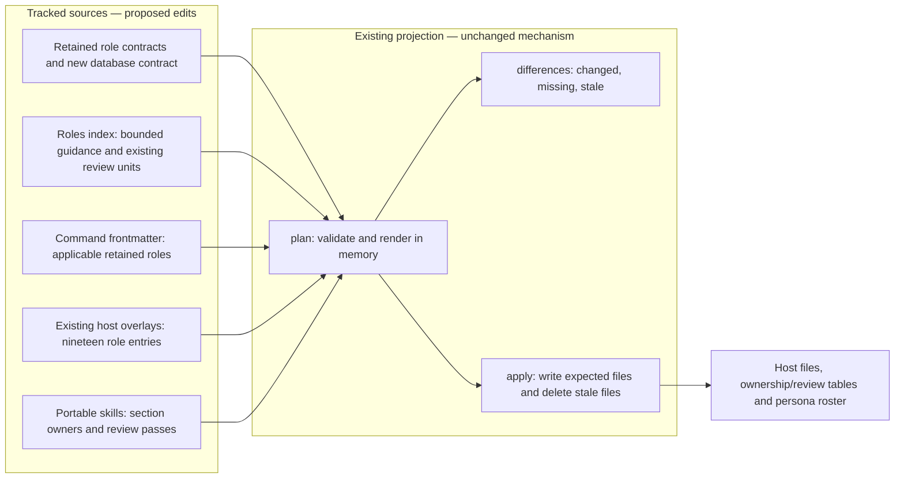
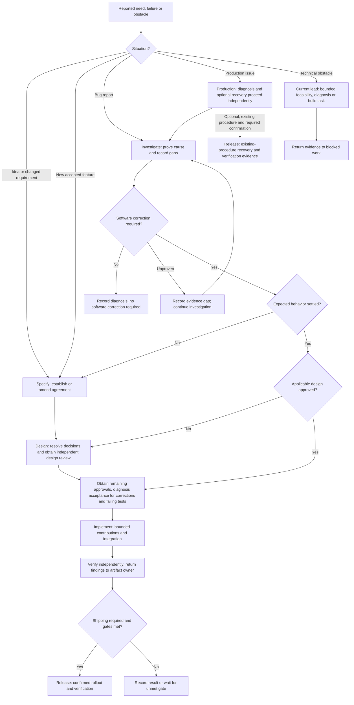
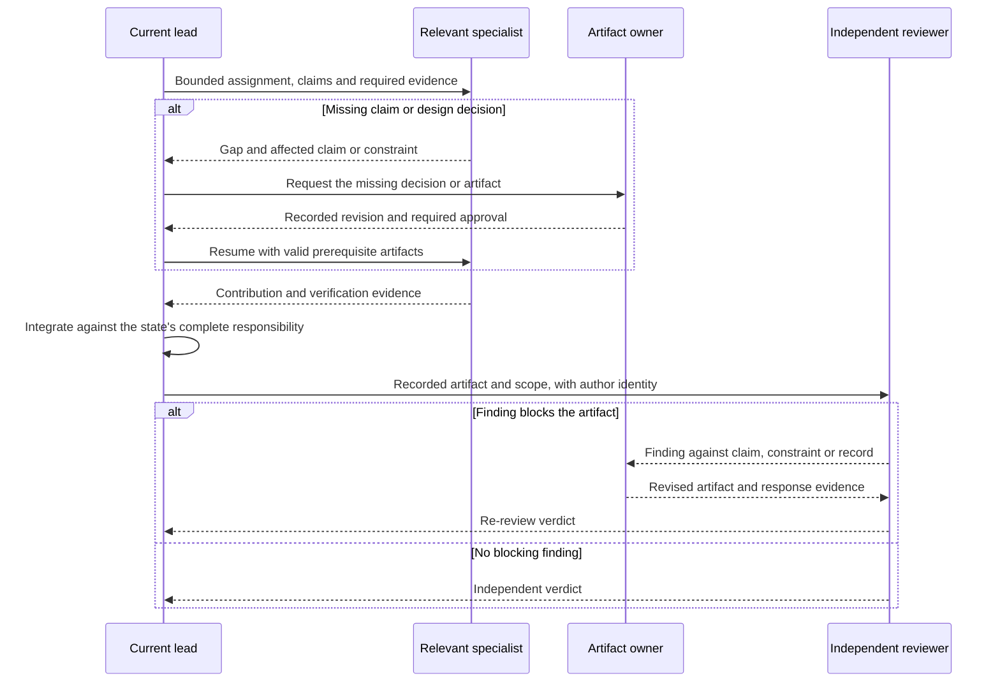

# Specification: Role contract

## 1. Business Goal

<!-- last written by: spec-author, 2026-10-16 -->

A consuming repository can identify who leads its work and which expertise the
specification requires, using host-free contracts it can adopt without editing;
this removes a peer-to-peer handoff graph whose overlapping roles obscure
accountability and turn specialties into unnecessary workflow stops. — Ruth

## 2. User Needs

<!-- last written by: spec-author, 2026-10-16 -->

| #   | Persona              | Need                                                           | Pain Point Today                                            |
| --- | -------------------- | -------------------------------------------------------------- | ----------------------------------------------------------- |
| 1   | Consuming repository | Adopt a role as-is and point it at a companion skill           | A role naming another project's paths must be rewritten     |
| 2   | Projection           | Read a fixed set of keys from every role                       | N/A (internal dependency on [0001-F1](../../scripts/.spec/README.md)) |
| 3   | Role author          | Know which keys a role may carry and which belong to a host    | Host knobs creep into role files and bind them to one host  |
| 4   | Person starting work | Identify the lead and relevant specialists for the situation | A global handoff graph makes every specialty look mandatory |
| 5   | Work lead | Integrate bounded contributions against the same claims | Peer handoffs leave nobody accountable for the complete result |
| 6   | Persistence maintainer | Obtain database expertise across the affected lifecycle | Persistence duties are scattered across general contracts |

### Collaboration glossary

| Term | Meaning |
| --- | --- |
| State | The responsibility currently exercised; not an executable state machine or a required separate agent invocation. |
| Lead | The role accountable for the current state's complete artifact and integration of assigned contributions. |
| Specialist | A role assigned bounded work because affected claims, surfaces or evidence require its expertise. |
| Mode | A bounded way a retained role works, without creating a separate role or changing its permissions. |
| Artifact handoff | Passing the recorded agreement, design, failing test, change or finding that the receiving responsibility needs. |

### State leads

| State | Lead | Artifact or responsibility |
| --- | --- | --- |
| Specify | `spec-author` | Discovery followed by the decided agreement and scenarios |
| Design | `architect` | Technical design and readiness |
| Implement | `implementer` | Integration of production changes against the design and failing tests |
| Verify | `spec-reviewer` | Independent design or diff findings and verdicts, with relevant verification evidence |
| Release | `release` | Rollout, recovery and verification using the existing confirmation rules |
| Investigate | `bug-finder` | Reproduction, classification, evidence and proven cause |

### Specialist selection

| Specialist | Trigger | Bounded contribution |
| --- | --- | --- |
| `domain` | Business invariants, rules or domain concepts need modeling or change | Domain model and enforceable rules |
| `ux` | Interaction, accessibility, states or copy need deciding | Decided interaction before presentation implementation |
| `ui` | The decided interaction requires presentation changes | Presentation code under the implementation lead |
| `database` | Persistence design, implementation, failure investigation or rollout is affected | Stored data shape, keys, indexes, nullability, transactions, queries, migration/backfill, compatibility and recovery evidence |
| `test-writer` | Agreed behavior lacks a failing test or traceability needs amendment | Tests and coverage records within existing section ownership |
| `tester` | Changed behavior needs execution or exploration | Run evidence and reproductions |
| `adversary` | A boundary, credential, permission or external input is affected | Independent hostile surface findings |
| `benchmarker` | A recorded performance, cost or structural concern needs measurement | Benchmarks and measurements of that concern |
| `metric-nerd` | An operational decision needs instrumentation, baselines or telemetry comparison | Signal requirements and operational evidence |
| `build` | A gate, build configuration, tool or pipeline needs work | Reproducible build and gate changes |
| `organizer` | Approved claims need work items or the queue needs maintenance | Decomposition and ranked work; no mandatory delivery stop |
| `document-writer` | Substantial prose is missing or stale | Documentation checked against the relevant artifact |
| `auditor` | A repository audit is requested, scheduled or required before release | Repository findings; no mandatory stop on every change |

### Retired roles and retained responsibilities

| Retired role | Destination | Retained responsibility |
| --- | --- | --- |
| `analyst` | `spec-author`, discovery mode | Identify requester, failure state, settled answers and material unknowns before writing a confirmed need as claims |
| `bug-fixer` | `implementer`, correction mode | Accepted diagnosis and a regression test failing for the proven cause precede the bounded fix; preserve regression, systemic-site and lesson duties |
| `yak-shaver` | Current lead with the relevant specialist | Remove the named obstruction, prove original work can resume and record adjacent work separately |
| `pair-programmer` | Collaboration mode available to every retained role | Visible steps, explanation, a stop at decision forks and a recorded decision; retain the active role's write boundaries |
| `log-parser` | `bug-finder`, log-analysis capability | Isolate the evidence window and correlation, reconstruct sequence, mark inference, protect secrets and report gaps; large evidence may be delegated as a bounded task |
| `critic` | Independent `spec-reviewer`, design-review mode | Review the design against claims, constraints and decisions before implementation; report findings without rewriting |

### Scenario routing

| Situation | Route | Conditional involvement |
| --- | --- | --- |
| Bug report | Investigate the existing claim → accepted diagnosis and failing regression test → Implement correction → Verify → Release when shipping is required | `spec-author` for missing/disputed expected behavior; `architect` for a design gap; specialists for the affected concern |
| New feature | Specify → Design → failing tests → Implement → Verify → Release | Only specialists whose trigger applies; `organizer` cuts work after agreement |
| Technical obstacle | Current lead retains parent work → bounded investigation or obstruction removal → resume original work | `architect` for an unknown approach; `bug-finder` for unexpected behavior; `build` for tooling or a gate |
| Pitched idea | Specify in discovery mode → agreement only when accepted | Bounded `architect` feasibility work if required to decide the idea; no speculative production implementation |
| Production issue | `bug-finder` diagnoses while `release` coordinates any recovery under an existing procedure → correction route only if software must change | Log analysis when logs exist; `metric-nerd` for operational evidence; other specialists for the affected concern |
| Changed shipped requirement | Amend the existing agreement → assess design, dependencies and compatibility → revised failing tests → Implement → Verify → Release | `database` for existing data or migration; `ux`/`domain` for changed interaction/rules; `metric-nerd` for rollout evaluation |

The tables define responsibility and artifact dependencies; the method skills
retain their gates and commands only convene the applicable roles. — Ruth

### Assumptions

| ID  | Assumption                                                                            |
| --- | ------------------------------------------------------------------------------------- |
| A-1 | The specification template's `##` headings are the authority on which sections exist. |
| A-2 | A consuming repository provides a companion skill that names its paths and commands.  |

## 3. Acceptance Criteria

<!-- last written by: spec-author, 2026-10-16 -->

| ID    | Claim                                                                                                                                                                     | Source                                                                         | Status |
| ----- | ------------------------------------------------------------------------------------------------------------------------------------------------------------------------- | ------------------------------------------------------------------------------ | ------ |
| B-001 | Given the role files, each declares `name`, a one-line `description`, a semver `version` and `owned_spec_sections`, and none carries a host key.                          | [ADR-0001](../../.spec/adr/0001-roles-are-host-free-and-hosts-are-overlays.md) | Active |
| B-002 | Given the roles and the unowned declarations in the roles index, every section of the specification template has exactly one owner.                                      | `sdd-conventions` § Section ownership                                          | Active |
| B-003 | Given a role body, it carries the headings Owns, Read first, Produce or Look for, and Refuse.                                                                              | Hooked role contracts                                                          | Active |
| B-004 | Given a role body, it names no product technology, library, repository path, package or build tool; the consuming repository's companion skill names those.               | Root README § Purpose                                                          | Active |
| B-005 | Given a role body carrying `## Look for`, it also carries `## Report`, so every reviewing role states the form its findings take. | OQ-1 | Active |
| B-006 | Given a role body linking `../skills/<name>/SKILL.md`, that skill exists in `skills/`; projection fails naming the role and the skill otherwise. | C-1 | Active |
| B-007 | Given a role declaring `persona`, it carries a one-line `name` and a one-line `voice`, and no other role declares the same persona name; the role name stays the file stem, the host agent name and every machine-read stamp. | Brief: personas | Active |
| B-008 | Given a role declaring `reviews`, each entry is a review unit and the body carries `## Look for` and `## Report`; projection fails naming the role otherwise. | `sdd-conventions` § Review passes | Active |
| B-009 | Given a review unit in the roles index, it declares what it reviews, when its pass runs and what the pass never does, and the registry shows all three; projection fails naming the unit and the missing key otherwise. | LTI review-pass registry | Active |
| B-010 | Given work exercising a state, this Feature assigns it the accountable lead in § 2 State leads. | User brief: lead-and-specialist grouping | Active |
| B-011 | Given a specialist assignment, this Feature requires a bounded contribution justified by an affected claim, surface or evidence under § 2 Specialist selection. | User brief: specialists do certain parts | Active |
| B-012 | Given a specialist contribution, this Feature keeps the current lead accountable for integrating it into the state's complete artifact. | User brief: implementer collaboration | Active |
| B-013 | Given an assignment by a lead, this Feature preserves the assigned role's existing artifact and specification-section write boundaries. | B-002; user brief: spec drives the software | Active |
| B-014 | Given work whose earlier required artifacts and approvals remain valid for its affected claims, this Feature starts at the earliest unmet responsibility. | User brief: small changes need no repeated discovery | Active |
| B-015 | Given an undecided need, this Feature assigns discovery to `spec-author` in the mode replacing `analyst` in § 2. | User brief: fold redundant roles; § 2 retirement mapping | Active |
| B-016 | Given a software correction, this Feature assigns it to `implementer` in the mode replacing `bug-fixer` in § 2. | User brief: fold redundant roles; § 2 retirement mapping | Active |
| B-017 | Given an incidental obstruction, this Feature assigns bounded removal to the current lead with relevant expertise in place of `yak-shaver`. | User brief: fold redundant roles; § 2 retirement mapping | Active |
| B-018 | Given a request for work alongside the person, this Feature offers the § 2 collaboration mode within the active role in place of `pair-programmer`. | User brief: fold redundant roles; § 2 retirement mapping | Active |
| B-019 | Given logs relevant to an investigation, this Feature assigns the § 2 log-analysis capability to `bug-finder` in place of `log-parser`. | User brief: fold redundant roles; § 2 retirement mapping | Active |
| B-020 | Given a design ready for review, this Feature assigns the design-review mode replacing `critic` to a `spec-reviewer` instance that did not author that design. | User brief: fold redundant roles; § 2 retirement mapping | Active |
| B-021 | Given a persistence concern, this Feature assigns `database` the bounded expertise in § 2 Specialist selection at the affected state. | User brief: add a database specialist | Active |
| B-022 | Given database work, this Feature constrains its storage decisions to the agreed domain invariants and architect-owned design. | User brief: database specialist; B-002 | Active |
| B-023 | Given a database migration or backfill, this Feature requires the database contribution to include compatibility and rollback or recovery verification. | User brief: database specialist; retained implementer/release migration duties | Active |
| B-024 | Given a measurement request, this Feature selects `benchmarker` or `metric-nerd` by their distinct § 2 triggers. | User brief: retain performance and observability distinction | Active |
| B-025 | Given required production instrumentation, this Feature assigns its code to the implementation lead or relevant implementation specialist. | User brief: specialists within implementation; existing benchmarker code boundary | Active |
| B-026 | Given a bug report, this Feature follows the § 2 bug route against existing claimed behavior. | User brief: bug comes in | Active |
| B-027 | Given an accepted new feature, this Feature follows the § 2 feature route with the stated artifact dependencies. | User brief: new feature starts | Active |
| B-028 | Given a technical obstacle, this Feature follows the § 2 obstacle route according to the kind of uncertainty. | User brief: technical problem | Active |
| B-029 | Given a pitched idea, this Feature follows the § 2 idea route without production implementation before acceptance. | User brief: new idea pitched | Active |
| B-030 | Given a production issue, this Feature follows the § 2 production route according to whether recovery or a software correction is required. | User brief: issue in production | Active |
| B-031 | Given unavailable incident telemetry, this Feature records the missing evidence as a gap without treating it as a proven cause. | User brief: production diagnosis depends on available observability | Active |
| B-032 | Given changed shipped requirements, this Feature follows the § 2 amendment route while retaining permanent claim anchors. | User brief: requirements change in production; spec-and-traceability | Active |
| B-033 | Given the resulting role roster, this Feature exposes exactly the six leads and thirteen specialists listed in § 2 as standalone roles. | User brief: consolidate six and add database | Active |
| B-034 | Given the consolidated roster, this Feature makes active role, command, host and projected references resolve to retained roles and their applicable modes. | User brief: functional roles; 0001-F1 B-008/B-009; 0001-F3 B-003 | Active |
| B-035 | Given historical records affected by role retirement, this Feature preserves their recorded identities and evidence. | spec-and-traceability § Claims and traceability / Records beside a specification | Active |
| B-036 | Given the roles index handoff guidance, this Feature presents bounded state, specialist and scenario guidance in place of the global all-role graph. | User brief: handoffs too complicated | Active |

## 4. Constraints

<!-- last written by: spec-author, 2026-10-16 -->

| ID  | Constraint                                                                        | Rules Out                                                             |
| --- | --------------------------------------------------------------------------------- | --------------------------------------------------------------------- |
| C-1 | A role names skills by relative link to `skills/<name>/SKILL.md` and nothing else. | A link into a host directory, an absolute path, a URL to another repo |
| C-2 | A role's `name` equals its file stem.                                              | A display name that differs from the file, an alias                   |
| C-3 | Ownership is declared on the role, never in a skill.                              | A hand-kept ownership table; a skill naming a role                    |
| C-4 | Grouping preserves existing approval, test-first, traceability and independent-review requirements. | Skipping a required gate because one lead coordinates several specialties |
| C-5 | State, specialist and mode guidance introduces no required agent invocation per responsibility. | Treating every specialist as a mandatory workflow stop or separate process |
| C-6 | Commands convene roles within 0001-F3 C-1 and C-2. | Embedding transitions, gates or next-state tables in command bodies |

## 5. Out of Scope

<!-- last written by: spec-author, 2026-10-16 -->

| #   | Item                                              | Exclusion Reason                                                        |
| --- | ------------------------------------------------- | ----------------------------------------------------------------------- |
| 1   | Rendering a role for a host                       | [0001-F1 Projection](../../scripts/.spec/README.md)                     |
| 2   | A role per technology or platform                 | A technology belongs in the consuming repository's companion skill (B-004) |
| 3   | Persona traits beyond a name and a voice          | A name and one line of voice are what a reader acts on; a trait list is restated prose |
| 4   | A role-level declaration of how scenarios execute, or an opt-out into documentation-only scenarios | How the runner executes scenarios is the companion's § "Testing"; a scenario alone is not coverage either way |
| 5   | Database engines, persistence frameworks and engine-specific tooling | Replaces the database-role exclusion on 2026-10-16: host-free database expertise is included by B-021; engine knowledge remains the companion's (B-004) |
| 6   | An executable workflow engine or new role frontmatter schema | Responsibility grouping uses existing contracts and review declarations; no runtime state machine is requested |
| 7   | Unrelated role renames or changes to section ownership | The accepted scope retires the six § 2 roles and adds `database`; existing artifact boundaries remain |

## 6. Concern Separation

<!-- last written by: architect, 2026-10-16 -->

| #   | Concern                                           | Classification |
| --- | ------------------------------------------------- | -------------- |
| 1   | Which frontmatter keys a role carries             | Business       |
| 2   | Which body headings a role carries                | Business       |
| 3   | Keeping product technology out of a role body     | Business       |
| 4   | Validating the keys                               | Technical      |
| 5   | The name a role signs its prose with              | Business       |
| 6   | Which unit of work a role reviews                 | Business       |
| 7   | Accountable leads, conditional expertise and retained modes | Business |
| 8   | Database contribution boundaries and recovery evidence | Business |
| 9   | Artifact prerequisites and independent review | Business |
| 10  | Contract, command and overlay reference migration | Technical |
| 11  | Deterministic generation and stale-output removal | Technical |
| 12  | Separating contract checks from evidence of role behavior | Both |

Lead accountability integrates contributions; it grants no additional write
authority. The existing section owners and review units remain the boundaries.
The database specialist supplies persistence expertise within those boundaries,
without owning a specification section. — Marcus

## 7. Technical Design

<!-- last written by: architect, 2026-10-16 -->

A role file is Markdown with YAML frontmatter. The keys and their checks are
declared by `loadRole` in [`Projection.fsx`](../../scripts/Projection.fsx);
that function is the authority, not this section.

| Key                   | Form                                                      |
| --------------------- | --------------------------------------------------------- |
| `name`                | equals the file stem                                      |
| `description`         | one line; the host's trigger text                         |
| `version`             | semver, bumped when the contract changes                  |
| `owned_spec_sections` | list of `"<n>"`, `"Tasks"`, `"Scoring"` or `"<n>/<Subsection>"`; empty is valid |
| `persona`             | optional; `name` and `voice`, one line each; the name unique across roles |
| `reviews`             | optional list of review units from the roles index; a reviewing body follows |

A persona is how a role signs the prose it writes: reports, findings, review
notes. Projection puts one generated line naming it ahead of the body and lists
every persona in [`PERSONAS.md`](../PERSONAS.md). A stamp a tool reads —
`last written by`, `author`, the § 12 Reviewer column — keeps the role name, so
no tool has to map a persona back to a role.

The review units — design, diff, surface, repository — are declared once, in
the same frontmatter under `review_units`, in the order their passes run, each
with what it reviews, when its pass runs and what the pass never does (B-009). A
role
declaring `reviews` carries the reviewing headings (B-008); which role reviews
which unit is generated into
[`sdd-conventions` § Review passes](../../skills/sdd-conventions/SKILL.md#review-passes).

Sections no single role owns are declared once, in the frontmatter of
[`README.md`](../README.md) under `unowned_spec_sections`, and merged with the
roles' claims before the totality check.

The body is free Markdown under four headings in this order: `## Owns`,
`## Read first`, `## Produce` (or `## Look for` followed by `## Report` for a
reviewing role), and `## Refuse`. A role may add a heading, such as `## Escalate`. Links to skills are relative, `../skills/<name>/SKILL.md`, so that
the same bytes resolve from `agents/` and from a host's agents directory one
level below the root.

Baseline readiness: **Ready for tests and implementation for B-001–B-009.**
The design above remains the recorded role-format design.

### DR-1 — Collaboration stays in contracts and artifacts

For B-010–B-014 and B-026–B-036, revise the existing Markdown contracts and
indexes; reuse the loaders, renderers and validation plan in
[`Projection.fsx`](../../scripts/Projection.fsx). No workflow runtime, new
frontmatter key or central list of role names is needed. This follows
[decision 0001](decisions/0001-lead-and-specialist-collaboration.md) and accepted
[ADR-0008](../../.spec/adr/0008-a-role-file-declares-its-contract-and-no-host-setting.md).
The incumbent representation already supports empty section ownership and
multiple review units per role. A new hierarchy or machine-readable state
registry would duplicate the agreement without enforcing agent behavior.

[`agents/README.md`](../README.md) becomes the operational entry point: state
leads, conditional specialist triggers, retained modes and six short situation
routes replace its global peer graph. Keep its existing `review_units` and
`unowned_spec_sections` declarations. Its guidance links the authoritative
workflow, ownership and review rules in `sdd-conventions`; it does not reproduce
the gates. Root [`README.md`](../../README.md) updates its role count, role and
command summaries and links to this entry point. § 2 records the agreed change;
it is not a second active roster for future additions to maintain.

Each lead contract states its accountable artifact, bounded-assignment inputs
(affected claims, concern, allowed files/artifacts and completion evidence),
integration duty and escalation to the existing artifact owner. Relevant
specialist contracts state their trigger, contribution and limits. Use existing
report/finding locations named by the companion; introduce no assignment schema
or additional tracking artifact. If a contribution exposes a missing claim or
design decision, the lead obtains that owner's revision before dependent work
continues. Rendering an unchanged model does not require domain modeling;
telemetry alone does not require benchmarking (B-011, B-024).

The diagram shows existing projection components and the proposed source edits
(DR-1, B-033–B-034, C-3, C-6).

### DR-2 — Retire identities after transferring their duties

For B-015–B-020 and B-033–B-035, transfer the duties before removing the six
source files and overlay entries. Preserve retained personas and machine-read
role stamps; retired personas disappear only from the generated active roster.
Bump the minor version of each changed role contract; start the new database
contract at `0.1.0`. Modes remain prose within existing headings, with no
independent persona, host setting or alias.

| Source destination | Required integration |
| --- | --- |
| [`spec-author.md`](../spec-author.md) | Absorb `analyst.md` discovery inputs, settled-answer search, separating questions and confirmed-need artifact. Discovery cannot invent claims; agreement authoring follows confirmation. Its description covers both activities. |
| [`implementer.md`](../implementer.md) | Absorb `bug-fixer.md` correction mode: accepted proven diagnosis, regression test observed failing for that cause, minimal correction, regression/systemic-site checks and a lesson when a gap is revealed. Preserve separate investigation and test ownership. |
| [`bug-finder.md`](../bug-finder.md) | Absorb `log-parser.md` window, correlation, first anomaly, ordered evidence, inference, secret protection and gap reporting. A large evidence task returns a bounded account to this lead. Change its correction handoff to `implementer`. An unsupported cause remains unproven. |
| [`spec-reviewer.md`](../spec-reviewer.md) | Absorb `critic.md` design review, including complexity, reuse, failure paths, diagram consistency and testability checks. Keep design findings separate from diff verdicts and preserve read-only behavior. |
| All retained contracts | Offer the active role's collaboration mode by linking the portable rule below; the mode adds visible steps and recorded decisions, not authority to write another artifact. |
| All six lead contracts | Retain the parent assignment during obstruction removal, request only relevant expertise, require proof the blocked work resumes and return adjacent work for separate tracking. |

Put the shared collaboration-mode procedure once in the non-generated prose of
[`coding-conventions`](../../skills/coding-conventions/SKILL.md): show the next
step and its result, stop at a decision fork with options and a recommendation,
record the person's decision in the companion's working record, and retain the
active responsibility's write boundary. It names no role or persona. This
replaces `pair-programmer.md` without copying its procedure into nineteen files.
Bounded obstruction guidance replaces `yak-shaver.md`; it does not authorize
an investigator or reviewer to make production changes. That work goes to the
appropriate implementation assignment.

Set `spec-reviewer`'s existing `reviews` to `[design, diff]` and remove
`critic.md`. Keep the four review units and their order unchanged.
[`reviewRows`](../../scripts/Projection.fsx) requires one role per unit, not one
unit per role, so no projector change is needed. Amend the roles index's
one-unit-per-reviewer wording. A design-review instance must not have authored
the design; diff review likewise remains independent of its subject. Record
the reviewing instance and authored scope in the review evidence. Combining
contracts never permits self-review; projector totality proves assignment of
units, not instance independence (B-020, C-4).

### DR-3 — Database expertise follows existing ownership

For B-021–B-025, add `agents/database.md` as a host-free specialist with
`owned_spec_sections: []`, the standard headings and a unique optional persona
under B-007. Its description covers persistence design advice, implementation,
investigation and release compatibility/recovery. No database engine, framework
or consuming-project path belongs in the contract; the companion supplies them.

| Boundary | Database contribution and handoff |
| --- | --- |
| Design | Supply schema/column types, nullability/defaults, keys, uniqueness/indexes, foreign-key actions, query access paths, transaction/concurrency boundaries and ordered migration advice. `architect` records the design; unresolved storage choices return there. |
| Domain | Storage follows agreed invariants and their domain model; `domain` retains rule modeling. An unsettled business rule returns to `spec-author`; storage convenience cannot redefine it. |
| Implement | Change only assigned persistence code, queries, migrations or backfills against the approved design and failing tests. `implementer` integrates the result with other layers. `test-writer` retains tests and traceability. |
| Investigate | Supply stored-data/query/transaction evidence to `bug-finder`; distinguish read-only diagnosis from a corrective write. No speculative repair or unredacted sensitive data in the evidence. |
| Release | Supply compatibility evidence for affected serving versions, verified rollback or recovery, and backup/potential-loss information for destructive changes. `release` retains deployment and recovery coordination and existing confirmation requirements. |

Update [`domain.md`](../domain.md), [`architect.md`](../architect.md),
[`implementer.md`](../implementer.md), [`bug-finder.md`](../bug-finder.md) and
[`release.md`](../release.md) to name these interfaces without moving their
ownership. A migration contribution is incomplete until its intent, rollout
order, compatible versions and recovery evidence are supplied; if reversal
cannot recover the information, explicitly require the agreed backup/restore
path and potential loss assessment before release. Keep migrations as history.
This contract does not introduce a database or prescribe an application's
schema; each affected Feature must settle those details in its own design.

Clarify [`metric-nerd.md`](../metric-nerd.md) as operational signal requirements,
baselines and comparisons, with missing telemetry recorded as missing evidence.
It routes instrumentation code to `implementer` or the assigned implementation
specialist. Preserve [`benchmarker.md`](../benchmarker.md)'s written performance,
cost or structural concern trigger, measurement ownership and prohibition on
production behavior. Neither instrumentation nor telemetry availability implies
a performance benchmark.

### DR-4 — Route from artifact gaps, not a mandatory chain of agents

For B-014 and B-026–B-032, the roles index's six situation routes reference
the § 2 agreement and the existing method gates. A bug uses its existing claim
and applicable approved design; a disputed behavior returns to Specify and a
design gap to Design. Tests still fail before corrections start, and the person
still accepts the diagnosis. A new feature starts at the agreement. An idea
stays in discovery until accepted; bounded feasibility returns evidence there.
A technical obstacle returns its finding to the lead of the blocked work.
Production diagnosis and operational recovery may proceed together, under
their separate leads, without treating recovery as evidence for a code fix.
A shipped amendment preserves withdrawn IDs and obtains replacement claims,
compatibility assessment and revised failing tests before implementation.

This responsibility-selection view is guidance, not a runtime algorithm
(DR-4, B-014, B-026–B-032, C-4–C-5).

The next view makes the missing-input and review-failure paths explicit;
participants describe responsibilities, not additional roles or mandatory
agent invocations (DR-1, DR-2, B-011–B-014, B-020, C-4–C-5).

### DR-5 — Migrate sources together and regenerate outputs

For B-033–B-036, implement the consolidation as one coherent source-and-output
change after the failing checks are recorded. The exact active surfaces are:

| Surface | Migration |
| --- | --- |
| `agents/*.md` | Revise the retained contracts described above and specialist collaboration boundaries; add `database.md`; remove `analyst.md`, `bug-fixer.md`, `yak-shaver.md`, `pair-programmer.md`, `log-parser.md`, `critic.md` after duty transfer. Remove retired links, descriptions and handoffs in every retained body, including `architect.md`'s feedback sources. |
| `agents/README.md`, root `README.md` | Replace the peer graph and twenty-four-role/count wording with the agreed six leads and thirteen specialists; update command summaries and discovery/review descriptions. Keep one active grouping authority in the roles index. |
| `commands/spec.md`, `design-ui.md` | Replace analyst participation with `spec-author` discovery mode; deduplicate the role in `spec`. |
| `commands/design.md` | Convene `spec-reviewer` for independent design review in place of critic; add conditional database design advice. Retain conditional domain, testability and benchmarking contributions. |
| `commands/bug.md` | Convene `bug-finder`, `test-writer`, `implementer`; use integrated log analysis and correction mode. Add conditional database expertise for persistence failures. |
| `commands/implement.md`, `ship.md` | Add conditional database implementation or compatibility/recovery participation. Implementer coordinates applicable contributions; no database assignment for unrelated changes. Other command role lists remain unchanged unless a stale reference is found. |
| `hosts/claude.yaml`, `hosts/codex.yaml` | Remove six retired mappings and add database. Preserve retained model/effort settings and read-only tool limits. Database uses the domain specialist's existing judgment profile: Claude `opus`/`high`, unrestricted tools for assigned writes, preloads `sdd-conventions`, `coding-conventions`, `clarify-requirements`; Codex existing default model with `high` effort. Merge critic's `coding-conventions` preload into Claude spec-reviewer without expanding its read-only tools. |
| `skills/coding-conventions/SKILL.md`, other active skill prose | Add the portable collaboration rule. Search outside generated markers for retired names/personas or role links and replace any with section-owner/review-pass language. Do not add role-name aliases to the linter. |
| `scripts/project.tests.fsx` | Test writer revises the existing real-roster expectation and reviewer/unit expectation, preserving all baseline checks, then adds amendment coverage through existing fixture/library seams. No production projector change is planned. |

Commands name roles and skills in frontmatter only; their bodies describe
conditional contributions and modes using existing responsibility labels.
They must not gain stage tables, transition logic or new gates
([0001-F3 C-1/C-2](../../commands/.spec/README.md#4-constraints)). Skills remain
role-free outside generated blocks
([0001-F4](../../skills/.spec/README.md)); the current `lintSkills` derives names
from the live roster, so removing a role would also remove its detection pattern.
An explicit retirement search is therefore necessary even when lint passes.

Run the projector to regenerate `.claude/agents/`, `.codex/agents/`, affected
`.claude/commands/`, `.agents/skills/` and `.claude/skills/`, the generated review
registry/ownership block and `agents/PERSONAS.md`. Existing `differences` detects
each retired agent file as stale; existing `apply` removes it. The database
host files are new planned outputs. Ownership rows must remain identical;
the design reviewer changes to `spec-reviewer` while the four units retain
their order. Never hand-edit generated files.

Search all tracked files for the retired names, personas, twenty-four-role
counts and old reviewer assumptions. Classify each hit: migrate active
guidance, regenerate generated content, and preserve historical decisions,
sign-offs, lesson evidence and claim Source citations (B-035). A historical
link to a retired path can remain evidence; an active convening link cannot.
The § 2 retirement mapping and decision 0001 intentionally retain the old names.
Current sibling-spec descriptions of roster size or reviewer assignment are
findings for their section owners; coordinate those edits rather than silently
rewriting historical measurements or another owner's section.

`plan` validates all source inputs before any output write. A dangling host mapping,
retired command reference, duplicate/missing review-unit holder or ownership
violation must stop projection without producing new output.
An omitted per-role host mapping remains valid through existing host defaults;
the real-roster check verifies the explicit nineteen-entry overlays planned here.
Filesystem writes in `apply` are sequential, not a multi-file transaction:
interruption can leave mixed outputs. Fix the source error or rerun projection from the same reviewed
sources, then run `--check`; never treat a partial run as a deliverable. Revert
the coherent source/output commit and regenerate to roll back this migration.
Do not restore an individual retired output by hand. Existing consumers pinned
to old refs keep those files; this repository does not uninstall files in a
consumer or promise host-session reload (0001-F1 § 5). — Marcus

### Verification boundary and readiness

Contract and projection checks can establish the nineteen-role set, host
coverage, unchanged section ownership, complete review-unit assignment,
conditional contract wording, resolvable command references, byte-preserved
contract projection and stale-file removal. Use existing synthetic checkout
fixtures, `loadRoles`, `reviewRows`, `plan`, `differences` and `apply` in
[`project.tests.fsx`](../../scripts/project.tests.fsx); include a fixture where
one role reviews both design and diff and retirement leaves stale host files.
These checks prove the shipped instructions and migration mechanism, not that
an arbitrary agent will follow them. Avoid a test that merely searches for one
word and reports the full behavioral scenario as executed.

For the six situation routes and refusal/ownership boundaries, retain the
tagged positive and negative scenarios as review cases. Testability review
must identify which artifact checks are executable and which require recorded
independent evidence against the actual assignments, contributions, approvals
and findings. An independent walkthrough can verify routing from supplied
artifacts and rejection of missing prerequisites; it is not live-agent
behavior coverage. No model API call, prompt simulator or new runtime harness
is part of this design. § 8 and § 9 remain the test writer's authority; do not
promote a row to `Covered` from contract presence alone. Unverified behavior
remains honestly `Missing` or `Partial` under the existing traceability rules;
any shipping waiver requires the existing § 11 approval record. ADR-0006 still
blocks delivery of a claim whose row is `Missing`, without blocking agreement
or this design handoff.

Run `dotnet specht --strict`, `dotnet fsi scripts/project.tests.fsx`, projection,
then `dotnet fsi scripts/project.fsx --check`. Independently inspect the diff
and classified retirement search, including both host files for database and
spec-reviewer. Review evidence must distinguish the design author's identity
from the reviewing instance and preserve the earlier scoped baseline evidence.

Performance reasoning: the workload remains one small checkout processed
offline. Removing six roles and adding one reduces role-rendering work from
twenty-four to nineteen; validation/rendering still scales with source bytes
and output count using the existing plan. This is a cost model, not a measured
latency claim, and introduces no target or infrastructure cost. No application
domain model or performance workload is present, so domain implementation and
benchmark measurement are not required for this contract change. If later
evidence identifies a written cost concern, route that measurement to
`benchmarker` rather than inventing a benchmark here.

Views not applicable: no database entity/column view because this change adds
expertise, not persisted application data; no class view or compiling stubs
because it declares no new runtime interface; no state-machine view because
the responsibility states are guidance, not executable lifecycle state.
The source/projection component, routing and collaboration sequence views
above cover the applicable boundaries and failure paths.

Amendment readiness: **Ready for tests and implementation for B-010–B-036**
within the source/projection and evidence boundaries above. On 2026-10-16,
testability review found the source/projection approach ready and retained
unverified behavioral coverage as `Missing`; see § 8 Collaboration amendment.
Independent design critique returned Ready with no outstanding findings after
the B-030 recovery-path finding was resolved and re-reviewed. All three
Mermaid views rendered and were visually inspected. No material decision or
blocking OQ remains; the six retirements, database boundary and nineteen-role
shape are already agreed. These amendment reviews do not reassess or replace
the B-001–B-009 baseline readiness and evidence recorded above.

Design risk: **2 (medium)** for this collaboration-design scope: the mechanism
is reused, but active-reference retirement spans contracts, commands, overlays
and generated files, and combining review identities could obscure instance
independence. Coherent regeneration, ownership checks, the classified search
and independent review evidence address those risks. This verdict does not
change § 12 sign-off or assert that the amendment is implemented. — Marcus

## 8. Testing Strategy

<!-- last written by: test-writer, 2026-10-16 -->

B-001 to B-003 run against the real checkout inside
`dotnet fsi scripts/project.tests.fsx`, in the group prefixed `F2_`, so a role
edit that breaks the contract fails the same command CI runs. The baseline
scenarios for B-001–B-009 in [`roles.feature`](roles.feature) are checked by
the cited tests, with B-004 assessed manually as described below.

- B-001: `loadRoles` over `agents/`; the loader itself rejects a missing key,
  a non-semver version, a multi-line description or a host key, so the test
  asserts the roster loads and that both host overlays map every role.
- B-002: `ownershipRows` over the real roles, index and template; one row per
  template section plus the subsection row.
- B-003: the `## ` headings of each loaded body.
- B-005: every loaded body carrying `## Look for` also carries `## Report`.
- B-006: `validateSkillLinks` over the real roles passes, and a synthetic role
  linking a missing skill makes `plan` fail before anything is written.
- B-007: `loadRole` rejects a persona missing a key or not a mapping and
  `validatePersonas` rejects a shared name; the test runs both on synthetic
  roles and runs `validatePersonas` over the real roster.
- B-008: the real roster declares exactly the four passes; a synthetic role
  declaring a unit on a body without the reviewing headings fails `plan`.
- B-009: every real unit loads with all three keys; a synthetic unit missing
  `never`, or given as bare text, fails `plan` naming the unit.
- B-004 is a review question, not a test: at review, grep the role bodies for
  the names of the consuming project's stack and tooling. The reviewer records
  the result in § 12. A lint over a word list was considered and rejected
  because the list would itself be technology-specific.

### Collaboration amendment

Testability verdict: **Ready to write source/projection conformance tests against
DR-1–DR-5; agent-behavior coverage remains an explicit delivery gap.**
B-010–B-036 have tagged scenarios but no executable tests or scenario execution
evidence. The existing projector suite does not execute them; all amendment
§ 9 rows remain `Missing`. This design-only assessment adds neither tests nor
coverage. — Kevin

| Claims | Proposed verification and limit |
| --- | --- |
| B-010–B-014 | Independently inspect supplied assignments and integrated artifacts against state leads, justified expertise, ownership and earliest unmet prerequisite. Include unchanged-model and missing-approval cases. |
| B-015–B-020 | Exercise discovery, correction, obstruction, collaboration, log analysis and design review with synthetic scenario inputs; inspect decisions, refusals, evidence gaps and distinct author/reviewer identities. |
| B-021–B-025 | Review persistence assignments, invariant conflicts, compatibility/recovery evidence and measurement/instrumentation ownership. This Feature tests the specialist contract, not an application's database migration. |
| B-026–B-032 | Independently walk each tagged positive and negative situation case using supplied artifacts; record selected responsibility, unmet gates and supporting evidence. |
| B-033 | Add a real-checkout test asserting the exact nineteen-role set and both host mappings. Count alone cannot detect a substituted role. |
| B-034 | Add synthetic migration integration checks through `plan`, `differences` and `apply`; inspect projected instruction bytes, stale retirement outputs, command references and unchanged ownership. |
| B-035–B-036 | Verify synthetic historical records survive projection byte-for-byte; independently classify real retirement-search hits and review bounded guidance for all six situations. |

The first four rows require acceptance evidence against the actual assignments,
contributions, approvals and findings when available. A synthetic artifact
walkthrough assesses the instructions' routing and refusal guidance; it does
not execute an agent or establish that an agent obeys them. Record the scenario
tag, supplied prerequisites, observed artifact/decision, assertion result and
independent reviewer in the existing companion-named evidence location.
Review contract wording for transferred duties and boundaries, not a keyword
whose presence is reported as behavioral coverage. Source checks can prove
that instructions are present and preserved, never lead selection, secret
protection, gate compliance or independence of an actual reviewing instance.

Executable tiers reuse [`project.tests.fsx`](../../scripts/project.tests.fsx):
unit tests exercise existing loading, ownership and review-unit decisions;
integration tests exercise the real plan/write/check path on synthetic temporary
checkouts. A single retained reviewer must own both design and diff while all
four ordered units remain total; duplicate/missing holders must still fail.
Existing deterministic-output and review-registry tests are reused, not replaced.
Update the existing roster and reviewer expectations without weakening baseline
checks. Register each added test in the explicit `tests` list and confirm the
reported discovered count increases; a function definition alone never runs.

For migration, first project a synthetic pre-retirement checkout, then change
its source contracts, commands and overlays to the agreed retained roster.
Check that `differences` reports retired host files as stale and database outputs
as missing; `apply` must remove stale files and write the expected bytes; a new
`plan` and check must report no differences. Exercise the public CLI's
`--root <synthetic-dir>` and `--check` for exit status and drift reporting rather
than imitating their decisions. Invalid retired command references, host mappings
to absent source roles and invalid review assignments must fail planning before output writes.
Preserve historical fixture bytes and existing outputs on rejected plans.
No mutation of the working checkout's generated files belongs in these tests.

Critical seams and remaining gaps:

- B-013/B-020, C-3/C-4: ownership/registry checks prove declarations; independent evidence must establish actual write boundaries and distinct reviewing instances.
- B-014/B-016/B-026–B-032, C-4: missing approvals, unproven causes and recovery-only cases need refusal evidence; a complete route table is insufficient.
- B-034/B-035, C-6: classify active versus historical references independently; retirement removes live-roster lint patterns, so passing lint cannot prove migration completeness.
- B-033/B-034, DR-5: absent overlay entries inherit defaults; real-roster tests check explicit mapping completeness, while dangling host references fail `plan`.
- B-010–B-032, C-5: no agent-behavior runner is defined. Do not invent a workflow engine, schema, prompt simulator or model API harness.
- § 8 coverage reporting: README § Maintaining omits the threshold/gate required by ADR-0007; report this gap and unmeasured coverage, never invent a percentage.

The filesystem root is already explicit in projection entry points; synthetic
temporary checkouts isolate writes. No new network, provider, clock, constructor,
ambient-state or public-member seam is introduced. Network/provider tests, time
cases, application database/UI tiers and compiling interface stubs are not
applicable because this amendment introduces instructions, not runtime APIs or
persisted data. Use no credentials, live traffic, sleeps or wall-clock assertions.

Keep proposed evidence distinct from executed coverage. Neither walkthroughs nor
projector checks justify marking behavioral rows `Covered`. Under
[ADR-0006](../../.spec/adr/0006-a-missing-row-blocks-the-merge-not-approval.md),
`Missing` does not block agreement or design approval, but blocks delivery of
the affected claim. Any deliberate unverified shipping requires the existing
§ 11 approval record; this assessment supplies no waiver. — Kevin

### Performance

Not applicable.

## 9. Traceability Matrix

<!-- last written by: test-writer, 2026-10-16 -->

| Claim ID | Scenario                                            | Test                                                     | Status  |
| -------- | --------------------------------------------------- | -------------------------------------------------------- | ------- |
| B-001    | Every role declares the contract keys               | `F2_B001_EveryRoleDeclaresTheContractKeysAndNoHostKey`   | Covered |
| B-002    | Every template section has exactly one owner        | `F2_B002_EveryTemplateSectionHasExactlyOneOwner`         | Covered |
| B-003    | Every role body carries the four headings           | `F2_B003_EveryRoleBodyCarriesTheFourSections`            | Covered |
| B-004    | A role body names no product technology             | Manual: review question in § 8                           | Partial |
| B-005    | A reviewing role states its report                  | `F2_B005_LookForRoleCarriesReport`                       | Covered |
| B-006    | A role links only skills that exist                 | `F2_B006_EverySkillLinkResolves`                         | Covered |
| B-007    | A persona carries a name and a voice and is unique  | `F2_B007_PersonaRequiresNameAndVoiceAndIsUnique`         | Covered |
| B-008    | A reviewing role carries the reviewing headings     | `F2_B008_ReviewingRoleCarriesLookForAndReport`           | Covered |
| B-009    | A review unit declares its trigger and refusal      | `F2_B009_ReviewUnitDeclaresTriggerAndRefusal`            | Covered |
| B-010 | Each state has one accountable lead | Missing | Missing |
| B-011 | Specialists join for bounded relevant work | Missing | Missing |
| B-012 | The lead integrates specialist contributions | Missing | Missing |
| B-013 | Lead accountability preserves section ownership | Missing | Missing |
| B-014 | A bounded change reuses valid earlier artifacts | Missing | Missing |
| B-015 | Discovery belongs to the specification author | Missing | Missing |
| B-016 | The implementer owns a diagnosed correction | Missing | Missing |
| B-017 | Obstruction removal returns to the blocked work | Missing | Missing |
| B-018 | Pairing is a mode of the active role | Missing | Missing |
| B-019 | Investigation includes correlated log analysis | Missing | Missing |
| B-020 | A different reviewer performs design review | Missing | Missing |
| B-021 | Database expertise joins an affected state | Missing | Missing |
| B-022 | Database decisions follow agreed invariants | Missing | Missing |
| B-023 | Changing existing data requires recovery evidence | Missing | Missing |
| B-024 | Measurements follow their purpose | Missing | Missing |
| B-025 | Production instrumentation follows implementation ownership | Missing | Missing |
| B-026 | A bug follows the existing agreement | Missing | Missing |
| B-027 | A new feature follows artifact dependencies | Missing | Missing |
| B-028 | Technical obstacles select relevant investigation | Missing | Missing |
| B-029 | An exploratory idea stays in discovery | Missing | Missing |
| B-030 | A production incident uses available evidence and recovery | Missing | Missing |
| B-031 | Missing telemetry remains an evidence gap | Missing | Missing |
| B-032 | Changed shipped behavior amends the existing agreement | Missing | Missing |
| B-033 | The simplified roster exposes nineteen roles | Missing | Missing |
| B-034 | Active references follow the consolidated roles | Missing | Missing |
| B-035 | Historical evidence survives retirement | Missing | Missing |
| B-036 | Handoff guidance answers who is involved and when | Missing | Missing |

## 10. Lessons / Spec Deltas

<!-- last written by: spec-author, 2026-10-16 -->

| Date | Trigger | Delta |
| --- | --- | --- |
| 2026-10-16 | User requested simpler roles and handoffs | Add B-010–B-036 and § 2 grouping/routing; retire six standalone roles by folding their duties into retained roles or modes; include `database`, reversing § 5 row 5's earlier exclusion; record the choice and rejected alternatives in [decision 0001](decisions/0001-lead-and-specialist-collaboration.md). — Ruth |

## 11. Open Questions

<!-- last written by: spec-author, 2026-10-14 -->

| ID   | Question                                                                                   | Blocks | Resolution |
| ---- | ------------------------------------------------------------------------------------------ | ------ | ---------- |
| OQ-1 | Should the contract require a `## Report` heading for reviewing roles, as `spec-reviewer` and `architect` already carry? | B-003  | Resolved 2026-10-14: yes. A body with `## Look for` also carries `## Report`; claimed as B-005. |

## 12. Sign-off

<!-- last written by: spec-author, 2026-10-16 -->

| Section | Status | Reviewer      | Note                                                            |
| ------- | ------ | ------------- | --------------------------------------------------------------- |
| 1-12    | 🟡     | spec-reviewer | Baseline draft. Preserve B-004 review evidence: grep at scaffolding and second-wave roster (2026-10-14) found no product technology in role bodies. |
| 1-5, 7-10, 12, scenarios, decision 0001 | 🟢 | spec-reviewer | Agreement-only amendment reviewed 2026-10-16; § 7 scopes baseline readiness, §§ 8–9 record pending coverage; implementation remains pending. |

## Tasks

None cut. The first six roles landed with the scaffolding change and the second
wave of eighteen with the roster change; a new role or a contract change cuts
its own work item.

## Scoring

| Field | Value | Basis                                              |
| ----- | ----- | -------------------------------------------------- |
| value | 0     | Not scored: tooling agreement, not a product Feature |
| risk  | 0     | Not scored: tooling agreement, not a product Feature |
