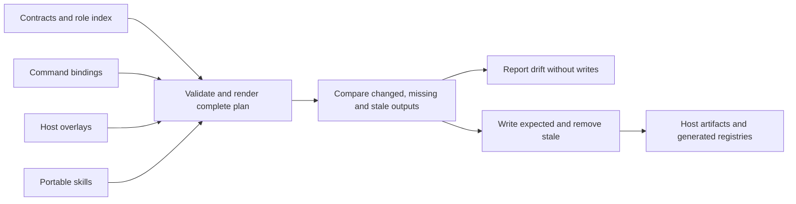
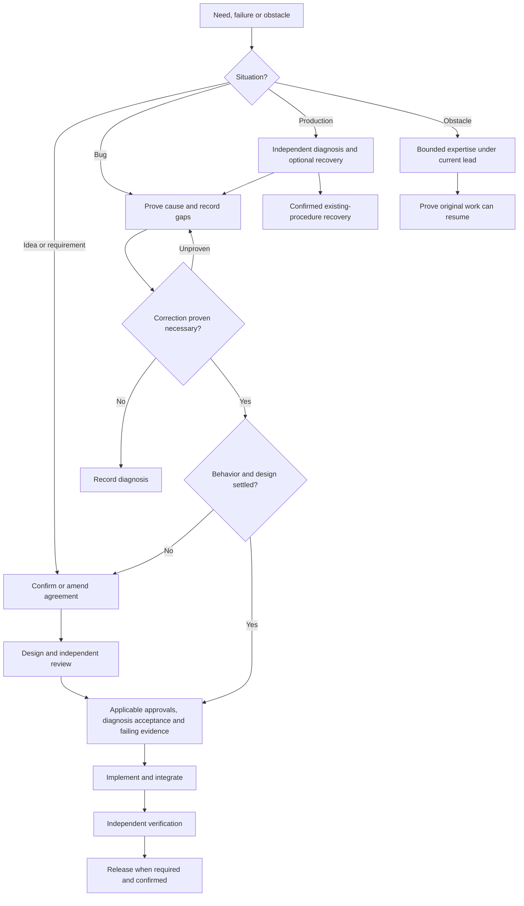
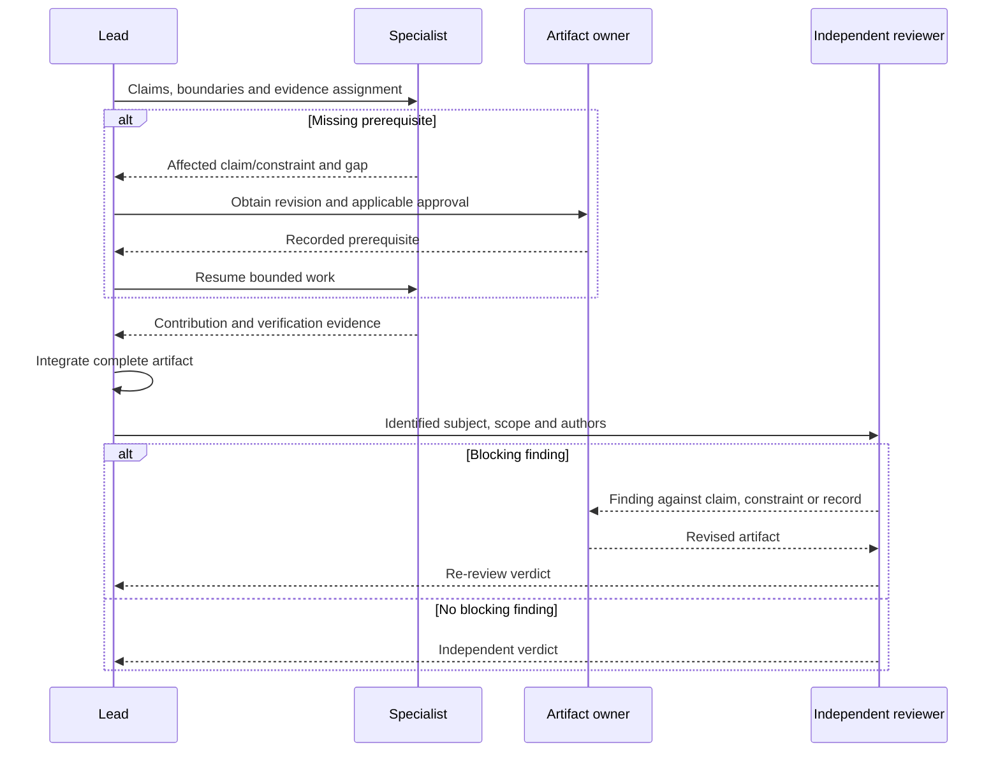

# Specification: Role contract

## 1. Business Goal

<!-- last written by: spec-author, 2026-10-27 -->

A consuming repository can identify accountable leads and required expertise
from host-free contracts, without overlapping handoffs or mandatory specialty
stops.

## 2. User Needs

<!-- last written by: spec-author, 2026-10-27 -->

| # | Persona | Need | Pain Point Today |
| --- | -------------------- | -------------------------------------------------------------- | ----------------------------------------------------------- |
| 1 | Consuming repository | Adopt a role as-is and point it at a companion skill | A role naming another project's paths must be rewritten |
| 2 | Projection | Read a fixed set of keys from every role | N/A (internal dependency on 0001-F1) |
| 3 | Role author | Know which keys a role may carry and which belong to a host | Host knobs creep into role files and bind them to one host |
| 4 | Person starting work | Identify the lead and relevant specialists for the situation | A global handoff graph makes every specialty look mandatory |
| 5 | Work lead | Integrate bounded contributions against the same claims | Peer handoffs leave nobody accountable for the complete result |
| 6 | Persistence maintainer | Obtain database expertise across the affected lifecycle | Persistence duties are scattered across general contracts |
| 7 | Consuming specification author | Name the specialist responsible for optional observability declarations | Operational signal requirements otherwise inherit an unrelated parent-section owner |

### Collaboration glossary

| Term | Meaning |
| --- | --- |
| State | The responsibility currently exercised; not an executable state machine or a required separate agent invocation. |
| Lead | The role accountable for the current state's complete artifact and integration of assigned contributions. |
| Specialist | A role assigned bounded work because affected claims, surfaces or evidence require its expertise. |
| Mode | A bounded way a retained role works, without creating a separate role or changing its permissions. |
| Artifact handoff | Passing the recorded agreement, design, failing test, change or finding that the receiving responsibility needs. |
| Boundary | A named seam or operation whose outcome an operational signal observes. |
| Signal | A declared log, span or metric associated with a boundary and a claim. |

### State leads

| State | Lead | Artifact or responsibility |
| --- | --- | --- |
| Specify | `spec-author` | Discovery followed by the decided agreement and scenarios |
| Design | `architect` | Technical design and readiness |
| Implement | `implementer` | Integration of production changes against the design and failing tests |
| Verify | `spec-reviewer` | Independent design or diff findings and verdicts, with relevant verification evidence |
| Release | `release` | Rollout, recovery and verification using the existing confirmation rules |
| Investigate | `bug-finder` | Reproduction, classification, evidence and proven cause |

### Specialist selection

| Specialist | Trigger | Bounded contribution |
| --- | --- | --- |
| `domain` | Business invariants, rules or domain concepts need modeling or change | Domain model and enforceable rules |
| `ux` | Interaction, accessibility, states or copy need deciding | Decided interaction before presentation implementation |
| `ui` | The decided interaction requires presentation changes | Presentation code under the implementation lead |
| `database` | Persistence design, implementation, failure investigation or rollout is affected | Stored data shape, keys, indexes, nullability, transactions, queries, migration/backfill, compatibility and recovery evidence |
| `test-writer` | Agreed behavior lacks a failing test or traceability needs amendment | Tests and coverage records within existing section ownership |
| `tester` | Changed behavior needs execution or exploration | Run evidence and reproductions |
| `adversary` | A boundary, credential, permission or external input is affected | Independent hostile surface findings |
| `benchmarker` | A recorded performance, cost or structural concern needs measurement | Benchmarks and measurements of that concern |
| `observability` | An operational decision needs instrumentation, baselines or telemetry comparison, or an existing optional observability subsection needs authoring | Signal requirements, operational evidence and the optional subsection contract below |
| `build` | A gate, build configuration, tool or pipeline needs work | Reproducible build and gate changes |
| `organizer` | Approved claims need work items or the queue needs maintenance | Decomposition and ranked work; no mandatory delivery stop |
| `document-writer` | Substantial prose is missing or stale | Documentation checked against the relevant artifact |
| `auditor` | A repository audit is requested, scheduled or required before release | Repository findings; no mandatory stop on every change |

### Optional observability subsection contract

A consuming specification may include `### Observability` under § 7;
`observability` owns only `7/Observability`, and its owner note and
`last written by` stamp name `observability`. Absence is valid; this repository
adds no mandatory local subsection or template change. Parent § 7 remains
architect-owned and § 8 Performance remains benchmarker-owned.

The declaration has the ordered columns `Boundary | Signal | Level | Template | Fields | Claim`.

| Column | Content |
| --- | --- |
| Boundary | The seam or operation observed |
| Signal | `log`, `span` or `metric` |
| Level | Severity for a log only; no severity for a span or metric |
| Template | Constant message template, span name or instrument name |
| Fields | Field names, without runtime values or payloads |
| Claim | The claim references the signal serves |

Where no relevant signal is required, the subsection states `None.` with a
reason. Each emitted boundary signal is declared and asserted in a test;
`observability` hands declarations, existing claim links and recorded approvals
to `test-writer` under B-044. This gives `observability` no authority to write
tests, production code, parent design, performance findings or review verdicts.

### Retired roles and retained responsibilities

| Retired role | Destination | Retained responsibility |
| --- | --- | --- |
| `analyst` | `spec-author`, discovery mode | Identify requester, failure state, settled answers and material unknowns before writing a confirmed need as claims |
| `bug-fixer` | `implementer`, correction mode | Accepted diagnosis and a regression test failing for the proven cause precede the bounded fix; preserve regression, systemic-site and lesson duties |
| `yak-shaver` | Current lead with the relevant specialist | Remove the named obstruction, prove original work can resume and record adjacent work separately |
| `pair-programmer` | Collaboration mode available to every retained role | Visible steps, explanation, a stop at decision forks and a recorded decision; retain the active role's write boundaries |
| `log-parser` | `bug-finder`, log-analysis capability | Isolate the evidence window and correlation, reconstruct sequence, mark inference, protect secrets and report gaps; large evidence may be delegated as a bounded task |
| `critic` | Independent `spec-reviewer`, design-review mode | Review the design against claims, constraints and decisions before implementation; report findings without rewriting |

### Scenario routing

| Situation | Route | Conditional involvement |
| --- | --- | --- |
| Bug report | Investigate the existing claim → accepted diagnosis and failing regression test → Implement correction → Verify → Release when shipping is required | `spec-author` for missing/disputed expected behavior; `architect` for a design gap; specialists for the affected concern |
| New feature | Specify → Design → failing tests → Implement → Verify → Release | Only specialists whose trigger applies; `organizer` cuts work after agreement |
| Technical obstacle | Current lead retains parent work → bounded investigation or obstruction removal → resume original work | `architect` for an unknown approach; `bug-finder` for unexpected behavior; `build` for tooling or a gate |
| Pitched idea | Specify in discovery mode → agreement only when accepted | Bounded `architect` feasibility work if required to decide the idea; no speculative production implementation |
| Production issue | `bug-finder` diagnoses while `release` coordinates any recovery under an existing procedure → correction route only if software must change | Log analysis when logs exist; `observability` for operational evidence; other specialists for the affected concern |
| Changed shipped requirement | Amend the existing agreement → assess design, dependencies and compatibility → revised failing tests → Implement → Verify → Release | `database` for existing data or migration; `ux`/`domain` for changed interaction/rules; `observability` for rollout evaluation |

The tables define responsibility and artifact dependencies; the method skills
retain their gates and commands only convene the applicable roles.

### Assumptions

| ID | Assumption |
| --- | ------------------------------------------------------------------------------------- |
| A-1 | The specification template's `##` headings are the authority on which sections exist. |
| A-2 | A consuming repository provides a companion skill that names its paths and commands. |

### Behavior-preserving refactors

The implementation lead and affected implementation specialists use the
refactor evidence defined in `deliver-change` § Behavior-preserving refactors.
The test writer supplies characterization tests for identified gaps. Artifact
ownership, existing approvals and independent review remain in force;
[decision 0002](decisions/0002-refactors-use-existing-contract-evidence.md)
records the user's choice.

### Feature status synchronization

The work-item owner synchronizes a Feature's `status` from the single Feature
coordination record identified by the companion, following `sdd-conventions`
§ The spec / work-item split. Children retain independent delivery states;
numbered specification sections and `spec_status` retain their existing owners.
[Decision 0003](decisions/0003-feature-status-has-one-coordination-source.md)
records the user's source-selection choice.

## 3. Acceptance Criteria

<!-- last written by: spec-author, 2026-10-27 -->

| ID | Claim | Source | Status |
| ----- | ------------------------------------------------------------------------------------------------------------------------------------------------------------------------- | ------------------------------------------------------------------------------ | ------ |
| B-001 | Given the role files, each declares `name`, a one-line `description`, a semver `version` and `owned_spec_sections`, and none carries a host key. | [ADR-0001](../../.spec/adr/0001-roles-are-host-free-and-hosts-are-overlays.md) | Withdrawn |
| B-002 | Given the roles and the unowned declarations in the roles index, every section of the specification template has exactly one owner. | `sdd-conventions` § Section ownership | Active |
| B-003 | Given a role body, it carries the headings Owns, Read first, Produce or Look for, and Refuse. | Initial role-contract agreement | Active |
| B-004 | Given a role body, it names no product technology, library, repository path, package or build tool; the consuming repository's companion skill names those. | Root README § Purpose | Active |
| B-005 | Given a role body carrying `## Look for`, it also carries `## Report`, so every reviewing role states the form its findings take. | OQ-1 | Active |
| B-006 | Given a role body linking `../skills/<name>/SKILL.md`, that skill exists in `skills/`; projection fails naming the role and the skill otherwise. | C-1 | Active |
| B-007 | Given a role declaring `persona`, it carries a one-line `name` and a one-line `voice`, and no other role declares the same persona name; the role name stays the file stem, the host agent name and every machine-read stamp. | Brief: personas | Withdrawn |
| B-008 | Given a role declaring `reviews`, each entry is a review unit and the body carries `## Look for` and `## Report`; projection fails naming the role otherwise. | `sdd-conventions` § Review passes | Active |
| B-009 | Given a review unit in the roles index, it declares what it reviews, when its pass runs and what the pass never does, and the registry shows all three; projection fails naming the unit and the missing key otherwise. | sdd-conventions § Review passes | Active |
| B-010 | Given work exercising a state, this Feature assigns it the accountable lead in § 2 State leads. | User brief: lead-and-specialist grouping | Active |
| B-011 | Given a specialist assignment, this Feature requires a bounded contribution justified by an affected claim, surface or evidence under § 2 Specialist selection. | User brief: specialists do certain parts | Active |
| B-012 | Given a specialist contribution, this Feature keeps the current lead accountable for integrating it into the state's complete artifact. | User brief: implementer collaboration | Active |
| B-013 | Given an assignment by a lead, this Feature preserves the assigned role's existing artifact and specification-section write boundaries. | B-002; user brief: spec drives the software | Active |
| B-014 | Given work whose earlier required artifacts and approvals remain valid for its affected claims, this Feature starts at the earliest unmet responsibility. | User brief: small changes need no repeated discovery | Active |
| B-015 | Given an undecided need, this Feature assigns discovery to `spec-author` in the mode replacing `analyst` in § 2. | User brief: fold redundant roles; § 2 retirement mapping | Active |
| B-016 | Given a software correction, this Feature assigns it to `implementer` in the mode replacing `bug-fixer` in § 2. | User brief: fold redundant roles; § 2 retirement mapping | Active |
| B-017 | Given an incidental obstruction, this Feature assigns bounded removal to the current lead with relevant expertise in place of `yak-shaver`. | User brief: fold redundant roles; § 2 retirement mapping | Active |
| B-018 | Given a request for work alongside the person, this Feature offers the § 2 collaboration mode within the active role in place of `pair-programmer`. | User brief: fold redundant roles; § 2 retirement mapping | Active |
| B-019 | Given logs relevant to an investigation, this Feature assigns the § 2 log-analysis capability to `bug-finder` in place of `log-parser`. | User brief: fold redundant roles; § 2 retirement mapping | Active |
| B-020 | Given a design ready for review, this Feature assigns the design-review mode replacing `critic` to a `spec-reviewer` instance that did not author that design. | User brief: fold redundant roles; § 2 retirement mapping | Active |
| B-021 | Given a persistence concern, this Feature assigns `database` the bounded expertise in § 2 Specialist selection at the affected state. | User brief: add a database specialist | Active |
| B-022 | Given database work, this Feature constrains its storage decisions to the agreed domain invariants and architect-owned design. | User brief: database specialist; B-002 | Active |
| B-023 | Given a database migration or backfill, this Feature requires the database contribution to include compatibility and rollback or recovery verification. | User brief: database specialist; retained implementer/release migration duties | Active |
| B-024 | Given a measurement request, this Feature selects `benchmarker` or `observability` by their distinct § 2 triggers. | User brief: retain performance and observability distinction | Active |
| B-025 | Given required production instrumentation, this Feature assigns its code to the implementation lead or relevant implementation specialist. | User brief: specialists within implementation; existing benchmarker code boundary | Active |
| B-026 | Given a bug report, this Feature follows the § 2 bug route against existing claimed behavior. | User brief: bug comes in | Active |
| B-027 | Given an accepted new feature, this Feature follows the § 2 feature route with the stated artifact dependencies. | User brief: new feature starts | Active |
| B-028 | Given a technical obstacle, this Feature follows the § 2 obstacle route according to the kind of uncertainty. | User brief: technical problem | Active |
| B-029 | Given a pitched idea, this Feature follows the § 2 idea route without production implementation before acceptance. | User brief: new idea pitched | Active |
| B-030 | Given a production issue, this Feature follows the § 2 production route according to whether recovery or a software correction is required. | User brief: issue in production | Active |
| B-031 | Given unavailable incident telemetry, this Feature records the missing evidence as a gap without treating it as a proven cause. | User brief: production diagnosis depends on available observability | Active |
| B-032 | Given changed shipped requirements, this Feature follows the § 2 amendment route while retaining permanent claim anchors. | User brief: requirements change in production; spec-and-traceability | Active |
| B-033 | Given the resulting role roster, this Feature exposes exactly the six leads and thirteen specialists listed in § 2 as standalone roles. | User brief: consolidate six and add database | Active |
| B-034 | Given the consolidated roster, this Feature makes active role, command, host and projected references resolve to retained roles and their applicable modes. | User brief: functional roles; 0001-F1 B-008, 0001-F1 B-009; 0001-F3 B-003 | Active |
| B-035 | Given historical records affected by role retirement, this Feature preserves their recorded identities and evidence. | spec-and-traceability § Claims and traceability / Records beside a specification | Active |
| B-036 | Given the roles index handoff guidance, this Feature presents bounded state, specialist and scenario guidance in place of the global all-role graph. | User brief: handoffs too complicated | Active |
| B-037 | Given a consuming specification with the optional § 7 Observability subsection, this Feature assigns that subsection's ownership and author stamp to `observability` without requiring its presence. | User amendment: optional observability ownership, 2026-10-16 | Active |
| B-038 | Given an observability contribution, this Feature requires the portable declarations and write boundaries in § 2 Optional observability subsection contract. | User amendment: boundary-signal declarations, 2026-10-16 | Active |
| B-039 | Given migration from `metric-nerd` to `observability`, this Feature replaces the active role identity within the nineteen-role roster while preserving historical identities and evidence. | User amendment: rename the actual role, 2026-10-16; B-035 | Active |
| B-040 | Given a role declaring `persona`, it requires a nonblank single-line `voice` and permits an omitted `name`; a supplied name is nonblank, single-line and unique across roles, while role identifiers and machine-read stamps retain the role name. | Owner request: optional persona names | Active |
| B-041 | Given a source role, it declares name, nonblank description, numeric version and owned_spec_sections; optional schema metadata and host fields are accepted, and rendered settings remain overlay-owned. | Owner examples; ADR-0009 | Active |
| B-042 | Given a behavior-preserving refactor, this Feature assigns implementation against preserved constraints and adequate passing tests, with characterization tests added for gaps before production changes instead of requiring a new claim or failing test. | User decision 0002, 2026-10-17 | Active |
| B-043 | Given a Feature specification's mirrored delivery status, this Feature assigns its synchronization to the work-item owner using only the explicitly identified Feature coordination item as the source. | User decision 0003, 2026-10-17 | Active |
| B-044 | Given an existing claim, test assertions may use approved constraints, technical design and signal declarations traceable to it, citing their source and approval without introducing new user-visible behavior. | User decision 0004, 2026-10-17 | Active |
| B-045 | Given interrupted taken work, its recorded owner may resume while another owner requires an explicit release or authorized reassignment, with no transfer inferred from elapsed time. | User decision 0005, 2026-10-17 | Active |
| B-046 | Given a newly allocated ID, it becomes permanent on merge or citation outside its authoring branch, and only an unpublished ID may change with all local references updated. | User decision 0006, 2026-10-17 | Active |
| B-047 | Given a substantive agreement or design edit, approval of the changed scope requires review against its new revision while applicable approval for unchanged scope carries forward with its evidence. | User decision 0007, 2026-10-17 | Active |

## 4. Constraints

<!-- last written by: spec-author, 2026-10-27 -->

| ID | Constraint | Rules Out |
| --- | --------------------------------------------------------------------------------- | --------------------------------------------------------------------- |
| C-1 | A role names skills by relative link to `skills/<name>/SKILL.md` and nothing else. | A link into a host directory, an absolute path, a URL to another repo |
| C-2 | A role's `name` equals its file stem. | A display name that differs from the file, an alias |
| C-3 | Ownership is declared on the role, never in a skill. | A hand-kept ownership table; a skill naming a role |
| C-4 | Grouping preserves existing approval, test-first, traceability and independent-review requirements. | Skipping a required gate because one lead coordinates several specialties |
| C-5 | State, specialist and mode guidance introduces no required agent invocation per responsibility. | Treating every specialist as a mandatory workflow stop or separate process |
| C-6 | Commands convene roles within 0001-F3 C-1 and 0001-F3 C-2. | Embedding transitions, gates or next-state tables in command bodies |

## 5. Out of Scope

<!-- last written by: spec-author, 2026-10-27 -->

| # | Item | Exclusion Reason |
| --- | ------------------------------------------------- | ----------------------------------------------------------------------- |
| 1 | Rendering a role for a host | 0001-F1 |
| 2 | A role per technology or platform | A technology belongs in the consuming repository's companion skill (B-004) |
| 3 | Persona traits beyond a name and a voice | A name and one line of voice are what a reader acts on; a trait list is restated prose |
| 4 | A role-level declaration of how scenarios execute, or an opt-out into documentation-only scenarios | How the runner executes scenarios is the companion's § "Testing"; a scenario alone is not coverage either way |
| 5 | Database engines, persistence frameworks and engine-specific tooling | Host-free database expertise is B-021; engine knowledge belongs to the companion (B-004) |
| 6 | An executable workflow engine or new role frontmatter schema | Responsibility grouping uses existing contracts and review declarations; no runtime state machine is requested |
| 7 | Unrelated role renames or changes to section ownership | The accepted scope retires the six § 2 roles, adds `database` and explicitly renames `metric-nerd` to `observability` with optional `7/Observability` ownership; all other artifact boundaries remain |
| 8 | Mandatory local observability subsections, template changes or new subsection runtime/schema | Consumers may supply the optional subsection using existing ownership support; no local `.specht` edit or executable signal validator is requested |

## 6. Concern Separation

<!-- last written by: architect, 2026-10-27 -->

| Concern | Classification |
| --- | --- |
| Portable role format, persona and review units | Business |
| Accountable leads, specialist triggers and retained modes | Business |
| Persistence expertise and artifact prerequisites | Business |
| Validation, reference migration and deterministic regeneration | Technical |
| Optional signal ownership and active identity | Both |
| Instruction checks versus actual behavior evidence | Both |

Lead accountability integrates contributions without extending write authority;
section owners and review units retain their boundaries.

## 7. Technical Design

<!-- last written by: architect, 2026-10-27 -->

Use Markdown contracts with typed YAML metadata under ADR-0008 and ADR-0009.
Portable schemas own frontmatter/document shape; repository validation adds
version, ownership and file-stem identity requirements. Host overlays remain
authoritative for rendered settings. Multiline descriptions and extensible
metadata remain portable (B-041).

Persona projection prepends voice/signing text outside the unchanged body and
generates the roster. Machine-read stamps, author fields and reviewer identity
retain role names. Review-unit and unowned-section declarations live in the role
index; combine them with role declarations for unique, total ownership.
One role may review multiple units; the four-unit order remains unchanged.
Relative skill links resolve from source and projected agent locations.

### DR-1 — Collaboration stays in contracts and artifacts

For B-010–B-014 and B-026–B-036, use existing contracts, indexes, host overlays
and projection; no workflow runtime, assignment schema, new key or state registry
is needed ([decision 0001](decisions/0001-lead-and-specialist-collaboration.md)).
The role index owns current lead/specialist grouping and six situation routes;
it links method gates rather than copying them. § 2 records the agreed boundary.

A bounded assignment names claims, concern, allowed artifacts and completion
evidence. The lead integrates the complete artifact and obtains missing claim
or design revisions from their owner before dependent work resumes. Specialists
are conditional: rendering alone needs no domain modeling, telemetry alone no
benchmark. Existing companion records hold findings and handoffs.

DR-1/DR-5, C-3/C-6: reuse projection; no runtime orchestration is introduced.

### DR-2 — Transfer duties before retiring identities

Retain the six retirement mappings in § 2 and historical decision evidence.
Discovery belongs to the agreement author; correction to the implementation
lead; log analysis to investigation; design review to the independent reviewer.
Collaboration and obstruction removal are modes within retained responsibilities.
Do not recreate retired contracts or aliases. Preserve retained personas and
machine-read role stamps; remove retired personas only from the active roster.
Version changes follow the existing contract-version rule.

The portable collaboration procedure lives once in coding guidance: show a next
step/result, stop at decision forks with options/recommendation, record the
person's choice, retain write boundaries. An obstructed lead keeps its assignment,
obtains bounded expertise and proof work can resume, and routes adjacent scope
for separate tracking.

Design and diff reviewers remain independent instances of their subjects;
record instance and authored scope. Unique review-unit assignment cannot prove
instance independence (B-020, C-4).

### DR-3 — Persistence and operational expertise retain boundaries

The database specialist owns no specification section. It supplies:

| Boundary | Contribution and retained owner |
| --- | --- |
| Design | Types, nullability/defaults, keys/indexes, foreign-key actions, query paths, transactions/concurrency and ordered migrations; design owner records decisions |
| Domain | Storage follows agreed invariants; domain owner models rules; agreement owner resolves unsettled behavior |
| Implementation | Assigned persistence code, queries, migrations/backfills under approved design and failing tests; implementation lead integrates, test owner retains tests |
| Investigation | Data/query/transaction evidence, separating diagnosis from corrective writes and protecting sensitive data; investigation lead proves cause |
| Release | Serving-version compatibility, rollback/recovery, and backup/loss evidence for destructive changes; release lead retains coordination and confirmation |

A migration contribution includes intent, rollout order, compatible versions and
recovery evidence. Irreversible information loss requires the agreed backup/
restore path and loss assessment. Preserve migration history; this contract
chooses no database or application schema.

Operational signal requirements and baseline/trend comparisons belong to
observability; missing telemetry remains an evidence gap. Instrumentation code
returns to its implementation owner. Benchmarking retains written performance,
cost/structure concerns, measurement and § 8 Performance. Operational comparison
alone does not invoke it.

### DR-4 — Route from artifact gaps

Routes preserve existing gates rather than enforcing a mandatory agent chain.
Bugs reuse settled behavior and applicable approved design; disputed behavior
returns to agreement, design gaps to design. Accepted diagnosis and failing
regression evidence precede correction. Ideas remain discovery until confirmed;
bounded feasibility returns evidence there. Production diagnosis and existing-
procedure recovery may proceed independently; recovery proves no code cause.
Shipped amendments preserve withdrawn IDs and require replacement agreement,
compatibility assessment and revised failing evidence.

DR-4, C-4/C-5: responsibilities are guidance, not executable state transitions.

DR-1/DR-2: missing inputs and findings return to their owners, without write
permission transfer.

### DR-5 — Regenerate a coherent source/output change

Maintain nineteen active roles, six leads and thirteen specialists. Remove
retired active bindings after duty transfer; update indexes, conditional command
frontmatter and both host overlays together. Commands keep dependency names in
frontmatter and responsibility labels in bodies (0001-F3 C-1, 0001-F3 C-2);
portable skills remain role-free (0001-F4). Search retired identities explicitly:
a live-roster-derived linter cannot detect every removed name. Classify hits as
active guidance, generated output or retained historical evidence.

Preserve retained model/effort/tool profiles. Database uses the domain judgment
profile: Claude opus/high with assigned-write tools and convention/clarification
preloads; Codex inherits its default model at high effort. Observability retains
Claude sonnet/medium with shared-convention preload and Codex's inherited model/
medium effort. Keep reviewer read-only profiles.

Validate all inputs before publication; invalid host/command identities,
ownership or review coverage publish nothing. Omitted per-role mappings still
inherit host defaults. Regenerate host agents, commands/skills, persona roster,
ownership and review blocks; stale retired host files are removed. Prior owners
and review assignments remain, apart from DR-6's optional nested row.

Writes are sequential, not a tree transaction. Recover an interrupted run by
fixing sources or rerunning the same coherent sources, then checking drift.
Rollback reverts the coherent source/output change and regenerates. Existing
consumers pinned to older refs retain those artifacts; this migration promises
neither consumer uninstall nor session reload (0001-F1 § 5).

### DR-6 — Optional observability ownership

The active operational identity is observability; preserve Tess and all signal/
baseline/trend duties, without an alias. Existing nested ownership supports
`7/Observability`; exact `### Observability` under § 7 belongs to that owner,
including note and stamp. Absence is valid and invokes no required subsection or
specialist. Other design subheadings retain the parent owner; Performance is
unchanged. No template, manifest or executable ownership mechanism is added.

The § 2 signal-table contract is authoritative. Independent content review
checks constant templates/names, field names without values/payloads, claim links
and log-only severity; ownership checks prove authorship, not signal correctness.
`None.` requires a reason. Signal declarations and applicable approval go to the
test owner; production instrumentation, tests, parent design and performance
findings retain their owners. No new signal validator or severity taxonomy.

Regeneration replaces both old operational host identities and adds only the
optional nested ownership row; historical names/provenance remain recoverable.
The design command conditionally invokes the signal owner only for an existing
subsection, while release uses operational comparison when relevant.

### Entry evidence and responsibility rules

B-042 uses adequate passing preserved-contract evidence for refactors and
failing-test evidence for behavior changes. The implementation lead integrates;
artifact ownership still governs corrections. Supporting design/decision details
must trace to an existing claim and applicable approval (B-044); readiness alone
is insufficient. New behavior returns to agreement, missing support to its owner.

B-043 gives the work-item owner source-first synchronization of the unique
Feature coordination status into frontmatter. Companion identity/maintenance
mapping is authoritative; queue guidance diagnoses gaps without aggregation,
tracker migration or automatic writes. Coordination occupies no child lane.

B-045 uses append-only existing ownership events for continuation, release and
authorized reassignment; neither transfer nor release is delivery. B-046 makes
IDs permanent upon merge or external citation, including shared review/items;
unknown publication evidence cannot permit renumbering.

B-047 requires review unit, scope and recoverable subject identity. Changed scope
and affected dependencies need new review; unchanged scope retains applicable
baseline evidence. Historical verdicts remain historical. Requesters provide
unavailable baseline/target, complete diff and requested history; incomplete
inputs cannot produce approval. The sign-off owner records returned verdicts;
applicable design approval precedes stubs and dependent tests. Companion guidance
maps working notes, scratch evidence and release procedures without inventing
missing publication/recovery commands.

### Evidence boundary and readiness

Contract/projection checks establish shipped instructions, roster, host coverage,
ownership, review-unit assignment and regeneration; they do not prove arbitrary
agent compliance. Scenario walkthroughs verify routing from supplied artifacts,
not live-agent behavior. No model API, prompt simulator or new runtime harness is
introduced. § 8–9 own testing and status; contract presence cannot promote a row
to Covered. ADR-0006's delivery gate remains intact.

The offline cost model remains linear in source bytes/output count; no latency
target or measured performance claim is made. Database/class/runtime-state views
and compiling stubs do not apply: these are contracts without persisted
application data or new executable interfaces.

Readiness: Ready for tests and implementation within these source/projection
and evidence boundaries. Baseline B-001–B-009 and collaboration B-010–B-036 retain
their scoped historical readiness; B-037–B-039 require applicable testability and
independent design review under § 12. Risk: 2 (medium), because active identity
migration and reviewer-instance independence can fail despite valid generation.
No material design question remains; this verdict grants no approval or coverage.

## 8. Testing Strategy

<!-- last written by: test-writer, 2026-10-27 -->

Testability: mechanical source/projection conformance is executable; instruction
conformance uses synthetic manual walkthroughs. Neither establishes live workflow
compliance, actual write-boundary enforcement or reviewer independence.

Exercise role loading, ownership, review-unit completeness, personas, binding
migration and rejected-plan preservation through synthetic roots and the real
checkout. Assess role duties, prerequisite refusals, authority, ownership and
approval applicability against positive and negative scenario inputs. Keep
manual evidence distinct from executable coverage; Partial rows remain Partial.

Use explicit temporary filesystem roots without network, credentials, ambient
time, sleeps or captured traffic. Runtime database/UI tiers, provider seams and
compiling interface stubs do not apply to instruction-only changes. B-004 needs
review of consuming-project technology names; a portable word-list lint is
inappropriate.

The repository requires 80% pooled changed executable production-line coverage
under ADR-0007. Missing coverage blocks delivery, not agreement/design approval
under ADR-0006; a waiver requires its existing § 11 approval record. — Kevin

### Performance

Not applicable.

## 9. Traceability Matrix

<!-- last written by: test-writer, 2026-10-27 -->

| Claim ID | Scenario                                            | Test                                                     | Status  |
| -------- | --------------------------------------------------- | -------------------------------------------------------- | ------- |
| B-001 | Every role declares the original contract keys | Superseded by B-041 | Withdrawn |
| B-041 | [@B-041](roles.feature) Source role keys and portable fields | `F2_B041_EverySourceRoleDeclaresRepositoryKeys`, `B019_AgentSchemaRejectsInvalidFrontmatter`, `B024_HostOverlaysRemainAuthoritative`, `B019_LiteralDescriptionRoundTripsThroughBothHosts` | Covered |
| B-002    | [@B-002](roles.feature) Every template section has exactly one owner | `F2_B002_EveryTemplateSectionHasExactlyOneOwner`         | Covered |
| B-003    | [@B-003](roles.feature) Every role body carries the four headings | `F2_B003_EveryRoleBodyCarriesTheFourSections`            | Covered |
| B-004    | [@B-004](roles.feature) A role body names no product technology | Manual: inspect role bodies for consuming-project technology names; record review in § 12                           | Partial |
| B-005    | [@B-005](roles.feature) A reviewing role states its report | `F2_B005_LookForRoleCarriesReport`                       | Covered |
| B-006    | [@B-006](roles.feature) A role links only skills that exist | `F2_B006_EverySkillLinkResolves`                         | Covered |
| B-007    | [@B-007](roles.feature) A persona carries a name and a voice and is unique | `F2_B007_PersonaRequiresNameAndVoiceAndIsUnique`         | Withdrawn |
| B-008    | [@B-008](roles.feature) A reviewing role carries the reviewing headings | `F2_B008_ReviewingRoleCarriesLookForAndReport`           | Covered |
| B-009    | [@B-009](roles.feature) A review unit declares its trigger and refusal | `F2_B009_ReviewUnitDeclaresTriggerAndRefusal`            | Covered |
| B-010 | [@B-010](roles.feature) Each state has one accountable lead | Manual: Priya, @B-010 instruction-conformance walkthrough (§ 9); live-agent behavior unverified | Partial |
| B-011 | [@B-011](roles.feature) Specialists join for bounded relevant work | Manual: Priya, @B-011 instruction-conformance walkthrough (§ 9); live-agent behavior unverified | Partial |
| B-012 | [@B-012](roles.feature) The lead integrates specialist contributions | Manual: Priya, @B-012 instruction-conformance walkthrough (§ 9); live-agent behavior unverified | Partial |
| B-013 | [@B-013](roles.feature) Lead accountability preserves section ownership | Manual: Priya, @B-013 instruction-conformance walkthrough (§ 9); live-agent behavior unverified | Partial |
| B-014 | [@B-014](roles.feature) A bounded change reuses valid earlier artifacts | Manual: Priya, @B-014 instruction-conformance walkthrough (§ 9); live-agent behavior unverified | Partial |
| B-015 | [@B-015](roles.feature) Discovery belongs to the specification author | Manual: Priya, @B-015 instruction-conformance walkthrough (§ 9); live-agent behavior unverified | Partial |
| B-016 | [@B-016](roles.feature) The implementer owns a diagnosed correction | Manual: Priya, @B-016 instruction-conformance walkthrough (§ 9); live-agent behavior unverified | Partial |
| B-017 | [@B-017](roles.feature) Obstruction removal returns to the blocked work | Manual: Priya, @B-017 instruction-conformance walkthrough (§ 9); live-agent behavior unverified | Partial |
| B-018 | [@B-018](roles.feature) Pairing is a mode of the active role | Manual: Priya, @B-018 instruction-conformance walkthrough (§ 9); live-agent behavior unverified | Partial |
| B-019 | [@B-019](roles.feature) Investigation includes correlated log analysis | Manual: Priya, @B-019 instruction-conformance walkthrough (§ 9); live-agent behavior unverified | Partial |
| B-020 | [@B-020](roles.feature) A different reviewer performs design review | Manual: Priya, @B-020 instruction-conformance walkthrough (§ 9); live-agent behavior unverified | Partial |
| B-021 | [@B-021](roles.feature) Database expertise joins an affected state | Manual: Priya, @B-021 instruction-conformance walkthrough (§ 9); live-agent behavior unverified | Partial |
| B-022 | [@B-022](roles.feature) Database decisions follow agreed invariants | Manual: Priya, @B-022 instruction-conformance walkthrough (§ 9); live-agent behavior unverified | Partial |
| B-023 | [@B-023](roles.feature) Changing existing data requires recovery evidence | Manual: Priya, @B-023 instruction-conformance walkthrough (§ 9); live-agent behavior unverified | Partial |
| B-024 | [@B-024](roles.feature) Measurements follow their purpose | Manual: Priya, @B-024 instruction-conformance walkthrough (§ 9); live-agent behavior unverified | Partial |
| B-025 | [@B-025](roles.feature) Production instrumentation follows implementation ownership | Manual: Priya, @B-025 instruction-conformance walkthrough (§ 9); live-agent behavior unverified | Partial |
| B-026 | [@B-026](roles.feature) A bug follows the existing agreement | Manual: Priya, @B-026 instruction-conformance walkthrough (§ 9); live-agent behavior unverified | Partial |
| B-027 | [@B-027](roles.feature) A new feature follows artifact dependencies | Manual: Priya, @B-027 instruction-conformance walkthrough (§ 9); live-agent behavior unverified | Partial |
| B-028 | [@B-028](roles.feature) Technical obstacles select relevant investigation | Manual: Priya, @B-028 instruction-conformance walkthrough (§ 9); live-agent behavior unverified | Partial |
| B-029 | [@B-029](roles.feature) An exploratory idea stays in discovery | Manual: Priya, @B-029 instruction-conformance walkthrough (§ 9); live-agent behavior unverified | Partial |
| B-030 | [@B-030](roles.feature) A production incident uses available evidence and recovery | Manual: Priya, @B-030 instruction-conformance walkthrough (§ 9); live-agent behavior unverified | Partial |
| B-031 | [@B-031](roles.feature) Missing telemetry remains an evidence gap | Manual: Priya, @B-031 instruction-conformance walkthrough (§ 9); live-agent behavior unverified | Partial |
| B-032 | [@B-032](roles.feature) Changed shipped behavior amends the existing agreement | Manual: Priya, @B-032 instruction-conformance walkthrough (§ 9); live-agent behavior unverified | Partial |
| B-033 | [@B-033](roles.feature) The simplified roster exposes nineteen roles | `F2_B033_NineteenRolesHaveExplicitMappingsOnBothHosts`; `F2_B033_NewSpecialistsProjectSourceBodiesAndAgreedProfiles`; mechanical guarantees only (§ 9) | Covered |
| B-034 | [@B-034](roles.feature) Active references follow the consolidated roles | `F2_B034_FourReviewUnitsAndExistingSectionOwnersStayUnchanged`; `F2_B034_MigrationRemovesThreeRolesAddsTwoAndPassesPublicCheck`; `F2_B034_RetiredBindingsFailBeforeWriting`; `F2_B034_ActiveConveningBindingsResolveToRetainedRoles`; mechanical guarantees only (§ 9) | Covered |
| B-035 | [@B-035](roles.feature) Historical evidence survives retirement | `F2_B035_HistoricalEvidenceAndExistingOutputsSurviveRejectedPlans`; mechanical guarantees only (§ 9) | Covered |
| B-036 | [@B-036](roles.feature) Handoff guidance answers who is involved and when | Manual: Priya, @B-036 instruction-conformance walkthrough (§ 9); live-agent behavior unverified | Partial |
| B-037 | [@B-037](roles.feature) Optional observability ownership and stamps | `F2_B037_OptionalObservabilityAcceptsItsDeclaredOwnerStamp`; `F2_B037_AbsentObservabilityNeedsNoSubsectionOrTemplateEdit`; `F2_B037_ArchitectCannotStampObservabilityBeforeWrites`; `F2_B037_SiblingDesignAndPerformanceKeepTheirExistingOwners`; mechanical guarantees only (§ 9) | Covered |
| B-038 | [@B-038](roles.feature) Portable signal declarations and write boundaries | Manual: Priya, four @B-038 instruction-conformance cases (§ 9), 2026-10-16; live-agent behavior unverified | Partial |
| B-039 | [@B-039](roles.feature) Nineteen-to-nineteen observability rename preserves history | `F2_B039_RenameKeepsNineteenRolesMigratesBindingsAndPreservesHistory`; `F2_B039_FormerOperationalBindingsFailWithoutChangingExistingOutputs`; `F2_B033_NineteenRolesHaveExplicitMappingsOnBothHosts`; `F2_B033_NewSpecialistsProjectSourceBodiesAndAgreedProfiles`; `F2_B034_ActiveConveningBindingsResolveToRetainedRoles`; mechanical guarantees only (§ 9) | Covered |
| B-040 | A persona requires a voice and permits an optional unique name | `F2_B040_PersonaRequiresVoiceAndOptionalUniqueName`, `F2_B040_InvalidSuppliedNameFails`, `F2_B040_InvalidVoiceFails` | Covered |
| B-042 | [@B-042](roles.feature) Refactors use preserved contracts and adequate tests | Manual: local instruction-conformance walkthrough (§ 9); independent static review recorded in § 12; live-agent evaluation pending | Partial |
| B-043 | [@B-043](roles.feature) Feature status has one coordination source | Manual: local instruction-conformance walkthrough (§ 9); independent static review recorded in § 12; live-agent evaluation pending | Partial |
| B-044 | [@B-044](roles.feature) Approved supporting details authorize claim-traceable assertions | Manual: local instruction-conformance walkthrough (§ 9); independent static review recorded in § 12; live-agent evaluation pending | Partial |
| B-045 | [@B-045](roles.feature) Taken work retains explicit ownership | Manual: local instruction-conformance walkthrough (§ 9); independent static review recorded in § 12; live-agent evaluation pending | Partial |
| B-046 | [@B-046](roles.feature) Publication makes identifiers permanent | Manual: local instruction-conformance walkthrough (§ 9); independent static review recorded in § 12; live-agent evaluation pending | Partial |
| B-047 | [@B-047](roles.feature) Approval follows the reviewed revision and scope | Manual: local instruction-conformance walkthrough (§ 9); independent static review recorded in § 12; live-agent evaluation pending | Partial |

Executable test names resolve in [`project.tests.fsx`](../../scripts/project.tests.fsx).

### Recorded verification

Mechanical names above identify projection tests only. Manual locators refer to
these authored or independent instruction walkthroughs; Partial statuses do not
claim executed workflow coverage.

| Manual evidence | Inputs and checked boundary | Result / limitation |
| --- | --- | --- |
| Priya, `/root/verify_role_migration`, 2026-10-16; B-010–B-032, B-036 | Positive/negative tagged scenarios; lead selection, bounded expertise, artifact gates, write boundaries, correlation/secrets, recovery and missing telemetry | Instruction checks passed; no live-agent execution. |
| Priya, same instance/date; four B-038 cases | Constant signal names, ordered columns, log-only severity, field names without values; absent subsection; reasoned `None.`; declaration/assertion and ownership handoff | Passed; no emitted signals or real instrumentation. |
| Local, 2026-10-17; B-042 | Adequate passing baseline; coverage gap; failing baseline; changed behavior/contract | Preserved-contract entry, characterization, investigation and agreement routes conform. |
| Local, 2026-10-17; B-043 | Coordination source versus children; missing/duplicate source; recommendation | Only coordination supplies mirror; gaps leave it unchanged; recommendation writes nothing. |
| Local, 2026-10-17; B-044 | Approved claim-linked detail; draft/unapproved/unlinked detail; extra behavior; requested supporting assertion | Authority and amendment routes conform. |
| Local, 2026-10-17; B-045/B-046 | Interrupted owner; inactivity; release/reassignment; missing ownership; unpublished collision; externally cited IDs; uncertain publication | Continuation and explicit-transfer rules conform; permanent/uncertain collisions are not renumbered. |
| Local, 2026-10-17; B-012/B-013/B-014/B-020 | Ready without approval; incomplete review inputs | Recorder/reviewer bindings conform; dependent work waits; incomplete input produces a gap. |
| Local, 2026-10-17; B-047 | R1 approves A/B; R2 changes A or a design dependency; blocked/missing/conflicting evidence | Changed scope waits; applicable B baseline survives; bounded verdict preserves history. |

Local checks are authored evidence; independent content verdicts remain in § 12.
Detailed prior walkthroughs are recoverable from this specification at
`57cd1200b089d2872d4538c91b5d085cf069307d`, former § 8.

| Historical mechanical run | Recorded result |
| --- | --- |
| Initial role consolidation | 37 baseline tests; 44 expanded tests with three expected failures; 44 passing after implementation. |
| Optional observability | 50 discovered, 10 failures before implementation; independent 50/50 pass afterward; 78 outputs current; strict checks clean. |

### Bounded handoff probes

On 2026-10-17, the owner authorized two fresh read-only instances against runtime
baseline `2997ac3`. Source excerpts and invented fixtures were supplied without
expected outcomes. Instances proposed actions only: no tools, writes, delegation,
messages or external calls. The coordinator graded decisions, not exact wording;
no independent grading is claimed.

| Probe | Authority | Checked decision | Result |
| --- | --- | --- | --- |
| H1 | B-014 | Agreement before delivery item; independent recording | Pass |
| H2 | B-012, B-013, B-020 | Ready alone cannot authorize stubs/tests; reviewer returns verdict | Pass |
| H3 | B-042 | Passing preserved-contract entry; characterize only a gap | Pass |
| H4 | B-044 | Approved existing-claim detail allowed; extra behavior returned | Pass |
| H5 | B-045 | Recorded owner resumes; silence cannot authorize takeover | Pass |
| H6 | B-043; 0001-F5 B-017, 0001-F5 B-040, 0001-F5 B-042 | Report mirror drift without writes; coordinator occupies no child lane | Pass |
| H7 | B-046 | Shared citation makes an unmerged ID permanent | Pass |
| H8 | B-047 | Changed scope waits; unchanged applicable baseline survives | Pass |
| H9 | B-012, B-013, B-017 | Bounded helper returns runnable failing regression to parent | Pass after fixture clarification |

`/root/handoff_probe_a` handled H1–H4; `/root/handoff_probe_b` handled H5–H9,
reusing its instance for H9 clarification. H9 first ambiguously required a
successful test invocation despite an intentionally failing parent regression;
a successful build plus discovered expected assertion failure established
resumability. The parent still owned making the regression pass.

These nine responses do not establish actual write enforcement, executed
handoff/resumption, full projected-prompt precedence, repeatability or platform
behavior. H1 did not independently test grooming. Partial/Missing statuses remain
unchanged. Source hashes stayed unchanged. Local grading/fingerprints reside in
`.artifacts/handoff-evaluation/`; raw responses remain in those two transcripts
of session `01a14b53-64a3-7f92-bfb0-531bbe8620b3`.

## 10. Lessons / Spec Deltas

<!-- last written by: spec-author, 2026-10-27 -->

| Date | Trigger | Change | Affected IDs |
| --- | --- | --- | --- |
| 2026-10-16 | Simpler roles and handoffs | Consolidate six roles; add database expertise; decision 0001. | B-010–B-036; §§ 2, 5 |
| 2026-10-16 | Design continuation | Record readiness, testability and independent design verdicts. | DR-1–DR-5 |
| 2026-10-16 | Concurrent roster change at `5924065` | Reconcile nineteen-role target and distinct observability capability. | decision 0001; § 7 |
| 2026-10-16 | Authorized implementation | Implement roster and regenerate hosts; mechanical and instruction evidence remain distinct. | B-010–B-036; §§ 8–9 |
| 2026-10-16 | Observability rename and declaration shape | Rename active identity; retain optional ownership and historical evidence. | B-037–B-039; decision 0001 |
| 2026-10-16 | Optional persona names | Withdraw B-007; allocate B-040 after published B-010–B-039; retain voices and bodies. | B-007, B-040 |
| 2026-10-16 | Portable frontmatter examples | Withdraw B-001; adopt ADR-0009. | B-001, B-041 |
| 2026-10-17 | Refactor evidence policy | Use preserved constraints and adequate passing tests; retain correction ownership. | B-042; decision 0002; B-012–B-013 |
| 2026-10-17 | Feature mirror source | Use one identified coordination item. | B-043; decision 0003 |
| 2026-10-17 | Assertion authority | Permit approved supporting details traceable to an existing claim. | B-044; decision 0004; OQ-2 |
| 2026-10-17 | Ownership and ID permanence | Require explicit transfer; make publication the permanence boundary. | B-045–B-046; decisions 0005–0006; OQ-3–OQ-4 |
| 2026-10-17 | Revision-scoped approval | Review changed scope at its new revision. | B-047; decision 0007; OQ-5 |
| 2026-10-27 | Confirmed concise-specification plan | Compress in place; qualify sibling references; separate strategy, locators and history. | §§ 1–12; IDs unchanged |

## 11. Open Questions

<!-- last written by: spec-author, 2026-10-27 -->

| ID | Question | Blocks | Resolution |
| ---- | ------------------------------------------------------------------------------------------ | ------ | ---------- |
| OQ-1 | Should the contract require a `## Report` heading for reviewing roles, as `spec-reviewer` and `architect` already carry? | B-003 | Resolved 2026-10-14: yes. A body with `## Look for` also carries `## Report`; claimed as B-005. |
| OQ-2 | May approved constraints, design and signal declarations authorize test assertions traceable to an existing claim, or must each assertion appear in the claim text? | B-038 | Resolved 2026-10-17: approved supporting details may authorize assertions traceable to an existing claim; new user-visible behavior requires a claim amendment. See B-044 and decision 0004. |
| OQ-3 | How may an interrupted taken item resume or transfer without allowing duplicate ownership? | B-012 | Resolved 2026-10-17: recorded owner may resume; another owner needs explicit release or authorized reassignment, never timeout alone. See B-045 and decision 0005. |
| OQ-4 | When does a newly allocated ID become permanent, given the existing collision exception? | B-046 | Resolved 2026-10-17: on merge or citation outside its authoring branch; unpublished IDs may change with all local references updated. See decision 0006. |
| OQ-5 | Does a substantive edit require new approval for its changed scope, or does earlier approval apply until explicitly revoked? | B-014 | Resolved 2026-10-17: review changed scope against its new revision; carry applicable approval forward for unchanged scope. See B-047 and decision 0007. |

## 12. Sign-off

<!-- last written by: spec-author, 2026-10-27 -->

| Section | Status | Reviewer | Note |
| --- | --- | --- | --- |
| Concision migration: §§ 1–12 | 🟢 | spec-reviewer | Independent `/root/review`, 2026-10-27: Approved snapshot SHA-256 `f27fd76c55d76a7023b3e96f55f010b453564c682325dd738b0b557381841b38`; no findings. Unchanged baseline scope retains its prior evidence; no new behavior or coverage is approved. |

### Historical verdicts

These verdicts concern earlier subjects; they do not approve this migration.
Full notes, limitations and superseded pending rows are recoverable from § 12
of this specification at Git revision `57cd1200b089d2872d4538c91b5d085cf069307d`.

| Scope | Verdict | Reviewer | Subject / evidence |
| --- | --- | --- | --- |
| Diff: PR #9 §8 evidence migration and version restoration | 🟢 | spec-reviewer | 2026-10-17; `/root/pr9_review`; `c7e3a9d`; `e9a277dcb696e1f08e01210ab091a2e0c87c293fd0134a9eaa81eb8a729eb227`; `1dbc35023731704b2e2c547b092ffdc732987bcb65aae9410259588f6208f111`; Partial |
| Design: current approval-table/history layout | 🟢 | spec-reviewer | 2026-10-17; `/root/contract_design_diff_review`; `3f9a49d4441601fdf1e37b5dee1d196b857b9d157fe9f325aa886481476ed66a` |
| Diff: verdict recording and bounded history clarification | 🟢 | spec-reviewer | 2026-10-17; `/root/contract_design_diff_review`; `3f9a49d4441601fdf1e37b5dee1d196b857b9d157fe9f325aa886481476ed66a` |
| Surface: R4 record-only delta applicability | 🟢 | adversary | 2026-10-17; `/root/contract_surface_review`; `3f9a49d4441601fdf1e37b5dee1d196b857b9d157fe9f325aa886481476ed66a` |
| Design: § 7 policy/handoff amendments | 🟢 | spec-reviewer | 2026-10-17; `/root/contract_design_diff_review`; `36ab103e778d070d3ca8291ab56c63a0b96991bf6c656fb5c176ffce63785d5b`; retrospective; not proof of pre-implementation review |
| Diff: §§ 2–3, 7–12; contracts, skills, decisions and scenarios | 🟢 | spec-reviewer | 2026-10-17; `/root/contract_design_diff_review`; `36ab103e778d070d3ca8291ab56c63a0b96991bf6c656fb5c176ffce63785d5b` |
| Surface: submitted amendment boundaries | 🟢 | adversary | 2026-10-17; `/root/contract_surface_review`; `36ab103e778d070d3ca8291ab56c63a0b96991bf6c656fb5c176ffce63785d5b` |
| Baseline: 1-12 and scenarios | 🟢 | spec-reviewer | 2026-10-17; `/root/baseline_roles_next`; `2997ac3c6dbdf3bef910ffb6fef86aecc19d0bed`; retrospective; No historical pre-implementation approval; Partial |
| 1-5, 7-10, 12, scenarios, decision 0001 | 🟢 | spec-reviewer | 2026-10-16 |
| 6-7 | 🟢 | critic | 2026-10-16 |
| 6-8, Tasks | 🟢 | spec-reviewer | 2026-10-16 |
| 7-8, 10, Tasks, decision 0001 | 🟢 | spec-reviewer | 2026-10-16; `785de62` |
| 8-10, Tasks; implementation artifacts | 🟢 | spec-reviewer | 2026-10-16; `/root/review_role_implementation`; `6867e83`; Partial; live-agent |
| Implementation boundaries | 🟢 | adversary | 2026-10-16; `/root/attack_role_boundaries` |
| 2-5, 7-8, 10, 12, scenarios, decision 0001; B-037–B-039 | 🟢 | spec-reviewer | 2026-10-16; `/root/review_role_implementation` |
| 8-9; B-037–B-039 implementation and evidence | 🟢 | spec-reviewer | 2026-10-16; `/root/review_role_implementation`; `0df178a`; Partial; live-agent |
| B-037–B-039 ownership and implementation boundaries | 🟢 | adversary | 2026-10-16; `/root/attack_role_boundaries` |
| 3, 7-10, 12 | 🟢 | spec-reviewer | 2026-10-16; `/root/persona_diff_review`; `e60dea1` |
| Optional-name input and projection boundary | 🟢 | adversary | 2026-10-16; `/root/persona_surface_review` |
| B-041; amended agreement, design and coverage | 🟢 | spec-reviewer | 2026-10-16; `/root/final_schema_review` |
| Diff: baseline verdict recording | 🟢 | spec-reviewer | 2026-10-17; `/root/baseline_roles_next`; `a148bf47a5a726c87dbf4908547bcc27c6cfe56c70dfb7b7b95a2ca33ab629ed`; Partial |

## Tasks

<!-- last written by: organizer, 2026-10-17 -->

- [0049 — Coordinate Role contract delivery](../.issue/0049-coordinate-role-contract.yml) — authoritative delivery-status source.
- [0028 — Restore registry triggers and settle two role-contract exclusions](../.issue/0028-registry-triggers.yml).
- [0040 — Implement lead and specialist collaboration](../.issue/0040-role-collaboration-design.yml).

## Scoring

| Field | Value | Basis                                              |
| ----- | ----- | -------------------------------------------------- |
| value | 0     | Not scored: tooling agreement, not a product Feature |
| risk  | 0     | Not scored: tooling agreement, not a product Feature |
