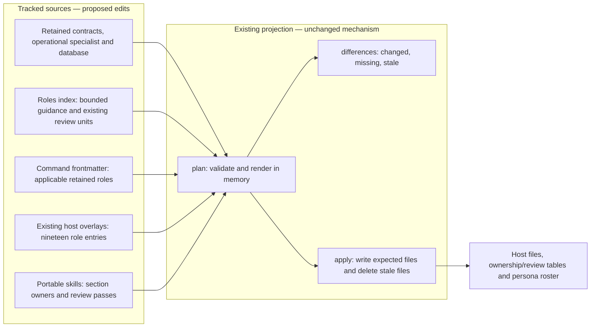
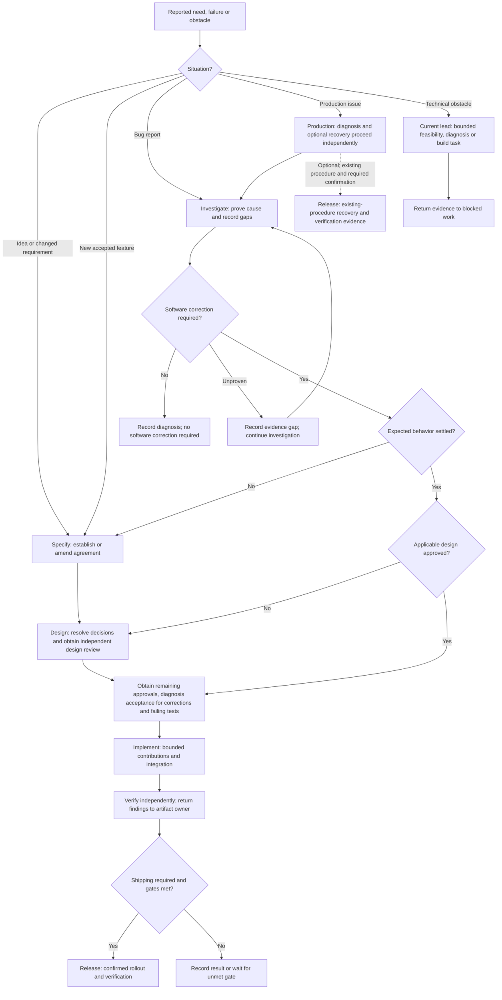
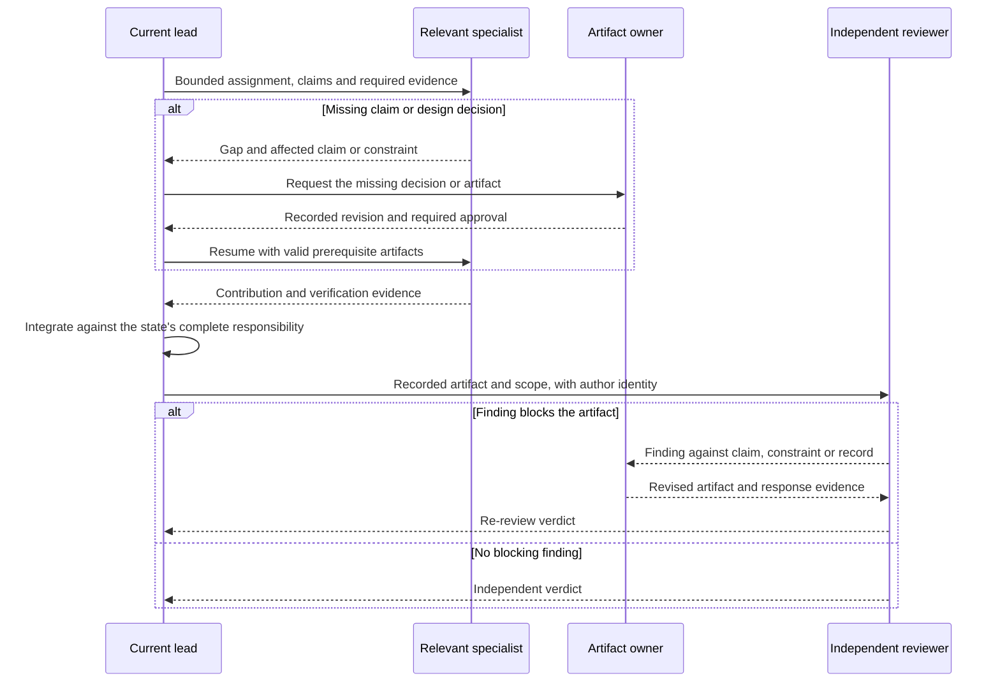

# Specification: Role contract

## 1. Business Goal

<!-- last written by: spec-author, 2026-10-16 -->

A consuming repository can identify who leads its work and which expertise the
specification requires, using host-free contracts it can adopt without editing;
this removes a peer-to-peer handoff graph whose overlapping roles obscure
accountability and turn specialties into unnecessary workflow stops. — Ruth

## 2. User Needs

<!-- last written by: spec-author, 2026-10-17 -->

| #   | Persona              | Need                                                           | Pain Point Today                                            |
| --- | -------------------- | -------------------------------------------------------------- | ----------------------------------------------------------- |
| 1   | Consuming repository | Adopt a role as-is and point it at a companion skill           | A role naming another project's paths must be rewritten     |
| 2   | Projection           | Read a fixed set of keys from every role                       | N/A (internal dependency on [0001-F1](../../scripts/.spec/README.md)) |
| 3   | Role author          | Know which keys a role may carry and which belong to a host    | Host knobs creep into role files and bind them to one host  |
| 4   | Person starting work | Identify the lead and relevant specialists for the situation | A global handoff graph makes every specialty look mandatory |
| 5   | Work lead | Integrate bounded contributions against the same claims | Peer handoffs leave nobody accountable for the complete result |
| 6   | Persistence maintainer | Obtain database expertise across the affected lifecycle | Persistence duties are scattered across general contracts |
| 7   | Consuming specification author | Name the specialist responsible for optional observability declarations | Operational signal requirements otherwise inherit an unrelated parent-section owner |

### Collaboration glossary

| Term | Meaning |
| --- | --- |
| State | The responsibility currently exercised; not an executable state machine or a required separate agent invocation. |
| Lead | The role accountable for the current state's complete artifact and integration of assigned contributions. |
| Specialist | A role assigned bounded work because affected claims, surfaces or evidence require its expertise. |
| Mode | A bounded way a retained role works, without creating a separate role or changing its permissions. |
| Artifact handoff | Passing the recorded agreement, design, failing test, change or finding that the receiving responsibility needs. |
| Boundary | A named seam or operation whose outcome an operational signal observes. |
| Signal | A declared log, span or metric associated with a boundary and a claim. |

### State leads

| State | Lead | Artifact or responsibility |
| --- | --- | --- |
| Specify | `spec-author` | Discovery followed by the decided agreement and scenarios |
| Design | `architect` | Technical design and readiness |
| Implement | `implementer` | Integration of production changes against the design and failing tests |
| Verify | `spec-reviewer` | Independent design or diff findings and verdicts, with relevant verification evidence |
| Release | `release` | Rollout, recovery and verification using the existing confirmation rules |
| Investigate | `bug-finder` | Reproduction, classification, evidence and proven cause |

### Specialist selection

| Specialist | Trigger | Bounded contribution |
| --- | --- | --- |
| `domain` | Business invariants, rules or domain concepts need modeling or change | Domain model and enforceable rules |
| `ux` | Interaction, accessibility, states or copy need deciding | Decided interaction before presentation implementation |
| `ui` | The decided interaction requires presentation changes | Presentation code under the implementation lead |
| `database` | Persistence design, implementation, failure investigation or rollout is affected | Stored data shape, keys, indexes, nullability, transactions, queries, migration/backfill, compatibility and recovery evidence |
| `test-writer` | Agreed behavior lacks a failing test or traceability needs amendment | Tests and coverage records within existing section ownership |
| `tester` | Changed behavior needs execution or exploration | Run evidence and reproductions |
| `adversary` | A boundary, credential, permission or external input is affected | Independent hostile surface findings |
| `benchmarker` | A recorded performance, cost or structural concern needs measurement | Benchmarks and measurements of that concern |
| `observability` | An operational decision needs instrumentation, baselines or telemetry comparison, or an existing optional observability subsection needs authoring | Signal requirements, operational evidence and the optional subsection contract below |
| `build` | A gate, build configuration, tool or pipeline needs work | Reproducible build and gate changes |
| `organizer` | Approved claims need work items or the queue needs maintenance | Decomposition and ranked work; no mandatory delivery stop |
| `document-writer` | Substantial prose is missing or stale | Documentation checked against the relevant artifact |
| `auditor` | A repository audit is requested, scheduled or required before release | Repository findings; no mandatory stop on every change |

### Optional observability subsection contract

A consuming specification may include `### Observability` under § 7;
`observability` owns only `7/Observability`, and its owner note and
`last written by` stamp name `observability`. Absence is valid; this repository
adds no mandatory local subsection or template change. Parent § 7 remains
architect-owned and § 8 Performance remains benchmarker-owned. — Ruth

The declaration has the ordered columns `Boundary | Signal | Level | Template | Fields | Claim`. — Ruth

| Column | Content |
| --- | --- |
| Boundary | The seam or operation observed |
| Signal | `log`, `span` or `metric` |
| Level | Severity for a log only; no severity for a span or metric |
| Template | Constant message template, span name or instrument name |
| Fields | Field names, without runtime values or payloads |
| Claim | The claim references the signal serves |

Where no relevant signal is required, the subsection states `None.` with a
reason. Each emitted boundary signal is declared and asserted in a test;
`observability` hands declarations, existing claim links and recorded approvals
to `test-writer` under B-044. This gives `observability` no authority to write
tests, production code, parent design, performance findings or review verdicts. — Ruth

### Retired roles and retained responsibilities

| Retired role | Destination | Retained responsibility |
| --- | --- | --- |
| `analyst` | `spec-author`, discovery mode | Identify requester, failure state, settled answers and material unknowns before writing a confirmed need as claims |
| `bug-fixer` | `implementer`, correction mode | Accepted diagnosis and a regression test failing for the proven cause precede the bounded fix; preserve regression, systemic-site and lesson duties |
| `yak-shaver` | Current lead with the relevant specialist | Remove the named obstruction, prove original work can resume and record adjacent work separately |
| `pair-programmer` | Collaboration mode available to every retained role | Visible steps, explanation, a stop at decision forks and a recorded decision; retain the active role's write boundaries |
| `log-parser` | `bug-finder`, log-analysis capability | Isolate the evidence window and correlation, reconstruct sequence, mark inference, protect secrets and report gaps; large evidence may be delegated as a bounded task |
| `critic` | Independent `spec-reviewer`, design-review mode | Review the design against claims, constraints and decisions before implementation; report findings without rewriting |

### Scenario routing

| Situation | Route | Conditional involvement |
| --- | --- | --- |
| Bug report | Investigate the existing claim → accepted diagnosis and failing regression test → Implement correction → Verify → Release when shipping is required | `spec-author` for missing/disputed expected behavior; `architect` for a design gap; specialists for the affected concern |
| New feature | Specify → Design → failing tests → Implement → Verify → Release | Only specialists whose trigger applies; `organizer` cuts work after agreement |
| Technical obstacle | Current lead retains parent work → bounded investigation or obstruction removal → resume original work | `architect` for an unknown approach; `bug-finder` for unexpected behavior; `build` for tooling or a gate |
| Pitched idea | Specify in discovery mode → agreement only when accepted | Bounded `architect` feasibility work if required to decide the idea; no speculative production implementation |
| Production issue | `bug-finder` diagnoses while `release` coordinates any recovery under an existing procedure → correction route only if software must change | Log analysis when logs exist; `observability` for operational evidence; other specialists for the affected concern |
| Changed shipped requirement | Amend the existing agreement → assess design, dependencies and compatibility → revised failing tests → Implement → Verify → Release | `database` for existing data or migration; `ux`/`domain` for changed interaction/rules; `observability` for rollout evaluation |

The tables define responsibility and artifact dependencies; the method skills
retain their gates and commands only convene the applicable roles. — Ruth

### Assumptions

| ID  | Assumption                                                                            |
| --- | ------------------------------------------------------------------------------------- |
| A-1 | The specification template's `##` headings are the authority on which sections exist. |
| A-2 | A consuming repository provides a companion skill that names its paths and commands.  |

### Behavior-preserving refactors

The implementation lead and affected implementation specialists use the
refactor evidence defined in `deliver-change` § Behavior-preserving refactors.
The test writer supplies characterization tests for identified gaps. Artifact
ownership, existing approvals and independent review remain in force;
[decision 0002](decisions/0002-refactors-use-existing-contract-evidence.md)
records the user's choice.

### Feature status synchronization

The work-item owner synchronizes a Feature's `status` from the single Feature
coordination record identified by the companion, following `sdd-conventions`
§ The spec / work-item split. Children retain independent delivery states;
numbered specification sections and `spec_status` retain their existing owners.
[Decision 0003](decisions/0003-feature-status-has-one-coordination-source.md)
records the user's source-selection choice.

## 3. Acceptance Criteria

<!-- last written by: spec-author, 2026-10-17 -->

| ID    | Claim                                                                                                                                                                     | Source                                                                         | Status |
| ----- | ------------------------------------------------------------------------------------------------------------------------------------------------------------------------- | ------------------------------------------------------------------------------ | ------ |
| B-001 | Given the role files, each declares `name`, a one-line `description`, a semver `version` and `owned_spec_sections`, and none carries a host key.                          | [ADR-0001](../../.spec/adr/0001-roles-are-host-free-and-hosts-are-overlays.md) | Withdrawn |
| B-002 | Given the roles and the unowned declarations in the roles index, every section of the specification template has exactly one owner.                                      | `sdd-conventions` § Section ownership                                          | Active |
| B-003 | Given a role body, it carries the headings Owns, Read first, Produce or Look for, and Refuse.                                                                              | Hooked role contracts                                                          | Active |
| B-004 | Given a role body, it names no product technology, library, repository path, package or build tool; the consuming repository's companion skill names those.               | Root README § Purpose                                                          | Active |
| B-005 | Given a role body carrying `## Look for`, it also carries `## Report`, so every reviewing role states the form its findings take. | OQ-1 | Active |
| B-006 | Given a role body linking `../skills/<name>/SKILL.md`, that skill exists in `skills/`; projection fails naming the role and the skill otherwise. | C-1 | Active |
| B-007 | Given a role declaring `persona`, it carries a one-line `name` and a one-line `voice`, and no other role declares the same persona name; the role name stays the file stem, the host agent name and every machine-read stamp. | Brief: personas | Withdrawn |
| B-008 | Given a role declaring `reviews`, each entry is a review unit and the body carries `## Look for` and `## Report`; projection fails naming the role otherwise. | `sdd-conventions` § Review passes | Active |
| B-009 | Given a review unit in the roles index, it declares what it reviews, when its pass runs and what the pass never does, and the registry shows all three; projection fails naming the unit and the missing key otherwise. | LTI review-pass registry | Active |
| B-010 | Given work exercising a state, this Feature assigns it the accountable lead in § 2 State leads. | User brief: lead-and-specialist grouping | Active |
| B-011 | Given a specialist assignment, this Feature requires a bounded contribution justified by an affected claim, surface or evidence under § 2 Specialist selection. | User brief: specialists do certain parts | Active |
| B-012 | Given a specialist contribution, this Feature keeps the current lead accountable for integrating it into the state's complete artifact. | User brief: implementer collaboration | Active |
| B-013 | Given an assignment by a lead, this Feature preserves the assigned role's existing artifact and specification-section write boundaries. | B-002; user brief: spec drives the software | Active |
| B-014 | Given work whose earlier required artifacts and approvals remain valid for its affected claims, this Feature starts at the earliest unmet responsibility. | User brief: small changes need no repeated discovery | Active |
| B-015 | Given an undecided need, this Feature assigns discovery to `spec-author` in the mode replacing `analyst` in § 2. | User brief: fold redundant roles; § 2 retirement mapping | Active |
| B-016 | Given a software correction, this Feature assigns it to `implementer` in the mode replacing `bug-fixer` in § 2. | User brief: fold redundant roles; § 2 retirement mapping | Active |
| B-017 | Given an incidental obstruction, this Feature assigns bounded removal to the current lead with relevant expertise in place of `yak-shaver`. | User brief: fold redundant roles; § 2 retirement mapping | Active |
| B-018 | Given a request for work alongside the person, this Feature offers the § 2 collaboration mode within the active role in place of `pair-programmer`. | User brief: fold redundant roles; § 2 retirement mapping | Active |
| B-019 | Given logs relevant to an investigation, this Feature assigns the § 2 log-analysis capability to `bug-finder` in place of `log-parser`. | User brief: fold redundant roles; § 2 retirement mapping | Active |
| B-020 | Given a design ready for review, this Feature assigns the design-review mode replacing `critic` to a `spec-reviewer` instance that did not author that design. | User brief: fold redundant roles; § 2 retirement mapping | Active |
| B-021 | Given a persistence concern, this Feature assigns `database` the bounded expertise in § 2 Specialist selection at the affected state. | User brief: add a database specialist | Active |
| B-022 | Given database work, this Feature constrains its storage decisions to the agreed domain invariants and architect-owned design. | User brief: database specialist; B-002 | Active |
| B-023 | Given a database migration or backfill, this Feature requires the database contribution to include compatibility and rollback or recovery verification. | User brief: database specialist; retained implementer/release migration duties | Active |
| B-024 | Given a measurement request, this Feature selects `benchmarker` or `observability` by their distinct § 2 triggers. | User brief: retain performance and observability distinction | Active |
| B-025 | Given required production instrumentation, this Feature assigns its code to the implementation lead or relevant implementation specialist. | User brief: specialists within implementation; existing benchmarker code boundary | Active |
| B-026 | Given a bug report, this Feature follows the § 2 bug route against existing claimed behavior. | User brief: bug comes in | Active |
| B-027 | Given an accepted new feature, this Feature follows the § 2 feature route with the stated artifact dependencies. | User brief: new feature starts | Active |
| B-028 | Given a technical obstacle, this Feature follows the § 2 obstacle route according to the kind of uncertainty. | User brief: technical problem | Active |
| B-029 | Given a pitched idea, this Feature follows the § 2 idea route without production implementation before acceptance. | User brief: new idea pitched | Active |
| B-030 | Given a production issue, this Feature follows the § 2 production route according to whether recovery or a software correction is required. | User brief: issue in production | Active |
| B-031 | Given unavailable incident telemetry, this Feature records the missing evidence as a gap without treating it as a proven cause. | User brief: production diagnosis depends on available observability | Active |
| B-032 | Given changed shipped requirements, this Feature follows the § 2 amendment route while retaining permanent claim anchors. | User brief: requirements change in production; spec-and-traceability | Active |
| B-033 | Given the resulting role roster, this Feature exposes exactly the six leads and thirteen specialists listed in § 2 as standalone roles. | User brief: consolidate six and add database | Active |
| B-034 | Given the consolidated roster, this Feature makes active role, command, host and projected references resolve to retained roles and their applicable modes. | User brief: functional roles; 0001-F1 B-008/B-009; 0001-F3 B-003 | Active |
| B-035 | Given historical records affected by role retirement, this Feature preserves their recorded identities and evidence. | spec-and-traceability § Claims and traceability / Records beside a specification | Active |
| B-036 | Given the roles index handoff guidance, this Feature presents bounded state, specialist and scenario guidance in place of the global all-role graph. | User brief: handoffs too complicated | Active |
| B-037 | Given a consuming specification with the optional § 7 Observability subsection, this Feature assigns that subsection's ownership and author stamp to `observability` without requiring its presence. | User amendment: optional observability ownership, 2026-10-16 | Active |
| B-038 | Given an observability contribution, this Feature requires the portable declarations and write boundaries in § 2 Optional observability subsection contract. | User amendment: boundary-signal declarations, 2026-10-16 | Active |
| B-039 | Given migration from `metric-nerd` to `observability`, this Feature replaces the active role identity within the nineteen-role roster while preserving historical identities and evidence. | User amendment: rename the actual role, 2026-10-16; B-035 | Active |
| B-040 | Given a role declaring `persona`, it requires a nonblank single-line `voice` and permits an omitted `name`; a supplied name is nonblank, single-line and unique across roles, while role identifiers and machine-read stamps retain the role name. | Owner request: optional persona names | Active |
| B-041 | Given a source role, it declares name, nonblank description, numeric version and owned_spec_sections; optional schema metadata and host fields are accepted, and rendered settings remain overlay-owned. | Owner examples; ADR-0009 | Active |
| B-042 | Given a behavior-preserving refactor, this Feature assigns implementation against preserved constraints and adequate passing tests, with characterization tests added for gaps before production changes instead of requiring a new claim or failing test. | User decision 0002, 2026-10-17 | Active |
| B-043 | Given a Feature specification's mirrored delivery status, this Feature assigns its synchronization to the work-item owner using only the explicitly identified Feature coordination item as the source. | User decision 0003, 2026-10-17 | Active |
| B-044 | Given an existing claim, test assertions may use approved constraints, technical design and signal declarations traceable to it, citing their source and approval without introducing new user-visible behavior. | User decision 0004, 2026-10-17 | Active |
| B-045 | Given interrupted taken work, its recorded owner may resume while another owner requires an explicit release or authorized reassignment, with no transfer inferred from elapsed time. | User decision 0005, 2026-10-17 | Active |
| B-046 | Given a newly allocated ID, it becomes permanent on merge or citation outside its authoring branch, and only an unpublished ID may change with all local references updated. | User decision 0006, 2026-10-17 | Active |
| B-047 | Given a substantive agreement or design edit, approval of the changed scope requires review against its new revision while applicable approval for unchanged scope carries forward with its evidence. | User decision 0007, 2026-10-17 | Active |

## 4. Constraints

<!-- last written by: spec-author, 2026-10-16 -->

| ID  | Constraint                                                                        | Rules Out                                                             |
| --- | --------------------------------------------------------------------------------- | --------------------------------------------------------------------- |
| C-1 | A role names skills by relative link to `skills/<name>/SKILL.md` and nothing else. | A link into a host directory, an absolute path, a URL to another repo |
| C-2 | A role's `name` equals its file stem.                                              | A display name that differs from the file, an alias                   |
| C-3 | Ownership is declared on the role, never in a skill.                              | A hand-kept ownership table; a skill naming a role                    |
| C-4 | Grouping preserves existing approval, test-first, traceability and independent-review requirements. | Skipping a required gate because one lead coordinates several specialties |
| C-5 | State, specialist and mode guidance introduces no required agent invocation per responsibility. | Treating every specialist as a mandatory workflow stop or separate process |
| C-6 | Commands convene roles within 0001-F3 C-1 and C-2. | Embedding transitions, gates or next-state tables in command bodies |

## 5. Out of Scope

<!-- last written by: spec-author, 2026-10-16 -->

| #   | Item                                              | Exclusion Reason                                                        |
| --- | ------------------------------------------------- | ----------------------------------------------------------------------- |
| 1   | Rendering a role for a host                       | [0001-F1 Projection](../../scripts/.spec/README.md)                     |
| 2   | A role per technology or platform                 | A technology belongs in the consuming repository's companion skill (B-004) |
| 3   | Persona traits beyond a name and a voice          | A name and one line of voice are what a reader acts on; a trait list is restated prose |
| 4   | A role-level declaration of how scenarios execute, or an opt-out into documentation-only scenarios | How the runner executes scenarios is the companion's § "Testing"; a scenario alone is not coverage either way |
| 5   | Database engines, persistence frameworks and engine-specific tooling | Replaces the database-role exclusion on 2026-10-16: host-free database expertise is included by B-021; engine knowledge remains the companion's (B-004) |
| 6   | An executable workflow engine or new role frontmatter schema | Responsibility grouping uses existing contracts and review declarations; no runtime state machine is requested |
| 7   | Unrelated role renames or changes to section ownership | The accepted scope retires the six § 2 roles, adds `database` and explicitly renames `metric-nerd` to `observability` with optional `7/Observability` ownership; all other artifact boundaries remain |
| 8   | Mandatory local observability subsections, template changes or new subsection runtime/schema | Consumers may supply the optional subsection using existing ownership support; no local `.specht` edit or executable signal validator is requested |

## 6. Concern Separation

<!-- last written by: architect, 2026-10-16 -->

| #   | Concern                                           | Classification |
| --- | ------------------------------------------------- | -------------- |
| 1   | Which frontmatter keys a role carries             | Business       |
| 2   | Which body headings a role carries                | Business       |
| 3   | Keeping product technology out of a role body     | Business       |
| 4   | Validating the keys                               | Technical      |
| 5   | The name a role signs its prose with              | Business       |
| 6   | Which unit of work a role reviews                 | Business       |
| 7   | Accountable leads, conditional expertise and retained modes | Business |
| 8   | Database contribution boundaries and recovery evidence | Business |
| 9   | Artifact prerequisites and independent review | Business |
| 10  | Contract, command and overlay reference migration | Technical |
| 11  | Deterministic generation and stale-output removal | Technical |
| 12  | Separating contract checks from evidence of role behavior | Both |
| 13  | Optional signal declarations, subsection ownership and active role identity | Both |

Lead accountability integrates contributions; it grants no additional write
authority. The existing section owners and review units remain the boundaries.
The database specialist supplies persistence expertise within those boundaries,
without owning a specification section. — Marcus

## 7. Technical Design

<!-- last written by: architect, 2026-10-16 -->

A role file is Markdown with YAML frontmatter. The portable keys and structure
are declared by [the agent schema](../../schemas/agent.schema.json); repository
version, ownership and name checks additionally live in `loadRole` in
[`Projection.fsx`](../../scripts/Projection.fsx).

| Key                   | Form                                                      |
| --------------------- | --------------------------------------------------------- |
| `name`                | equals the file stem                                      |
| `description`         | nonblank host trigger text; folded or literal multiline YAML is permitted |
| `version`             | semver, bumped when the contract changes                  |
| `owned_spec_sections` | list of `"<n>"`, `"Tasks"`, `"Scoring"` or `"<n>/<Subsection>"`; empty is valid |
| `persona`             | optional; required one-line `voice`, optional nonblank one-line `name`; supplied names unique across roles |
| `reviews`             | optional list of review units from the roles index; a reviewing body follows |

A persona declares the voice of reports, findings and review notes, and may
optionally name their signer. Projection puts a voice line ahead of the body
for unnamed personas, preserves the signing line for named personas, and lists
every persona in [`PERSONAS.md`](../PERSONAS.md). A stamp a tool reads —
`last written by`, `author`, the § 12 Reviewer column — keeps the role name, so
no tool has to map a persona back to a role.

The review units — design, diff, surface, repository — are declared once, in
the same frontmatter under `review_units`, in the order their passes run, each
with what it reviews, when its pass runs and what the pass never does (B-009). A
role
declaring `reviews` carries the reviewing headings (B-008); which role reviews
which unit is generated into
[`sdd-conventions` § Review passes](../../skills/sdd-conventions/SKILL.md#review-passes).

Sections no single role owns are declared once, in the frontmatter of
[`README.md`](../README.md) under `unowned_spec_sections`, and merged with the
roles' claims before the totality check.

The body is free Markdown under four headings in this order: `## Owns`,
`## Read first`, `## Produce` (or `## Look for` followed by `## Report` for a
reviewing role), and `## Refuse`. A role may add a heading, such as `## Escalate`. Links to skills are relative, `../skills/<name>/SKILL.md`, so that
the same bytes resolve from `agents/` and from a host's agents directory one
level below the root.

Baseline readiness: **Ready for tests and implementation for B-001–B-009.**
The design above remains the recorded role-format design.

### DR-1 — Collaboration stays in contracts and artifacts

For B-010–B-014 and B-026–B-036, revise the existing Markdown contracts and
indexes; reuse the loaders, renderers and validation plan in
[`Projection.fsx`](../../scripts/Projection.fsx). No workflow runtime, new
frontmatter key or central list of role names is needed. This follows
[decision 0001](decisions/0001-lead-and-specialist-collaboration.md) and accepted
[ADR-0008](../../.spec/adr/0008-a-role-file-declares-its-contract-and-no-host-setting.md).
The incumbent representation already supports empty section ownership and
multiple review units per role. A new hierarchy or machine-readable state
registry would duplicate the agreement without enforcing agent behavior.

The initial consolidation baseline was main `785de62`: twenty role contracts.
Commit `5924065` already folded correction into `implementer`, log analysis
into `bug-finder` and design review into `spec-reviewer`; preserve those duties
and verify their agreement boundaries. It also folded operational comparison
into `benchmarker`. The later user agreement requires that expertise to remain
distinct, so this amendment restores `metric-nerd`, adds `database` and retires
the remaining `analyst`, `pair-programmer` and `yak-shaver`: twenty minus three
plus two equals nineteen. The original twenty-four-role roster and its six
retirement mappings remain historical context, not the current migration input.
DR-1–DR-5 retain that initial migration's provenance and former operational-role
name. DR-6 governs the subsequent nineteen-to-nineteen rename and optional
subsection ownership; its active paths supersede the earlier migration paths.

[`agents/README.md`](../README.md) becomes the operational entry point: state
leads, conditional specialist triggers, retained modes and six short situation
routes replace its global peer graph. Keep its existing `review_units` and
`unowned_spec_sections` declarations. Its guidance links the authoritative
workflow, ownership and review rules in `sdd-conventions`; it does not reproduce
the gates. Root [`README.md`](../../README.md) updates its role count, role and
command summaries and links to this entry point. § 2 records the agreed change;
it is not a second active roster for future additions to maintain.

Each lead contract states its accountable artifact, bounded-assignment inputs
(affected claims, concern, allowed files/artifacts and completion evidence),
integration duty and escalation to the existing artifact owner. Relevant
specialist contracts state their trigger, contribution and limits. Use existing
report/finding locations named by the companion; introduce no assignment schema
or additional tracking artifact. If a contribution exposes a missing claim or
design decision, the lead obtains that owner's revision before dependent work
continues. Rendering an unchanged model does not require domain modeling;
telemetry alone does not require benchmarking (B-011, B-024).

The diagram shows existing projection components and the proposed source edits
(DR-1, B-033–B-034, C-3, C-6).

### DR-2 — Retire identities after transferring their duties

For B-015–B-020 and B-033–B-035, transfer the remaining three roles' duties
before removing their source files and overlay entries; do not recreate the
three already-retired roles. Preserve retained personas and machine-read
role stamps; retired personas disappear only from the generated active roster.
Bump the minor version of each changed role contract; start the new database
contract at `0.1.0`. Modes remain prose within existing headings, with no
independent persona, host setting or alias.

| Source destination | Baseline and required integration |
| --- | --- |
| [`spec-author.md`](../spec-author.md) | Remaining transfer: absorb `analyst.md` discovery inputs, settled-answer search, separating questions and confirmed-need artifact. Discovery cannot invent claims; agreement authoring follows confirmation. Its description covers both activities. |
| [`implementer.md`](../implementer.md) | Correction already folded from bug-fixer: preserve minimal cause-bounded correction, regression/systemic-site checks and gap lessons. Verify explicit accepted diagnosis and the regression test observed failing for that cause; retain separate investigation and test ownership. |
| [`bug-finder.md`](../bug-finder.md) | Log analysis and correction handoff to implementer already landed: preserve window, correlation, first anomaly, ordered evidence, inference, secret protection and gap reporting. Complete the bounded large-evidence assignment and missing-telemetry guidance; an unsupported cause remains unproven. |
| [`spec-reviewer.md`](../spec-reviewer.md) | Design review already folded from critic: preserve complexity, reuse, failure-path, diagram and testability checks. Verify design findings remain separate from diff verdicts and read-only behavior remains intact. |
| All retained contracts | Remaining mode integration: link the portable collaboration procedure below; visible steps and recorded decisions grant no authority to write another artifact. |
| All six lead contracts | Remaining obstruction integration: retain parent ownership, request relevant expertise, require proof the blocked work resumes and return adjacent work for separate tracking. |

Put the shared collaboration-mode procedure once in the non-generated prose of
[`coding-conventions`](../../skills/coding-conventions/SKILL.md): show the next
step and its result, stop at a decision fork with options and a recommendation,
record the person's decision in the companion's working record, and retain the
active responsibility's write boundary. It names no role or persona. This
replaces `pair-programmer.md` without copying its procedure into nineteen files.
Bounded obstruction guidance replaces `yak-shaver.md`; it does not authorize
an investigator or reviewer to make production changes. That work goes to the
appropriate implementation assignment.

Preserve `spec-reviewer`'s existing `reviews: [design, diff]`; `critic.md`
is already removed. Keep the four review units and their order unchanged.
[`reviewRows`](../../scripts/Projection.fsx) requires one role per unit, not one
unit per role, so no projector change is needed. Preserve the roles index's
updated multiple-unit wording. A design-review instance must not have authored
the design; diff review likewise remains independent of its subject. Record
the reviewing instance and authored scope in the review evidence. Combining
contracts never permits self-review; projector totality proves assignment of
units, not instance independence (B-020, C-4).

### DR-3 — Database expertise follows existing ownership

For B-021–B-025, add `agents/database.md` as a host-free specialist with
`owned_spec_sections: []`, the standard headings and a unique optional persona
under B-007. Its description covers persistence design advice, implementation,
investigation and release compatibility/recovery. No database engine, framework
or consuming-project path belongs in the contract; the companion supplies them.

| Boundary | Database contribution and handoff |
| --- | --- |
| Design | Supply schema/column types, nullability/defaults, keys, uniqueness/indexes, foreign-key actions, query access paths, transaction/concurrency boundaries and ordered migration advice. `architect` records the design; unresolved storage choices return there. |
| Domain | Storage follows agreed invariants and their domain model; `domain` retains rule modeling. An unsettled business rule returns to `spec-author`; storage convenience cannot redefine it. |
| Implement | Change only assigned persistence code, queries, migrations or backfills against the approved design and failing tests. `implementer` integrates the result with other layers. `test-writer` retains tests and traceability. |
| Investigate | Supply stored-data/query/transaction evidence to `bug-finder`; distinguish read-only diagnosis from a corrective write. No speculative repair or unredacted sensitive data in the evidence. |
| Release | Supply compatibility evidence for affected serving versions, verified rollback or recovery, and backup/potential-loss information for destructive changes. `release` retains deployment and recovery coordination and existing confirmation requirements. |

Update [`domain.md`](../domain.md), [`architect.md`](../architect.md),
[`implementer.md`](../implementer.md), [`bug-finder.md`](../bug-finder.md) and
[`release.md`](../release.md) to name these interfaces without moving their
ownership. A migration contribution is incomplete until its intent, rollout
order, compatible versions and recovery evidence are supplied; if reversal
cannot recover the information, explicitly require the agreed backup/restore
path and potential loss assessment before release. Keep migrations as history.
This contract does not introduce a database or prescribe an application's
schema; each affected Feature must settle those details in its own design.

The initial consolidation restored `agents/metric-nerd.md` from its historical
`ea553e9:agents/metric-nerd.md` contract, retaining persona Tess and empty section
ownership; advance its historical `0.2.0` version to `0.3.0` for the clarified
boundary. Its trigger is an operational decision requiring signal requirements,
baselines, trends or comparison. Missing telemetry remains an evidence gap.
It supplies instrumentation requirements and routes production instrumentation
code to `implementer` or the assigned implementation specialist.

Separate those operational duties from the current
[`benchmarker.md`](../benchmarker.md): remove the broad operational-decision
trigger, comparison/instrumentation procedure and corresponding rollout
handoffs transferred by `5924065`. Preserve its written performance, cost or
structural concern trigger, baseline comparisons within such a benchmark,
measurement ownership, `8/Performance` ownership and prohibition on production
behavior. This preserves all agreed duties without leaving two owners for
operational comparison. Neither instrumentation nor telemetry availability
implies a performance benchmark.

### DR-4 — Route from artifact gaps, not a mandatory chain of agents

For B-014 and B-026–B-032, the roles index's six situation routes reference
the § 2 agreement and the existing method gates. A bug uses its existing claim
and applicable approved design; a disputed behavior returns to Specify and a
design gap to Design. Tests still fail before corrections start, and the person
still accepts the diagnosis. A new feature starts at the agreement. An idea
stays in discovery until accepted; bounded feasibility returns evidence there.
A technical obstacle returns its finding to the lead of the blocked work.
Production diagnosis and operational recovery may proceed together, under
their separate leads, without treating recovery as evidence for a code fix.
A shipped amendment preserves withdrawn IDs and obtains replacement claims,
compatibility assessment and revised failing tests before implementation.

This responsibility-selection view is guidance, not a runtime algorithm
(DR-4, B-014, B-026–B-032, C-4–C-5).

The next view makes the missing-input and review-failure paths explicit;
participants describe responsibilities, not additional roles or mandatory
agent invocations (DR-1, DR-2, B-011–B-014, B-020, C-4–C-5).

### DR-5 — Migrate sources together and regenerate outputs

For B-033–B-036, implement the consolidation as one coherent source-and-output
change after the failing checks are recorded. The exact active surfaces are:

| Surface | Migration |
| --- | --- |
| `agents/*.md` | Revise retained contracts and specialist boundaries; restore `metric-nerd.md`; add `database.md`; remove the remaining `analyst.md`, `yak-shaver.md`, `pair-programmer.md` after duty transfer. Preserve already-landed correction/log-analysis/design-review folds and absence of their old files; remove any stale active links or handoffs. |
| `agents/README.md`, root `README.md` | Replace the remaining peer graph and twenty-role/count wording with six leads and thirteen specialists; restore operational metric-nerd participation and update command/discovery summaries. Keep one active grouping authority in the roles index. |
| `commands/spec.md`, `design-ui.md` | Replace analyst participation with `spec-author` discovery mode; deduplicate the role in `spec`. |
| `commands/design.md` | Preserve existing spec-reviewer design review; add conditional database design advice. Retain conditional domain, testability and written-cost benchmarking contributions. |
| `commands/bug.md` | Preserve existing bug-finder/test-writer/implementer list and integrated log/correction duties; add conditional database expertise for persistence failures. |
| `commands/implement.md` | Add conditional database implementation. Implementer coordinates applicable contributions; no database assignment for unrelated changes. |
| `commands/ship.md` | Replace benchmarker participation for operational rollout comparison with restored metric-nerd; update the body to operational evidence. Add conditional database compatibility/recovery participation. Written-cost benchmarks remain conditionally selected when their own trigger applies. Other command lists remain unchanged unless a stale reference is found. |
| `hosts/claude.yaml`, `hosts/codex.yaml` | Remove remaining analyst/pair-programmer/yak-shaver mappings; add database and restored metric-nerd. Preserve retained model/effort settings, existing spec-reviewer preloads/read-only tools and absent retired mappings. Database uses domain's judgment profile: Claude `opus`/`high`, unrestricted tools for assigned writes, preloads `sdd-conventions`, `coding-conventions`, `clarify-requirements`; Codex existing default model with `high` effort. Restore metric-nerd's historical default profile: Claude `skills: [sdd-conventions]` inheriting `sonnet`/`medium`; Codex empty override inheriting its defaults. |
| `skills/coding-conventions/SKILL.md`, other active skill prose | Add the portable collaboration rule. Search outside generated markers for retired names/personas or role links and replace any with section-owner/review-pass language. Do not add role-name aliases to the linter. |
| `scripts/project.tests.fsx` | Test writer revises the existing twenty-role expectation to nineteen, verifies restored operational/performance separation and preserves the already-updated design/diff reviewer expectation and all baseline checks. Add amendment coverage through existing fixture/library seams; no production projector change is planned. |

Commands name roles and skills in frontmatter only; their bodies describe
conditional contributions and modes using existing responsibility labels.
They must not gain stage tables, transition logic or new gates
([0001-F3 C-1/C-2](../../commands/.spec/README.md#4-constraints)). Skills remain
role-free outside generated blocks
([0001-F4](../../skills/.spec/README.md)); the current `lintSkills` derives names
from the live roster, so removing a role would also remove its detection pattern.
An explicit retirement search is therefore necessary even when lint passes.

Run the projector to regenerate `.claude/agents/`, `.codex/agents/`, affected
`.claude/commands/`, `.agents/skills/` and `.claude/skills/`, the generated review
registry/ownership block and `agents/PERSONAS.md`. Existing `differences` detects
the three remaining retired agent files per host as stale; existing `apply`
removes them. Database and restored metric-nerd host files are new planned
outputs. Ownership rows, the existing spec-reviewer assignment for design/diff,
and the four review units' order must remain identical. Regeneration restores
Tess to the active persona roster and removes only the remaining retirees.
Verify already-retired host files stay absent. Never hand-edit generated files.

Search all tracked files for the six retired names/personas, old twenty- and
twenty-four-role counts, merged measurement wording and reviewer assumptions.
Classify each hit: migrate active
guidance, regenerate generated content, and preserve historical decisions,
sign-offs, lesson evidence and claim Source citations (B-035). A historical
link to a retired path can remain evidence; an active convening link cannot.
The § 2 retirement mapping and decision 0001 intentionally retain the old names.
Current sibling-spec descriptions of roster size or reviewer assignment are
findings for their section owners; coordinate those edits rather than silently
rewriting historical measurements or another owner's section.

`plan` validates all source inputs before any output write. A dangling host mapping,
retired command reference, duplicate/missing review-unit holder or ownership
violation must stop projection without producing new output.
An omitted per-role host mapping remains valid through existing host defaults;
the real-roster check verifies the explicit nineteen-entry overlays planned here.
Filesystem writes in `apply` are sequential, not a multi-file transaction:
interruption can leave mixed outputs. Fix the source error or rerun projection from the same reviewed
sources, then run `--check`; never treat a partial run as a deliverable. Revert
the coherent source/output commit and regenerate to roll back this migration.
Do not restore an individual retired output by hand. Existing consumers pinned
to old refs keep those files; this repository does not uninstall files in a
consumer or promise host-session reload (0001-F1 § 5). — Marcus

### DR-6 — Optional signal ownership and operational-role rename

For B-037–B-039, rename the existing source to `agents/observability.md`, with
`name: observability`, version `0.4.0` and
`owned_spec_sections: ["7/Observability"]`. Preserve Tess's persona, operational signal requirements,
baseline/trend/comparison duties, missing-evidence reporting and production-code
boundary. The roster remains nineteen roles; the old identity becomes history,
not an alias or a second contract. This is the user-agreed amendment in § 2;
it adds no runtime, schema, technology decision or imported consumer ADR.

Reuse `ownershipRows` and `validateStamps` from
[`Projection.fsx`](../../scripts/Projection.fsx) unchanged. Existing subsection
support validates the parent `7`, generates the nested ownership row and does
not require the subsection in a template or specification. When a consumer
provides exactly `### Observability` under § 7, its owner note and author stamp
name `observability`; a present architect stamp there is rejected. Without the
subsection there is nothing to author or validate for it. Unrelated § 7
subheadings retain the architect parent, and `8/Performance` retains its current
owner. This amendment creates no local `### Observability` subsection and
changes no `.specht` template or manifest.

The role authors the portable subsection declaration in the § 2 column order:
`Boundary | Signal | Level | Template | Fields | Claim`. Each row identifies
the observed boundary, one `log`/`span`/`metric`, its constant message template,
span name or instrument name, field names without runtime values or payloads,
and the claims served. Only log rows declare a severity; span/metric Level
cells are empty. If no relevant signal is required, write `None.` with its
reason. Do not invent a logging-level taxonomy, serializer or executable
signal-table validator. Independent review checks these content requirements;
ownership/stamp checks establish authorship boundaries, not signal correctness.
Production instrumentation and its tests remain with their implementation and
test owners. Observability hands the declared emitted boundary-signal contract
to test-writer so those signals are asserted in the affected tests; it writes
neither the tests nor production instrumentation. Parent design questions return
to architect, performance findings
to benchmarker, and review verdicts remain independently owned.

Rename active index rows, links and handoffs in `agents/README.md`, root
`README.md` and retained role bodies, including `architect.md`'s optional
subsection boundary. Replace the old mappings in both host overlays without
changing their profiles: Claude inherits `sonnet`/`medium` with
`skills: [sdd-conventions]`; Codex keeps its empty override and inherited model
and `medium` effort. In `commands/design.md`, add observability to frontmatter
and conditionally convene the signal owner when the optional subsection exists;
absence does not force creating it or invoking an agent. In `commands/ship.md`,
rename the operational contributor. Command bodies retain responsibility labels
and acquire no transitions or gates.

Regenerate both host agent files, affected commands/skills, the persona roster
and ownership table. The table gains only the optional `7/Observability` row;
do not hand-edit its generated block or add role names to portable skill prose.
The generated Claude/Codex observability files replace the two metric-nerd
files: `differences` reports old files stale and new files missing, check mode
writes nothing, and `apply` removes/writes them. A stale host or command binding
to the old identity fails planning before writes. Preserve historical decisions,
reviews, source citations and the initial migration's identity/provenance.
Rollback reverts the coherent source/output change and regenerates; partial
generation uses DR-5's rerun-and-check recovery.

Verification uses the existing temporary-checkout seams. For B-037, exercise
absence, correctly stamped presence, an architect-stamped subsection rejected
with the actual owner named, and unrelated headings returning to parent
ownership while Performance stays unchanged. Extend the B-034 owner assertion
to preserve every prior owner plus the one new nested row; do not replace it
with a count or weaker subset check. Update the specialist/profile expectation
for database's empty ownership versus observability's single nested ownership.
For B-039, exercise a nineteen-to-nineteen rename, two stale/two missing host
files, no-write drift checking, successful apply/recheck, invalid old bindings
and byte-preserved historical evidence. For B-038, assess source instructions
and synthetic declarations against the tagged positive/negative cases without
claiming that projector success proves actual instrumentation or agent
compliance. No new diagrams or compiling stubs apply: the change uses existing
declarations and generation/stamp seams, with no new runtime interface or
application data model. — Marcus

### Verification boundary and readiness

Contract and projection checks can establish the nineteen-role set, host
coverage, preserved prior section owners plus DR-6's optional nested row, complete review-unit assignment,
conditional contract wording, resolvable command references, byte-preserved
contract projection and stale-file removal. Use existing synthetic checkout
fixtures, `loadRoles`, `reviewRows`, `plan`, `differences` and `apply` in
[`project.tests.fsx`](../../scripts/project.tests.fsx); include a fixture where
one role reviews both design and diff and retirement leaves stale host files.
These checks prove the shipped instructions and migration mechanism, not that
an arbitrary agent will follow them. Avoid a test that merely searches for one
word and reports the full behavioral scenario as executed.

For the six situation routes and refusal/ownership boundaries, retain the
tagged positive and negative scenarios as review cases. Testability review
must identify which artifact checks are executable and which require recorded
independent evidence against the actual assignments, contributions, approvals
and findings. An independent walkthrough can verify routing from supplied
artifacts and rejection of missing prerequisites; it is not live-agent
behavior coverage. No model API call, prompt simulator or new runtime harness
is part of this design. § 8 and § 9 remain the test writer's authority; do not
promote a row to `Covered` from contract presence alone. Unverified behavior
remains honestly `Missing` or `Partial` under the existing traceability rules;
any shipping waiver requires the existing § 11 approval record. ADR-0006 still
blocks delivery of a claim whose row is `Missing`, without blocking agreement
or this design handoff.

Run `dotnet specht --strict`, `dotnet fsi scripts/project.tests.fsx`, projection,
then `dotnet fsi scripts/project.fsx --check`. Independently inspect the diff
and classified retirement search, including both host files for database and
spec-reviewer. Review evidence must distinguish the design author's identity
from the reviewing instance and preserve the earlier scoped baseline evidence.

Performance reasoning: the workload remains one small checkout processed
offline. Retiring three roles, restoring metric-nerd and adding database reduces
role-rendering work from twenty to nineteen. Validation/rendering still scales
with source bytes and output count using the existing plan. This is a cost model, not a measured
latency claim, and introduces no target or infrastructure cost. No application
domain model or performance workload is present, so domain implementation and
benchmark measurement are not required for this contract change. If later
evidence identifies a written cost concern, route that measurement to
`benchmarker` rather than inventing a benchmark here.

Views not applicable: no database entity/column view because this change adds
expertise, not persisted application data; no class view or compiling stubs
because it declares no new runtime interface; no state-machine view because
the responsibility states are guidance, not executable lifecycle state.
The source/projection component, routing and collaboration sequence views
above cover the applicable boundaries and failure paths.

Amendment readiness: **Ready for tests and implementation for B-010–B-036**
within the source/projection and evidence boundaries above. On 2026-10-16,
testability review found the source/projection approach ready and retained
unverified behavioral coverage as `Missing`; see § 8 Collaboration amendment.
Independent design critique of the preceding design returned Ready after the
B-030 recovery-path finding was resolved and re-reviewed. Those reviews remain
evidence for that scope. Refreshed testability and independent design/diff
review approved the reconciliation against main `785de62`, including restored
operational expertise and the twenty-to-nineteen migration, within the
source/projection scope. Behavioral evidence remains pending and ADR-0006's
delivery gate remains intact. All three Mermaid views rendered and were
visually inspected. No material decision or blocking OQ remains; the six
retirements, database boundary and nineteen-role shape are already agreed.
These amendment reviews do not reassess or replace the B-001–B-009 baseline
readiness and evidence recorded above.

Observability amendment readiness: **Ready for tests and implementation for
B-037–B-039** within DR-6's source/projection and evidence boundaries, pending
the existing testability and independent design-review passes. No blocking
decision remains; the rename, optional ownership and signal-table shape are
agreed. Risk **2 (medium)**: stale active identities and overly broad ownership
assertions are the main failure paths; exact prior-plus-nested owner checks,
rename lifecycle tests and independent content review address them. Earlier
scoped review evidence remains unchanged. — Marcus

Design risk: **2 (medium)** for this collaboration-design scope: the mechanism
is reused, but active-reference retirement spans contracts, commands, overlays
and generated files, and combining review identities could obscure instance
independence. Coherent regeneration, ownership checks, the classified search
and independent review evidence address those risks. This verdict does not
change § 12 sign-off or assert that the amendment is implemented. — Marcus

### Portable frontmatter amendment

ADR-0009 supersedes the baseline key restriction. The schemas own optional
metadata and host fields, permit multiline descriptions, and expose portable
frontmatter independently of this repository's version/ownership requirements.
Host overlays remain authoritative. Earlier design and review evidence is
historical; B-041 governs the amended source contract.

## 8. Testing Strategy

<!-- last written by: test-writer, 2026-10-16 -->

B-001 to B-003 run against the real checkout inside
`dotnet fsi scripts/project.tests.fsx`, in the group prefixed `F2_`, so a role
edit that breaks the contract fails the same command CI runs. The baseline
scenarios for B-001–B-009 in [`roles.feature`](roles.feature) are checked by
the cited tests, with B-004 assessed manually as described below.

- B-041: `loadRoles` over the real checkout verifies repository keys; projection
  tests verify portable metadata, optional host fields, folded/literal descriptions
  and unchanged overlay authority under ADR-0009. B-001 is withdrawn.

- B-002: `ownershipRows` over the real roles, index and template; one row per
  template section plus the Performance and Observability subsection rows.
- B-003: the `## ` headings of each loaded body.
- B-005: every loaded body carrying `## Look for` also carries `## Report`.
- B-006: `validateSkillLinks` over the real roles passes, and a synthetic role
  linking a missing skill makes `plan` fail before anything is written.
- B-040 (replaces B-007): unnamed personas load; `loadRole` rejects missing or
  invalid voices, invalid supplied names and non-mappings; `validatePersonas`
  rejects shared supplied names and accepts multiple unnamed personas.
- B-008: the real roster declares exactly the four passes; a synthetic role
  declaring a unit on a body without the reviewing headings fails `plan`.
- B-009: every real unit loads with all three keys; a synthetic unit missing
  `never`, or given as bare text, fails `plan` naming the unit.
- B-004 is a review question, not a test: at review, grep the role bodies for
  the names of the consuming project's stack and tooling. The reviewer records
  the result in § 12. A lint over a word list was considered and rejected
  because the list would itself be technology-specific.

### Collaboration amendment

Testability verdict: **Source/projection conformance verified; live-agent
behavior remains unverified.** Before implementation, the baseline ran 37 tests
with no failures. The expanded suite discovered 44 tests and failed three:
the old twenty-role roster, absent database specialist and retired analyst
command binding. After implementation, independent verification reported
44 tests passing. All 37 baseline tests remain registered. — Kevin

The seven tests added for the initial amendment remain registered in
[`project.tests.fsx`](../../scripts/project.tests.fsx), with current roster/profile
expectations updated by B-037–B-039. They exercise existing seams:

| Claim tag | Executed test | Verified guarantee |
| --- | --- | --- |
| [@B-033](roles.feature) | `F2_B033_NineteenRolesHaveExplicitMappingsOnBothHosts` | Exact nineteen-role membership and explicit mappings on both hosts. |
| [@B-033](roles.feature) | `F2_B033_NewSpecialistsProjectSourceBodiesAndAgreedProfiles` | Database owns no sections; observability owns only `7/Observability`. Both use agreed host profiles and project their source bodies unchanged. |
| [@B-034](roles.feature) | `F2_B034_FourReviewUnitsAndExistingSectionOwnersStayUnchanged` | Every existing section owner and all four ordered review units remain unchanged, with only `7/Observability` added; spec-reviewer holds design and diff. |
| [@B-034](roles.feature) | `F2_B034_MigrationRemovesThreeRolesAddsTwoAndPassesPublicCheck` | Synthetic twenty-to-nineteen migration reports all six stale and four missing host files; check writes nothing, apply removes retirees and writes additions, then public check exits zero. |
| [@B-034](roles.feature) | `F2_B034_RetiredBindingsFailBeforeWriting` | Commands and host mappings to all six absent retired identities fail planning before outputs; the public CLI rejects a retired command with exit two. |
| [@B-034](roles.feature) | `F2_B034_ActiveConveningBindingsResolveToRetainedRoles` | Delivered command bindings, host bindings and contract links resolve without retired identities. |
| [@B-035](roles.feature) | `F2_B035_HistoricalEvidenceAndExistingOutputsSurviveRejectedPlans` | Invented historical identities and claim anchors retain their exact bytes through projection and rejected planning; rejection preserves existing output bytes. |

Unit checks exercise loading, overlays, ownership and review decisions.
Integration checks exercise `plan`, `differences`, `apply` and the public CLI
with explicit temporary roots. The migration checks observe CLI exit one for
drift and zero after apply, including diagnostic content and unchanged drift
before apply. Existing duplicate/missing review-holder and deterministic-output
tests remain in the suite. No test mutates the working checkout's generated files.

These tests establish mechanical roster, binding and preservation guarantees.
They do not establish duty transfer, lead selection, secret protection, approval
compliance or independence of an actual reviewing instance. A synthetic scenario
walkthrough can assess instruction conformance, but cannot establish that a live
agent obeys the instructions.

### Independent instruction-conformance walkthrough

Priya, independent instance `/root/verify_role_migration`, reported the following
manual walkthroughs on 2026-10-16, before the metric-nerd rename. The names and
observations below preserve that prior-scope evidence; the new amendment is
verified separately below. Each used invented prerequisite states from
all positive and negative scenarios bearing the cited tag in
[`roles.feature`](roles.feature), then inspected the delivered instructions for
the selected lead, contribution, gate/refusal and evidence boundary. All listed
instruction-conformance assertions passed. These are manual walkthrough results,
not live-agent execution or proof of behavioral compliance. — Kevin

| Scenario tag | Supplied prerequisite and observed instruction decision |
| --- | --- |
| [@B-010](roles.feature) | Each of six state responsibilities selects its agreed lead. |
| [@B-011](roles.feature) | Changed business rules and presentation select domain and ui; rendering an unchanged model selects ui alone. |
| [@B-012](roles.feature) | Multiple bounded contributions leave implementer accountable for integration. |
| [@B-013](roles.feature) | An unresolved database storage decision returns to architect rather than authorizing another owner to write the design. |
| [@B-014](roles.feature) | Valid earlier artifacts permit implementation; a missing applicable approval blocks it. |
| [@B-015](roles.feature) | An ambiguous raw ask requires a separating question and confirmed need in discovery. |
| [@B-016](roles.feature) | Accepted cause and observed red regression permit bounded correction; removing either prerequisite stops correction. |
| [@B-017](roles.feature) | A bounded build obstruction returns to parent work with proof it resumes; adjacent work remains separate. |
| [@B-018](roles.feature) | Pairing during agreement authoring exposes steps and decisions while retaining spec-author's write boundary. |
| [@B-019](roles.feature) | Concurrent log evidence requires window, correlation, first anomaly, inference and secret boundaries; bounded analysis retains diagnosis ownership. |
| [@B-020](roles.feature) | Design review selects a different read-only instance; its author is refused as reviewer. |
| [@B-021](roles.feature) | Persistence concerns select database advice, assigned code, read-only investigation or release recovery by state; UI-only work requires no database assignment. |
| [@B-022](roles.feature) | Storage cannot redefine invariants; unresolved design returns to architect and an unsettled business rule to spec-author. |
| [@B-023](roles.feature) | Changed stored information requires compatibility, rollout and recovery evidence; destructive changes require backup and loss assessment. |
| [@B-024](roles.feature) | A written cost/performance concern selects benchmarker; operational comparison selects metric-nerd; telemetry alone triggers no benchmark. |
| [@B-025](roles.feature) | Operational signal requirements remain distinct from production instrumentation assigned to implementation. |
| [@B-026](roles.feature) | An existing-claim bug requires diagnosis, red regression, correction and independent verification; disputed behavior returns to spec-author and a design change to architect. |
| [@B-027](roles.feature) | New-feature artifact gates precede implementation and release; presentation-only work selects ui without inventing database work. |
| [@B-028](roles.feature) | Unknown feasibility selects architect, unexpected behavior bug-finder and a broken gate build; each returns to the original lead. |
| [@B-029](roles.feature) | An unaccepted pitch stays in discovery; bounded feasibility returns disposable decision evidence without authorizing implementation. |
| [@B-030](roles.feature) | Incident diagnosis, operational comparison and confirmed recovery retain distinct responsibilities; configuration-only recovery invents no code assignment, and recovery never substitutes for correction verification. |
| [@B-031](roles.feature) | Missing telemetry is an explicit evidence gap and cannot prove a cause or absence of failure. |
| [@B-032](roles.feature) | Shipped amendments withdraw old IDs and add replacement IDs, revised tests and dependency assessment; interaction-only changes select ux without inventing migration. |
| [@B-036](roles.feature) | All six local situation routes identify bounded leads, expertise and artifact dependencies, linking authoritative rules without a global peer graph. |

Critical seams and remaining gaps:

- B-013/B-020, C-3/C-4: ownership/registry checks prove declarations; independent evidence must establish actual write boundaries and distinct reviewing instances.
- B-014/B-016/B-026–B-032, C-4: missing approvals, unproven causes and recovery-only cases need refusal evidence; a complete route table is insufficient.
- B-034/B-035, C-6: classify active versus historical references independently; retirement removes live-roster lint patterns, so passing lint cannot prove migration completeness.
- B-033/B-034, DR-5: absent overlay entries inherit defaults; real-roster tests check explicit mapping completeness, while dangling host references fail `plan`.
- B-010–B-032, C-5: no agent-behavior runner is defined. Do not invent a workflow engine, schema, prompt simulator or model API harness.
- § 8 coverage reporting: README § Maintaining omits the threshold/gate required by ADR-0007; report this gap and unmeasured coverage, never invent a percentage.

The filesystem root is already explicit in projection entry points; synthetic
temporary checkouts isolate writes. No new network, provider, clock, constructor,
ambient-state or public-member seam is introduced. Network/provider tests, time
cases, application database/UI tiers and compiling interface stubs are not
applicable because this amendment introduces instructions, not runtime APIs or
persisted data. Use no credentials, live traffic, sleeps or wall-clock assertions.

Keep manual instruction conformance distinct from executed behavioral coverage. Neither walkthroughs nor
projector checks justify marking behavioral rows `Covered`. Under
[ADR-0006](../../.spec/adr/0006-a-missing-row-blocks-the-merge-not-approval.md),
`Missing` does not block agreement or design approval, but blocks delivery of
the affected claim. Any deliberate unverified shipping requires the existing
§ 11 approval record; this assessment supplies no waiver. — Kevin

### Performance

Not applicable.

### Optional observability amendment evidence

Testability verdict for B-037–B-039: **Mechanical conformance verified;
signal-declaration instructions manually assessed; live-agent behavior unverified.**
Six added tests increased discovery from 44 to 50. Before source implementation,
the suite reported **50 tests, 10 failed**, exit ten: five updated roster/owner/
binding checks and five new checks rejected the absent delivered observability
contract. After implementation and regeneration, Priya independently ran the
suite: **50 tests, 0 failed**, exit zero. Projection check reported
`up to date: 78 outputs`, exit zero; strict specifications reported zero errors
and warnings. This extends rather than replaces the earlier dated evidence. — Kevin

| Scenario tag | Executed tests and mechanical guarantees |
| --- | --- |
| [@B-037](roles.feature) | `F2_B037_OptionalObservabilityAcceptsItsDeclaredOwnerStamp`: delivered ownership declaration accepts its correctly stamped optional subsection. |
| [@B-037](roles.feature) | `F2_B037_AbsentObservabilityNeedsNoSubsectionOrTemplateEdit`: omission is valid, with specification and template bytes unchanged. |
| [@B-037](roles.feature) | `F2_B037_ArchitectCannotStampObservabilityBeforeWrites`: architect's subsection stamp is rejected naming the actual owner before output writes. |
| [@B-037](roles.feature) | `F2_B037_SiblingDesignAndPerformanceKeepTheirExistingOwners`: sibling design retains architect and Performance retains benchmarker; observability stamps on either are rejected. |
| [@B-039](roles.feature) | `F2_B039_RenameKeepsNineteenRolesMigratesBindingsAndPreservesHistory`: synthetic nineteen-to-nineteen rename reports two stale/two missing host files, checks without writes, migrates command/host bindings, applies and rechecks cleanly, preserving historical identity/claim bytes. |
| [@B-039](roles.feature) | `F2_B039_FormerOperationalBindingsFailWithoutChangingExistingOutputs`: former command and host bindings fail planning, preserving existing output/history bytes. |

The B-033 current-roster/profile tests and
`F2_B034_FourReviewUnitsAndExistingSectionOwnersStayUnchanged` also pass with
observability replacing metric-nerd and only `7/Observability` added. The
original twenty-to-nineteen fixture retains its historical metric-nerd roster
and still passes. Ownership/stamp fixtures derive the optional declaration
from the delivered role rather than introducing a substitute owner contract.
No local or consumer template changed. Existing explicit filesystem roots and
synthetic checkouts cover the library and CLI integration seams without new
network, provider, clock, ambient-state, constructor or public-member seams.
Runtime database/UI tiers and compiling interface stubs remain inapplicable.

Priya, independent instance `/root/verify_role_migration`, verified the following
four [@B-038](roles.feature) cases on 2026-10-16 against the delivered role and
§ 2/DR-6. Inputs were invented. All manual instruction-conformance assertions
passed; none executes an agent, emits an application signal or tests real
instrumentation. — Kevin

| Scenario | Supplied prerequisite and observed instruction decision |
| --- | --- |
| Portable signal declarations identify the boundary and claim | Invented `work-item dispatch` boundary serving B-901 supplied log/span/metric rows with constant names and field names. Exact `Boundary \| Signal \| Level \| Template \| Fields \| Claim` order, claim references and log-only severity conform; reordered columns and span/metric severity do not. Illustrative `Info` is no prescribed severity taxonomy. |
| A reason supports the absence of relevant signals | `None. No operational decision depends on a signal at this boundary.` conforms for a boundary needing no signal; unexplained `None.` is incomplete. An absent subsection remains valid. |
| Runtime values do not replace portable signal requirements | Dynamic `dispatch-item-42`, fields `workItemId=42, outcome=accepted` and span severity require correction to constant `work-item.dispatch`, field names `workItemId, outcome` and empty span Level, preserving B-901 and column order. No captured traffic was used. |
| Signal declarations preserve implementation and design boundaries | Invented emitted signals without assertions require every emitted boundary signal declared and asserted in affected tests, with declarations handed to test-writer. Observability writes neither tests nor production code; instrumentation goes to implementation, parent design to architect, performance to benchmarker and verdicts to independent review. |

Priya also parsed actual new host files: Codex inherits `gpt-6.1-sol`/`medium`;
Claude inherits `sonnet`/`medium`, preloads only `sdd-conventions` and has no
tools override. Both retain the source-body suffix. Former source and host
files are absent, and the inspected active binding surfaces contain no old
identity. These observations establish mechanical and instruction conformance,
not actual author/refusal enforcement.

Changed-line coverage remains unmeasured because README § Maintaining supplies
no threshold. B-038 earns only Partial manual instruction conformance.
Live-agent behavior remains unverified; ADR-0006 and the existing no-waiver
limitation continue to apply. — Kevin

## 9. Traceability Matrix

<!-- last written by: test-writer, 2026-10-16 -->

| Claim ID | Scenario                                            | Test                                                     | Status  |
| -------- | --------------------------------------------------- | -------------------------------------------------------- | ------- |
| B-001 | Every role declares the original contract keys | Superseded by B-041 | Withdrawn |
| B-041 | [@B-041](roles.feature) Source role keys and portable fields | `F2_B041_EverySourceRoleDeclaresRepositoryKeys`, `B019_AgentSchemaRejectsInvalidFrontmatter`, `B024_HostOverlaysRemainAuthoritative`, `B019_LiteralDescriptionRoundTripsThroughBothHosts` | Covered |
| B-002    | [@B-002](roles.feature) Every template section has exactly one owner | `F2_B002_EveryTemplateSectionHasExactlyOneOwner`         | Covered |
| B-003    | [@B-003](roles.feature) Every role body carries the four headings | `F2_B003_EveryRoleBodyCarriesTheFourSections`            | Covered |
| B-004    | [@B-004](roles.feature) A role body names no product technology | Manual: review question in § 8                           | Partial |
| B-005    | [@B-005](roles.feature) A reviewing role states its report | `F2_B005_LookForRoleCarriesReport`                       | Covered |
| B-006    | [@B-006](roles.feature) A role links only skills that exist | `F2_B006_EverySkillLinkResolves`                         | Covered |
| B-007    | [@B-007](roles.feature) A persona carries a name and a voice and is unique | `F2_B007_PersonaRequiresNameAndVoiceAndIsUnique`         | Withdrawn |
| B-008    | [@B-008](roles.feature) A reviewing role carries the reviewing headings | `F2_B008_ReviewingRoleCarriesLookForAndReport`           | Covered |
| B-009    | [@B-009](roles.feature) A review unit declares its trigger and refusal | `F2_B009_ReviewUnitDeclaresTriggerAndRefusal`            | Covered |
| B-010 | [@B-010](roles.feature) Each state has one accountable lead | Manual: Priya, @B-010 instruction-conformance walkthrough (§ 8); live-agent behavior unverified | Partial |
| B-011 | [@B-011](roles.feature) Specialists join for bounded relevant work | Manual: Priya, @B-011 instruction-conformance walkthrough (§ 8); live-agent behavior unverified | Partial |
| B-012 | [@B-012](roles.feature) The lead integrates specialist contributions | Manual: Priya, @B-012 instruction-conformance walkthrough (§ 8); live-agent behavior unverified | Partial |
| B-013 | [@B-013](roles.feature) Lead accountability preserves section ownership | Manual: Priya, @B-013 instruction-conformance walkthrough (§ 8); live-agent behavior unverified | Partial |
| B-014 | [@B-014](roles.feature) A bounded change reuses valid earlier artifacts | Manual: Priya, @B-014 instruction-conformance walkthrough (§ 8); live-agent behavior unverified | Partial |
| B-015 | [@B-015](roles.feature) Discovery belongs to the specification author | Manual: Priya, @B-015 instruction-conformance walkthrough (§ 8); live-agent behavior unverified | Partial |
| B-016 | [@B-016](roles.feature) The implementer owns a diagnosed correction | Manual: Priya, @B-016 instruction-conformance walkthrough (§ 8); live-agent behavior unverified | Partial |
| B-017 | [@B-017](roles.feature) Obstruction removal returns to the blocked work | Manual: Priya, @B-017 instruction-conformance walkthrough (§ 8); live-agent behavior unverified | Partial |
| B-018 | [@B-018](roles.feature) Pairing is a mode of the active role | Manual: Priya, @B-018 instruction-conformance walkthrough (§ 8); live-agent behavior unverified | Partial |
| B-019 | [@B-019](roles.feature) Investigation includes correlated log analysis | Manual: Priya, @B-019 instruction-conformance walkthrough (§ 8); live-agent behavior unverified | Partial |
| B-020 | [@B-020](roles.feature) A different reviewer performs design review | Manual: Priya, @B-020 instruction-conformance walkthrough (§ 8); live-agent behavior unverified | Partial |
| B-021 | [@B-021](roles.feature) Database expertise joins an affected state | Manual: Priya, @B-021 instruction-conformance walkthrough (§ 8); live-agent behavior unverified | Partial |
| B-022 | [@B-022](roles.feature) Database decisions follow agreed invariants | Manual: Priya, @B-022 instruction-conformance walkthrough (§ 8); live-agent behavior unverified | Partial |
| B-023 | [@B-023](roles.feature) Changing existing data requires recovery evidence | Manual: Priya, @B-023 instruction-conformance walkthrough (§ 8); live-agent behavior unverified | Partial |
| B-024 | [@B-024](roles.feature) Measurements follow their purpose | Manual: Priya, @B-024 instruction-conformance walkthrough (§ 8); live-agent behavior unverified | Partial |
| B-025 | [@B-025](roles.feature) Production instrumentation follows implementation ownership | Manual: Priya, @B-025 instruction-conformance walkthrough (§ 8); live-agent behavior unverified | Partial |
| B-026 | [@B-026](roles.feature) A bug follows the existing agreement | Manual: Priya, @B-026 instruction-conformance walkthrough (§ 8); live-agent behavior unverified | Partial |
| B-027 | [@B-027](roles.feature) A new feature follows artifact dependencies | Manual: Priya, @B-027 instruction-conformance walkthrough (§ 8); live-agent behavior unverified | Partial |
| B-028 | [@B-028](roles.feature) Technical obstacles select relevant investigation | Manual: Priya, @B-028 instruction-conformance walkthrough (§ 8); live-agent behavior unverified | Partial |
| B-029 | [@B-029](roles.feature) An exploratory idea stays in discovery | Manual: Priya, @B-029 instruction-conformance walkthrough (§ 8); live-agent behavior unverified | Partial |
| B-030 | [@B-030](roles.feature) A production incident uses available evidence and recovery | Manual: Priya, @B-030 instruction-conformance walkthrough (§ 8); live-agent behavior unverified | Partial |
| B-031 | [@B-031](roles.feature) Missing telemetry remains an evidence gap | Manual: Priya, @B-031 instruction-conformance walkthrough (§ 8); live-agent behavior unverified | Partial |
| B-032 | [@B-032](roles.feature) Changed shipped behavior amends the existing agreement | Manual: Priya, @B-032 instruction-conformance walkthrough (§ 8); live-agent behavior unverified | Partial |
| B-033 | [@B-033](roles.feature) The simplified roster exposes nineteen roles | `F2_B033_NineteenRolesHaveExplicitMappingsOnBothHosts`; `F2_B033_NewSpecialistsProjectSourceBodiesAndAgreedProfiles`; mechanical guarantees only (§ 8) | Covered |
| B-034 | [@B-034](roles.feature) Active references follow the consolidated roles | `F2_B034_FourReviewUnitsAndExistingSectionOwnersStayUnchanged`; `F2_B034_MigrationRemovesThreeRolesAddsTwoAndPassesPublicCheck`; `F2_B034_RetiredBindingsFailBeforeWriting`; `F2_B034_ActiveConveningBindingsResolveToRetainedRoles`; mechanical guarantees only (§ 8) | Covered |
| B-035 | [@B-035](roles.feature) Historical evidence survives retirement | `F2_B035_HistoricalEvidenceAndExistingOutputsSurviveRejectedPlans`; mechanical guarantees only (§ 8) | Covered |
| B-036 | [@B-036](roles.feature) Handoff guidance answers who is involved and when | Manual: Priya, @B-036 instruction-conformance walkthrough (§ 8); live-agent behavior unverified | Partial |
| B-037 | [@B-037](roles.feature) Optional observability ownership and stamps | `F2_B037_OptionalObservabilityAcceptsItsDeclaredOwnerStamp`; `F2_B037_AbsentObservabilityNeedsNoSubsectionOrTemplateEdit`; `F2_B037_ArchitectCannotStampObservabilityBeforeWrites`; `F2_B037_SiblingDesignAndPerformanceKeepTheirExistingOwners`; mechanical guarantees only (§ 8) | Covered |
| B-038 | [@B-038](roles.feature) Portable signal declarations and write boundaries | Manual: Priya, four @B-038 instruction-conformance cases (§ 8), 2026-10-16; live-agent behavior unverified | Partial |
| B-039 | [@B-039](roles.feature) Nineteen-to-nineteen observability rename preserves history | `F2_B039_RenameKeepsNineteenRolesMigratesBindingsAndPreservesHistory`; `F2_B039_FormerOperationalBindingsFailWithoutChangingExistingOutputs`; `F2_B033_NineteenRolesHaveExplicitMappingsOnBothHosts`; `F2_B033_NewSpecialistsProjectSourceBodiesAndAgreedProfiles`; `F2_B034_ActiveConveningBindingsResolveToRetainedRoles`; mechanical guarantees only (§ 8) | Covered |
| B-040 | A persona requires a voice and permits an optional unique name | `F2_B040_PersonaRequiresVoiceAndOptionalUniqueName`, `F2_B040_InvalidSuppliedNameFails`, `F2_B040_InvalidVoiceFails` | Covered |

## 10. Lessons / Spec Deltas

<!-- last written by: spec-author, 2026-10-17 -->

| Date | Trigger | Delta |
| --- | --- | --- |
| 2026-10-17 | User required review of substantively changed scope at its new revision | Add B-047 and [decision 0007](decisions/0007-approval-follows-the-reviewed-revision.md); resolve OQ-5 while retaining applicable unchanged-scope evidence. |
| 2026-10-17 | User selected explicit ownership continuation and publication-based ID permanence | Add B-045/B-046 and decisions [0005](decisions/0005-taken-work-retains-explicit-ownership.md)/[0006](decisions/0006-published-identifiers-are-permanent.md); resolve OQ-3 and the ID collision exception without migrating old records. |
| 2026-10-17 | User allowed approved supporting details traceable to an existing claim | Add B-044 and [decision 0004](decisions/0004-test-details-trace-to-approved-claims.md); resolve OQ-2 while preserving agreement and artifact ownership. |
| 2026-10-17 | User selected one Feature coordination item as the mirrored status source | Add B-043 and [decision 0003](decisions/0003-feature-status-has-one-coordination-source.md); preserve child state, specification maturity and numbered-section ownership. |
| 2026-10-17 | User selected preserved constraints and adequate tests for behavior-preserving refactors | Add B-042 and [decision 0002](decisions/0002-refactors-use-existing-contract-evidence.md); retain failing tests for behavior changes and existing artifact boundaries. Route PR revisions to their existing owners under B-012–B-013. |
| 2026-10-16 | User requested simpler roles and handoffs | Add B-010–B-036 and § 2 grouping/routing; retire six standalone roles by folding their duties into retained roles or modes; include `database`, reversing § 5 row 5's earlier exclusion; record the choice and rejected alternatives in [decision 0001](decisions/0001-lead-and-specialist-collaboration.md). — Ruth |
| 2026-10-16 | User requested the next part after committing the agreement | Record DR-1–DR-5, source/projection testability and independent design reviews; preserve baseline evidence and pending amendment coverage. — Ruth |
| 2026-10-16 | Concurrent main commit `5924065` changed the active roster | Reconcile the design with three completed folds and the combined measurement role; preserve the agreed nineteen-role target and distinct observability capability; append provenance to decision 0001. — Ruth |
| 2026-10-16 | User authorized failing tests followed by remaining role changes | Add seven registered conformance/migration tests, observe three failures before implementation, then implement the nineteen-role roster and regenerate both hosts. Record executable guarantees separately from independent manual instruction-conformance evidence; no live-agent behavior or coverage percentage is established. — Ruth |
| 2026-10-16 | User requested the actual observability rename and supplied an optional signal declaration shape | Rename active `metric-nerd` identity references to `observability`; add B-037–B-039 for optional `7/Observability` ownership, portable declaration boundaries and the nineteen-to-nineteen migration; preserve prior review evidence and append the accepted scope to decision 0001. — Ruth |
| 2026-10-16 | Owner requested clearing persona names, then rebasing on the simplified main roster | Withdraw B-007 and add B-040 for optional names with required voices. Retain all nineteen current roles and clear their names without changing their bodies or voices. The branch’s new B-010 was reassigned to B-040 because main already claimed B-010–B-039. |

2026-10-16: Owner supplied proper portable frontmatter examples. Withdraw B-001,
add B-041 and adopt ADR-0009; preserve prior baseline evidence and roster bodies.

## 11. Open Questions

<!-- last written by: spec-author, 2026-10-17 -->

| ID   | Question                                                                                   | Blocks | Resolution |
| ---- | ------------------------------------------------------------------------------------------ | ------ | ---------- |
| OQ-1 | Should the contract require a `## Report` heading for reviewing roles, as `spec-reviewer` and `architect` already carry? | B-003  | Resolved 2026-10-14: yes. A body with `## Look for` also carries `## Report`; claimed as B-005. |
| OQ-2 | May approved constraints, design and signal declarations authorize test assertions traceable to an existing claim, or must each assertion appear in the claim text? | B-038 | Resolved 2026-10-17: approved supporting details may authorize assertions traceable to an existing claim; new user-visible behavior requires a claim amendment. See B-044 and decision 0004. |
| OQ-3 | How may an interrupted taken item resume or transfer without allowing duplicate ownership? | B-012 | Resolved 2026-10-17: recorded owner may resume; another owner needs explicit release or authorized reassignment, never timeout alone. See B-045 and decision 0005. |
| OQ-4 | When does a newly allocated ID become permanent, given the existing collision exception? | B-046 | Resolved 2026-10-17: on merge or citation outside its authoring branch; unpublished IDs may change with all local references updated. See decision 0006. |
| OQ-5 | Does a substantive edit require new approval for its changed scope, or does earlier approval apply until explicitly revoked? | B-014 | Resolved 2026-10-17: review changed scope against its new revision; carry applicable approval forward for unchanged scope. See B-047 and decision 0007. |

## 12. Sign-off

<!-- last written by: spec-author, 2026-10-17 -->

| Section | Status | Reviewer      | Note                                                            |
| ------- | ------ | ------------- | --------------------------------------------------------------- |
| Design: current approval-table/history layout | 🟢 | spec-reviewer | Independent `/root/contract_design_diff_review`, 2026-10-17, approved R4 subject `3f9a49d4441601fdf1e37b5dee1d196b857b9d157fe9f325aa886481476ed66a`; current coverage and historical evidence remain distinct. |
| Diff: verdict recording and bounded history clarification | 🟢 | spec-reviewer | Independent `/root/contract_design_diff_review`, 2026-10-17, approved R4 subject `3f9a49d4441601fdf1e37b5dee1d196b857b9d157fe9f325aa886481476ed66a` with no findings; verdict scopes and limitations preserved. |
| Surface: R4 record-only delta applicability | 🟢 | adversary | Independent `/root/contract_surface_review`, 2026-10-17, approved applicability to `3f9a49d4441601fdf1e37b5dee1d196b857b9d157fe9f325aa886481476ed66a`; no new findings or authority changes. |
| Design: § 7 policy/handoff amendments | 🟢 | spec-reviewer | Independent `/root/contract_design_diff_review`, 2026-10-17, approved subject `36ab103e778d070d3ca8291ab56c63a0b96991bf6c656fb5c176ffce63785d5b`; retrospective content approval, not proof of pre-implementation review. |
| Diff: §§ 2–3, 7–12; contracts, skills, decisions and scenarios | 🟢 | spec-reviewer | Independent `/root/contract_design_diff_review`, 2026-10-17, approved subject `36ab103e778d070d3ca8291ab56c63a0b96991bf6c656fb5c176ffce63785d5b` after both retirement/history findings were resolved; no remaining findings. |
| Surface: submitted amendment boundaries | 🟢 | adversary | Independent `/root/contract_surface_review`, 2026-10-17, approved subject `36ab103e778d070d3ca8291ab56c63a0b96991bf6c656fb5c176ffce63785d5b`; no actionable findings, with R2/R3 applicability verified. |
| 1-12    | 🟡     | spec-reviewer | Baseline draft. Preserve B-004 review evidence: grep at scaffolding and second-wave roster (2026-10-14) found no product technology in role bodies. |
| 1-5, 7-10, 12, scenarios, decision 0001 | 🟢 | spec-reviewer | Agreement-only amendment reviewed 2026-10-16; § 7 scopes baseline readiness, §§ 8–9 record pending coverage; implementation remains pending. |
| 6-7 | 🟢 | critic | B-010–B-036 design critique, 2026-10-16; independent instance approved after B-030 recovery-path correction and re-review. |
| 6-8, Tasks | 🟢 | spec-reviewer | Design-only amendment reviewed 2026-10-16; no findings, baseline evidence preserved, implementation and new executable coverage pending. |
| 7-8, 10, Tasks, decision 0001 | 🟢 | spec-reviewer | Reconciliation against main `785de62` reviewed 2026-10-16; design Ready, no findings; earlier scope and pending behavioral coverage preserved. |
| 8-10, Tasks; implementation artifacts | 🟢 | spec-reviewer | Jessica, independent `/root/review_role_implementation`, 2026-10-16: no findings after `6867e83`; 44 tests pass. Mechanical guarantees Covered; manual instruction conformance Partial; live-agent behavior unverified. |
| Implementation boundaries | 🟢 | adversary | Kyle, independent `/root/attack_role_boundaries`, 2026-10-16: no actionable findings; ownership, read-only investigation, review independence and release confirmation preserved as instruction boundaries. |
| 2-5, 7-8, 10, 12, scenarios, decision 0001; B-037–B-039 | 🟢 | spec-reviewer | Jessica, independent `/root/review_role_implementation`, 2026-10-16: agreement and DR-6 design approved, Ready; no findings. Amendment tests and implementation remain pending; prior approval scopes and evidence preserved. |
| 8-9; B-037–B-039 implementation and evidence | 🟢 | spec-reviewer | Jessica, independent `/root/review_role_implementation`, 2026-10-16: approved `0df178a` and final coverage records; no findings. 50 projector and 23 installer tests pass; 78 outputs current; strict check: zero errors/warnings. B-037/B-039 Covered mechanically; B-038 Partial, four manual instruction cases. Live-agent behavior, real instrumentation and coverage percentage unverified. |
| B-037–B-039 ownership and implementation boundaries | 🟢 | adversary | Kyle, independent `/root/attack_role_boundaries`, 2026-10-16: no actionable findings in the amended observability boundary. |
| 3, 7-10, 12 | 🟢 | spec-reviewer | Approved 2026-10-16: independent `/root/persona_diff_review` reviewed the optional-name rebase delta B-040 against main `e60dea1`; nineteen upstream bodies and voices preserved, 55 projector and 23 installer tests pass, 78 outputs current, strict checks clean. Earlier baseline and collaboration evidence retained. |

| Optional-name input and projection boundary | 🟢 | adversary | Independent `/root/persona_surface_review`, 2026-10-16: no security regressions in the rebase delta; validation, escaped rendering and role permissions preserved. |
| B-041; amended agreement, design and coverage | 🟢 | spec-reviewer | Independent `/root/final_schema_review`, 2026-10-16: approved after literal-description round-trip fix and ADR-0009 reconciliation; stale description row corrected. 62 projector and 23 installer tests pass; strict checks clean; 78 outputs current. |

### Superseded amendment review history

These pending records predate the current independent verdicts. They retain
their original notes; current live-agent evidence limits remain in § 8.

- B-047; approval applicability — 🟡 — spec-reviewer — User policy decision recorded 2026-10-17; independent review and live-agent evaluation pending. Earlier evidence retained for its reviewed subject.
- Review completion and read-only inputs; B-012/B-013/B-014/B-020 — 🟡 — spec-reviewer — Existing responsibilities reconciled 2026-10-17; independent review and live-agent evaluation pending.
- B-045/B-046; ownership and ID publication — 🟡 — spec-reviewer — User decisions recorded 2026-10-17; independent review and live-agent evaluation pending. Prior approval scopes retained.
- B-044; assertion authority amendment — 🟡 — spec-reviewer — User policy decision recorded 2026-10-17; independent review and live-agent evaluation pending. Earlier approval scopes remain unchanged.
- B-043; Feature status synchronization amendment — 🟡 — spec-reviewer — User source-selection decision recorded 2026-10-17; independent review and behavioral evaluation pending. Prior approval evidence retains its original scope.
- B-042; refactor and contract-audit handoff corrections — 🟡 — spec-reviewer — User policy decision recorded 2026-10-17; independent design/diff review pending for the refactor, PR/domain routing, substitution, unresolved-report, measurement, dependency and approval-reuse corrections. Earlier evidence remains unchanged for its original scope.

Current amendment verdicts apply to the identified reviewed snapshot. Earlier
pending rows are retained for their earlier subjects; current review approval
does not establish live-agent behavior or unperformed platform/manager runs.

## Tasks

<!-- last written by: organizer, 2026-10-16 -->

- [0040 — Implement lead and specialist collaboration](../.issue/0040-role-collaboration-design.yml).

## Scoring

| Field | Value | Basis                                              |
| ----- | ----- | -------------------------------------------------- |
| value | 0     | Not scored: tooling agreement, not a product Feature |
| risk  | 0     | Not scored: tooling agreement, not a product Feature |
