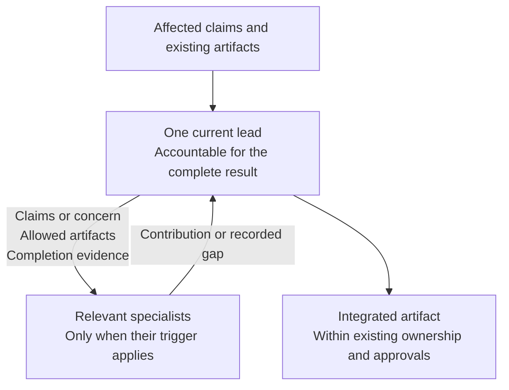

# Role contracts

Nineteen host-free contracts provide six lead responsibilities and thirteen
specialties. The lead owns the complete result for its current responsibility
and integrates bounded contributions. The specification determines the work
and the expertise it needs.

## Leads

| Responsibility | Lead | Complete result |
| --- | --- | --- |
| Specify | [spec-author](spec-author.md) | Confirmed need, agreement and scenarios |
| Design | [architect](architect.md) | Technical design and readiness |
| Implement | [implementer](implementer.md) | Integrated change against the design and behavior-change or refactor evidence |
| Verify | [spec-reviewer](spec-reviewer.md) | Independent design or diff findings and verdict |
| Release | [release](release.md) | Rollout or recovery and verification |
| Investigate | [bug-finder](bug-finder.md) | Reproduction, evidence and proven cause |

## Specialists

| Specialist | Joins when | Bounded contribution |
| --- | --- | --- |
| [domain](domain.md) | Business rules, invariants or concepts need modeling or change | Domain advice and model implementation |
| [ux](ux.md) | Interaction, accessibility, states or copy need deciding | Decided interaction |
| [ui](ui.md) | A decided interaction needs presentation changes | Components and presentation state |
| [database](database.md) | Persistence design, implementation, diagnosis or rollout is affected | Storage, queries, transactions, migrations and recovery evidence |
| [test-writer](test-writer.md) | Agreed behavior needs tests or traceability changes | Behavior tests, refactor characterization and coverage records |
| [tester](tester.md) | Behavior needs execution or exploration | Run evidence and reproductions |
| [adversary](adversary.md) | A boundary, credential, permission or external input changes | Independent security findings |
| [benchmarker](benchmarker.md) | A written performance, cost or structural concern needs measurement | Benchmark and comparative finding |
| [observability](observability.md) | An operational decision needs signals or comparison, or an existing Observability subsection needs authoring | Optional subsection declarations, signal requirements, baselines and trends |
| [build](build.md) | A build, gate, tool or pipeline needs work | Reproducible tooling and checks |
| [organizer](organizer.md) | Approved claims need work items or the queue needs maintenance | Breakdown and ranked work |
| [document-writer](document-writer.md) | Substantial documentation is missing or stale | Prose checked against its source |
| [auditor](auditor.md) | A repository audit is requested, scheduled or required | Findings about the repository at rest |

## Handoffs

Start at the earliest responsibility whose required artifacts or approvals are
missing. Reuse the agreement and design that remain valid for the affected
claims. The authoritative ordering and gates are in
[sdd-conventions § Workflow](../skills/sdd-conventions/SKILL.md#workflow).

An assignment names its affected claims or concern, allowed files or artifacts,
and completion evidence. The specialist returns its contribution or a recorded
gap to the lead. The lead integrates contributions and obtains any missing
claim or design decision from its existing owner before dependent work resumes.
The parent assignment remains with its lead during bounded obstruction removal;
proof that the original work can resume completes that subtask. Adjacent work is
recorded separately.

A responsibility can be exercised in the current session or delegated after its
contract is read; it does not require a separate agent invocation. A reviewing
instance must be different from the instance that authored its subject.
Leadership and collaboration modes never expand a contract's write boundaries.

Agreement authoring returns an independent diff verdict to the sign-off owner;
design returns an independent design verdict there too. The applicable recorded
approval accompanies each dependent handoff; readiness alone is not approval.
Review requesters supply the identified snapshot, diff and unavailable history
under [sdd-conventions § Review passes](../skills/sdd-conventions/SKILL.md#review-passes),
so a read-only reviewer need not gain shell access to inspect the change.

| Situation | Lead path and required artifacts | Conditional expertise |
| --- | --- | --- |
| Bug report | Investigate → accepted diagnosis and failing regression test → Implement correction → Verify → Release when shipping | Agreement owner for missing or disputed behavior; design owner for a design gap; domain, UI or database for the affected concern |
| New feature | Specify → Design → failing tests → Implement → Verify → Release | UX for interaction; domain for modeling; database for persistence; testing and measurement expertise for the claims |
| Technical obstacle | Current lead retains the work → bounded assistance → evidence that the original work can resume | Architect for feasibility; bug-finder for unexpected behavior; build for tooling or a gate |
| Pitched idea | Specify in discovery mode → agreement once the need is confirmed | UX for interaction; architect for bounded feasibility evidence; no speculative production implementation |
| Production issue | Investigate while Release can coordinate an existing recovery procedure → correction route only if software must change | Correlated logs when available; observability for operational evidence; missing telemetry stays an evidence gap |
| Changed shipped requirement | Amend the agreement with permanent claim anchors → assess design, dependencies and compatibility → revised failing tests → Implement → Verify → Release | UX/domain for changed interaction or rules; database for stored data or migrations; operational comparison for rollout |

Operational recovery follows its existing procedure and confirmation rules; it
can start before diagnosis is complete and continue alongside a software fix.
Recovery evidence does not establish that a later code correction is verified.
Telemetry availability alone does not require a performance benchmark.

## Modes

Discovery belongs to specification authoring; correction belongs to
implementation; log analysis belongs to investigation; design review belongs to
independent verification. For requested pairing, use
[coding-conventions § Collaboration mode](../skills/coding-conventions/SKILL.md#collaboration-mode)
within the active contract. These are retained capabilities, not additional
workflow stops. The agreed consolidation and its history are recorded in
[0001-F2](.spec/README.md).

## Artifact boundaries

Read the recorded artifact the responsibility needs, rather than a chat summary
of it. Each specification section retains exactly one owner; the authoritative
map is [sdd-conventions § Section ownership](../skills/sdd-conventions/SKILL.md#section-ownership).
A lead requests another owner's revision rather than writing that section.

When present, `### Observability` under Technical Design (§ 7) belongs to
[observability](observability.md), including its owner note and author stamp.
Its absence is valid; the architect retains the parent design. The role contract
names the signal declarations and handoff to the test writer.

The four review units are declared in this index's frontmatter and claimed by
the relevant contracts. Their ordering, independence and findings belong to
[sdd-conventions § Review passes](../skills/sdd-conventions/SKILL.md#review-passes).
Reviewers report; artifact owners revise.

The generated [persona roster](PERSONAS.md) lists each contract’s voice and
optional name for signing prose. Host models, effort and tools belong to the overlays. Installation and
projection are described in [README](../README.md#consuming).
