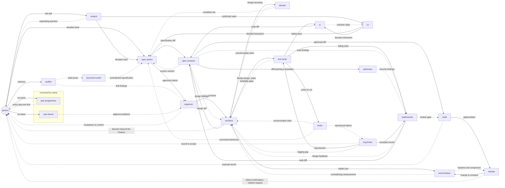

# Role contracts

A specification-driven repository treats the specification as the artifact of
record; code is downstream of it. Twenty roles work that chain, and each
is a **documented contract** — for whoever takes the role, a person or an agent.

| Role                                    | Turns                                   | Into                                                      |
| --------------------------------------- | --------------------------------------- | --------------------------------------------------------- |
| [`analyst`](analyst.md)                 | a raw ask                               | discovery notes and a decided need                        |
| [`spec-author`](spec-author.md)         | a decided need                          | the agreement, and the `.feature` file                    |
| [`organizer`](organizer.md)             | agreed claims                           | ranked work items and the Tasks index                     |
| [`architect`](architect.md)             | the authored agreement and scenarios    | a technical design, diagrams and readiness findings       |
| [`domain`](domain.md)                   | business rules in claims                | a domain model whose invariants cannot be bypassed        |
| [`ux`](ux.md)                           | user needs and claims                   | a decided interaction: flows, states and copy             |
| [`test-writer`](test-writer.md)         | a claim                                 | a failing scenario and failing tests                      |
| [`implementer`](implementer.md)         | a failing test, or a diagnosed bug      | production code, design feedback and bug lessons          |
| [`ui`](ui.md)                           | a decided interaction and failing tests | presentation code                                         |
| [`pair-programmer`](pair-programmer.md) | a task the person wants to steer        | small visible steps and the item's decision log           |
| [`tester`](tester.md)                   | a change to verify                      | a run report and reproductions                            |
| [`spec-reviewer`](spec-reviewer.md)     | a design, or a diff                     | a verdict per section, and findings                       |
| [`adversary`](adversary.md)             | the surface a change exposes            | security findings                                         |
| [`benchmarker`](benchmarker.md)         | a cost concern, or a decision           | a benchmark, or a baseline and a comparison               |
| [`bug-finder`](bug-finder.md)           | a failure report and its logs           | a reproduction and a root-cause record                    |
| [`yak-shaver`](yak-shaver.md)           | an incidental obstacle                  | the obstacle removed, and what was left alone             |
| [`build`](build.md)                     | a broken or missing gate                | a reproducible build and gates that fail when they should |
| [`release`](release.md)                 | an artifact that passed the gates       | a confirmed release with a rollback                       |
| [`document-writer`](document-writer.md) | stale or missing prose                  | documents checked against what exists                     |
| [`auditor`](auditor.md)                 | the repository at rest                  | drift findings, grouped by rule                           |

## Sequential trust

**Each role trusts only the artifact the preceding role produced — never a chat
summary of it.** The architect reads the groomed agreement and its scenarios
before tests and implementation begin. The test writer works from the claim and
the recorded design. The implementer works from that design, the failing test
and the claim it cites, not from a description of what the test is getting at. A
conversational handoff leaves no artifact and does not survive to the next
session or the next agent.

The authoritative sequence is
[`sdd-conventions` § Workflow](../skills/sdd-conventions/SKILL.md#workflow).

## Handoffs

A solid edge hands an artifact to the role that works from it. A dashed edge
carries a finding or a question. Where no edge is drawn, a finding goes to the
owner of the section it concerns. A role file names only the roles it hands
to; who hands to it is read here.

Every role has an edge in and an edge out. The shortest route to the diff pass
on a specification is `analyst`, `spec-author`, `spec-reviewer`; a need already
decided enters at `spec-author`. `ux` feeds the agreement rather than code, so
an interaction reaches `ui` only behind a claim and a failing test.

`pair-programmer` and `yak-shaver` are convened by no command; a host calls
each by name. A role that finds its input missing or wrong escalates to the
owning role and never supplies the gap: writing into someone else's section
removes the only signal that the preceding stage is incomplete.

## Where ownership is written

Which role owns which section is derived from each role's `owned_spec_sections`
and written in exactly one place:
[`sdd-conventions` § Section ownership](../skills/sdd-conventions/SKILL.md#section-ownership).
The section no single role owns is declared in this file's frontmatter.
Ownership is not restated in the role files — a second copy is a second thing to
drift.

The spec reviewer, the adversary and the auditor review the units of work
declared under `review_units` in this file's frontmatter and claimed by each
role's `reviews`. Which pass reviews what, and in what order, is in
[`sdd-conventions` § Review passes](../skills/sdd-conventions/SKILL.md#review-passes).

Each role also declares the persona it signs its prose with; the roster is
generated into [`PERSONAS.md`](PERSONAS.md).

## Standing notes

- **Small changes can combine roles; the ordering is mandatory.** A new or
  amended specification passes architecture review before tests and
  implementation. A one-line fix does not need a separate agent for every role;
  it still may not reach code before the claim it satisfies exists.
- **Scenarios execute.** The project's acceptance tier runs the `.feature`
  files. Unit tests still cover the concerns — a passing acceptance scenario is
  not a substitute for them, and § 9 cites both.
- **Every role writes less than it wants to.** The rule is
  [`coding-conventions`](../skills/coding-conventions/SKILL.md) §§ "Design" and
  "Say it once, and briefly"; a role file names only what that means for the
  artifact it owns.
- **The contracts are also installable agents.** `hosts/<host>.yaml` maps each
  role to a model and effort for that host, and `dotnet fsi scripts/project.fsx`
  writes the host-native files. Consumers pull the committed outputs with
  `skillfile`; see the repository `README.md`.
