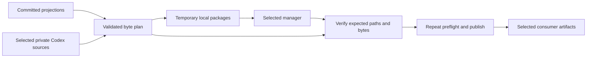
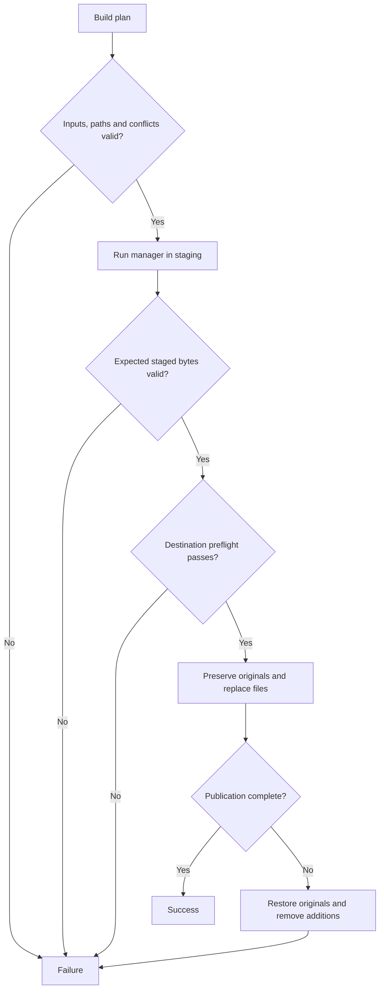
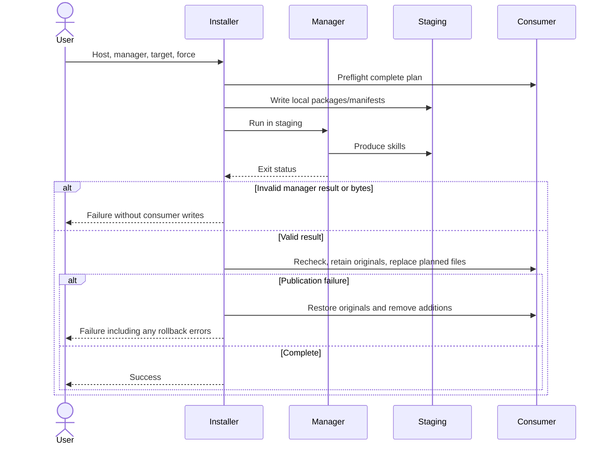

# Specification: Host installation

## 1. Business Goal

<!-- last written by: spec-author, 2026-10-27 -->

A consumer installs the complete method for its chosen AI host with one
cross-platform script and its preferred package manager, without choosing
individual files or receiving another host's formats.

## 2. User Needs

<!-- last written by: spec-author, 2026-10-27 -->

| # | Persona | Need | Pain Point Today |
| --- | --- | --- | --- |
| 1 | Consumer | Install every role, method skill and command together | Individual pulls omit dependencies |
| 2 | Claude Code user | Install Claude-native artifacts | Host-free sources are not the finished output |
| 3 | Codex user | Install Codex-native artifacts with usable source references | Markdown agent installation does not supply the projected TOML contracts |
| 4 | Team maintainer | Choose Skillfile or Microsoft apm in a consumer project | The README offers individual Skillfile additions only |

### Assumptions

None. Stakeholder-approved defaults are recorded in § 11.

## 3. Acceptance Criteria

<!-- last written by: spec-author, 2026-10-27 -->

| ID | Claim | Source | Status |
| --- | --- | --- | --- |
| B-001 | Given a consumer project and the Claude host selection, this Feature installs all committed Claude roles, method skills and commands into that project's Claude-native directories. | User request, 2026-10-16 | Active |
| B-002 | Given a consumer project and the Codex host selection, this Feature installs all committed Codex roles and method and command skills into that project's Codex-native directories. | User request, 2026-10-16 | Active |
| B-003 | Given either supported host and Skillfile as the selected manager, this Feature invokes Skillfile as part of installing the complete selected host. | User clarification, 2026-10-16 | Active |
| B-004 | Given either supported host and Microsoft apm as the selected manager, this Feature invokes Microsoft apm as part of installing the complete selected host. | User clarification, 2026-10-16 | Active |
| B-005 | Given the documented prerequisites on Windows, macOS or Linux, this Feature accepts the same script arguments and produces the selected host's installation. | User request for a cross-platform scripting language | Active |
| B-006 | Given an installed role or command, this Feature supplies the repository-owned contracts and skills that its instructions reference at their installed locations. | Complete installation in B-001 and B-002 | Active |
| B-007 | Given a Codex installation, its planned private bundle supplies selected runtime role contracts, method skills and runtime resources with a consumer-facing index, excluding maintainer specifications. | User decision 0002, 2026-10-17 | Active |
| B-008 | Given `.issue` tracker entries in native skill projections or private method sources, installation excludes them at every depth for both hosts and managers while preserving other runtime files. | Decision 0003, 2026-10-17 | Active |

## 4. Constraints

<!-- last written by: spec-author, 2026-10-27 -->

| ID | Constraint | Rules Out |
| --- | --- | --- |
| C-1 | Installation is scoped to the selected consumer project. | User-wide host installation |
| C-2 | The installer consumes committed host projections. | Requiring consumers to run the F# projector or install the .NET SDK |
| C-3 | Installation preserves unrelated consumer instructions, configuration and artifacts. | Replacing entire host folders, root AGENTS.md or CLAUDE.md |
| C-4 | A source or destination link cannot redirect installation outside its declared boundary. | Following escaping symlinks or junctions |
| C-5 | Manager or validation failure produces an unsuccessful script exit. | Reporting a complete installation after a failed subprocess |

## 5. Out of Scope

<!-- last written by: spec-author, 2026-10-27 -->

| # | Item | Exclusion Reason |
| --- | --- | --- |
| 1 | Direct installation of the whole repository with only a package-manager command | The user selected a script that invokes the manager |
| 2 | User-wide installation | The user selected project folders |
| 3 | Hosts other than Claude Code and Codex | The request names these two hosts |
| 4 | Changing role contracts, host model mappings or command behavior | Projection remains owned by 0001-F1 and commands by 0001-F3 |
| 5 | Installing the host applications or package-manager executables | Consumers supply the documented prerequisites |
| 6 | Authoring a consumer's companion skill | Its paths, commands and stack belong to the consumer |

## 6. Concern Separation

<!-- last written by: architect, 2026-10-27 -->

| Concern | Boundary | Satisfies |
| --- | --- | --- |
| Artifact content and host paths | 0001-F1 projections and 0001-F3 commands | B-001, B-002, C-2 |
| Installation plan | Select projected bytes and preserve relative layout | B-001, B-002 |
| Skill acquisition | Selected manager in isolated temporary project | B-003, B-004, C-3 |
| Contract dependencies | Native Claude links; private authoritative Codex sources | B-006 |
| Consumer writes | Validate/promote planned files; consumer instructions/configuration stay consumer-owned | C-1, C-3, C-4 |
| Failure reporting | Failed phase and unsuccessful exit; manager success alone is insufficient | C-5 |

## 7. Technical Design

<!-- last written by: architect, 2026-10-27 -->

### DR-1 — Plan before effects

Use an importable, effect-free Python 3.11+ standard-library module (OQ-4) with a
CLI requiring `--host claude|codex`, `--manager skillfile|apm`, `--target`, and
optional `--force`. The checkout supplies committed package bytes. Keep artifact
selection/rebasing/conflict comparison separate from manager execution and
publication; the plan is ordered project-relative paths to immutable bytes.
A source-root seam supports synthetic checkouts and subprocess/filesystem
boundaries remain substitutable.

Adapt the two manager manifest/process contracts with direct branches. Both
return staged skills; direct manager writes into the consumer cannot satisfy the
common preservation/conflict policy. No provider hierarchy or second launcher is
needed.

### DR-2 — Projection and dependency layout

| Host | Project destination | Transformation |
| --- | --- | --- |
| Claude | `.claude/agents/<role>.md`, `.claude/commands/<name>.md` | Committed bytes |
| Claude | `.claude/skills/<name>/**` | Verified manager output, byte-preserved |
| Codex | `.codex/agents/<role>.toml` | Rebase authoritative-source prefix only |
| Codex | `.agents/skills/<name>/**` | Verified manager output, byte-preserved |
| Codex | `.sdd/agents/<role>.md` and optional persona roster | Selected native roles' source bytes |
| Codex | `.sdd/agents/README.md` | Derived runtime index |
| Codex | `.sdd/skills/<name>/**` | Method runtime bytes, excluding `.spec` and `.issue` |

ADR-0011 carries forward ADR-0005's command-skill discovery locations. Both
managers install skills; the wrapper promotes agents and native Claude commands.
Require nonempty artifact categories and a `SKILL.md` per selected skill, including
nested support files.

For Codex, replace exactly the known source-prefix reference with the private
project-relative source path. Parse before/after TOML and verify all other
values and decoded instruction remainder are unchanged. Unexpected prefixes
fail. Validate known sibling-role and relative method-skill links against the
complete private byte plan before effects, ignoring anchors. This bounded grammar
is not a general Markdown parser. Consumer instruction/companion references
retain consumer meaning; private sources avoid overwriting ordinary consumer
agent/skill directories. Rewriting every link or regenerating projections during
installation would duplicate 0001-F1 and violate C-2/ADR-0002.

Select private contracts from native-role inventory; require every source and
reserve index/roster names against role collisions. The derived index links only
shipped contracts, method entry points and optional roster; producer indexes and
unshipped dependencies are excluded ([decision
0002](decisions/0002-runtime-contracts-with-a-consumer-index.md)). Exclude exact
`.spec` entries before private-source traversal; this exclusion does not alter
committed native projections. B-008 excludes exact `.issue` entries before
validation/read/descent in both native and private skill trees at every depth,
including linked metadata. Other hidden and binary runtime resources retain
paths/bytes ([decision 0003](decisions/0003-exclude-tracker-metadata.md)).

### DR-3 — Isolated manager staging

Resolve the selected executable on PATH. Invoke argument lists with explicit cwd,
no shell and checked exits; path characters remain within their arguments. Copy
inputs to short staging-relative package paths and use actual manager manifest
grammar, not shell quoting. Installation does not fetch this repository or install
the manager itself.

Skillfile declares local skills individually and the selected host's local
installation target. Run validation before installation; neither failure permits
promotion or fallback to personal configuration. Accept one complete matching
skill tree from Claude's native staging path or Codex's explicit `.codex/skills`
and `.agents/skills` alternatives; differing valid candidates are ambiguous.
Promote to the projected destination regardless of staging layout.

apm receives independent local native skill-package directories, each rooted at
`SKILL.md`, under a dependency-free temporary project and explicit host/only-apm
selection. Do not use a single collection package: apm 0.33.0 rewrites sibling
links within it. Independent packages preserve links escaping their package root;
exact-byte verification still guards future changes.

After manager success, every expected file must exist, match input bytes and be
unlinked. Ignore unplanned manager files; never promote them. Staged host artifacts,
manifests, locks and project configuration are discarded. Manager user-cache and
configured lifecycle effects remain outside project isolation; apm 0.33.0 can
initialize its user cache even for local dependency-free input.

DR-3/C-3: only verified planned bytes cross the consumer-write boundary.

### DR-4 — Publication and recovery

Canonicalize declared checkout/project roots once. Enumerate without following
links; reject symlinks/reparse points, including dangling links, at every source,
staged and destination component beneath the roots. Require relative contained
paths. Python 3.11 file attributes suffice for Windows junction checks. Structural
file/directory collisions fail even with force.

Preflight the whole plan before the manager and immediately before publication.
Missing files are additions, equal bytes no-ops, and different bytes conflicts
unless forced. Report all known conflicts and write none. Force permits only
planned replacements; never prune unrelated or previously installed files. There
is no ownership ledger or uninstall contract, including for previously installed
metadata.

Prepare replacements beside destinations, retain originals, then replace each
file atomically. On caught publication failure restore replaced originals, remove
new additions and only empty directories created by this attempt. Report rollback
errors with paths and return failure. No tree transaction, crash recovery,
concurrent-installer serialization or validation-race defense is claimed.

DR-4/C-3–C-5: manager/validation failures precede writes; publication errors
attempt rollback and never become success.

DR-3/DR-4: process success and verification precede consumer publication. No
entity/class/persistent-state view applies: one invocation has file state and
functional byte plans, without a database or object hierarchy.

### Feasibility, cost and readiness

Historical 2026-10-16 probes with Skillfile 1.7.1 and apm 0.33.0 established local
nested-byte staging. Complete-repository apm collection input failed byte
verification before consumer writes; separate local packages preserved sibling
links. These are feasibility observations, not claim coverage or cross-platform
proof. Byte verification remains mandatory for every installation.

Planning, staging comparison and publication are O(total selected bytes + file
count), with O(total bytes) plan memory and temporary package/output/rollback disk.
External manager duration is unmeasured; there is no service or latency target.

Readiness: Ready for tests and implementation for B-001–B-006 and B-008, subject
to applicable independent design approval in § 12. OQ-1–OQ-5 are resolved and
subprocess/filesystem seams are controllable. Risk: medium for manager layout/
version drift, cross-platform links, prefix dependency preservation and partial
publication; verification and rollback address these within the stated limits.

## 8. Testing Strategy

<!-- last written by: test-writer, 2026-10-27 -->

Exercise public installation and CLI behavior for both hosts and both managers
using synthetic checkouts. Substitute subprocess execution while parsing actual
manager manifest grammar, validating arguments, checked execution and isolated
working directories, and copying staged packages to declared destinations.
Scenarios are documentary; executable acceptance checks use the public entry.

Cover dependency closure, prefix derivation, manager/output failures, complete-plan
conflicts, idempotence, force replacement, path structure, linked sources and
destinations, simulated reparse attributes and rollback. Verify runtime bytes,
producer-record exclusion and private-link closure in synthetic and real trees.

Testability: existing subprocess/filesystem seams need no network, real manager,
credential, ambient clock, sleep or captured traffic. Import is inert; constructor,
clock and provider seams do not apply. Local macOS results do not establish
Windows/Linux execution; real-manager feasibility is separate from offline
acceptance coverage. Require 80% pooled changed executable production-line
coverage under ADR-0007. — Kevin

## 9. Traceability Matrix

<!-- last written by: test-writer, 2026-10-27 -->

| Claim ID | Scenario | Test | Status |
| --- | --- | --- | --- |
| B-001 | [@B-001](install.feature#L5) | `test_B001_B003_claude_skillfile_complete_installation`; `test_B001_B004_claude_apm_complete_installation` | Covered |
| B-002 | [@B-002](install.feature#L14) | `test_B002_B003_codex_skillfile_complete_installation`; `test_B002_B004_codex_apm_complete_installation` | Covered |
| B-003 | [@B-003](install.feature#L23) | `test_B001_B003_claude_skillfile_complete_installation`; `test_B002_B003_codex_skillfile_complete_installation`; `test_C5_failed_manager_leaves_consumer_unchanged` | Covered |
| B-004 | [@B-004](install.feature#L35) | `test_B001_B004_claude_apm_complete_installation`; `test_B002_B004_codex_apm_complete_installation` | Covered |
| B-005 | [@B-005](install.feature#L47) | `test_B005_cli_accepts_host_manager_target_and_force`; `test_B005_cli_help_invalid_arguments_and_failure_exit`; all four complete-installation tests on the three-OS CI matrix | Covered |
| B-006 | [@B-006](install.feature#L60) | `test_B006_codex_rebases_only_source_prefix_and_supplies_dependencies`; `test_B001_B003_claude_skillfile_complete_installation`; `test_B006_unexpected_codex_source_prefix_is_rejected`; `test_B006_missing_authoritative_role_is_rejected`; `test_B006_missing_referenced_private_method_is_rejected` | Covered |
| B-007 | [@B-007](install.feature) Runtime bundle and consumer index | `test_B007_consumer_index_uses_selected_runtime_inventory_with_both_managers`; `test_B007_private_specs_are_excluded_at_every_depth_and_runtime_bytes_survive`; `test_B007_native_role_cannot_overwrite_the_consumer_index`; `test_B007_checkout_runtime_bundle_is_closed_over_private_file_links` | Covered |
| B-008 | Tracker metadata scenarios in the companion `.feature` | `test_B008_root_tracker_is_not_a_skill_for_either_host_or_manager`; `test_B008_nested_native_and_private_tracker_records_are_omitted`; `test_B008_linked_tracker_is_skipped_before_source_validation` | Covered |

B-005 has executable acceptance and argument-mechanism coverage; actual
Windows/Linux CI execution remains pending. Local macOS results do not assert
execution on those platforms. Written by Kevin.

Executable test names resolve in [`test_install.py`](../test_install.py).

### Recorded verification

| Historical run | Recorded evidence |
| --- | --- |
| Initial implementation | 21 discovered against stubs, intended behavior failures without discovery/import errors; 23 passing after implementation on macOS/Python 3.13.5. |
| Manager invocation | Both apm acceptance cases failed against the former invocation, then passed. |
| Runtime bundle | Four new tests failed intended packaging assertions while 23 baseline tests passed; 27 passing after correction. Real offline bundle had no private specifications or unresolved private links. |
| Shared coverage | Serial run against `d4eac9c975718756f0d97d150ddced6f90044648`: 37/37 changed executable lines (floor 80%); fixture-isolation correction then allowed concurrent F# runs. |
| Tracker metadata | Three new cases observed red before implementation; 30 tests passed across both hosts/managers, including source links on macOS. Source-bound coverage against `d4eac9c`: 49/50 (98%). |

File counts were checkout observations, not compatibility promises. No additional
Windows/Linux or real-manager execution is claimed. — Kevin

## 10. Lessons / Spec Deltas

<!-- last written by: spec-author, 2026-10-27 -->

| Date | Trigger | Change | Affected IDs |
| --- | --- | --- | --- |
| 2026-10-17 | Runtime-only private bundle | Exclude producer records; retain consumer index and runtime bytes; [lesson 0001](lessons/0001-runtime-bundles-exclude-producer-records.md). | B-007; DR-2; decision 0002 |
| 2026-10-17 | Tracker metadata exclusion | Exclude reserved tracker entries without changing runtime bytes. | B-008; decision 0003 |
| 2026-10-27 | Confirmed concise-specification plan | Compress in place; qualify sibling references; separate strategy, locators and history. | §§ 1–12; IDs unchanged |

## 11. Open Questions

<!-- last written by: spec-author, 2026-10-27 -->

| ID | Question | Blocks | Resolution |
| --- | --- | --- | --- |
| OQ-1 | Which apm and installation scope are intended? | B-001–B-004 | Resolved by the user, 2026-10-16: Microsoft apm; project folders. |
| OQ-2 | Does compatibility mean script invocation or direct whole-repository installation through either manager? | B-003, B-004 | Resolved by the user, 2026-10-16: the script invokes either manager. |
| OQ-3 | Does this agreement belong in the proposed installation epic 0038, separate from projection epic 0001? | B-001–B-006 | Resolved by the user, 2026-10-16: approved the scope and defaults; epic 0038 accepted. |
| OQ-4 | May the design use Python 3.11+ with no third-party Python dependencies, explicit host and manager arguments, and a checkout as its source? | B-001–B-005 | Resolved by the user, 2026-10-16: approved. |
| OQ-5 | Should a differing destination file fail without overwriting it, with any replacement available only through an explicit installer option? | B-001, B-002, B-006 | Resolved by the user, 2026-10-16: approved; replacement requires --force. |
| OQ-6 | Should private Codex copies contain runtime contracts/resources with a consumer index, or maintainer documents with their full referenced-file closure? | B-006 | Resolved by the user, 2026-10-17: runtime contracts/resources with a consumer-facing index; exclude maintainer specifications. See decision 0002 and B-007. |

## 12. Sign-off

<!-- last written by: spec-author, 2026-10-27 -->

| Section | Status | Reviewer | Note |
| --- | --- | --- | --- |
| Concision migration: §§ 1–12 | 🟢 | spec-reviewer | Independent `/root/review`, 2026-10-27: Approved snapshot SHA-256 `f27fd76c55d76a7023b3e96f55f010b453564c682325dd738b0b557381841b38`; no findings. Unchanged baseline scope retains its prior evidence; no new behavior or coverage is approved. |

### Historical verdicts

These verdicts concern earlier subjects; they do not approve this migration.
Full notes, limitations and superseded pending rows are recoverable from § 12
of this specification at Git revision `57cd1200b089d2872d4538c91b5d085cf069307d`.

| Scope | Verdict | Reviewer | Subject / evidence |
| --- | --- | --- | --- |
| Design: § 7 runtime bundle amendment | 🟢 | spec-reviewer | 2026-10-17; `/root/contract_design_diff_review`; `36ab103e778d070d3ca8291ab56c63a0b96991bf6c656fb5c176ffce63785d5b`; retrospective; not proof of pre-implementation review |
| Diff: §§ 3, 7–12; installer, tests, decision and lesson | 🟢 | spec-reviewer | 2026-10-17; `/root/contract_design_diff_review`; `36ab103e778d070d3ca8291ab56c63a0b96991bf6c656fb5c176ffce63785d5b` |
| Surface: submitted amendment boundaries | 🟢 | adversary | 2026-10-17; `/root/contract_surface_review`; `36ab103e778d070d3ca8291ab56c63a0b96991bf6c656fb5c176ffce63785d5b` |
| 1-5 | 🟢 | spec-reviewer | 2026-10-16 |
| 6-7 | 🟢 | spec-reviewer | 2026-10-16 |
| 8-9 | 🟢 | spec-reviewer | 2026-10-16; Windows/Linux CI pending |
| 10-12 | 🟢 | spec-reviewer | 2026-10-16 |
| Agreement: B-008 tracker metadata | 🟢 | spec-reviewer | 2026-10-17; `/root/contract_design_diff_review`; `052e8bcc4eb813d0916cad49aa0ca791ca6be25aefff7861a97a4fd24054d363` |
| Design: § 7 tracker metadata | 🟢 | spec-reviewer | 2026-10-17; `/root/contract_design_diff_review`; `052e8bcc4eb813d0916cad49aa0ca791ca6be25aefff7861a97a4fd24054d363` |
| Diff: B-008 tracker metadata and executed tests | 🟢 | spec-reviewer | 2026-10-17; `/root/contract_design_diff_review`; `daf48f71a5b4f352a6e3df1a39bb0825f496322bc46f6ab2b558d67c3343965d` |
| Surface: tracker metadata boundary | 🟢 | adversary | 2026-10-17; `/root/contract_surface_review`; `daf48f71a5b4f352a6e3df1a39bb0825f496322bc46f6ab2b558d67c3343965d` |

Historical surface approval: Kyle, 2026-10-16; real-manager smoke covered both hosts with Skillfile 1.7.1 and Microsoft apm 0.33.0. Windows/Linux execution was unverified.

## Tasks

<!-- last written by: organizer, 2026-10-17 -->

- [0054 — Coordinate Host installation delivery](../.issue/0054-coordinate-host-installation.yml) — authoritative delivery-status source.
- [0039 — Install complete Claude or Codex hosts through Skillfile or Microsoft apm](../.issue/0039-host-installer.yml).

## Scoring

| Field | Value | Basis |
| --- | --- | --- |
| value | 0 | Not scored before agreement |
| risk | 0 | Manager compatibility and source references need design validation |
