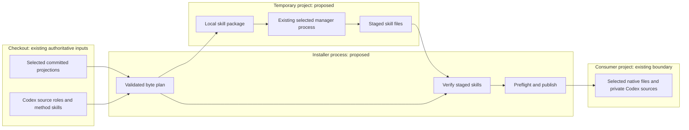
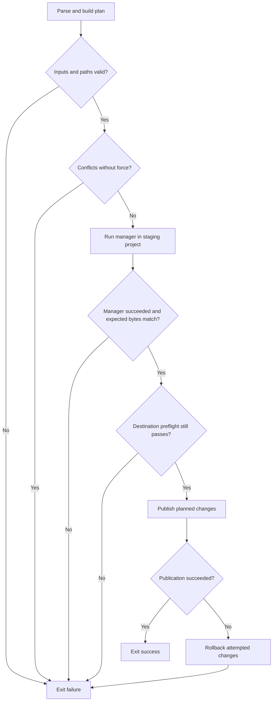
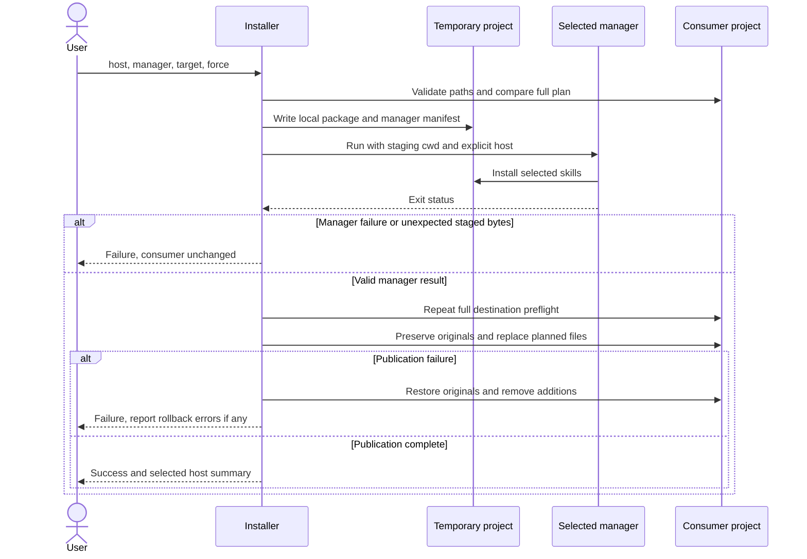

# Specification: Host installation

## 1. Business Goal

<!-- last written by: spec-author, 2026-10-16 -->

A consumer installs the complete method for its chosen AI host with one
cross-platform script and its preferred package manager, without choosing
individual files or receiving another host's formats.

## 2. User Needs

<!-- last written by: spec-author, 2026-10-16 -->

| # | Persona | Need | Pain Point Today |
| --- | --- | --- | --- |
| 1 | Consumer | Install every role, method skill and command together | Individual pulls omit dependencies |
| 2 | Claude Code user | Install Claude-native artifacts | Host-free sources are not the finished output |
| 3 | Codex user | Install Codex-native artifacts with usable source references | Markdown agent installation does not supply the projected TOML contracts |
| 4 | Team maintainer | Choose Skillfile or Microsoft apm in a consumer project | The README offers individual Skillfile additions only |

### Assumptions

None. Stakeholder-approved defaults are recorded in § 11.

## 3. Acceptance Criteria

<!-- last written by: spec-author, 2026-10-16 -->

| ID | Claim | Source | Status |
| --- | --- | --- | --- |
| B-001 | Given a consumer project and the Claude host selection, this Feature installs all committed Claude roles, method skills and commands into that project's Claude-native directories. | User request, 2026-10-16 | Active |
| B-002 | Given a consumer project and the Codex host selection, this Feature installs all committed Codex roles and method and command skills into that project's Codex-native directories. | User request, 2026-10-16 | Active |
| B-003 | Given either supported host and Skillfile as the selected manager, this Feature invokes Skillfile as part of installing the complete selected host. | User clarification, 2026-10-16 | Active |
| B-004 | Given either supported host and Microsoft apm as the selected manager, this Feature invokes Microsoft apm as part of installing the complete selected host. | User clarification, 2026-10-16 | Active |
| B-005 | Given the documented prerequisites on Windows, macOS or Linux, this Feature accepts the same script arguments and produces the selected host's installation. | User request for a cross-platform scripting language | Active |
| B-006 | Given an installed role or command, this Feature supplies the repository-owned contracts and skills that its instructions reference at their installed locations. | Complete installation in B-001 and B-002 | Active |

## 4. Constraints

<!-- last written by: spec-author, 2026-10-16 -->

| ID | Constraint | Rules Out |
| --- | --- | --- |
| C-1 | Installation is scoped to the selected consumer project. | User-wide host installation |
| C-2 | The installer consumes committed host projections. | Requiring consumers to run the F# projector or install the .NET SDK |
| C-3 | Installation preserves unrelated consumer instructions, configuration and artifacts. | Replacing entire host folders, root AGENTS.md or CLAUDE.md |
| C-4 | A source or destination link cannot redirect installation outside its declared boundary. | Following escaping symlinks or junctions |
| C-5 | Manager or validation failure produces an unsuccessful script exit. | Reporting a complete installation after a failed subprocess |

## 5. Out of Scope

<!-- last written by: spec-author, 2026-10-16 -->

| # | Item | Exclusion Reason |
| --- | --- | --- |
| 1 | Direct installation of the whole repository with only a package-manager command | The user selected a script that invokes the manager |
| 2 | User-wide installation | The user selected project folders |
| 3 | Hosts other than Claude Code and Codex | The request names these two hosts |
| 4 | Changing role contracts, host model mappings or command behavior | Projection remains owned by 0001-F1 and commands by 0001-F3 |
| 5 | Installing the host applications or package-manager executables | Consumers supply the documented prerequisites |
| 6 | Authoring a consumer's companion skill | Its paths, commands and stack belong to the consumer |

## 6. Concern Separation

<!-- last written by: architect, 2026-10-16 -->

| Concern | Owner and boundary | Satisfies |
| --- | --- | --- |
| Artifact content and host paths | Existing projections owned by 0001-F1; command contracts owned by 0001-F3 | B-001, B-002, C-2 |
| Installation plan | This Feature selects the host's projected files and preserves their relative layout | B-001, B-002 |
| Skill acquisition | The selected manager installs local skill directories into an isolated temporary project | B-003, B-004, C-3 |
| Contract dependencies | This Feature preserves native Claude references and supplies private authoritative sources for Codex | B-006 |
| Consumer writes | This Feature validates and promotes only planned files; consumer instructions and configuration remain consumer-owned | C-1, C-3, C-4 |
| Failure reporting | The CLI reports the failed phase and returns an unsuccessful exit; manager success alone is insufficient | C-5 |

Written by Marcus.

## 7. Technical Design

<!-- last written by: architect, 2026-10-16 -->

### DR-1 — One Python entry point, with a plan before effects

`install/install.py` is both the executable script and an importable module,
using Python 3.11+ and only its standard library, as approved in OQ-4. Its
`main` parses required `--host claude|codex`, `--manager skillfile|apm` and
`--target <project>` arguments plus optional `--force`. The checkout is the
parent of the script's containing `install` directory; the importable `install`
entry point accepts a source root so synthetic checkouts can exercise the same
behavior. Importing the module
has no effects. The declaring file becomes the authority for these interfaces
once stubs exist.

The plan is an ordered mapping of project-relative paths to immutable bytes.
Artifact selection, prefix rebasing and conflict comparison are separate from
subprocess execution and filesystem publication. An injected or patched
`subprocess.run` supplies the existing test substitution seam. No provider base
class, registration system, asynchronous framework or second command launcher
is needed for two manager branches.

An Adapter is appropriate only at the subprocess boundary: Skillfile and apm
consume different local-package manifests, but both return a staged skill tree.
Two direct branches implement that adaptation. The simpler alternative, having
each manager write directly into the consumer, cannot provide C-3's common
conflict policy and exposes manager-owned instruction/configuration writes.

### DR-2 — Selected projections and dependency layout

| Host | Checkout input | Project destination | Transform |
| --- | --- | --- | --- |
| Claude | `.claude/agents/*.md` | `.claude/agents/<role>.md` | None |
| Claude | `.claude/commands/*.md` | `.claude/commands/<name>.md` | None |
| Claude | `.claude/skills/<name>/**` | `.claude/skills/<name>/**` | Verified manager output, byte-preserved |
| Codex | `.codex/agents/*.toml` | `.codex/agents/<role>.toml` | Rebase only the authoritative-source prefix |
| Codex | `.agents/skills/<name>/**` | `.agents/skills/<name>/**` | Verified manager output, byte-preserved |
| Codex | `agents/*.md` | `.sdd/agents/<file>.md` | None |
| Codex | `skills/<name>/**` | `.sdd/skills/<name>/**` | None |

Codex's discovery tree already includes command skills, per accepted
[ADR-0005](../../.spec/adr/0005-commands-project-to-claude-commands-and-codex-skills.md).
Claude commands are promoted directly because Skillfile has no command entity.
Skillfile's Markdown agent model does not represent Codex TOML agents; both
managers therefore install skills while this wrapper promotes agents and Claude
commands. Every selected skill directory must contain `SKILL.md`; nested support
files remain part of the plan. Empty or missing required artifact categories
are validation failures, rather than successful empty installations.

The Codex source-prefix sentence names `.sdd/agents/<role>.md` instead of
`agents/<role>.md`; the rest of `developer_instructions`, every other TOML
value, and the role body are unchanged. Match exactly the known prefix once,
fail on an unexpected prefix, and parse the before/after TOML with `tomllib` to
verify only that source reference changed. The source is project-relative, so
moving the consumer project preserves it. Source-role sibling links resolve
under `.sdd/agents`; their `../skills/` links resolve under `.sdd/skills`.
Before staging, validate the contracts' known Markdown sibling and
`../skills/<name>/...` links against the private byte plan, ignoring anchor
fragments; a missing repository-owned dependency fails validation. Source skill
selection copies named skill directories containing `SKILL.md`, excluding
top-level specification metadata such as `skills/.spec`. This bounded link
grammar matches the existing contracts; it is not a general Markdown parser.
Claude's sibling and skill links already resolve under `.claude/`; it needs no
private copy. Consumer README, AGENTS.md and companion references retain their
consumer meaning.

Private Codex sources avoid overwriting ordinary consumer `agents/` and
`skills/` directories. Rewriting every link was rejected because it changes
role bodies and duplicates the projector's responsibility. Modifying committed
projections or running the projector during installation was rejected by C-2
and [ADR-0002](../../.spec/adr/0002-generated-host-outputs-are-committed.md).

### DR-3 — Managers run in an isolated staging project

Resolve the selected executable on PATH, then invoke it with an argument list,
an explicit working directory, no shell and checked exit status. Paths containing
spaces, quotes, dollar signs or non-ASCII characters remain single arguments.
Write manifest paths using each manager's actual grammar; copy inputs to short
relative staging paths so consumer/checkout path characters never enter manager
manifests. Do not apply shell quoting to manifest values. The wrapper does not
install manager executables or fetch this repository: its validated local
checkout supplies package bytes.

Create a temporary project and copy the selected skill directories into its
local package tree. Host artifacts, project manifests and generated project
configuration remain in staging and are discarded. Manager-internal user cache
and configured lifecycle effects are outside that isolation boundary; apm 0.33.0
initializes `~/.apm/cache` even for a dependency-free local invocation.

Skillfile's staging `Skillfile` declares one `local skill <name>
package/skills/<name>` line per skill, followed by `install claude-code local`
or `install codex local`. Invoke `skillfile validate`, then `skillfile install`;
either failure stops. Validation prevents malformed manifests from falling back
to personal configuration. Claude output is `.claude/skills`; Codex output may
be `.codex/skills` in verified version 1.7.1 or `.agents/skills` in the documented
current layout. Accept one complete matching output tree from these explicit
locations and reject ambiguous differing candidates. Promote its bytes to
DR-2's projected path, regardless of the manager's staging path. The currently
documented custom `install-path` syntax is rejected by the tested 1.7.1 CLI and
is not used.

apm receives each `package/skills/<name>` directory as an independent local native
skill package, containing `SKILL.md` at its root. Its staging `apm.yml` contains
`name: sdd-install` and `version: 1.0.0`, without dependencies. Invoke one
`apm install ./package/skills/<name1> ./package/skills/<name2> ... --target
<claude|codex> --only apm` argument list. The references use the already validated
skill names; no shell interprets them. apm may update the temporary manifest and
lock file. Its verified output is `.claude/skills` or `.agents/skills`, respectively.
After manager success, require every expected skill
file at its staged destination to equal the validated input bytes. Ignore
unplanned manager-generated files; never promote them. Missing, changed or linked
expected staged files fail before a consumer write.

Do not stage all skills as one package's `.apm/skills` collection: apm 0.33.0
rewrites sibling-skill Markdown links toward that collection, changing committed
bytes and making the installed links depend on discarded staging files. With
independent native packages, sibling-skill links lie outside each package root;
apm preserves them. The installer still requires exact bytes for every file, so
future rewriting changes fail safely. Accepting rewritten content or reversing
rewrites was rejected because it would add a second link transformation contract.

DR-3 / C-3 — existing artifacts and manager processes, with proposed staging and promotion:

### DR-4 — Preflight, publication and recovery

Canonicalize the declared checkout and project roots once. Enumerate selected
trees without following links, and reject symlinks or Windows reparse points at
every source, staged and destination component beneath their roots, including
dangling links. Python 3.11's `lstat` and Windows file attributes supply the
junction check; `Path.is_junction`, added in a later Python version, is not a
prerequisite. Validate every resulting path is relative and contained. Existing
directories where files are planned, or files where directories are needed,
are structural errors even with `--force`.

Preflight the complete plan before invoking the manager and again immediately
before publication. A missing file is an addition; equal bytes are a no-op;
different bytes are a conflict unless `--force` was supplied. Report all known
conflicting relative paths and write none. `--force` permits only the planned
file replacements; it never removes unrelated files or directories. A second
installation uses the same conflict rules and does not prune files from an older
release because this Feature has no ownership ledger or uninstall contract.

Prepare replacement files next to their destinations and use `os.replace` for
each atomic replacement. Preserve originals for rollback before replacing them.
On an ordinary caught publication failure, restore replaced originals, remove
newly installed files and remove only empty directories created by this attempt;
return failure. A rollback failure is reported with the affected path and still
returns failure. Manager or validation failure occurs before publication and
cannot leave a consumer installation. There is no whole-tree transaction,
crash recovery, concurrent-installer serialization or defense against another
process racing path validation. These limits follow the local single-run
installation boundary rather than inventing a filesystem transaction.

DR-4 / C-3–C-5 — installation decisions and terminal results:

DR-3 / DR-4 — subprocess success precedes consumer commit:

No database view applies: state is project files, without a schema or migration.
No class diagram applies: the implementation uses functions and immutable byte
plans without an object hierarchy. No persistent state diagram applies: one
invocation has no durable workflow state; DR-4's algorithm and sequence show
failure transitions and rollback.

### Feasibility, cost and readiness

The bounded feasibility question was whether each manager preserves complete
local skill directories while consumer host writes remain isolated. The parent
investigation on 2026-10-16 tested a synthetic `alpha/SKILL.md` and nested binary
file with real Skillfile 1.7.1 and apm 0.33.0. Both built-in Skillfile host
manifests installed local skills successfully; Codex wrote `.codex/skills`.
Both initial apm host invocations preserved the synthetic local collection at
their expected output paths. A subsequent complete-repository invocation
correctly failed byte verification before consumer writes: apm had rewritten
sibling-skill links. The revised DR-3 mechanism was then executed with real apm
0.33.0 using separate local `clarify-requirements` and `sdd-conventions` package
arguments; both outputs matched their original bytes, including sibling links.
The installed apm `LinkResolver._rewrite_relative_asset_link` corroborates the
mechanism: links escaping its package root retain their original text. The
mechanism is feasible; full byte verification remains mandatory for each
installation. These smoke results are not executable claim coverage or
Windows/Linux verification.
[Skillfile's format](https://github.com/eljulians/skillfile/blob/master/SPEC.md)
and [apm install](https://microsoft.github.io/apm/reference/cli/install/)
are compatibility references. The failed `install-path` experiment demonstrates
why the documented surface alone cannot choose a supported manifest.

For B-001–B-006's complete repository installation, planning, staging comparison
and publication scan each selected file a fixed number of times: estimated
O(total bytes + file count), with O(total bytes) plan memory and temporary disk
for package, output and rollback copies. Manager process time is external and
unmeasured. No latency or throughput target is stated. There is no service,
broker or paid infrastructure; one local subprocess and temporary filesystem
space are the added resources.

Readiness: **Ready for tests and implementation**, subject to the independent
design review before tests depend on it. B-001–B-006 and C-1–C-5 have a concrete
mechanism and a controllable subprocess/filesystem seam; OQ-1–OQ-5 are resolved
by the user's approved scope/defaults. No unresolved requirement blocks design.

| Covered item | Risk | Reason |
| --- | --- | --- |
| Complete host installation, B-001/B-002 | Medium | Manager output paths differ; only a verified explicit mapping reaches the consumer |
| Manager compatibility, B-003/B-004 | Medium | Upstream CLI/manifest changes can reject staging; mismatch must fail before publication |
| Cross-platform invocation, B-005 | Medium | Windows reparse points and manifest escaping require platform-specific verification |
| Dependency closure, B-006 | Medium | Codex prefix rebasing must preserve the decoded instruction remainder and private relative links |
| Consumer preservation, C-3/C-4 | Medium | Publication spans files; ordinary failures roll back, while crash and concurrent-writer transactions are absent |

Written by Marcus.

## 8. Testing Strategy

<!-- last written by: test-writer, 2026-10-16 -->

`python3 -m unittest discover -s install -p 'test_*.py' -v` discovers 23
public-entry tests in `install/test_install.py`; discovery previously had zero
installer tests. The `.feature` scenarios are documentary; named unittest cases
execute their acceptance behaviors through `install` and `main`.

Synthetic checkouts exercise all four host/manager combinations. A patched
`subprocess.run` parses each actual manifest grammar, checks argument lists,
checked execution and isolated working directories, and copies staged local
packages to the manager's declared output location. No network, real manager,
credential, ambient clock, delay or recorded traffic enters this suite.

Focused boundary cases pin TOML prefix derivation, dependency closure, missing
or failed managers, changed/missing/ambiguous output, all-plan conflicts,
idempotence, forced replacements, structural path errors, source/destination/
staged links, simulated Windows reparse attributes and publication rollback.
The tests substitute existing subprocess and filesystem seams; no production
member is exposed for testing. Module import has no effects; constructors and
clock/provider seams are not applicable to this functional filesystem CLI.

Initial red evidence: 21 tests discovered against the declared stubs; complete
installation and CLI cases fail with `NotImplementedError`, without import,
fixture or discovery errors. Rejection cases explicitly reject an unimplemented
stub as evidence of correct validation. After implementation, all 23 discovered
tests pass locally on macOS, Python 3.13.5. The revised apm package-list
invocation first failed both apm acceptance cases against the prior command,
then passed after implementation. Synthetic skills include relative sibling
links so byte-preservation checks cover the compatibility issue.

Cross-platform execution belongs to the Python CI matrix for Windows, macOS and
Linux. Local macOS execution cannot substantiate Windows/Linux claims; those
runs remain pending CI. Real-manager compatibility smoke is separate feasibility
evidence in § 7, not an offline acceptance substitute.

README § Maintaining defines no changed-line coverage percentage or gate;
therefore no numeric threshold is asserted. Behavioral test discovery and the
full existing repository checks are required. No numeric coverage claim or
threshold is asserted; generated coverage reports are not committed.

Written by Kevin.

## 9. Traceability Matrix

<!-- last written by: test-writer, 2026-10-16 -->

| Claim ID | Scenario | Test | Status |
| --- | --- | --- | --- |
| B-001 | [@B-001](install.feature#L5) | `test_B001_B003_claude_skillfile_complete_installation`; `test_B001_B004_claude_apm_complete_installation` | Covered |
| B-002 | [@B-002](install.feature#L14) | `test_B002_B003_codex_skillfile_complete_installation`; `test_B002_B004_codex_apm_complete_installation` | Covered |
| B-003 | [@B-003](install.feature#L23) | `test_B001_B003_claude_skillfile_complete_installation`; `test_B002_B003_codex_skillfile_complete_installation`; `test_C5_failed_manager_leaves_consumer_unchanged` | Covered |
| B-004 | [@B-004](install.feature#L35) | `test_B001_B004_claude_apm_complete_installation`; `test_B002_B004_codex_apm_complete_installation` | Covered |
| B-005 | [@B-005](install.feature#L47) | `test_B005_cli_accepts_host_manager_target_and_force`; `test_B005_cli_help_invalid_arguments_and_failure_exit`; all four complete-installation tests on the three-OS CI matrix | Covered |
| B-006 | [@B-006](install.feature#L60) | `test_B006_codex_rebases_only_source_prefix_and_supplies_dependencies`; `test_B001_B003_claude_skillfile_complete_installation`; `test_B006_unexpected_codex_source_prefix_is_rejected`; `test_B006_missing_authoritative_role_is_rejected`; `test_B006_missing_referenced_private_method_is_rejected` | Covered |

B-005 has executable acceptance and argument-mechanism coverage; actual
Windows/Linux CI execution remains pending. Local macOS results do not assert
execution on those platforms. Written by Kevin.

## 10. Lessons / Spec Deltas

<!-- last written by: spec-author, 2026-10-16 -->

None.

## 11. Open Questions

<!-- last written by: spec-author, 2026-10-16 -->

| ID | Question | Blocks | Resolution |
| --- | --- | --- | --- |
| OQ-1 | Which apm and installation scope are intended? | B-001–B-004 | Resolved by the user, 2026-10-16: Microsoft apm; project folders. |
| OQ-2 | Does compatibility mean script invocation or direct whole-repository installation through either manager? | B-003, B-004 | Resolved by the user, 2026-10-16: the script invokes either manager. |
| OQ-3 | Does this agreement belong in the proposed installation epic 0038, separate from projection epic 0001? | B-001–B-006 | Resolved by the user, 2026-10-16: approved the scope and defaults; epic 0038 accepted. |
| OQ-4 | May the design use Python 3.11+ with no third-party Python dependencies, explicit host and manager arguments, and a checkout as its source? | B-001–B-005 | Resolved by the user, 2026-10-16: approved. |
| OQ-5 | Should a differing destination file fail without overwriting it, with any replacement available only through an explicit installer option? | B-001, B-002, B-006 | Resolved by the user, 2026-10-16: approved; replacement requires --force. |

## 12. Sign-off

<!-- last written by: spec-author, 2026-10-16 -->

| Section | Status | Reviewer | Note |
| --- | --- | --- | --- |
| 1-5 | 🟢 | spec-reviewer | Jessica approved, 2026-10-16; stakeholder approved scope and defaults the same day. |
| 6-7 | 🟢 | spec-reviewer | Jessica approved the recorded design with no findings, 2026-10-16. |
| 8-9 | 🟢 | spec-reviewer | Jessica approved, 2026-10-16; 23 tests pass on macOS with Python 3.11 and 3.13; Windows/Linux CI pending. |
| 10-12 | 🟢 | spec-reviewer | Jessica approved the recorded clarifications and review evidence, 2026-10-16. |

Kyle approved the filesystem and subprocess surface pass without findings,
2026-10-16. Full real-manager smoke verified identical consumer results for
Skillfile 1.7.1 and Microsoft apm 0.33.0 on both hosts: 39 Claude files or 91
Codex files, preserving consumer instructions. No Windows/Linux run is claimed.

## Tasks

[0039 — Host installer](../.issue/0039-host-installer.yml), B-001–B-006.

## Scoring

| Field | Value | Basis |
| --- | --- | --- |
| value | 0 | Not scored before agreement |
| risk | 0 | Manager compatibility and source references need design validation |
