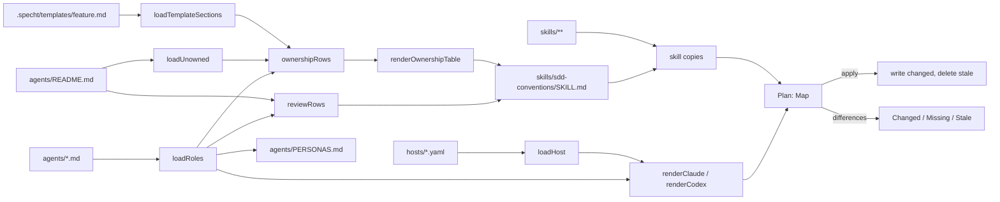

# Specification: Projection

## 1. Business Goal

<!-- last written by: spec-author, 2026-10-14 -->

A role is written once, host-free, and every AI host reads a native file that
carries that role's text plus the model, effort and tool choices the host
needs. Without projection a maintainer either keeps one copy per host and
watches them drift, or keeps one copy and loses the per-host model mapping;
this Feature removes both failure states.

## 2. User Needs

<!-- last written by: spec-author, 2026-10-14 -->

| #   | Persona           | Need                                                                 | Pain Point Today                                              |
| --- | ----------------- | -------------------------------------------------------------------- | ------------------------------------------------------------- |
| 1   | Role maintainer   | Edit one role file and have every host's agent file follow           | A role edited in one host directory diverges from the others  |
| 2   | Host tuner        | Map a role to a model and effort per host without touching the role  | Model choices embedded in the role file bind it to one host   |
| 3   | Consuming repository | Pull a finished host-native file by path at a tagged ref           | Nothing to pull unless the outputs are committed              |
| 4   | Reviewer          | See in a pull request that outputs match their sources               | Drift between source and output is invisible until a host reads a stale file |

### Assumptions

| ID  | Assumption                                                                                      |
| --- | ----------------------------------------------------------------------------------------------- |
| A-1 | Claude Code reads `.claude/agents/<name>.md` and `.claude/skills/<name>/SKILL.md`.              |
| A-2 | Codex reads `.codex/agents/<name>.toml` and discovers skills at `.agents/skills/<name>/SKILL.md`. |
| A-3 | A relative link written as `../skills/<name>/SKILL.md` resolves from both `agents/` and `.claude/agents/`. |

## 3. Acceptance Criteria

<!-- last written by: spec-author, 2026-10-14 -->

| ID    | Claim                                                                                                                                                                                                                 | Source                                        | Status |
| ----- | --------------------------------------------------------------------------------------------------------------------------------------------------------------------------------------------------------------------- | --------------------------------------------- | ------ |
| B-001 | Given a role file and the Claude overlay, this Feature emits `.claude/agents/<name>.md` whose frontmatter carries the name, the description and the overlay keys in overlay order, and whose body is the role body verbatim, preceded only by the persona line of B-012. | [ADR-0001](../../.spec/adr/0001-roles-are-host-free-and-hosts-are-overlays.md) | Active |
| B-002 | Given a role file and the Codex overlay, this Feature emits `.codex/agents/<name>.toml` carrying the name, the description, `developer_instructions` prefixed with the authoritative-source sentence, and the overlay keys. | ADR-0001                                      | Active |
| B-003 | Given a role body containing quotes, backslashes, tabs, non-ASCII text and characters outside the Basic Multilingual Plane, the Codex file parses as TOML and the text after the prefix equals the role body.          | [ADR-0003](../../.spec/adr/0003-the-projector-is-an-fsharp-script.md) | Active |
| B-004 | Given a directory under `skills/`, this Feature copies every file in it byte for byte to the Claude skills directory and to the Codex discovery directory.                                                            | A-1, A-2                                      | Active |
| B-005 | Given the roles' `owned_spec_sections` and the unowned declarations, this Feature writes the section-ownership table into `sdd-conventions` between its generated markers, one row per template section in template order. | LTI `generate-spec-ownership.sh`              | Active |
| B-006 | Given two roles claiming one section, this Feature fails naming the section and both roles, and writes nothing.                                                                                                       | LTI double-claim rule                         | Active |
| B-007 | Given a template section no role or unowned declaration claims, or a claim naming a section the template lacks, this Feature fails naming the section and writes nothing.                                            | LTI totality rule                             | Active |
| B-008 | Given outputs equal to what the sources produce, `--check` exits 0; given a changed, a missing or a stale output, `--check` exits 1 naming each path and writes nothing.                                               | [ADR-0002](../../.spec/adr/0002-generated-host-outputs-are-committed.md) | Active |
| B-009 | Given an overlay naming a role with no file, or a role file whose `name` differs from its file name, this Feature fails naming the role.                                                                              | ADR-0001                                      | Active |
| B-010 | Given a role file carrying `model`, `effort`, `tools` or `model_reasoning_effort`, this Feature fails naming the key.                                                                                                  | ADR-0001                                      | Active |
| B-011 | Given the roles' personas, this Feature writes the persona roster into `agents/PERSONAS.md` between its generated markers, one row per persona sorted by persona name, carrying the persona, a link to the role and the voice. | [0001-F2](../../agents/.spec/README.md) B-007 | Active |
| B-012 | Given a role with a persona, both host files carry one generated line naming the persona and its voice and saying machine-read stamps keep the role name, ahead of the role body, which follows verbatim; a role without a persona gets no line. | 0001-F2 B-007 | Active |
| B-013 | Given the review units declared in the roles index and the roles' `reviews`, this Feature writes the review-pass registry into `sdd-conventions` between its generated markers, one row per unit in declared order. | LTI `generate-review-passes.sh` | Active |
| B-014 | Given two roles reviewing one unit, this Feature fails naming the unit and both roles, and writes nothing. | LTI double-claim rule | Active |
| B-015 | Given a declared unit no role reviews, or a role reviewing a unit the index does not declare, this Feature fails naming the unit, and writes nothing. | LTI totality rule | Active |

## 4. Constraints

<!-- last written by: spec-author, 2026-10-14 -->

| ID  | Constraint                                                                  | Rules Out                                                                    |
| --- | --------------------------------------------------------------------------- | ---------------------------------------------------------------------------- |
| C-1 | A role is defined once, in `agents/<name>.md`, and carries no host key.     | A model, effort or tool list in a role file; a second role copy per host     |
| C-2 | A role body projects verbatim.                                              | Per-host wording, link rewriting, or any transform of the body text          |
| C-3 | Outputs are committed and byte-deterministic.                               | Timestamps, absolute paths, CRLF, a byte-order mark, machine-dependent order |
| C-4 | Projection reads only the checkout.                                         | A network call, a package feed lookup, or an environment variable at run time |
| C-5 | Projection runs with the pinned .NET SDK and nothing else installed.        | Python, Node, a packaged tool, or a build system as a prerequisite           |

## 5. Out of Scope

<!-- last written by: spec-author, 2026-10-14 -->

| #   | Item                                                   | Exclusion Reason                                                                 |
| --- | ------------------------------------------------------ | -------------------------------------------------------------------------------- |
| 1   | Installing outputs into a consuming repository         | A consumer pulls a committed path with its own tooling; see the root README       |
| 2   | Commands                                               | [0001-F3 Commands](../../commands/.spec/README.md)                                |
| 3   | Hosts other than Claude Code and Codex                 | Each needs its own overlay and renderer; added as a new host, not a change here  |
| 4   | Linting the one-way rule between skills and roles      | A separate check over `skills/`; this Feature only generates the ownership table |
| 5   | Validating the role body's section headings            | Owned by [0001-F2 Role contract](../../agents/.spec/README.md)                   |

## 6. Concern Separation

<!-- last written by: architect, 2026-10-14 -->

| #   | Concern                                                        | Classification |
| --- | -------------------------------------------------------------- | -------------- |
| 1   | Which keys a role file may carry, and which a host overlay may | Business       |
| 2   | Merging defaults with per-role overlay keys                    | Technical      |
| 3   | Rendering Claude frontmatter and Codex TOML                    | Technical      |
| 4   | Section ownership: one owner per section, total over the template | Business    |
| 5   | Determinism and the check mode                                 | Both           |
| 6   | Copying skills to each host's discovery directory              | Technical      |

## 7. Technical Design

<!-- last written by: architect, 2026-10-14 -->

Two files. [`Projection.fsx`](../Projection.fsx) is a library with no top-level
effects: it loads, validates, merges and renders, and returns a plan. It is the
declaring file for every type and function named below. [`project.fsx`](../project.fsx)
parses the command line, builds the plan, and either applies it or reports
differences. [`project.tests.fsx`](../project.tests.fsx) loads the library
directly and never shells out.

Design positions:

- **A plan before any write.** Every output is computed into memory first. A
  validation failure therefore writes nothing (B-006, B-007, B-009, B-010), and
  `--check` is a comparison of the same map against disk (B-008).
- **The overlay is a merge of two ordered lists.** `defaults`, then the role's
  own keys, later keys replacing earlier ones in place. Emission order is the
  overlay's first-seen order, after `name` and `description`.
- **YAML in, hand-written YAML and TOML out.** YamlDotNet parses the inputs. The
  outputs are small enough to emit by hand with a fixed key order, which is what
  makes them deterministic (C-3). A TOML basic string is encoded by the library
  itself; a JSON serializer was tried and rejected because it escapes characters
  outside the Basic Multilingual Plane as surrogate pairs, which TOML forbids
  (B-003).
- **The body keeps its first newline.** The split after the frontmatter's closing
  `---` leaves the body starting with the blank line that follows it, so the
  Codex instructions are the prefix, one newline, and the body unchanged.
- **Stale means "in an output root, not in the plan".** The output roots are the
  directories named by each host's `output` and `skills_output`. Anything else
  under `.claude/`, `.codex/` or `.agents/` is untouched and gitignored.
- **The companion is both a source and an output.** Its generated block is
  replaced in memory, the result is written back to `skills/sdd-conventions/SKILL.md`
  and copied to each host with the same bytes.
- **The registry is the ownership table's twin.** `reviewRows` applies the
  same one-owner and totality rules to review units that `ownershipRows`
  applies to sections, and both blocks are replaced in the companion in memory
  before it is written or copied.
- **The persona roster is the same kind of file.** `agents/PERSONAS.md` holds
  prose around a generated block; the roles loader skips it as it skips the
  roles index. The persona line is the one text projection adds to a role: it
  goes before the body, never into it, so C-2 holds for every byte of the body.

Durable choices are recorded in [ADR-0001](../../.spec/adr/0001-roles-are-host-free-and-hosts-are-overlays.md),
[ADR-0002](../../.spec/adr/0002-generated-host-outputs-are-committed.md) and
[ADR-0003](../../.spec/adr/0003-the-projector-is-an-fsharp-script.md).

Readiness: **Ready for tests and implementation.**

## 8. Testing Strategy

<!-- last written by: test-writer, 2026-10-14 -->

One tier: `dotnet fsi scripts/project.tests.fsx`, exit code equal to the number
of failures. Each test builds a synthetic checkout under the temporary directory
with two roles, both host overlays, one skill with a nested file, the companion
with empty markers, and a feature template of three numbered sections plus Tasks
and Scoring. Tests call the library, never the command line, so a failure names
the function. The scenarios in [`projection.feature`](projection.feature) are
executed by those tests; there is no separate step-definition layer because the
repository has no acceptance harness beyond `dotnet fsi`.

Mechanism per claim:

- B-001, B-002: `renderClaude`, `renderCodex` and `overlay`; the test compares
  whole files, including a role absent from the overlay receiving the defaults.
- B-003: `tomlString`; the test decodes the emitted string with its own TOML
  basic-string decoder and asserts the body round-trips and no surrogate escape
  appears.
- B-004: `plan` collecting `filesUnder` each skill; compared as bytes, with CRLF
  and a binary file in the fixture.
- B-005: `ownershipRows` and `renderOwnershipTable`; exact table, idempotent on a
  second plan. A subsection row renders under its parent and is exempt from
  totality.
- B-006, B-007, B-009, B-010: `loadRole`, `validateHostRoles`, `ownershipRows`
  raise `ProjectionError`; each test asserts the message names the offender and
  that no output directory exists afterwards.
- B-008: `differences` and `apply`; one changed, one missing and one stale file
  planted, all three reported, none touched by the check, all repaired by apply.
- B-011: `renderPersonaTable` through `plan`; exact table, sorted by persona,
  idempotent, and a role without a persona has no row.
- B-012: `personaLine` through `renderClaude` and `renderCodex`; whole Claude
  file and decoded Codex instructions compared, and a persona-less role
  unchanged.
- B-013, B-014, B-015: `reviewRows` and `renderReviewTable` through `plan` on a
  fixture with two units; exact registry, then a double claim, an unreviewed
  unit and an undeclared one, each failing before anything is written.
- C-3: two plans produce identical bytes, no byte-order mark, no absolute path.

Anything the design makes hard to test: the command-line exit codes are a thin
shell over `differences` and are exercised by CI running `--check`, not by a
test.

### Performance

Not measured. Eighty outputs from twenty-four roles, seven skills and eight
commands complete well inside the `dotnet fsi` start-up time; a concern appears only if
the roster grows by an order of magnitude.

## 9. Traceability Matrix

<!-- last written by: test-writer, 2026-10-14 -->

| Claim ID | Scenario                                                   | Test                                                              | Status  |
| -------- | ---------------------------------------------------------- | ----------------------------------------------------------------- | ------- |
| B-001    | A role projects to a Claude agent file                     | `B001_RoleAndClaudeOverlay_EmitsFrontmatterAndVerbatimBody`       | Covered |
| B-002    | A role projects to a Codex agent file                      | `B002_RoleAndCodexOverlay_EmitsTomlWithPrefixedInstructions`      | Covered |
| B-003    | A hostile body survives the Codex encoding                 | `B003_HostileBody_RoundTripsThroughToml`                          | Covered |
| B-004    | A skill is copied to both hosts                            | `B004_SkillDirectory_CopiedByteForByteToBothHosts`                | Covered |
| B-005    | Ownership declarations become the companion's table        | `B005_OwnedSections_WriteOwnershipTableBetweenMarkers`, `B005b_Subsection_RendersUnderItsParentAndIsExemptFromTotality` | Covered |
| B-006    | Two roles claim one section                                | `B006_TwoRolesClaimOneSection_FailsNamingBoth`                    | Covered |
| B-007    | A template section has no owner                            | `B007_UnownedTemplateSection_FailsNamingIt`                       | Covered |
| B-008    | Check passes when current and names every drift            | `B008_Check_IsSilentWhenCurrentAndNamesEveryDrift`                | Covered |
| B-009    | An overlay or a role name points at nothing                | `B009_OverlayNamesMissingRole_Fails`, `B009b_RoleNameDiffersFromFileName_Fails` | Covered |
| B-010    | A role file carries a host key                             | `B010_RoleFileCarriesHostKey_FailsNamingTheKey`                   | Covered |
| B-011    | Personas become the roster                                 | `B011_Personas_WriteRosterBetweenMarkers`                         | Covered |
| B-012    | A persona line precedes the body on both hosts             | `B012_Persona_PrecedesVerbatimBodyOnBothHosts`                    | Covered |
| B-013    | Review units become the registry                           | `B013_ReviewUnits_WriteRegistryBetweenMarkers`                    | Covered |
| B-014    | Two roles review one unit                                  | `B014_TwoRolesReviewOneUnit_FailsNamingBoth`                      | Covered |
| B-015    | A unit no role reviews, or one nobody declared             | `B015_UnreviewedOrUndeclaredUnit_FailsNamingIt`                   | Covered |

## 10. Lessons / Spec Deltas

<!-- last written by: spec-author, 2026-10-14 -->

None.

## 11. Open Questions

<!-- last written by: spec-author, 2026-10-14 -->

None.

## 12. Sign-off

<!-- last written by: spec-reviewer, 2026-10-14 -->

| Section | Status | Reviewer      | Note                                                   |
| ------- | ------ | ------------- | ------------------------------------------------------ |
| 1-12    | 🟡     | spec-reviewer | Scaffold draft; claims and tests landed in one change. |

## Tasks

None cut. This is a tooling agreement delivered in the scaffolding change; a
later change to a claim cuts its own work item.

## Scoring

| Field | Value | Basis                                              |
| ----- | ----- | -------------------------------------------------- |
| value | 0     | Not scored: tooling agreement, not a product Feature |
| risk  | 0     | Not scored: tooling agreement, not a product Feature |
