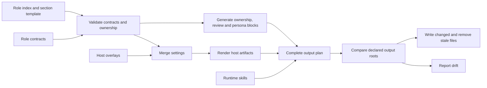

# Specification: Projection

## 1. Business Goal

<!-- last written by: spec-author, 2026-10-27 -->

A maintainer writes each role once; projection supplies every host's native
format and model mapping without divergent role copies.

## 2. User Needs

<!-- last written by: spec-author, 2026-10-27 -->

| # | Persona | Need | Pain Point Today |
| --- | ----------------- | -------------------------------------------------------------------- | ------------------------------------------------------------- |
| 1 | Role maintainer | Edit one role file and have every host's agent file follow | A role edited in one host directory diverges from the others |
| 2 | Host tuner | Map a role to a model and effort per host without touching the role | Model choices embedded in the role file bind it to one host |
| 3 | Consuming repository | Pull a finished host-native file by path at a tagged ref | Nothing to pull unless the outputs are committed |
| 4 | Reviewer | See in a pull request that outputs match their sources | Drift between source and output is invisible until a host reads a stale file |

### Assumptions

| ID | Assumption |
| --- | ----------------------------------------------------------------------------------------------- |
| A-1 | Claude Code reads `.claude/agents/<name>.md` and `.claude/skills/<name>/SKILL.md`. |
| A-2 | Codex reads `.codex/agents/<name>.toml` and discovers skills at `.agents/skills/<name>/SKILL.md`. |
| A-3 | A relative link written as `../skills/<name>/SKILL.md` resolves from both `agents/` and `.claude/agents/`. |

## 3. Acceptance Criteria

<!-- last written by: spec-author, 2026-10-27 -->

| ID | Claim | Source | Status |
| ----- | --------------------------------------------------------------------------------------------------------------------------------------------------------------------------------------------------------------------- | --------------------------------------------- | ------ |
| B-001 | Given a role file and the Claude overlay, this Feature emits `.claude/agents/<name>.md` whose frontmatter carries the name, the description and the overlay keys in overlay order, and whose body is the role body verbatim, preceded only by the persona line of B-018. | [ADR-0001](../../.spec/adr/0001-roles-are-host-free-and-hosts-are-overlays.md) | Active |
| B-002 | Given a role file and the Codex overlay, this Feature emits `.codex/agents/<name>.toml` carrying the name, the description, `developer_instructions` prefixed with the authoritative-source sentence, and the overlay keys. | ADR-0001 | Active |
| B-003 | Given a role body containing quotes, backslashes, tabs, non-ASCII text and characters outside the Basic Multilingual Plane, the Codex file parses as TOML and the text after the prefix equals the role body. | [ADR-0003](../../.spec/adr/0003-the-projector-is-an-fsharp-script.md) | Active |
| B-004 | Given a runtime skill directory under `skills/`, this Feature copies its files byte for byte to both hosts, excluding reserved `.spec` and `.issue` metadata entries. | A-1, A-2 | Active |
| B-005 | Given the roles' `owned_spec_sections` and the unowned declarations, this Feature writes the section-ownership table into `sdd-conventions` between its generated markers, one row per template section in template order. | 0001-F2 B-002 | Active |
| B-006 | Given two roles claiming one section, this Feature fails naming the section and both roles, and writes nothing. | sdd-conventions § Section ownership | Active |
| B-007 | Given a template section no role or unowned declaration claims, or a claim naming a section the template lacks, this Feature fails naming the section and writes nothing. | sdd-conventions § Section ownership | Active |
| B-008 | Given outputs equal to what the sources produce, `--check` exits 0; given a changed, a missing or a stale output, `--check` exits 1 naming each path and writes nothing. | [ADR-0002](../../.spec/adr/0002-generated-host-outputs-are-committed.md) | Active |
| B-009 | Given an overlay naming a role with no file, or a role file whose `name` differs from its file name, this Feature fails naming the role. | ADR-0001 | Active |
| B-010 | Given a role file carrying a host key, projection rejects it. | ADR-0001 | Withdrawn |
| B-011 | Given the roles' personas, this Feature writes the persona roster into `agents/PERSONAS.md` between its generated markers, one row per persona sorted by persona name, carrying the persona, a link to the role and the voice. | 0001-F2 B-007 | Withdrawn |
| B-012 | Given a role with a persona, both host files carry one generated line naming the persona and its voice and saying machine-read stamps keep the role name, ahead of the role body, which follows verbatim; a role without a persona gets no line. | 0001-F2 B-007 | Withdrawn |
| B-013 | Given the review units declared in the roles index and the roles' `reviews`, this Feature writes the review-pass registry into `sdd-conventions` between its generated markers, one row per unit in declared order. | 0001-F2 B-009 | Active |
| B-014 | Given two roles reviewing one unit, this Feature fails naming the unit and both roles, and writes nothing. | sdd-conventions § Review passes | Active |
| B-015 | Given a declared unit no role reviews, or a role reviewing a unit the index does not declare, this Feature fails naming the unit, and writes nothing. | sdd-conventions § Review passes | Active |
| B-016 | Given a specification whose section carries a `last written by` stamp naming a role other than the section's owner in the ownership table, this Feature fails naming the file, the section and both roles, and writes nothing. A section with no single owning role and a stamp inside a fenced block are not checked. | sdd-conventions § Section ownership | Active |
| B-017 | Given the roles' personas, projection writes one roster row per persona between the generated markers, carrying its name or `—`, its role link and its voice; named rows sort by persona name before unnamed rows sorted by role name. | 0001-F2 B-040 | Active |
| B-018 | Given a persona with no name, both hosts prepend `Voice: <voice>` without a signing instruction; named personas retain their existing persona and signing line, absent personas get no line, and role bodies follow verbatim. | 0001-F2 B-040 | Active |
| B-019 | Given a role file, projection validates its frontmatter and required body structure against the tracked agent JSON Schema. | Owner request: schemas | Active |
| B-020 | Given a skill directory, projection requires SKILL.md and validates its frontmatter and required body structure against the tracked skill JSON Schema. | Owner request: schemas | Active |
| B-021 | Given Markdown examples or comments containing headings, only actual top-level Markdown headings satisfy required structure. | Owner request: required structure | Active |
| B-022 | Given invalid source documents or missing or malformed schemas, projection fails with the source or schema path and the violated field or structure before writing any output. | Owner request: enforcement | Active |
| B-023 | Given a changed tracked schema, the next projection uses that schema's rules without a projector code change. | Owner request: explicit schemas | Active |
| B-024 | Given optional host settings in role frontmatter, projection accepts the document while host overlays remain authoritative for rendered host settings. | Owner examples: proper agent frontmatter | Active |
| B-025 | Given reserved `.issue` tracker entries under `skills/`, projection excludes them from skill discovery and copied skill resources at every depth while preserving other runtime files byte for byte. | Decision 0001, 2026-10-17 | Active |

## 4. Constraints

<!-- last written by: spec-author, 2026-10-27 -->

| ID | Constraint | Rules Out |
| --- | --------------------------------------------------------------------------- | ---------------------------------------------------------------------------- |
| C-1 | A role is defined once, in `agents/<name>.md`; host overlays are authoritative for rendered host settings. | A second role copy per host |
| C-2 | A role body projects verbatim. | Per-host wording, link rewriting, or any transform of the body text |
| C-3 | Outputs are committed and byte-deterministic; rendered text uses UTF-8 without a BOM and LF, while copied runtime resources preserve their bytes under B-004. | Timestamps, machine-dependent order, absolute generated paths, or newline/BOM rewriting of copied resources |
| C-4 | Projection reads checkout inputs offline after the pinned script dependencies are restored under ADR-0003. | Network, feed or environment-dependent projection decisions; dependency bootstrap is separate |
| C-5 | Projection runs with the pinned .NET SDK and nothing else installed. | Python, Node, a packaged tool, or a build system as a prerequisite |

## 5. Out of Scope

<!-- last written by: spec-author, 2026-10-27 -->

| # | Item | Exclusion Reason |
| --- | ------------------------------------------------------ | -------------------------------------------------------------------------------- |
| 1 | Installing outputs into a consuming repository | A consumer pulls a committed path with its own tooling; see the root README |
| 2 | Commands | 0001-F3 |
| 3 | Hosts other than Claude Code and Codex | Each needs its own overlay and renderer; added as a new host, not a change here |
| 4 | Linting the one-way rule between skills and roles | 0001-F4 |
| 5 | Defining the role body's required section headings | Owned by 0001-F2; B-019/B-021 enforce that structure through the tracked schema |

## 6. Concern Separation

<!-- last written by: architect, 2026-10-27 -->

| # | Concern | Classification |
| --- | --- | --- |
| 1 | Role and host key boundaries | Business |
| 2 | Overlay merging and host rendering | Technical |
| 3 | Total, unique section ownership | Business |
| 4 | Determinism and check mode | Both |
| 5 | Runtime skill copying | Technical |

## 7. Technical Design

<!-- last written by: architect, 2026-10-27 -->

Separate a side-effect-free load/validate/merge/render library from CLI parsing,
comparison and application. Compute every output in memory before writing;
validation failure publishes nothing. Check mode compares that same plan against
disk and remains read-only (B-006–B-010).

The diagram shows plan-before-write and deterministic publication (C-3).

Merge defaults then per-role keys, replacing values in place; emit overlay keys
in first-seen order after name and description. Parse YAML and emit fixed-order
YAML/TOML. Encode TOML basic strings directly: supplementary Unicode characters
must not become JSON surrogate escapes (B-003). Preserve the source body's first
newline and bytes; prepend persona text outside it (C-2).

Generate ownership and review registries with unique owners and total declared
coverage. Replace generated blocks in memory before copying the companion skill;
its source and host copies have identical bytes. The persona roster uses the same
block mechanism and is excluded from role loading.

Validate specification stamps against generated ownership before rendering.
Markdown source spans exclude fenced examples, including tilde and longer
backtick fences; subsection ownership applies only to declared subsection rows.

### Document schemas

Portable Draft 2020-12 schemas validate typed YAML frontmatter and document
structure. Require name, nonblank description and one nonblank title; accept
extensible metadata and folded/literal descriptions. Agent documents require
Owns, Read first, Produce or Look for, and Refuse; Look for requires Report, as
do nonempty reviews. Skills require Never add. Extract only top-level H1/H2
text, excluding code fences, comments, blockquotes and lists.

Portable agent metadata accepts optional host settings and persona; nested
metadata.version is distinct from top-level version. Repository source roles
additionally require version and owned_spec_sections. Host overlays own rendered
settings. Build each schema once per plan with isolated registration and owned
JSON lifetime. Report document, schema and failing location without values.
Schema files are tooling sources, never host outputs. Existing name, ownership,
persona uniqueness and skill-link guards still apply.

### Source and output boundaries

[Decision 0001](decisions/0001-exclude-tracker-metadata.md) keeps source discovery
and runtime copying distinct from output inventory. Skip exact `.spec` and
`.issue` entries before opening or descending at any source depth; preserve other
hidden runtime resources. 0001-F4 shares this traversal. Output inventory includes
all files below declared roots, so stale metadata remains reportable/removable
(B-008, B-025).

Reject roots escaping the checkout and linked roots, ancestors or entries before
comparison/publication; recheck relevant paths before each write or deletion.
This protects ordinary reconciliation, without claiming atomic safety against
concurrent path replacement. Split/format only native platform separators:
literal Unix backslashes retain their identity in configured roots, planned
paths and stale inventory. Application removes only stale files within declared
roots; unrelated source metadata and files outside those roots remain untouched.

Required name, description and version scalar failures retain the
repository-relative source path and field diagnostic in their existing validation
order (B-022); schema, rendering and exit semantics remain unchanged.

ADR-0001, ADR-0002 and ADR-0003 retain the host-free overlay, committed-output
and F# script decisions. No new dependency, public interface or ignore mechanism
is introduced.

Readiness: Ready for tests and implementation; applicable independent verdicts
remain in § 12.

## 8. Testing Strategy

<!-- last written by: test-writer, 2026-10-27 -->

Exercise library behavior and the public CLI through synthetic temporary roots;
check real-checkout declarations separately. Compare complete rendered files,
round-trip hostile encoding, preserve copied bytes, verify deterministic output,
and reject invalid schema, role, host, ownership, review and path inputs before
writes. Check/apply integration must distinguish drift, invalid inputs and a
current tree through exit codes and unchanged/published bytes.

Each runner owns and cleans only its unique scratch directory; overlapping
standalone and instrumented runs must preserve one another's inputs and unrelated
fixtures. Scenarios document acceptance behavior; there is no separate step layer.

Testability: explicit roots and existing library/CLI entry points provide seams
without network, credentials, ambient time or new public members. Boundary checks
use synthetic links and filesystem state. Repeated path validation does not
provide atomic protection against concurrent filesystem replacement. Require
80% pooled changed executable production-line coverage under ADR-0007; local
results do not establish other platforms or live-agent behavior.

### Performance

<!-- last written by: benchmarker, 2026-10-16 -->

Not measured. No latency measurement or performance target is established.

## 9. Traceability Matrix

<!-- last written by: test-writer, 2026-10-27 -->

| Claim ID | Scenario                                                   | Test                                                              | Status  |
| -------- | ---------------------------------------------------------- | ----------------------------------------------------------------- | ------- |
| B-001    | A role projects to a Claude agent file                     | `B001_RoleAndClaudeOverlay_EmitsFrontmatterAndVerbatimBody`       | Covered |
| B-002    | A role projects to a Codex agent file                      | `B002_RoleAndCodexOverlay_EmitsTomlWithPrefixedInstructions`      | Covered |
| B-003    | A hostile body survives the Codex encoding                 | `B003_HostileBody_RoundTripsThroughToml`                          | Covered |
| B-004    | A skill is copied to both hosts                            | `B004_SkillDirectory_CopiedByteForByteToBothHosts`                | Covered |
| B-005    | Ownership declarations become the companion's table        | `B005_OwnedSections_WriteOwnershipTableBetweenMarkers`, `B005b_Subsection_RendersUnderItsParentAndIsExemptFromTotality` | Covered |
| B-006    | Two roles claim one section                                | `B006_TwoRolesClaimOneSection_FailsNamingBoth`                    | Covered |
| B-007    | A template section has no owner                            | `B007_UnownedTemplateSection_FailsNamingIt`                       | Covered |
| B-008    | Check passes when current and names every drift            | `B008_Check_IsSilentWhenCurrentAndNamesEveryDrift`; `B008_StaleSpecificationOutputsAreReportedAndRemoved`; `B008_LinkedMetadataFailsBeforePublication`; `B008_LinkedOutputRootFailsBeforePublication`; `B008_LinkedOutputAncestorFailsBeforePublication`; `B008_EscapingOutputRootFailsBeforePublication`; `B008_LinkedPlannedFileFailsBeforePublication`; `B008_UnixBackslashPlannedLinkFailsBeforePublication`; `B008_UnixBackslashDiscoveredLinkFailsBeforePublication`; `B008_UnixBackslashStaleFilePreservesSlashSentinel`; `B008_UnixBackslashRoleRootPreservesSlashDirectory` | Covered |
| B-009    | An overlay or a role name points at nothing                | `B009_OverlayNamesMissingRole_Fails`, `B009b_RoleNameDiffersFromFileName_Fails` | Covered |
| B-010 | A role file carries a host key | Superseded by B-024 | Withdrawn |
| B-011    | Personas become the roster                                 | `B011_Personas_WriteRosterBetweenMarkers`                         | Withdrawn |
| B-012    | A persona line precedes the body on both hosts             | `B012_Persona_PrecedesVerbatimBodyOnBothHosts`                    | Withdrawn |
| B-013    | Review units become the registry                           | `B013_ReviewUnits_WriteRegistryBetweenMarkers`                    | Covered |
| B-014    | Two roles review one unit                                  | `B014_TwoRolesReviewOneUnit_FailsNamingBoth`                      | Covered |
| B-015    | A unit no role reviews, or one nobody declared             | `B015_UnreviewedOrUndeclaredUnit_FailsNamingIt`                   | Covered |
| B-016    | A section stamp names a role that does not own it          | `B016_StampNamingANonOwner_FailsNamingTheSectionAndBothRoles`, `B016_DesignSectionsRejectAnImplementationStamp`, `B016_SignOffRejectsAReviewersStamp`, `B016_TildeFencedExampleDoesNotCreateAnOwnershipViolation`, `B016_ShorterBackticksDoNotEndAFencedExample`, `B016_RealViolationAfterAFencedExampleIsStillRejected` | Covered |
| B-017 | Named and unnamed personas become the roster | `B017_Personas_WriteRosterBetweenMarkers`, `B017_MixedPersonas_SortNamedThenUnnamedRoles` | Covered |
| B-018 | Named or voice-only lines precede verbatim bodies | `B018_Persona_PrecedesVerbatimBodyOnBothHosts`, `B018_UnnamedPersona_PreservesVoiceOnBothHosts` | Covered |
| B-019 | [@B-019](projection.feature) Agent document schema | `B019_AgentSchemaRejectsInvalidFrontmatter`, `B019_PortableFrontmatterAcceptsUserExamples`, `B019_LiteralDescriptionRoundTripsThroughBothHosts` | Covered |
| B-020 | [@B-020](projection.feature) Skill document schema | `B020_SkillSchemaValidatesMetadataAndStructure` | Covered |
| B-021 | [@B-021](projection.feature) Parsed document structure | `B021_ExamplesCannotSatisfyRequiredHeadings` | Covered |
| B-022 | [@B-022](projection.feature) Reject before writes | `B022_InvalidSchemasPreserveExistingOutputs`; `B022_MissingRoleDescriptionNamesSourceAndPreservesOutputs`; `B022_MissingRoleDescriptionCliNamesSourceBeforeWrites` | Covered |
| B-023 | [@B-023](projection.feature) Schema-driven rules | `B023_ChangedSchemaRulesTakeEffectOnNextPlan` | Covered |
| B-024 | [@B-024](projection.feature) Host overlays remain authoritative | `B024_HostOverlaysRemainAuthoritative` | Covered |
| B-025 | Tracker metadata scenarios in the companion `.feature` | `B025_TrackerDirectoryIsNotASkill`; `B025_NestedTrackerResourcesAreOmittedAndRuntimeBytesSurvive`; `B008_B025_StaleTrackerOutputsAreReportedAndRemoved` | Covered |

Executable test names resolve in [`project.tests.fsx`](../project.tests.fsx).

### Recorded verification

| Historical run | Recorded evidence |
| --- | --- |
| Scratch isolation | Standalone and instrumented 67-test suites both passed; unrelated fixture survived both cleanups. |
| Markdown fences | Three failures in 67 tests before correction; 67/67 passed afterward, 80 outputs current, strict checks clean. |
| Tracker exclusion | Three new metadata cases red before implementation; 71 tests passed afterward. Source-bound coverage against `d4eac9c`: 49/50 (98%; floor 80%). |
| Baseline corrections | 71-test baseline; 11 expected failures among 12 new controls in 83 tests; 83 passing after correction; planned-link control raised pass count to 84. Four native-path controls then failed in 88 tests and passed after correction. |
| Final correction gate | 88 F# tests, six CLI cases, 30 installer and 36 gate tests passed; 88/89 changed executable lines (98.88%; floor 80%). Six collector/report processes exited zero; source hashes matched. |

Final historical correction evidence: `.artifacts/baseline-corrections/native-red-tests.log`,
`.artifacts/baseline-corrections/native-coverage.log` and coverage manifest run
`2c78c8cb933a428dba047a51e9f5aa54`. Requested/comparison base:
`d4eac9c975718756f0d97d150ddced6f90044648`; recorded HEAD: `2997ac3`.
The uncovered line was the existing unused missing-directory return. Local
results establish neither other-platform execution nor live-agent compliance.

## 10. Lessons / Spec Deltas

<!-- last written by: spec-author, 2026-10-27 -->

| Date | Trigger | Change | Affected IDs |
| --- | --- | --- | --- |
| 2026-10-16 | Optional persona names | Withdraw B-011–B-012; preserve unnamed voices and roster rows. | B-011–B-012, B-017–B-018 |
| 2026-10-16 | Schema enforcement and portable examples | Add source validation; B-024 replaces B-010 host-key rejection under ADR-0009. | B-010, B-019–B-024 |
| 2026-10-17 | Baseline correction | Align check-mode, offline and heading scope with ADR-0003; correct metadata and diagnostic boundaries. | C-3–C-4; B-008, B-022 |
| 2026-10-17 | Fence parsing failure | Correct parser without changing claim; [lesson 0001](lessons/0001-parse-fences-with-the-markdown-parser.md). | B-016 |
| 2026-10-17 | Output inventory and scalar diagnostics | Record [lesson 0002](lessons/0002-output-inventory-is-not-source-selection.md) and [lesson 0003](lessons/0003-preserve-source-context-before-schema-validation.md). | B-008, B-022 |
| 2026-10-17 | Tracker metadata exclusion | Exclude reserved tracker entries from runtime traversal. | B-025; decision 0001 |
| 2026-10-27 | Confirmed concise-specification plan | Compress in place; qualify sibling references; separate strategy, locators and history. | §§ 1–12; IDs unchanged |

## 11. Open Questions

<!-- last written by: spec-author, 2026-10-27 -->

None.

## 12. Sign-off

<!-- last written by: spec-author, 2026-10-27 -->

| Section | Status | Reviewer | Note |
| --- | --- | --- | --- |
| Concision migration: §§ 1–12 | 🟢 | spec-reviewer | Independent `/root/review`, 2026-10-27: Approved snapshot SHA-256 `f27fd76c55d76a7023b3e96f55f010b453564c682325dd738b0b557381841b38`; no findings. Unchanged baseline scope retains its prior evidence; no new behavior or coverage is approved. |

### Historical verdicts

These verdicts concern earlier subjects; they do not approve this migration.
Full notes, limitations and superseded pending rows are recoverable from § 12
of this specification at Git revision `57cd1200b089d2872d4538c91b5d085cf069307d`.

| Scope | Verdict | Reviewer | Subject / evidence |
| --- | --- | --- | --- |
| Design: § 7 fence parsing | 🟢 | spec-reviewer | 2026-10-17; `/root/contract_design_diff_review`; `36ab103e778d070d3ca8291ab56c63a0b96991bf6c656fb5c176ffce63785d5b`; retrospective; not proof of pre-implementation review |
| Diff: §§ 7–10; parser, tests and lesson | 🟢 | spec-reviewer | 2026-10-17; `/root/contract_design_diff_review`; `36ab103e778d070d3ca8291ab56c63a0b96991bf6c656fb5c176ffce63785d5b` |
| Surface: submitted amendment boundaries | 🟢 | adversary | 2026-10-17; `/root/contract_surface_review`; `36ab103e778d070d3ca8291ab56c63a0b96991bf6c656fb5c176ffce63785d5b` |
| Baseline correction: §§3–5,7–8,10,12 and scenarios | 🟢 | spec-reviewer | 2026-10-17; `/root/baseline_projection_commands`; `a2c1215ccec340282a9e75c4ba2e014946624db8f49c59513c03562bc247e7e3`; `2997ac3` |
| Surface: output and reference-link correction design | 🟢 | adversary | 2026-10-17; `/root/contract_surface_review`; `a2c1215ccec340282a9e75c4ba2e014946624db8f49c59513c03562bc247e7e3` |
| Surface: native-path correction design | 🟢 | adversary | 2026-10-17; `/root/contract_surface_review`; `5bf1f51041cb5d4fc324aa6d8d6cfaaf4cd03a06d5cfd3ae1354f655e68913dc` |
| 3, 7-10, 12 | 🟢 | spec-reviewer | 2026-10-16 |
| 3, 7-10, 12 | 🟢 | spec-reviewer | 2026-10-16; `/root/persona_diff_review`; `e60dea1` |
| B-019–B-024; schemas, projector and coverage | 🟢 | spec-reviewer | 2026-10-16; `/root/final_schema_review` |
| Agreement: B-025 tracker metadata | 🟢 | spec-reviewer | 2026-10-17; `/root/contract_design_diff_review`; `052e8bcc4eb813d0916cad49aa0ca791ca6be25aefff7861a97a4fd24054d363` |
| Design: § 7 tracker metadata | 🟢 | spec-reviewer | 2026-10-17; `/root/contract_design_diff_review`; `052e8bcc4eb813d0916cad49aa0ca791ca6be25aefff7861a97a4fd24054d363` |
| Diff: B-025 tracker metadata and executed tests | 🟢 | spec-reviewer | 2026-10-17; `/root/contract_design_diff_review`; `daf48f71a5b4f352a6e3df1a39bb0825f496322bc46f6ab2b558d67c3343965d` |
| Surface: tracker metadata boundary | 🟢 | adversary | 2026-10-17; `/root/contract_surface_review`; `daf48f71a5b4f352a6e3df1a39bb0825f496322bc46f6ab2b558d67c3343965d` |
| Surface: implemented output boundaries | 🟢 | adversary | 2026-10-17; `/root/contract_surface_review`; `6edf58971d594b9f033fabe226caf6da8d4be93cacfdb385d3446a9ebc56746b` |
| Diff: completed baseline corrections | 🟢 | spec-reviewer | 2026-10-17; `/root/baseline_projection_commands`; `6edf58971d594b9f033fabe226caf6da8d4be93cacfdb385d3446a9ebc56746b`; `a148bf47a5a726c87dbf4908547bcc27c6cfe56c70dfb7b7b95a2ca33ab629ed` |

Earlier `b148707e323938c2eb58ed22479ae09604c318bf781168cf3b0de07a5fffa088` review blocked history and linked-output traversal; R2 cleared those findings.

## Tasks

<!-- last written by: organizer, 2026-10-17 -->

- [0048 — Coordinate Projection delivery](../.issue/0048-coordinate-projection.yml) — authoritative delivery-status source.
- [0029 — Check section stamps against the ownership table](../.issue/0029-stamp-ownership-check.yml).
- [0041 — Enforce agent and skill document schemas in projection](../.issue/0041-agent-skill-schemas.yml).

## Scoring

| Field | Value | Basis                                              |
| ----- | ----- | -------------------------------------------------- |
| value | 0     | Not scored: tooling agreement, not a product Feature |
| risk  | 0     | Not scored: tooling agreement, not a product Feature |
