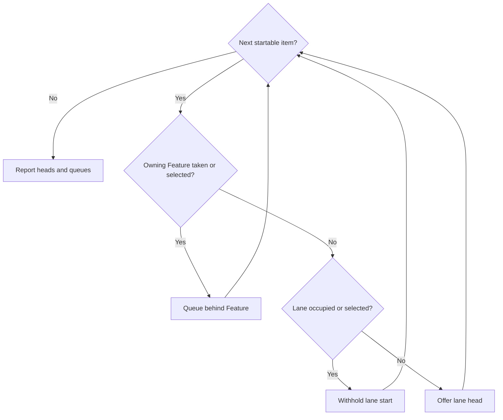

# Specification: Next work

## 1. Business Goal

<!-- last written by: spec-author, 2026-10-27 -->

A person can choose a Feature to finish, follow its remaining prerequisites
and identify the next actionable step, with blockers and occupied work named.
Incomplete evidence remains explicit rather than becoming a zero estimate or
permission to start.

## 2. User Needs

<!-- last written by: spec-author, 2026-10-27 -->

| # | Persona | Need | Pain Point Today |
| --- | --------------------------------- | -------------------------------------------------------------------------- | --------------------------------------------------------------------- |
| 1 | Person choosing a focus | Compare Features by importance, remaining work, blockers and completion path | An item-first list hides which Feature can be driven to completion |
| 2 | Person finishing selected Features | See the next actionable stage and every prerequisite another Feature owns | A focused list stops at a blocker without a path through it |
| 3 | Contributor choosing parallel work | See one head per lane, the occupied lanes and the uncertainty in each split | Independent dependency paths still collide on a shared edit |
| 4 | Consuming repository | Rank its queue by the same model as every other repository | Each repository re-derives a formula, and two answers cannot be compared |

### Assumptions

| ID | Assumption |
| --- | ----------------------------------------------------------------------------------------------------------------------- |
| A-1 | The companion `<project>-conventions` § "Next work" names tracker access, the identity contract, planning metadata, ranking inputs, shared-edit evidence, reservations and where standalone work appears. |
| A-2 | Every specification read follows the method's layout: § 11 names the claims each question blocks and § 12 records approval by section. |

## 3. Acceptance Criteria

<!-- last written by: spec-author, 2026-10-27 -->

Each source is a section of [`SKILL.md`](../SKILL.md).

| ID | Claim | Source | Status |
| ----- | -------------------------------------------------------------------------------------------------------------------------------------------------------------------------------------------------- | ---------------------------------------- | ------ |
| B-001 | Given a request to choose or finish Features, this Feature reports Feature comparisons and completion paths before any lane, blocker or item list. | § Report without taking work; § Never add | Active |
| B-002 | Given a Feature in the comparison, this Feature names its stable id, importance, remaining work, blockers, completion path and next available step, with importance, proximity to completion and blocker count as separate values. | § Start with the Feature choice | Active |
| B-003 | Given a requested Feature set, this Feature includes each required prerequisite another Feature owns, naming its owner and what it advances. | § Start with the Feature choice; § Report without taking work | Active |
| B-004 | Given a requested Feature set, this Feature leaves out work that advances none of the requested Features. | § Start with the Feature choice | Active |
| B-005 | Given a requested Feature that does not resolve, this Feature reports a scope error and does not widen the answer to other work. | § Start with the Feature choice | Active |
| B-006 | Given a valid scope with no available start, this Feature answers with the blockers and occupied work that explain it, not with an empty success. | § Derive an evidenced next step | Active |
| B-007 | Given one request, this Feature derives its comparison, scores, completion paths and lanes from one set of observed inputs. | § Start with the Feature choice | Active |
| B-008 | Given a report, this Feature names when its inputs were read. | § Start with the Feature choice | Active |
| B-009 | Given work at the specification, decomposition, design, investigation or implementation stage whose own inputs permit that stage, this Feature states that stage as its next step. | § Derive an evidenced next step | Active |
| B-010 | Given work at intake or decomposition, this Feature recommends authoring or splitting the agreement without requiring the approval that agreement will produce. | § Stage gates | Active |
| B-011 | Given design work, this Feature offers it only when §§ 1-5 are approved for its linked claims and no open question blocks them. | § Stage gates | Active |
| B-012 | Given design work whose gate is met and an unfinished implementation prerequisite, this Feature offers the design as the next step. | § Stage gates | Active |
| B-013 | Given implementation work, this Feature offers it only when §§ 1-7 are approved and the design is Ready for its linked claims, no open question blocks those claims and every prerequisite is delivered. | § Stage gates | Active |
| B-014 | Given a `spec_status` or an item status that reads as approved or ready while the gating § 12 rows are not approved, this Feature treats the gate as unmet. | § Stage gates; § Derive an evidenced next step | Active |
| B-015 | Given an open question whose row names blocked claims, none of which the work links, this Feature does not withhold the work for it. | § Stage gates | Active |
| B-016 | Given a spike, this Feature offers the investigation only when the spike states a bounded question and a time box. | § Stage gates | Active |
| B-017 | Given taken work inside or outside the requested scope, including work in review, this Feature shows its current reservation as occupied and offers no new start in its lane while that reservation remains. | § Stage gates; § Use lanes to support the choice | Active |
| B-018 | Given a prerequisite, this Feature counts it as delivered only when it finished as completed, and not while it is in review, closed as not planned or reopened. | § Stage gates | Active |
| B-019 | Given an item whose dependencies or spikes are unfinished, this Feature treats it as waiting whatever its status says. | § Stage gates | Active |
| B-020 | Given a container with unfinished children, this Feature offers its children as candidates and never the container. | § Stage gates | Active |
| B-021 | Given a stored derived field that disagrees with the authored inputs, this Feature derives the answer from the authored inputs. | § Derive an evidenced next step | Active |
| B-022 | Given ranked work in two priority tiers, this Feature orders the higher tier first whatever the completion scores. | § The ranking model, step 1 | Active |
| B-023 | Given a Feature's unfinished closure, this Feature scores it as the Feature's value divided by the summed cost of that closure, counting each item once even when several children wait on it. | § The ranking model, step 2; § Derive an evidenced next step | Active |
| B-024 | Given an unfinished item in progress or in review, this Feature counts its full cost in the closure until it is delivered. | § The ranking model, step 2 | Active |
| B-025 | Given a prerequisite that advances several selected Features, this Feature ranks it at the strongest tier among them and the best score within that tier. | § The ranking model, step 3 | Active |
| B-026 | Given a prerequisite that also advances an unselected Feature, this Feature's focused recommendation is the same as without that Feature. | § The ranking model, step 3 | Active |
| B-027 | Given two items with equal tier and score, this Feature orders them by the number of open items waiting on each, then by stable id, comparing exact values. | § The ranking model, step 4 | Active |
| B-028 | Given missing value, missing cost, unknown decomposition, a cycle, or an active claim with neither planned work nor verified delivery, this Feature leaves the affected score uncomputed, neither zero nor infinite. | § The ranking model | Active |
| B-029 | Given incomplete evidence for some work, this Feature still ranks and offers the independent work whose evidence is complete. | § Derive an evidenced next step; § Stage gates | Active |
| B-030 | Given work whose delivery state is missing, ambiguous or cannot be read, this Feature offers no start for it. | § Derive an evidenced next step | Active |
| B-031 | Given an item whose claim assignment is missing or names no existing claim, this Feature treats it as unlinked rather than inferring a claim from its prose. | § Derive an evidenced next step | Active |
| B-032 | Given a dependency cycle, a missing link, a decision hold or occupied work in scope, this Feature's report names it and the work it affects. | § Derive an evidenced next step; § Stage gates | Active |
| B-033 | Given a Feature whose known children are all delivered and which has an active claim with neither planned work nor verified delivery, this Feature does not report it finished. | § Report without taking work; § The ranking model | Active |
| B-034 | Given independent available lanes, this Feature offers one ranked startable head per lane, subject to one start per Feature (B-046). | § Use lanes to support the choice | Active |
| B-035 | Given two items with an evidenced shared edit, this Feature places them in one lane even when their dependencies are independent. | § Use lanes to support the choice; § Never add | Active |
| B-036 | Given an inferred lane conflict, this Feature states the evidence for it and its uncertainty. | § Use lanes to support the choice | Active |
| B-037 | Given actionable work that lacks ranking inputs, this Feature lists it apart from the ranked lane heads and not as blocked. | § Use lanes to support the choice | Active |
| B-038 | Given actionable standalone work, this Feature keeps it visible in the report as the companion directs. | § Use lanes to support the choice | Active |
| B-039 | Given a request to expand detail on a report, this Feature shows the same choices from the same inputs. | § Report without taking work | Active |
| B-040 | Given a request for the next work, this Feature claims no item, edits no record, writes back no derived value, and starts no branch, worktree or dispatch. | § Report without taking work; § The ranking model; § Never add | Active |
| B-041 | Given a dependency cycle in scope, this Feature routes it to grooming as a re-cut and drops no edge to break it. | § Stage gates | Active |
| B-042 | Given a mirrored `status` that disagrees with the tracker, this Feature reads delivery state from the tracker and names the disagreement; an unreadable tracker is B-030. | § Derive an evidenced next step | Active |
| B-043 | Given two records claiming one stable id, this Feature names the duplicate, chooses neither, and offers no start for the work that depends on either. | § Derive an evidenced next step | Active |
| B-044 | Given an open question whose row names no blocked claim (a row reading `None` names that it blocks nothing), this Feature treats its Feature's design and implementation readiness as unverified, offers neither, and names the gap. | § Stage gates | Active |
| B-045 | Given a Feature whose unfinished closure is empty and whose every active claim is delivered, this Feature reports it finished and leaves it out of ranking. | § Report without taking work; § The ranking model | Active |
| B-046 | Given startable items in one Feature in separate lanes, this Feature offers at most one start for that Feature, shows the others queued behind it, and offers none while the Feature has taken work. | § Use lanes to support the choice | Active |

## 4. Constraints

<!-- last written by: spec-author, 2026-10-27 -->

| ID | Constraint | Rules Out |
| --- | ----------------------------------------------------------------------------------------------------------------------- | --------------------------------------------------------------------------------------------- |
| C-1 | The tracker owns delivery state and the repository owns content, per `sdd-conventions` § "The spec / work-item split". | The skill keeping, inferring or writing a delivery record of its own |
| C-2 | `SKILL.md` names no repository, path, command, tracker or tool; the companion § "Next work" names them. | A tracker query, a metadata field the method does not define, an estimate scale, a priority vocabulary or an invocation flag in the skill |
| C-3 | The ranking model is the same in every repository; the companion names where its inputs are authored. | A per-repository formula, tier order or tie rule |

## 5. Out of Scope

<!-- last written by: spec-author, 2026-10-27 -->

| # | Item | Exclusion Reason |
| --- | ---------------------------------------------------------------------------- | ------------------------------------------------------------------------------------------ |
| 1 | Claiming, starting or dispatching the recommended work | Taking work is delivery, owned by [`deliver-change`](../../deliver-change/SKILL.md); B-040 |
| 2 | Authoring value, cost, claim assignments or dependencies | Authored at grooming; this Feature reads them and invents none (B-028, B-031) |
| 3 | Tracker access, metadata field names, estimate scale, priority vocabulary and the shared-edit registry | The companion's § "Next work" (C-2) |
| 4 | Saved release or goal targets as a scope | `SKILL.md` scopes by the requested Feature or Feature set; a saved target is a membership model of its own |
| 5 | A per-item declaration of the files it will edit | Lanes are inferred from evidenced shared edits, with the uncertainty stated (B-035, B-036) |
| 6 | An executable, tool or command that computes the answer | The deliverable is a skill an agent follows; § 7 |

## 6. Concern Separation

<!-- last written by: architect, 2026-10-27 -->

| Concern | Classification | Claims |
| --- | --- | --- |
| Feature comparisons, requested scope and standalone work | Business | B-001–B-006, B-037–B-038 |
| Stage evidence, delivery state and completion | Business | B-009–B-020, B-030, B-033, B-042–B-045 |
| Ranking policy and selected-Feature standing | Business | B-022, B-025–B-026 |
| Exact closure arithmetic and tie order | Technical | B-023–B-024, B-027 |
| Authored inputs, gaps, duplicate identities and cycles | Both | B-021, B-028–B-032, B-041, B-043 |
| Lanes, conflicts and one start per Feature | Both | B-034–B-036, B-046 |
| One read-only snapshot and stable detail | Technical | B-007–B-008, B-039–B-040 |
| Companion input mapping | Technical | C-2–C-3 |

## 7. Technical Design

<!-- last written by: architect, 2026-10-27 -->

The deliverable is portable guidance, not an executable (decision 0015).
0001-F1 B-004 projects it byte-for-byte; ADR-0002 requires committed,
drift-checked outputs. 0001-F4 B-001 keeps responsibility references role-free.

Read companion inputs, specification frontmatter and §§ 3, 7, 11, 12, and tracker
state once; record read time. Derive scope, gates, closures, rankings and lanes
from that snapshot. More detail preserves the same choices. Recommendation
never writes, takes work, starts a branch/worktree or dispatches (B-007–B-008,
B-039–B-040).

### Delivery and approval evidence

The tracker alone supplies delivery state (decision 0016). A disagreeing mirror
is a maintenance diagnostic, never a fallback; unreadable state withholds the
affected start while independent work remains rankable. Coordination identity
follows 0001-F2 decision 0003 and the companion; a Feature coordinator occupies
no child lane. Completion evidence cannot silently change tracker state.

0001-F2 decision 0005 governs reservations. Taken work, including review,
occupies its lane until explicit recorded release; release does not deliver it,
and authorized reassignment retains the reservation. Missing ownership is a gap,
not release (B-017; decision 0017). Recommendation performs none of these actions.

Evaluate stage gates per linked claim from applicable § 12 approval and § 11
questions; neither maturity nor tracker status substitutes. Readiness must cover
the linked claims (decision 0010). A question with no claim scope leaves the
whole Feature's design/implementation readiness unverified; `Blocks: None`
withholds nothing (B-044; decision 0019). Intake/decomposition may proceed where
approval is unnecessary. Containers with open children yield those children;
waiting derives from unfinished dependencies and spikes.

Approval applicability follows 0001-F2 decision 0007: changed scope and affected
dependencies need a verdict for the current subject; unchanged scope retains
applicable baseline evidence. Unclear/conflicting evidence withholds the affected
gate. Recommendation never edits sign-off or maturity.

### Ranking and incomplete evidence

Use authored priority/value/cost, explicit claim assignment and verified state.
Never infer claim links from prose or consume stored rank, blocks or waiting.
Missing inputs, decomposition or identity leave affected scores uncomputed and
starts withheld, with each gap named; independent work remains ranked. Duplicate
stable IDs select neither record and withhold every dependent start (B-043;
decision 0018). Companion identity rules determine the correction.

One lexicographic order governs all work: priority tier descending, exact
completion ratio descending, number of open waiting items descending, stable ID
ascending. A Feature's ratio is value divided by its unfinished transitive closure
cost. The closure is a set across Features: each open child/prerequisite counts
once at full cost until delivery. Round only for display. A prerequisite inherits
the strongest tier among selected Features it advances, then their best score
in that tier; unselected Features cannot move it (B-022–B-027).

Missing or zero total cost yields an uncomputed score. A Feature is finished only
when its closure is empty and every active claim has delivery evidence; report it
outside ranking (decision 0020). Delivered children with an active unplanned,
unverified claim mean unknown scope, not completion. Cycles terminate set
collection but leave members and affected Features unscored; name and route them to
grooming for merge, extraction or narrower dependency edges, never drop an edge
(B-041). Rank unaffected work.

### Lanes and starts

Dependency paths and evidenced shared edits join lanes transitively. State the
evidence and uncertainty of inferred joins; a shared Feature alone joins no lane.
Lanes predict parallelism, not conflict-free merging (decision 0011).

Scan startable items once in ranking order. First enforce one start per owning
Feature, including taken work; a capped item stays queued behind its Feature,
and its lane may offer the next item. Then reject an occupied lane or one with
an existing head; otherwise offer its head. A cross-Feature prerequisite consumes
its owner's start, not the selected Feature's. Actionable unscored work remains
separate, outside head selection; mark it queued if its Feature is occupied
(B-034, B-037, B-046; decision 0021).



Decision 0021: Feature caps precede lane selection; B-027 makes the scan total.

### Companion boundary

The method owns gates, arithmetic, tie order, caps and report placement. The
companion supplies authored-field locations, tier vocabulary/order, estimate
scale, tracker access/state field, reservation records, claim assignments,
identity/dependency contracts, shared-edit evidence and standalone-work location
(C-2–C-3, A-1). Cost is authored separately from risk. No per-repository ranking
variant is permitted.

```mermaid
sequenceDiagram
  actor Person
  participant Method as Next guidance
  participant Companion
  participant Specs as Specifications
  participant Tracker
  Person->>Method: Request optional Feature scope
  Method->>Companion: Read input mapping
  Method->>Specs: Read agreement, design and approvals
  Method->>Tracker: Read delivery and reservations
  Note over Method: Freeze inputs and read time
  alt Unknown requested Feature
    Method-->>Person: Scope error; do not widen
  else Resolved scope
    Method-->>Person: Feature comparisons, lanes, blockers and diagnostics
  end
  Person->>Method: Request detail
  Method-->>Person: Same snapshot and choices
```

C-1–C-3: the sequence has no writes. Database/class/state views do not apply:
there is no executable or stored workflow; the tracker owns delivery lifecycle.

Historical finding 5 was resolved in reviewed subject
`b148707e323938c2eb58ed22479ae09604c318bf781168cf3b0de07a5fffa088`, approved by
`/root/baseline_roles_next` on 2026-10-17. This is evidence for that subject,
not approval of this edit.

Readiness: Ready for tests and implementation for B-001–B-046. Risk is low for
the decision-driven prose changes; claim delivery still requires § 9 evidence.

## 8. Testing Strategy

<!-- last written by: test-writer, 2026-10-27 -->

Review scenarios against the cited skill text. The deliverable is prose; no
executable tier or behavior runner is established. Manual instruction checks do
not fill Missing traceability rows.

Use synthetic ownership, tracker and revision states to assess coordination
source/mirror drift without writes, same-owner continuation, release/reassignment
and changed-scope approval. Supporting authority is 0001-F2 B-043, 0001-F2 B-045
and 0001-F2 B-047. Authored walkthroughs and independent content review do not
establish live workflow behavior.

### Performance

Not applicable.

## 9. Traceability Matrix

<!-- last written by: test-writer, 2026-10-27 -->

| Claim ID | Scenario                                                    | Test    | Status  |
| -------- | ----------------------------------------------------------- | ------- | ------- |
| B-001    | Feature comparisons lead the report                         | Missing | Missing |
| B-002    | A Feature comparison keeps its facts apart                  | Missing | Missing |
| B-003    | A focused answer includes another Feature's prerequisite    | Missing | Missing |
| B-004    | A focused answer leaves out unrelated work                  | Missing | Missing |
| B-005    | An unknown Feature is a scope error                         | Missing | Missing |
| B-006    | A valid scope with no start is explained                    | Missing | Missing |
| B-007    | One set of inputs serves the whole answer                   | Missing | Missing |
| B-008    | The report says when its inputs were read                   | Missing | Missing |
| B-009    | Each stage can be the next step                             | Missing | Missing |
| B-010    | Intake does not wait for its own approval                   | Missing | Missing |
| B-011    | Design waits for an approved agreement                      | Missing | Missing |
| B-012    | Design runs ahead of an unfinished prerequisite             | Missing | Missing |
| B-013    | Implementation waits for approval, design and delivery      | Missing | Missing |
| B-014    | A status is not approval                                    | Missing | Missing |
| B-015    | An unrelated question blocks nothing                        | Missing | Missing |
| B-016    | A spike needs a bounded question and a time box             | Missing | Missing |
| B-017    | Taken work occupies its lane                                | Missing | Missing |
| B-018    | Only work finished as completed is delivered                | Missing | Missing |
| B-019    | Waiting is derived, not recorded                            | Missing | Missing |
| B-020    | A container is not offered while it has open children       | Missing | Missing |
| B-021    | Authored inputs win over a stored derived value             | Missing | Missing |
| B-022    | Priority tier comes before completion score                 | Missing | Missing |
| B-023    | A shared prerequisite is counted once                       | Missing | Missing |
| B-024    | Work in progress keeps its full cost                        | Missing | Missing |
| B-025    | A prerequisite inherits the strongest selected Feature      | Missing | Missing |
| B-026    | An unselected Feature does not move a focused answer        | Missing | Missing |
| B-027    | Ties break on waiting work, then stable id                  | Missing | Missing |
| B-028    | Missing inputs leave a score uncomputed                     | Missing | Missing |
| B-029    | Independent work is still ranked                            | Missing | Missing |
| B-030    | Unverified delivery state offers no start                   | Missing | Missing |
| B-031    | A claim link is not inferred from prose                     | Missing | Missing |
| B-032    | Gaps in scope are named                                     | Missing | Missing |
| B-033    | Delivered children alone do not finish a Feature            | Missing | Missing |
| B-034    | One head per available lane                                 | Missing | Missing |
| B-035    | A shared edit joins two lanes                               | Missing | Missing |
| B-036    | An inferred conflict carries its evidence and uncertainty   | Missing | Missing |
| B-037    | Unscored work is not reported as blocked                    | Missing | Missing |
| B-038    | Standalone work stays visible                               | Missing | Missing |
| B-039    | Expanding the report does not change its choices            | Missing | Missing |
| B-040    | Asking what is next takes no work                           | Missing | Missing |
| B-041    | A dependency cycle goes to grooming as a re-cut             | Missing | Missing |
| B-042    | The tracker wins over a mirrored status                     | Missing | Missing |
| B-043    | A duplicate id is named, not resolved                       | Missing | Missing |
| B-044    | A question naming no claim leaves readiness unverified      | Missing | Missing |
| B-045    | A finished Feature is not ranked                            | Missing | Missing |
| B-046    | One start per Feature                                       | Missing | Missing |

### Manual evidence

Authored static walkthroughs assess coordination source/mirror behavior against
0001-F2 B-043, continuation/reservation against 0001-F2 B-045, and changed versus
unchanged revision scope against 0001-F2 B-047. Independent content review is
recorded in § 12; Missing executable coverage remains Missing. Bounded historical
routing probes are recorded in 0001-F2 § 9; they do not fill these rows.

## 10. Lessons / Spec Deltas

<!-- last written by: spec-author, 2026-10-27 -->

| Date | Trigger | Change | Affected IDs |
| --- | --- | --- | --- |
| 2026-10-14 | Original planning agreement | Establish portable claims and local decision records; exclude repository-specific tracker syntax, tooling and metadata. | B-001–B-041; C-1–C-3; decisions 0001–0015 |
| 2026-10-15 | Maintainer rulings | Resolve tracker source, review reservations, duplicate IDs, unscoped questions, completion and one-start policy. | OQ-1–OQ-6; decisions 0016–0021; B-017, B-030, B-034, B-042–B-046 |
| 2026-10-17 | Baseline review | Align canonical lanes and reservation guidance with explicit-release policy. | B-017, B-046; decision 0017 |
| 2026-10-17 | Current approval applicability | Apply 0001-F2 decision 0007 to stage gates. | B-011–B-014; § 7 |
| 2026-10-17 | Ownership continuation | Apply 0001-F2 decision 0005 to current reservations. | B-017 |
| 2026-10-17 | Single coordination source | Apply 0001-F2 decision 0003; distinguish coordination records and delivery children. | B-017, B-040, B-042, B-046 |
| 2026-10-27 | Confirmed concise-specification plan | Compress in place; qualify sibling references; separate strategy, locators and history. | §§ 1–12; IDs unchanged |

## 11. Open Questions

<!-- last written by: spec-author, 2026-10-27 -->

| ID | Question | Blocks | Resolution |
| ---- | ------------------------------------------------------------------------------------------------------------------------------------------------------------------------------------------------ | ---------------------- | ---------- |
| OQ-1 | Given a specification's mirrored `status` that disagrees with the tracker, or a tracker that cannot be read, does this Feature read delivery state only from the tracker? `SKILL.md` does not say. | B-042 | Resolved 2026-10-15: yes. A disagreeing mirror is a diagnostic and an unreadable tracker offers no start; [decision 0016](decisions/0016-the-tracker-is-the-only-delivery-source.md), B-042. |
| OQ-2 | Given work in review, is it taken and does it hold its lane until delivered? `SKILL.md` counts its cost and refuses it as a prerequisite but does not say whether it reserves. | B-017 | Resolved 2026-10-15: yes. Review is taken and holds its lane until delivered; [decision 0017](decisions/0017-work-in-review-holds-its-lane.md), B-017. |
| OQ-3 | Given two records claiming one stable id, does this Feature diagnose the duplicate rather than choose one, or is that wholly the companion's identity contract? | B-043 | Resolved 2026-10-15: diagnose. The duplicate is named, neither record chosen, dependent starts withheld; [decision 0018](decisions/0018-a-duplicate-id-is-diagnosed.md), B-043. |
| OQ-4 | Given an open question whose § 11 row names no blocked claim, does it block every claim of the Feature, none, or leave the work's readiness unverified? | B-011, B-013, B-015 | Resolved 2026-10-15: unverified. Design and implementation starts are withheld and the gap named; [decision 0019](decisions/0019-an-unscoped-question-leaves-readiness-unverified.md), B-044. |
| OQ-5 | Given a Feature whose closure is empty and whose claims are all delivered, is it reported as finished, and is it left out of ranking? `SKILL.md` says only when a score is never infinite. | B-033 | Resolved 2026-10-15: yes to both. Finished and left out of ranking; [decision 0020](decisions/0020-a-finished-feature-is-not-ranked.md), B-045. |
| OQ-6 | Given two startable items in one Feature with no shared edit, are they two lanes, or is a Feature itself one lane with one active item? | B-034, B-035 | Resolved 2026-10-15: two lanes, one start. Lanes come from edits, but the Feature gets at most one start; [decision 0021](decisions/0021-one-start-per-feature.md), B-046. |
| OQ-7 | Should the adopted planning decisions be recorded as decision records in this Feature's `decisions/`, so the alternatives they rejected can be reviewed beside the claims? | None | Resolved 2026-10-14: yes. Decisions 0001–0015 record the adopted choices and rejected alternatives in [`decisions/`](decisions/). |

## 12. Sign-off

<!-- last written by: spec-author, 2026-10-27 -->

| Section | Status | Reviewer | Note |
| --- | --- | --- | --- |
| Concision migration: §§ 1–12 | 🟢 | spec-reviewer | Independent `/root/review`, 2026-10-27: Approved snapshot SHA-256 `f27fd76c55d76a7023b3e96f55f010b453564c682325dd738b0b557381841b38`; no findings. Unchanged baseline scope retains its prior evidence; no new behavior or coverage is approved. |

### Historical verdicts

These verdicts concern earlier subjects; they do not approve this migration.
Full notes, limitations and superseded pending rows are recoverable from § 12
of this specification at Git revision `57cd1200b089d2872d4538c91b5d085cf069307d`.

| Scope | Verdict | Reviewer | Subject / evidence |
| --- | --- | --- | --- |
| Design: § 7 coordination, ownership and approval applicability | 🟢 | spec-reviewer | 2026-10-17; `/root/contract_design_diff_review`; `36ab103e778d070d3ca8291ab56c63a0b96991bf6c656fb5c176ffce63785d5b`; retrospective; not proof of pre-implementation review |
| Diff: §§ 3, 7–8, 10, 12 and scenarios | 🟢 | spec-reviewer | 2026-10-17; `/root/contract_design_diff_review`; `36ab103e778d070d3ca8291ab56c63a0b96991bf6c656fb5c176ffce63785d5b` |
| Baseline: 1-12 and scenarios | 🟢 | spec-reviewer | 2026-10-17; `/root/baseline_roles_next`; `2997ac3c6dbdf3bef910ffb6fef86aecc19d0bed`; retrospective; No historical pre-implementation approval; Missing |
| Correction: §7, scenarios, decision0017 and canonical lanes | 🟢 | spec-reviewer | 2026-10-17; `/root/baseline_roles_next`; `b148707e323938c2eb58ed22479ae09604c318bf781168cf3b0de07a5fffa088`; Missing |
| Diff: lane and reservation corrections | 🟢 | spec-reviewer | 2026-10-17; `/root/baseline_roles_next`; `a148bf47a5a726c87dbf4908547bcc27c6cfe56c70dfb7b7b95a2ca33ab629ed`; Missing |

## Tasks

<!-- last written by: organizer, 2026-10-17 -->

- [0052 — Coordinate Next work delivery](../.issue/0052-coordinate-next-work.yml) — authoritative delivery-status source.

Supporting root history, retaining its existing parents: [0004 — Original agreement](../../../.issue/0004-next-skill-agreement.yml), [0030 — Specification authoring](../../../.issue/0030-next-skill-specification.yml), [0037 — Design alignment](../../../.issue/0037-align-f5-design-with-rulings.yml), and [0047 — Open-question rulings](../../../.issue/0047-resolve-f5-open-questions.yml).

## Scoring

| Field | Value | Basis                                                |
| ----- | ----- | ---------------------------------------------------- |
| value | 0     | Not scored: tooling agreement, not a product Feature |
| risk  | 0     | Not scored: tooling agreement, not a product Feature |
