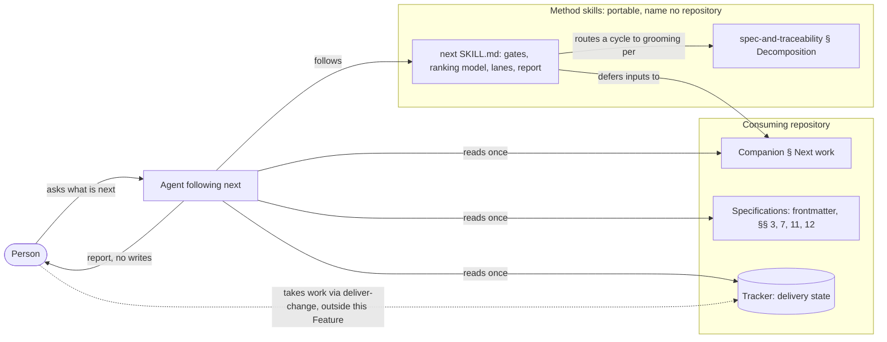
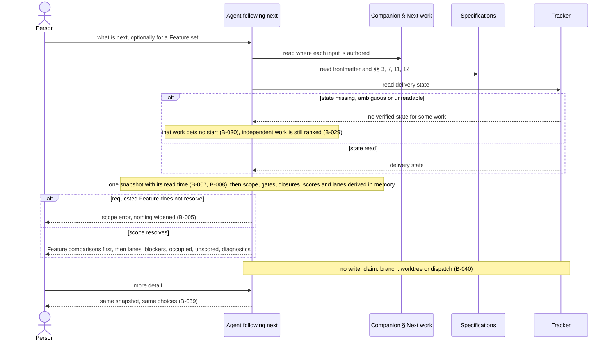

# Specification: Next work

## 1. Business Goal

<!-- last written by: spec-author, 2026-10-14 -->

A person asking what to work on next gets an answer they can act on: which
Feature to drive to completion, the path through its remaining work and
prerequisites, and the one step that is actionable now, with every blocked or
occupied step named. Without this Feature the answer is a task list that hides
which Feature can be finished, offers work whose agreement or design is not
approved, ranks the same queue differently in two repositories, and treats a
missing estimate or an unreadable tracker as zero or as permission to start.

## 2. User Needs

<!-- last written by: spec-author, 2026-10-14 -->

| #   | Persona                           | Need                                                                       | Pain Point Today                                                      |
| --- | --------------------------------- | -------------------------------------------------------------------------- | --------------------------------------------------------------------- |
| 1   | Person choosing a focus           | Compare Features by importance, remaining work, blockers and completion path | An item-first list hides which Feature can be driven to completion    |
| 2   | Person finishing selected Features | See the next actionable stage and every prerequisite another Feature owns | A focused list stops at a blocker without a path through it           |
| 3   | Contributor choosing parallel work | See one head per lane, the occupied lanes and the uncertainty in each split | Independent dependency paths still collide on a shared edit           |
| 4   | Consuming repository              | Rank its queue by the same model as every other repository                 | Each repository re-derives a formula, and two answers cannot be compared |

### Assumptions

| ID  | Assumption                                                                                                              |
| --- | ----------------------------------------------------------------------------------------------------------------------- |
| A-1 | The companion `<project>-conventions` § "Next work" names tracker access, the identity contract, planning metadata, ranking inputs, shared-edit evidence, reservations and where standalone work appears. |
| A-2 | Every specification read follows the method's layout: § 11 names the claims each question blocks and § 12 records approval by section. |

## 3. Acceptance Criteria

<!-- last written by: spec-author, 2026-10-15 -->

Each source is a section of [`SKILL.md`](../SKILL.md).

| ID    | Claim                                                                                                                                                                                              | Source                                   | Status |
| ----- | -------------------------------------------------------------------------------------------------------------------------------------------------------------------------------------------------- | ---------------------------------------- | ------ |
| B-001 | Given a request to choose or finish Features, this Feature reports Feature comparisons and completion paths before any lane, blocker or item list.                                                  | § Report without taking work; § Never add | Active |
| B-002 | Given a Feature in the comparison, this Feature names its stable id, importance, remaining work, blockers, completion path and next available step, with importance, proximity to completion and blocker count as separate values. | § Start with the Feature choice          | Active |
| B-003 | Given a requested Feature set, this Feature includes each required prerequisite another Feature owns, naming its owner and what it advances.                                                       | § Start with the Feature choice; § Report without taking work | Active |
| B-004 | Given a requested Feature set, this Feature leaves out work that advances none of the requested Features.                                                                                          | § Start with the Feature choice          | Active |
| B-005 | Given a requested Feature that does not resolve, this Feature reports a scope error and does not widen the answer to other work.                                                                   | § Start with the Feature choice          | Active |
| B-006 | Given a valid scope with no available start, this Feature answers with the blockers and occupied work that explain it, not with an empty success.                                                  | § Derive an evidenced next step          | Active |
| B-007 | Given one request, this Feature derives its comparison, scores, completion paths and lanes from one set of observed inputs.                                                                        | § Start with the Feature choice          | Active |
| B-008 | Given a report, this Feature names when its inputs were read.                                                                                                                                      | § Start with the Feature choice          | Active |
| B-009 | Given work at the specification, decomposition, design, investigation or implementation stage whose own inputs permit that stage, this Feature states that stage as its next step.                | § Derive an evidenced next step          | Active |
| B-010 | Given work at intake or decomposition, this Feature recommends authoring or splitting the agreement without requiring the approval that agreement will produce.                                    | § Stage gates                            | Active |
| B-011 | Given design work, this Feature offers it only when §§ 1-5 are approved for its linked claims and no open question blocks them.                                                                    | § Stage gates                            | Active |
| B-012 | Given design work whose gate is met and an unfinished implementation prerequisite, this Feature offers the design as the next step.                                                                | § Stage gates                            | Active |
| B-013 | Given implementation work, this Feature offers it only when §§ 1-7 are approved and the design is Ready for its linked claims, no open question blocks those claims and every prerequisite is delivered.                     | § Stage gates                            | Active |
| B-014 | Given a `spec_status` or an item status that reads as approved or ready while the gating § 12 rows are not approved, this Feature treats the gate as unmet.                                         | § Stage gates; § Derive an evidenced next step | Active |
| B-015 | Given an open question whose row names blocked claims, none of which the work links, this Feature does not withhold the work for it. | § Stage gates                            | Active |
| B-016 | Given a spike, this Feature offers the investigation only when the spike states a bounded question and a time box.                                                                                 | § Stage gates                            | Active |
| B-017 | Given taken work inside or outside the requested scope, including work in review, this Feature shows it as occupied until it is delivered and offers no new start in its lane. | § Stage gates; § Use lanes to support the choice | Active |
| B-018 | Given a prerequisite, this Feature counts it as delivered only when it finished as completed, and not while it is in review, closed as not planned or reopened.                                    | § Stage gates                            | Active |
| B-019 | Given an item whose dependencies or spikes are unfinished, this Feature treats it as waiting whatever its status says.                                                                            | § Stage gates                            | Active |
| B-020 | Given a container with unfinished children, this Feature offers its children as candidates and never the container.                                                                               | § Stage gates                            | Active |
| B-021 | Given a stored derived field that disagrees with the authored inputs, this Feature derives the answer from the authored inputs.                                                                    | § Derive an evidenced next step          | Active |
| B-022 | Given ranked work in two priority tiers, this Feature orders the higher tier first whatever the completion scores.                                                                                 | § The ranking model, step 1              | Active |
| B-023 | Given a Feature's unfinished closure, this Feature scores it as the Feature's value divided by the summed cost of that closure, counting each item once even when several children wait on it.    | § The ranking model, step 2; § Derive an evidenced next step | Active |
| B-024 | Given an unfinished item in progress or in review, this Feature counts its full cost in the closure until it is delivered.                                                                        | § The ranking model, step 2              | Active |
| B-025 | Given a prerequisite that advances several selected Features, this Feature ranks it at the strongest tier among them and the best score within that tier.                                         | § The ranking model, step 3              | Active |
| B-026 | Given a prerequisite that also advances an unselected Feature, this Feature's focused recommendation is the same as without that Feature.                                                         | § The ranking model, step 3              | Active |
| B-027 | Given two items with equal tier and score, this Feature orders them by the number of open items waiting on each, then by stable id, comparing exact values.                                       | § The ranking model, step 4              | Active |
| B-028 | Given missing value, missing cost, unknown decomposition, a cycle, or an active claim with neither planned work nor verified delivery, this Feature leaves the affected score uncomputed, neither zero nor infinite. | § The ranking model                      | Active |
| B-029 | Given incomplete evidence for some work, this Feature still ranks and offers the independent work whose evidence is complete.                                                                     | § Derive an evidenced next step; § Stage gates | Active |
| B-030 | Given work whose delivery state is missing, ambiguous or cannot be read, this Feature offers no start for it.                                                                                     | § Derive an evidenced next step          | Active |
| B-031 | Given an item whose claim assignment is missing or names no existing claim, this Feature treats it as unlinked rather than inferring a claim from its prose.                                      | § Derive an evidenced next step          | Active |
| B-032 | Given a dependency cycle, a missing link, a decision hold or occupied work in scope, this Feature's report names it and the work it affects.                                                      | § Derive an evidenced next step; § Stage gates | Active |
| B-033 | Given a Feature whose known children are all delivered and which has an active claim with neither planned work nor verified delivery, this Feature does not report it finished.                  | § Report without taking work; § The ranking model | Active |
| B-034 | Given independent available lanes, this Feature offers one ranked startable head per lane, subject to one start per Feature (B-046). | § Use lanes to support the choice        | Active |
| B-035 | Given two items with an evidenced shared edit, this Feature places them in one lane even when their dependencies are independent.                                                                 | § Use lanes to support the choice; § Never add | Active |
| B-036 | Given an inferred lane conflict, this Feature states the evidence for it and its uncertainty.                                                                                                     | § Use lanes to support the choice        | Active |
| B-037 | Given actionable work that lacks ranking inputs, this Feature lists it apart from the ranked lane heads and not as blocked.                                                                       | § Use lanes to support the choice        | Active |
| B-038 | Given actionable standalone work, this Feature keeps it visible in the report as the companion directs.                                                                                           | § Use lanes to support the choice        | Active |
| B-039 | Given a request to expand detail on a report, this Feature shows the same choices from the same inputs.                                                                                           | § Report without taking work             | Active |
| B-040 | Given a request for the next work, this Feature claims no item, edits no record, writes back no derived value, and starts no branch, worktree or dispatch.                                         | § Report without taking work; § The ranking model; § Never add | Active |
| B-041 | Given a dependency cycle in scope, this Feature routes it to grooming as a re-cut and drops no edge to break it.                                                                              | § Stage gates                            | Active |
| B-042 | Given a mirrored `status` that disagrees with the tracker, this Feature reads delivery state from the tracker and names the disagreement; an unreadable tracker is B-030. | § Derive an evidenced next step | Active |
| B-043 | Given two records claiming one stable id, this Feature names the duplicate, chooses neither, and offers no start for the work that depends on either. | § Derive an evidenced next step | Active |
| B-044 | Given an open question whose row names no blocked claim (a row reading `None` names that it blocks nothing), this Feature treats its Feature's design and implementation readiness as unverified, offers neither, and names the gap. | § Stage gates | Active |
| B-045 | Given a Feature whose unfinished closure is empty and whose every active claim is delivered, this Feature reports it finished and leaves it out of ranking. | § Report without taking work; § The ranking model | Active |
| B-046 | Given startable items in one Feature in separate lanes, this Feature offers at most one start for that Feature, shows the others queued behind it, and offers none while the Feature has taken work. | § Use lanes to support the choice | Active |

## 4. Constraints

<!-- last written by: spec-author, 2026-10-14 -->

| ID  | Constraint                                                                                                              | Rules Out                                                                                     |
| --- | ----------------------------------------------------------------------------------------------------------------------- | --------------------------------------------------------------------------------------------- |
| C-1 | The tracker owns delivery state and the repository owns content, per `sdd-conventions` § "The spec / work-item split". | The skill keeping, inferring or writing a delivery record of its own                          |
| C-2 | `SKILL.md` names no repository, path, command, tracker or tool; the companion § "Next work" names them.               | A tracker query, a metadata field the method does not define, an estimate scale, a priority vocabulary or an invocation flag in the skill |
| C-3 | The ranking model is the same in every repository; the companion names where its inputs are authored.                  | A per-repository formula, tier order or tie rule                                              |

## 5. Out of Scope

<!-- last written by: spec-author, 2026-10-14 -->

| #   | Item                                                                         | Exclusion Reason                                                                           |
| --- | ---------------------------------------------------------------------------- | ------------------------------------------------------------------------------------------ |
| 1   | Claiming, starting or dispatching the recommended work                       | Taking work is delivery, owned by [`deliver-change`](../../deliver-change/SKILL.md); B-040 |
| 2   | Authoring value, cost, claim assignments or dependencies                     | Authored at grooming; this Feature reads them and invents none (B-028, B-031)             |
| 3   | Tracker access, metadata field names, estimate scale, priority vocabulary and the shared-edit registry | The companion's § "Next work" (C-2)                                         |
| 4   | Saved release or goal targets as a scope                                     | `SKILL.md` scopes by the requested Feature or Feature set; a saved target is a membership model of its own |
| 5   | A per-item declaration of the files it will edit                             | Lanes are inferred from evidenced shared edits, with the uncertainty stated (B-035, B-036) |
| 6   | An executable, tool or command that computes the answer                      | The deliverable is a skill an agent follows; § 7                                           |

## 6. Concern Separation

<!-- last written by: architect, 2026-10-14 -->

| #   | Concern                                                                                                                              | Classification |
| --- | ------------------------------------------------------------------------------------------------------------------------------------ | -------------- |
| 1   | The report: Feature comparisons first with their facts kept apart, unscored and standalone work placed apart (B-001, B-002, B-037, B-038) | Business   |
| 2   | The requested scope: prerequisites another Feature owns, unrelated work left out, an unknown Feature as an error, an empty answer explained (B-003 to B-006) | Business |
| 3   | The evidence each stage needs before it is offered (B-009 to B-016)                                                                  | Business       |
| 4   | What counts as delivered, taken, waiting or a candidate (B-017 to B-020)                                                             | Business       |
| 5   | Ranking policy: tier before completion, a prerequisite's standing taken from the selected Features only (B-022, B-025, B-026)        | Business       |
| 6   | Ranking arithmetic: the closure counted once at full cost, exact comparison, the total tie order (B-023, B-024, B-027)               | Technical      |
| 7   | Authored inputs only: no stored derived field, no claim link inferred from prose (B-021, B-031)                                      | Technical      |
| 8   | Incomplete evidence: uncomputed scores, withheld starts, named gaps, a Feature not called finished, independent work still ranked (B-028 to B-030, B-032, B-033) | Both |
| 9   | Detecting a dependency cycle and routing it to grooming as a re-cut (B-041)                                                          | Both           |
| 10  | Lanes: one head per lane, shared edits joining lanes, each inferred conflict with its evidence and uncertainty (B-034 to B-036)      | Both           |
| 11  | One observed input set, its read time, and detail that leaves the choices unchanged (B-007, B-008, B-039)                            | Technical      |
| 12  | Recommending without taking work or writing anything back (B-040)                                                                    | Business       |
| 13  | The companion seam: where each input is authored and how delivery state is read (C-2, C-3)                                           | Technical      |

## 7. Technical Design

<!-- last written by: architect, 2026-10-14 -->

The deliverable is prose in [`SKILL.md`](../SKILL.md), which an agent follows;
there is no code ([decision 0015](decisions/0015-a-skill-not-an-executable.md)).
`SKILL.md` is the declaring file, and this section records the positions it
carries. [0001-F1](../../../scripts/.spec/README.md) B-004 copies it byte for
byte to each host's skills directory, where the copies are committed and
drift-checked
([ADR-0002](../../../.spec/adr/0002-generated-host-outputs-are-committed.md)). It
names no role ([0001-F4](../../.spec/README.md) B-001): the next actor is a
stage, such as grooming, or a section owner.

### Design positions

- **Observe once, then derive.** The companion's inputs, the specifications'
  frontmatter and §§ 3, 7, 11 and 12, and the tracker's delivery state are read
  once, as one snapshot stamped with its read time (B-007, B-008). Scope, gates,
  closures, scores, paths and lanes are derived from that snapshot alone, so
  expanding detail re-renders the same choices (B-039). Reading is the only
  effect.
- **Read-only.** No item is claimed, no record edited, and no branch, worktree
  or dispatch started (B-040); taking work is delivery's (§ 5 row 1). The
  tracker owns delivery state (C-1); whether a mirrored status may stand in for
  it is OQ-1.
- **Derived values are never written back.** Tier, score, gate, waiting and what
  an item gates exist only in the report (B-040). A stored derived field, such
  as `rank`, `blocks` or a status recording waiting, is never an input; the
  authored fields are (B-019, B-021, decision 0008).
- **Authored evidence only.** A missing value, cost, decomposition, claim link
  or delivery state is a gap, never a default: the dependent score stays
  uncomputed, the affected start is withheld and the gap is named, while
  independent work is still ranked (B-028 to B-032, decisions 0005 and 0012). A
  claim link is the companion's claim assignment, never the item's prose (B-031).
- **Gates per stage and per linked claim.** Approval is read from § 12 by
  section and open questions from § 11 by the claims they block; neither
  `spec_status` nor an item status stands in (B-011, B-013 to B-015). Decision
  0010 scopes every gate to the work's linked claims, the implementation gate's
  "design Ready" included, so a verdict that excepts some claims withholds only
  work linking them. Delivered means finished as completed (B-018); waiting is
  derived from unfinished `depends_on` and spikes (B-019); a container with open
  children yields its children (B-020).
- **One ranking model; the companion names its inputs.** `SKILL.md` § "The
  ranking model" is the only statement of the arithmetic (C-3). Work orders by
  one lexicographic key: priority tier, highest first; then completion score,
  the Feature's value over the summed cost of its unfinished closure; then the
  number of open items waiting on the item, most first; then stable id, lowest
  first (B-022, B-023, and the B-027 scenarios). The closure is a set — the open
  children and every open item they wait on, transitively and in any Feature —
  so each item counts once, at full cost until delivered (B-023, B-024). Scores
  compare as exact ratios, rounded only for display. A prerequisite takes the
  strongest tier among the selected Features it advances, then the best score in
  that tier, so an unselected Feature cannot move it (B-025, B-026). A score
  missing an input, or whose closure sums to no cost, is uncomputed — never
  zero, never infinite (B-028); how an empty closure is reported is OQ-5.
- **A cycle is routed, never broken.** Collecting a closure as a set terminates
  on a cycle; the members, and every Feature whose closure reaches one, stay
  unscored (B-028). The report names the members and the work they affect
  (B-032) and routes the cycle to grooming as a re-cut under
  [`spec-and-traceability`](../../spec-and-traceability/SKILL.md)
  § "Decomposition" — merge, extract, or narrow the edge — with no edge dropped
  (B-041). The rest of the queue is still ranked (B-029).
- **Lanes partition the open work.** Each item has one lane, and a dependency
  path or an evidenced shared edit puts two items in the same one, so joins are
  transitive (B-035). An inferred join states its evidence and its uncertainty
  (B-036); a lane predicts parallel work and promises no conflict-free merge
  (decision 0011). Whether a shared parent Feature is such a path is OQ-6. A
  lane holding taken work is occupied (B-017); every other lane offers its first
  startable item in ranking order (B-034). Actionable unscored work is listed
  apart, not as blocked (B-037).

### The companion seam

`SKILL.md` keeps every rule and defers every repository fact to the companion's
§ "Next work" (C-2, A-1).

| `SKILL.md` fixes                                         | The companion names                                                                         |
| -------------------------------------------------------- | ------------------------------------------------------------------------------------------- |
| Tier before score, the score, the closure, the tie order | Where value, cost and priority are authored; the tier vocabulary in order; the estimate scale |
| What delivered, taken and waiting mean                   | Tracker access, the field carrying delivery state, how taken work is recorded               |
| Each stage's gate and its evidence                       | The claim assignment; the identity and dependency contracts                                 |
| Shared edits join lanes, with their evidence             | Where shared-edit evidence is read                                                          |
| Standalone work stays visible                            | Where the report shows it                                                                   |

In this repository, [`.spec/templates/item.yml`](../../../.spec/templates/item.yml)
names where each input is authored and leaves the arithmetic to `SKILL.md`; its
cost mapping is finding 3.

### Views

Ownership and the seam; every element exists.

One request, including the unreadable-tracker and scope-error paths.

No entity, class or state view applies: nothing is stored, there is no code,
and the delivery lifecycle is the tracker's (C-1).

### Review map

§ 3's Source column names the sections each claim is read against. By section,
a reviewer checks:

| `SKILL.md` section                | Claims                                            | Check                                                                                          |
| --------------------------------- | ------------------------------------------------- | ---------------------------------------------------------------------------------------------- |
| § Start with the Feature choice   | B-002 to B-005, B-007, B-008                      | Comparison facts stay apart; scope neither widens nor drops a prerequisite; one input set, with its read time |
| § Derive an evidenced next step   | B-006, B-009, B-014, B-021, B-023, B-029 to B-032 | Every stage can be next; no default, stored derived value or inferred link; each gap named     |
| § Stage gates                     | B-010 to B-020, B-029, B-032, B-041               | Each gate's evidence; delivered, taken, waiting and container rules; a cycle routed, no edge dropped |
| § The ranking model               | B-022 to B-028, B-033, B-040                      | The key order; B-023's 4 ÷ 13; uncomputed is never zero or infinite; nothing written back       |
| § Use lanes to support the choice | B-017, B-034 to B-038                             | One head per lane; shared edits join lanes, with evidence; unscored and standalone placement   |
| § Report without taking work      | B-001, B-003, B-033, B-039, B-040                 | Features first; finished needs agreement and delivery; detail changes no choice; no work taken |
| § Never add                       | B-001, B-035, B-040                               | Each prohibition matches its claim                                                             |

Across the whole file the reviewer checks C-2 (no repository, path, command,
tracker or tool), C-3 (no per-repository variant of the model) and 0001-F4 B-001
(no role name).

### Findings

1. **B-027, `SKILL.md` § "The ranking model" step 4.** It names the tie keys
   but not their direction; the B-027 scenarios fix most waiting first, then
   lowest stable id. Read alone, the skill lets two repositories order a tie
   both ways, against C-3. Correction: state both directions in step 4. To
   `implementer`; the scenarios settle the design, so no claim waits on it.
2. **B-013, `SKILL.md` § "Stage gates", Implementation row.** Neither the row
   nor B-013 scopes "the design Ready" to the linked claims, as decision 0010
   does. Read alone, the skill withholds all implementation behind a verdict
   that excepts some claims, as this section's does. Correction: scope the row
   to the linked claims (`implementer`) and B-013's wording (`spec-author`).
3. **Decisions 0002 and 0004 against this repository's seam.** Both reject an
   item's risk as its cost; [`.spec/templates/item.yml`](../../../.spec/templates/item.yml)
   maps cost to `risk` and has no cost field, so this repository ranks its own
   queue on a cost the agreement rejects. Options: a cost field in the item
   schema (recommended: the decisions keep size apart from uncertainty), or an
   appended reversal of both decisions. To the person, who owns both.
4. **A-1 against `SKILL.md`.** A-1, like the Next work row of `sdd-conventions`
   § "Your companion", lists tracker access, planning metadata, ranking inputs
   and reservations; `SKILL.md` also defers the identity contract, shared-edit
   evidence and where standalone work shows (B-005, B-035, B-036, B-038). A
   companion written from that list omits them. Correction: name them in A-1
   (`spec-author`) and in the companion contract (the person; outside this
   Feature).

The excepted claims each wait on `spec-author` answering their question in
§ 11. OQ-1 and OQ-3 block claims not yet written; findings 1 to 4 block no
claim.

Readiness: **Ready for tests and implementation, except B-011, B-013 and B-015 (OQ-4), B-017 (OQ-2), B-033 (OQ-5), and B-034 and B-035 (OQ-6).**

## 8. Testing Strategy

<!-- last written by: test-writer, 2026-10-14 -->

The scenarios in [`next.feature`](next.feature) are verified by review: a reader
checks each against the `SKILL.md` text its claim cites. There is no executable
tier, because the deliverable is prose and not code.

### Performance

Not applicable.

## 9. Traceability Matrix

<!-- last written by: test-writer, 2026-10-15 -->

| Claim ID | Scenario                                                    | Test    | Status  |
| -------- | ----------------------------------------------------------- | ------- | ------- |
| B-001    | Feature comparisons lead the report                         | Missing | Missing |
| B-002    | A Feature comparison keeps its facts apart                  | Missing | Missing |
| B-003    | A focused answer includes another Feature's prerequisite    | Missing | Missing |
| B-004    | A focused answer leaves out unrelated work                  | Missing | Missing |
| B-005    | An unknown Feature is a scope error                         | Missing | Missing |
| B-006    | A valid scope with no start is explained                    | Missing | Missing |
| B-007    | One set of inputs serves the whole answer                   | Missing | Missing |
| B-008    | The report says when its inputs were read                   | Missing | Missing |
| B-009    | Each stage can be the next step                             | Missing | Missing |
| B-010    | Intake does not wait for its own approval                   | Missing | Missing |
| B-011    | Design waits for an approved agreement                      | Missing | Missing |
| B-012    | Design runs ahead of an unfinished prerequisite             | Missing | Missing |
| B-013    | Implementation waits for approval, design and delivery      | Missing | Missing |
| B-014    | A status is not approval                                    | Missing | Missing |
| B-015    | An unrelated question blocks nothing                        | Missing | Missing |
| B-016    | A spike needs a bounded question and a time box             | Missing | Missing |
| B-017    | Taken work occupies its lane                                | Missing | Missing |
| B-018    | Only work finished as completed is delivered                | Missing | Missing |
| B-019    | Waiting is derived, not recorded                            | Missing | Missing |
| B-020    | A container is not offered while it has open children       | Missing | Missing |
| B-021    | Authored inputs win over a stored derived value             | Missing | Missing |
| B-022    | Priority tier comes before completion score                 | Missing | Missing |
| B-023    | A shared prerequisite is counted once                       | Missing | Missing |
| B-024    | Work in progress keeps its full cost                        | Missing | Missing |
| B-025    | A prerequisite inherits the strongest selected Feature      | Missing | Missing |
| B-026    | An unselected Feature does not move a focused answer        | Missing | Missing |
| B-027    | Ties break on waiting work, then stable id                  | Missing | Missing |
| B-028    | Missing inputs leave a score uncomputed                     | Missing | Missing |
| B-029    | Independent work is still ranked                            | Missing | Missing |
| B-030    | Unverified delivery state offers no start                   | Missing | Missing |
| B-031    | A claim link is not inferred from prose                     | Missing | Missing |
| B-032    | Gaps in scope are named                                     | Missing | Missing |
| B-033    | Delivered children alone do not finish a Feature            | Missing | Missing |
| B-034    | One head per available lane                                 | Missing | Missing |
| B-035    | A shared edit joins two lanes                               | Missing | Missing |
| B-036    | An inferred conflict carries its evidence and uncertainty   | Missing | Missing |
| B-037    | Unscored work is not reported as blocked                    | Missing | Missing |
| B-038    | Standalone work stays visible                               | Missing | Missing |
| B-039    | Expanding the report does not change its choices            | Missing | Missing |
| B-040    | Asking what is next takes no work                           | Missing | Missing |
| B-041    | A dependency cycle goes to grooming as a re-cut             | Missing | Missing |
| B-042    | The tracker wins over a mirrored status                     | Missing | Missing |
| B-043    | A duplicate id is named, not resolved                       | Missing | Missing |
| B-044    | A question naming no claim leaves readiness unverified      | Missing | Missing |
| B-045    | A finished Feature is not ranked                            | Missing | Missing |
| B-046    | One start per Feature                                       | Missing | Missing |

## 10. Lessons / Spec Deltas

<!-- last written by: spec-author, 2026-10-15 -->

No lesson is recorded for this Feature.

### Ported from Hooked

This agreement ports Hooked's free-form `next` agreement (B-001 to B-035,
C-1 to C-4, decisions 0001 to 0015). Each Hooked claim, constraint and decision
is carried, rewritten as portable, or rejected. A Hooked call not stated in
`SKILL.md` is an open question in § 11, not a claim. Hooked's OQ-1 to OQ-12 were
resolved there into its decisions and are mapped through them. Every Hooked
decision was carried or rewritten, none wholly rejected, and each is a decision
record here, named in its row with the ids it governs.

| Hooked        | F5                         | Disposition                                                                                                 |
| ------------- | -------------------------- | ----------------------------------------------------------------------------------------------------------- |
| B-001         | B-034                      | Carried                                                                                                     |
| B-002         | B-003, B-004               | Carried, split into inclusion and exclusion                                                                 |
| B-003         | B-038                      | Rewritten: the separate section is the companion's to direct                                                |
| B-004         | B-009, B-016               | Carried; investigation gets its own gate                                                                    |
| B-005         | B-017, OQ-1                | Rewritten tracker-neutral: the occupied half is B-017; which record wins over a stale mirror is OQ-1        |
| B-006         | B-018, B-030               | Rewritten tracker-neutral: "closed as completed" becomes "finished as completed"; an unknown closure is B-030 |
| B-007         | B-012                      | Carried                                                                                                     |
| B-008         | B-013, B-014               | Carried; the status-label half is B-014                                                                     |
| B-009         | B-011, B-015, OQ-4         | Carried; a question naming no blocked claims is OQ-4                                                        |
| B-010         | B-031                      | Rewritten: the frontmatter list becomes the companion's claim assignment                                    |
| B-011         | B-022                      | Carried                                                                                                     |
| B-012         | B-023                      | Rewritten: effort becomes cost                                                                              |
| B-013         | B-025, B-026               | Carried, split into inheritance and the unselected Feature                                                  |
| B-014         | B-024                      | Carried                                                                                                     |
| B-015         | B-028, B-029, B-037        | Carried, split by assertion                                                                                 |
| B-016         | B-035, B-036               | Carried, split into grouping and explanation                                                                |
| B-017         | B-017, OQ-2                | Carried; whether review holds the lane is OQ-2                                                              |
| B-018         | B-029, B-030               | Carried                                                                                                     |
| B-019         | B-030                      | Rewritten tracker-neutral and merged: an unreadable tracker is delivery state that cannot be read           |
| B-020         | B-028, B-029, B-032        | Carried, split by assertion                                                                                 |
| B-021         | B-028                      | Merged                                                                                                      |
| B-022         | B-033, OQ-5                | Rewritten: finished needs the agreement as well as the children; reporting an empty closure is OQ-5         |
| B-023         | B-005                      | Carried                                                                                                     |
| B-024         | B-006                      | Carried                                                                                                     |
| B-025         | B-001, B-002, B-008        | Rewritten: compact mode, repository revision and local changes dropped; the read time kept                  |
| B-026         | B-039                      | Rewritten: the `--all` flag is an invocation form, not a rule                                               |
| B-027         | B-040                      | Rewritten tracker-neutral                                                                                   |
| B-028         | § 5 row 4                  | Rewritten as an exclusion; it states what is not built                                                      |
| B-029         | B-036, § 5 row 5           | Rewritten: the write-set field is excluded and the uncertainty kept                                         |
| B-030         | —                          | Rejected: effort and claim fields in Hooked's task frontmatter are the companion's planning metadata (C-2)  |
| B-031         | OQ-3                       | Rejected: the two layouts and identity resolution are the companion's identity contract; duplicate diagnosis is OQ-3 |
| B-032         | B-020                      | Carried                                                                                                     |
| B-033         | B-003, B-028               | Rejected: same-repository issue references are tracker syntax; the portable remainder is B-003 and B-028    |
| B-034         | B-007, B-027               | Rewritten: replay is a validation technique; one input set and a total tie order are the rule              |
| B-035         | B-019, B-021               | Rewritten: authored inputs win over any stored derived field                                                |
| C-1           | C-1                        | Rewritten tracker-neutral                                                                                   |
| C-2           | —                          | Rejected: Hooked's two specification layouts are its corpus                                                 |
| C-3           | —                          | Rejected: Hooked's pinned checker version is its tooling                                                    |
| C-4           | C-2                        | Rewritten: a skill needing no private source becomes a skill naming no repository or tool                   |
| Decision 0001 | [decisions/0001](decisions/0001-every-actionable-stage-can-be-next.md): B-009, B-010, B-012 | Carried                                                                    |
| Decision 0002 | [decisions/0002](decisions/0002-rank-toward-feature-completion.md): B-023 to B-026 | Carried; effort becomes cost                                                         |
| Decision 0003 | [decisions/0003](decisions/0003-priority-tier-before-completion-score.md): B-022, B-025, B-040, C-3 | Carried; the `critical`/`high`/`med`/`low` vocabulary rejected as the companion's (C-2) |
| Decision 0004 | [decisions/0004](decisions/0004-cost-is-an-explicit-estimate-counted-in-full.md): B-023, B-024, § 5 row 2 | Carried for full cost; the `1, 2, 3, 5, 8` scale and frontmatter storage rejected as the companion's (C-2) |
| Decision 0005 | [decisions/0005](decisions/0005-missing-cost-stays-unscored.md): B-028, B-029, B-037 | Carried                                                                            |
| Decision 0006 | [decisions/0006](decisions/0006-repository-and-requested-feature-scopes.md): B-004, B-005, B-006, § 5 row 4 | Carried; the `/next feature` syntax rejected as an invocation form       |
| Decision 0007 | [decisions/0007](decisions/0007-include-other-features-prerequisites.md): B-003 | Carried                                                                                   |
| Decision 0008 | [decisions/0008](decisions/0008-one-authoring-source-for-dependencies.md): B-019, B-021, C-1, OQ-1 | Rewritten tracker-neutral; the `"#228"` reference syntax rejected as tracker syntax |
| Decision 0009 | [decisions/0009](decisions/0009-explicit-claim-assignment.md): B-031 | Rewritten: the frontmatter field rejected as the companion's                                           |
| Decision 0010 | [decisions/0010](decisions/0010-readiness-by-stage-and-linked-claims.md): B-011 to B-015, B-018, B-020 | Carried; "agreement 1-5, design 6-7" is the method's ownership map          |
| Decision 0011 | [decisions/0011](decisions/0011-lanes-inferred-from-shared-edits.md): B-017, B-034 to B-036, § 5 row 5, OQ-2, OQ-6 | Carried; review reservation is OQ-2, one active item per Feature is OQ-6 |
| Decision 0012 | [decisions/0012](decisions/0012-isolate-incomplete-delivery-evidence.md): B-029, B-030, B-032, OQ-1 | Carried; a mirror standing in for an unreadable tracker is OQ-1           |
| Decision 0013 | [decisions/0013](decisions/0013-recommend-without-taking-work.md): B-001, B-002, B-008, B-039, B-040, § 5 row 1 | Carried with its reversal (Feature comparisons first); compact default and `--all` rejected as invocation forms |
| Decision 0014 | [decisions/0014](decisions/0014-standalone-work-stays-visible.md): B-003, B-038 | Carried; the separate section is the companion's to direct                              |
| Decision 0015 | [decisions/0015](decisions/0015-a-skill-not-an-executable.md): § 5 row 6, § 7, § 8 | Carried; Hooked's paths and its no-Feature placement rejected                         |

### Decided here

The maintainer resolved OQ-1 to OQ-6 on 2026-10-15. Each ruling is a decision
record naming the rule it follows and the option it rejected.

| Question | Decision | Claims |
| -------- | -------- | ------ |
| OQ-1 | [decisions/0016](decisions/0016-the-tracker-is-the-only-delivery-source.md): the tracker is the only delivery source | B-030, B-042 |
| OQ-2 | [decisions/0017](decisions/0017-work-in-review-holds-its-lane.md): work in review holds its lane | B-017 reworded |
| OQ-3 | [decisions/0018](decisions/0018-a-duplicate-id-is-diagnosed.md): a duplicate id is diagnosed | B-043 |
| OQ-4 | [decisions/0019](decisions/0019-an-unscoped-question-leaves-readiness-unverified.md): an unscoped question leaves readiness unverified | B-044 |
| OQ-5 | [decisions/0020](decisions/0020-a-finished-feature-is-not-ranked.md): a finished Feature is not ranked | B-045 |
| OQ-6 | [decisions/0021](decisions/0021-one-start-per-feature.md): one start per Feature, lanes still from edits | B-034 reworded, B-046 |

## 11. Open Questions

<!-- last written by: spec-author, 2026-10-15 -->

| ID   | Question                                                                                                                                                                                         | Blocks                 | Resolution |
| ---- | ------------------------------------------------------------------------------------------------------------------------------------------------------------------------------------------------ | ---------------------- | ---------- |
| OQ-1 | Given a specification's mirrored `status` that disagrees with the tracker, or a tracker that cannot be read, does this Feature read delivery state only from the tracker? `SKILL.md` does not say. Hooked B-005, decisions 0008 and 0012. | B-042 | Resolved 2026-10-15: yes. A disagreeing mirror is a diagnostic and an unreadable tracker offers no start; [decision 0016](decisions/0016-the-tracker-is-the-only-delivery-source.md), B-042. |
| OQ-2 | Given work in review, is it taken and does it hold its lane until delivered? `SKILL.md` counts its cost and refuses it as a prerequisite but does not say whether it reserves. Hooked B-017, decision 0011. | B-017                  | Resolved 2026-10-15: yes. Review is taken and holds its lane until delivered; [decision 0017](decisions/0017-work-in-review-holds-its-lane.md), B-017. |
| OQ-3 | Given two records claiming one stable id, does this Feature diagnose the duplicate rather than choose one, or is that wholly the companion's identity contract? Hooked B-031.                    | B-043 | Resolved 2026-10-15: diagnose. The duplicate is named, neither record chosen, dependent starts withheld; [decision 0018](decisions/0018-a-duplicate-id-is-diagnosed.md), B-043. |
| OQ-4 | Given an open question whose § 11 row names no blocked claim, does it block every claim of the Feature, none, or leave the work's readiness unverified? Hooked B-009.                             | B-011, B-013, B-015    | Resolved 2026-10-15: unverified. Design and implementation starts are withheld and the gap named; [decision 0019](decisions/0019-an-unscoped-question-leaves-readiness-unverified.md), B-044. |
| OQ-5 | Given a Feature whose closure is empty and whose claims are all delivered, is it reported as finished, and is it left out of ranking? `SKILL.md` says only when a score is never infinite. Hooked B-022. | B-033                  | Resolved 2026-10-15: yes to both. Finished and left out of ranking; [decision 0020](decisions/0020-a-finished-feature-is-not-ranked.md), B-045. |
| OQ-6 | Given two startable items in one Feature with no shared edit, are they two lanes, or is a Feature itself one lane with one active item? Hooked decision 0011.                                      | B-034, B-035           | Resolved 2026-10-15: two lanes, one start. Lanes come from edits, but the Feature gets at most one start; [decision 0021](decisions/0021-one-start-per-feature.md), B-046. |
| OQ-7 | Should the Hooked calls carried here be recorded as decision records in this Feature's `decisions/`, so the alternatives they rejected can be reviewed beside the claims?                          | None                   | Resolved 2026-10-14: yes. Each carried or rewritten Hooked decision is a record in [`decisions/`](decisions/), 0001 to 0015, named in its § 10 row. |

## 12. Sign-off

<!-- last written by: spec-author, 2026-10-15 -->

| Section | Status | Reviewer      | Note                    |
| ------- | ------ | ------------- | ----------------------- |
| 1-12    | 🟡     | spec-reviewer | Draft; not yet reviewed. |

## Tasks

None cut.

## Scoring

| Field | Value | Basis                                                |
| ----- | ----- | ---------------------------------------------------- |
| value | 0     | Not scored: tooling agreement, not a product Feature |
| risk  | 0     | Not scored: tooling agreement, not a product Feature |
